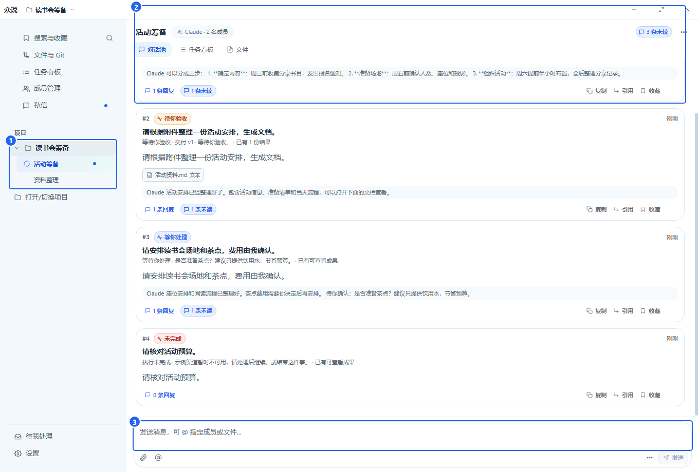

# 众说

众说是一个 Windows 本地多 AI 协作工作台。以文件夹作为项目，在房间里交代工作，让不同 AI 分析、执行和核对，在同一条对话里查看进展、文件成果并继续修改。



## 日常使用

打开 **设置 → 操作手册** 查看图文教程，或阅读仓库内的 [操作手册](docs/user-guide/README.md)（[离线 HTML](docs/user-guide/index.html)）。教程包含 20 张带编号的截图，从打开项目、添加 AI 到发出第一条消息逐步说明。

- **项目与房间**：每个项目对应本地工作文件夹，房间按话题组织任务。
- **多人协作**：用自然语言说明谁先做、谁核对；在原对话串中补充要求。
- **私信**：与一位 AI 独立讨论，每条新私信保持独立上下文。
- **任务与成果**：查看执行进展、停止或继续工作，预览、保存文件并提出修改意见。
- **本地资料**：聊天、附件、设置和任务记录保存在本机。

AI 成员使用电脑上已安装并配置的 Claude、Codex、DeepSeek Harness 或 Pi 渠道。第三方兼容模型由对应渠道配置。

DeepSeek Harness 适配官方 `@deepseek-ai/dsh@0.2.1-rc.5`。先安装该 CLI 和它要求的工具链，执行 `node scripts/build-dsh-runtime.mjs`，再执行 `node scripts/setup-deepseek-harness.mjs --install --artifact-dir dist/dsh-runtime` 安装众说专用连接组件；便携包附带 `ZhongshuoDual/runtime-tools/deepseek-harness/setup.cmd`。众说使用 Harness 的 `zhongshuo` profile，需让模型和 MCP 配置在该 profile 生效；单独在 `dsh web` 中配置不代表专用 profile 已配置。Pi 直接连接已安装的官方 CLI，沿用其模型配置。两种渠道使用原生完整权限，暂不提供只读、项目受限编辑或图片模式。Harness 连接组件 0.1.2 和官方 Pi 1.4.0 支持结果格式补交：使用独立新会话，仅整理已有输出，禁用所有工具，不重复执行业务。Pi 无需额外插件。

众说不依赖 Magpie 或特定网关。可使用 CLI 支持的官方服务或自行配置的网关，模型列表来自各自 CLI。添加 Harness 配置时保留已有供应商、默认模型和其他插件配置；详见操作手册的渠道配置说明。

Windows 官方 Harness 桌面安装版也可直接使用：默认 `dsh` 会解析桌面安装器入口，也可选择 `DeepSeek Harness.exe`。Pi 同时兼容官方安装器和 npm 全局安装；无需替换本机安装方式。

## 从源码构建

Windows 安装版：安装 Inno Setup 6 后执行 `node scripts/make-windows-installer.mjs`。输出目录为 `dist/installers/`，安装后从开始菜单或桌面打开 **众说**。程序附带运行所需的 Electron 和 Node.js；AI 渠道仍使用用户自行安装和配置的 CLI。安装版数据位于 `%LOCALAPPDATA%\Zhongshuo\data`，升级和卸载保留数据。当前发行包未配置代码签名。

准备 Windows、Node.js 24 或更高版本、pnpm 和 Git：

```powershell
git clone https://github.com/384615666/zhongshuo.git
cd zhongshuo
pnpm install --frozen-lockfile
node scripts/make-desktop-daily.mjs desktop-daily-win-local
```

构建结果位于 `dist/desktop/desktop-daily-win-local/`。双击其中的 `start-desktop.vbs` 启动应用，再按图文手册选择项目和添加 AI。该目录也附带离线操作手册。

如需让新包直接使用已有数据，关闭旧程序后执行 `node scripts/install-existing-data-launcher.mjs <新包目录> <已有server-data的绝对路径>`，再双击新包的 `start-existing-data.vbs`。该入口固定使用选定目录；连接标记缺失时自动补建，找不到原数据库时会报错。启动失败可查看包目录的 `startup-existing-data.log`。

## 开发与验证

```powershell
pnpm typecheck
pnpm typecheck:hifi
pnpm test
pnpm build:ui
```

默认测试使用本地、模拟或临时数据；真实模型测试使用单独配置，GitHub sandbox 测试也使用独立配置。它们会消耗模型额度或写入远端仓库，需明确选择对应测试后再运行。

| 目录 | 内容 |
| --- | --- |
| `src/contracts` | 命令、事件与数据契约 |
| `src/domain` | 路由与任务领域规则 |
| `src/persistence` | SQLite、迁移与持久化 |
| `src/adapter` | Claude、Codex、DeepSeek Harness、Pi 及模拟执行端 |
| `packages/dsh-runtime` | 众说专用 Harness profile 连接组件 |
| `src/daemon` | 调度、协作与执行服务 |
| `src/ui` | Electron 桌面客户端与正式 React 界面 |
| `docs/user-guide` | 面向用户的图文操作手册 |
| `tests` | 单元、集成、界面及单独配置的执行端测试 |

`hifi-prototype/` 是交互原型，有独立的 package.json；正式应用源码在 `src/`。

修改用户功能或按钮入口时，同时更新手册步骤和对应编号截图。`pnpm build:ui` 会从同一份手册源码生成应用内版与离线版；`node scripts/capture-user-guide.cjs` 可用独立示例项目重新采集截图。

## 许可证

众说自有代码使用 [MIT 许可证](LICENSE)。随项目保留的第三方代码与资源使用各自许可证，参见 [第三方说明](THIRD_PARTY_NOTICES.md)。
