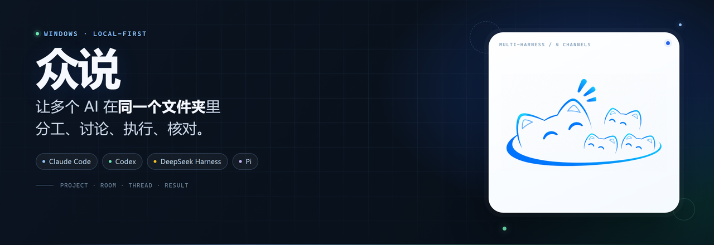
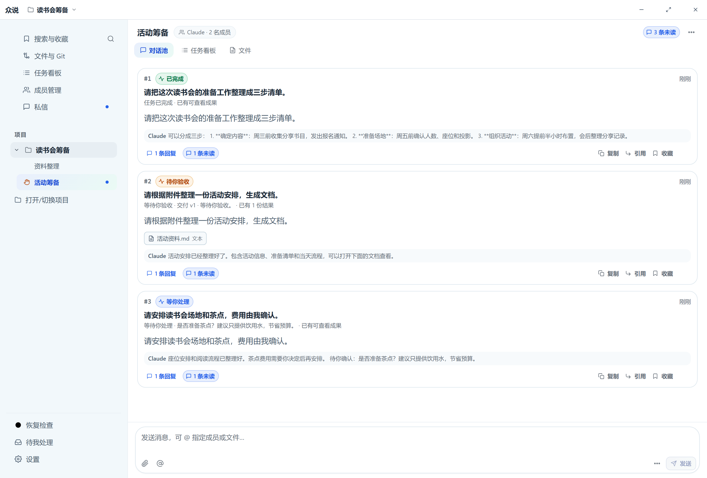
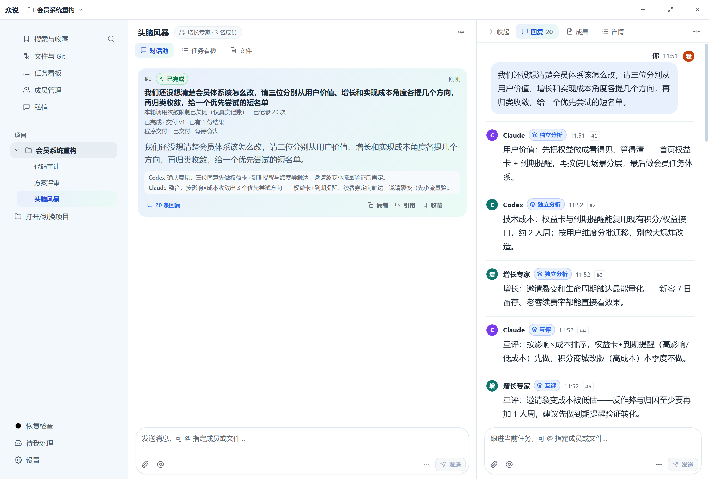
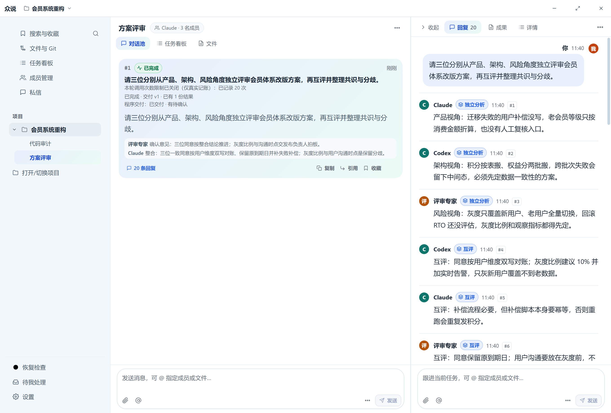
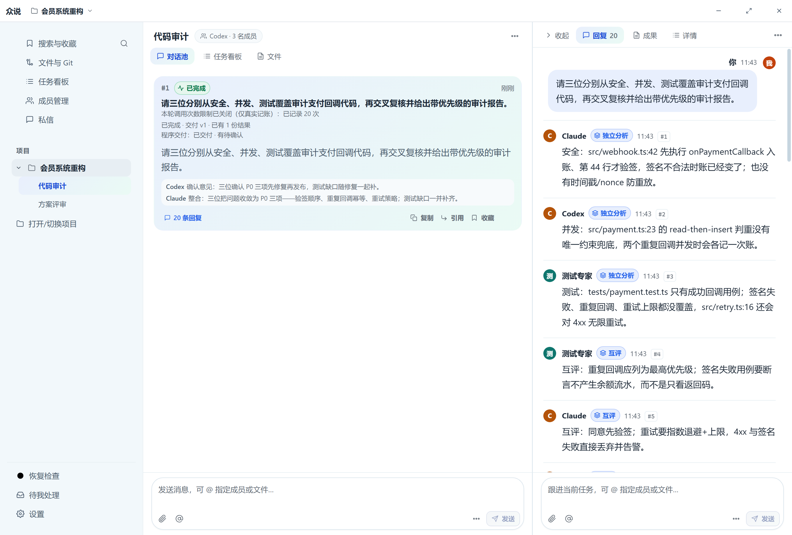
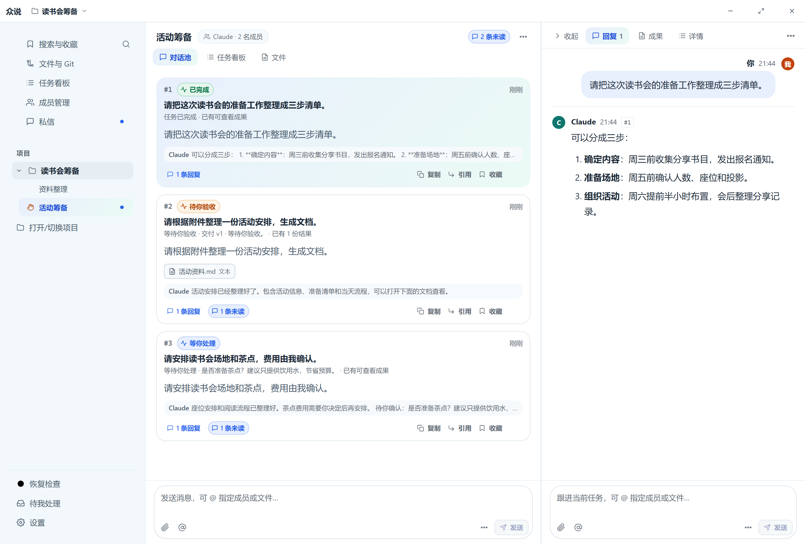

<a href="site/index.html">
  
</a>

<p align="center">
  <a href="https://github.com/384615666/zhongshuo"></a>
  <a href="#为什么是众说"></a>
  <a href="LICENSE"></a>
  <a href="https://github.com/384615666/zhongshuo"></a>
</p>

<p align="center">
  <a href="https://zhongshuo.lsjx.xyz/">产品主页</a>
  &nbsp;·&nbsp;
  <a href="docs/user-guide/README.md">操作手册</a>
  &nbsp;·&nbsp;
  <a href="#quick-start">快速开始</a>
  &nbsp;·&nbsp;
  <a href="https://github.com/384615666/zhongshuo">GitHub</a>
</p>

<a href="site/index.html">
  
</a>

<p align="center"><sub>同一个项目、同一间房：多个 AI 分工、讨论、执行，进度与成果留在回复串里。</sub></p>

<p align="center">
  <a href="https://zhongshuo.lsjx.xyz/download/"><b>⬇ 下载众说 Windows 安装包（最新版）</b></a>
  &nbsp;·&nbsp;
  <a href="https://github.com/384615666/zhongshuo/releases/latest">版本与 SHA256</a>
</p>

---

## 下载安装

Windows 10/11 x64：[下载最新版安装包](https://zhongshuo.lsjx.xyz/download/)。当前版本与 SHA256 见 [GitHub Release](https://github.com/384615666/zhongshuo/releases/latest)；安装包未配置代码签名，SmartScreen 可能提示「未知发布者」。安装版仅支持当前 Windows 用户，无需管理员权限。

也可以按下面的[快速开始](#quick-start)从源码构建。

## 为什么是众说

以文件夹为工作区，在每个工作区的房间里交代工作。不同 AI 可以分析、执行、互相核对；你可以看进展、预览文件、继续修改。

<table>
  <tr>
    <td width="50%" valign="top">
      <h3>📁 本地文件夹就是工作区</h3>
      <p>直接打开本地文件夹，项目、房间和对话串按你已有的工作组织，不另外建一套工作流。</p>
    </td>
    <td width="50%" valign="top">
      <h3>🤝 按你的方式协作</h3>
      <p>自动分工、指定一位执行、多agent分工、共同研讨，或在原对话串里继续追问和返工。</p>
    </td>
  </tr>
  <tr>
    <td width="50%" valign="top">
      <h3>🧩 各跑各的 harness</h3>
      <p>Claude Code、Codex、DeepSeek Harness、Pi 各自保留工具、MCP、记忆与 skill，在项目层交接。</p>
    </td>
    <td width="50%" valign="top">
      <h3>✅ 过程与结果都在原处</h3>
      <p>任务进度、停止与验收、文件成果和修改意见回到原对话串，不用在多个窗口之间来回找。</p>
    </td>
  </tr>
</table>

聊天、附件、设置和任务记录保存在本机；模型请求由你配置的 AI 渠道发出。

## 四种协作方式

| 你想…… | 众说里可以…… |
| --- | --- |
| 让它做事 | 自动协作、指定成员执行、多agent分工 |
| 让它一起想 | 共同研讨、简短交流 |
| 单独聊或记录 | 私信、文件评论 |
| 继续或修改 | 继续、停止 / 验收 / 返工 |

## 界面

<table>
  <tr>
    <td width="50%" valign="top">
      
      <br>
      <sub><b>头脑风暴</b> · 先让几位 AI 各出几招</sub>
    </td>
    <td width="50%" valign="top">
      
      <br>
      <sub><b>方案评审</b> · 对照约束逐条讨论</sub>
    </td>
  </tr>
  <tr>
    <td width="50%" valign="top">
      
      <br>
      <sub><b>代码审计</b> · 多位专家分头检查</sub>
    </td>
    <td width="50%" valign="top">
      
      <br>
      <sub><b>回复串</b> · 进度、文件和结论一起展示</sub>
    </td>
  </tr>
</table>

<a id="quick-start"></a>

## 快速开始

> 直接下载安装包最快；从源码构建需要 **Windows 10/11**、**Node.js 24+**、**pnpm**、**Git**，并先在电脑上安装、登录至少一个 AI CLI。

```powershell
git clone https://github.com/384615666/zhongshuo.git
cd zhongshuo
pnpm install --frozen-lockfile
node scripts/make-windows-installer.mjs
```

运行 `dist/installers/` 中生成的安装包，安装后从开始菜单打开众说，再按 [操作手册](docs/user-guide/README.md) 完成第一次协作：打开项目 → 添加 AI → 发出第一条消息。安装后也可以在 **设置 → 操作手册** 随时查看图文教程。

<details>
<summary><b>构建 Windows 安装包</b></summary>

需要先安装 Inno Setup 6：

```powershell
node scripts/make-windows-installer.mjs
```

安装包输出到 `dist/installers/`。安装版默认把聊天、任务和设置保存在 `%LOCALAPPDATA%\Zhongshuo\data`，升级和卸载保留数据；当前发行包未配置代码签名。

</details>

<details>
<summary><b>已有数据</b></summary>

本版本仅发行 Windows 安装包，不再提供便携包或远程访问入口。安装目录完整路径不超过 180 字符，数据目录不超过 240 字符。

旧便携版的数据通常在 `%APPDATA%\zhongshuo`。先正常退出旧程序，再进入安装版的 **设置 → 数据与存储 → 使用已有数据或从备份恢复**，选择旧数据目录并复制到新位置。导入会保留原目录，详细步骤见 [操作手册](docs/user-guide/README.md#optional)。

</details>

## AI 渠道

AI 成员使用电脑上已安装并配置的 Claude、Codex、DeepSeek Harness 或 Pi。第三方兼容模型由对应渠道配置。众说不依赖 Magpie 或特定网关；模型列表来自各自 CLI。

<details>
<summary><b>DeepSeek Harness / Pi 配置说明</b></summary>

DeepSeek Harness 适配官方 `@deepseek-ai/dsh@0.2.2-rc.1`。先安装该 CLI 和它要求的工具链，执行 `node scripts/build-dsh-runtime.mjs`，再执行 `node scripts/setup-deepseek-harness.mjs --install --artifact-dir dist/dsh-runtime` 安装众说专用连接组件；安装目录附带 `runtime-tools/deepseek-harness/setup.cmd`。众说使用 Harness 的 `zhongshuo` profile，需让模型和 MCP 配置在该 profile 生效；单独在 `dsh web` 中配置不代表专用 profile 已配置。

Pi 直接连接已安装的官方 CLI，沿用其模型配置；同时兼容官方安装器和 npm 全局安装，无需额外插件。

两种渠道使用原生完整权限，暂不提供只读、项目受限编辑或图片模式。Harness 连接组件 0.1.2 和官方 Pi 1.4.0 支持结果格式补交：使用独立新会话，仅整理已有输出，禁用所有工具，不重复执行业务。

Windows 官方 Harness 桌面安装版也可直接使用：默认 `dsh` 会解析桌面安装器入口，也可选择 `DeepSeek Harness.exe`。

</details>

<details>
<summary><b>开发与验证</b></summary>

```powershell
pnpm typecheck
pnpm typecheck:hifi
pnpm test
pnpm build:ui
```

默认测试使用本地、模拟或临时数据；真实模型测试使用单独配置，GitHub sandbox 测试也使用独立配置。它们会消耗模型额度或写入远端仓库，需明确选择对应测试后再运行。

| 目录 | 内容 |
| --- | --- |
| `src/contracts` | 命令、事件与数据契约 |
| `src/domain` | 路由与任务领域规则 |
| `src/persistence` | SQLite、迁移与持久化 |
| `src/adapter` | Claude、Codex、DeepSeek Harness、Pi 及模拟执行端 |
| `packages/dsh-runtime` | 众说专用 Harness profile 连接组件 |
| `src/daemon` | 调度、协作与执行服务 |
| `src/ui` | Electron 桌面客户端与正式 React 界面 |
| `docs/user-guide` | 面向用户的图文操作手册 |
| `tests` | 单元、集成、界面及单独配置的执行端测试 |

`hifi-prototype/` 是交互原型，有独立的 package.json；正式应用源码在 `src/`。

修改用户功能或按钮入口时，同时更新手册步骤和对应编号截图。`pnpm build:ui` 会从同一份手册源码生成应用内版与离线版；`node scripts/capture-user-guide.cjs` 可用独立示例项目重新采集截图。

</details>

---

<p align="center">
  <sub>Windows 本地多 AI 协作工作台 · 1.0 正式版</sub><br>
  <a href="https://zhongshuo.lsjx.xyz/">产品主页</a> &nbsp;·&nbsp;
  <a href="docs/user-guide/README.md">操作手册</a> &nbsp;·&nbsp;
  <a href="LICENSE">MIT License</a> &nbsp;·&nbsp;
  <a href="THIRD_PARTY_NOTICES.md">第三方说明</a>
</p>
