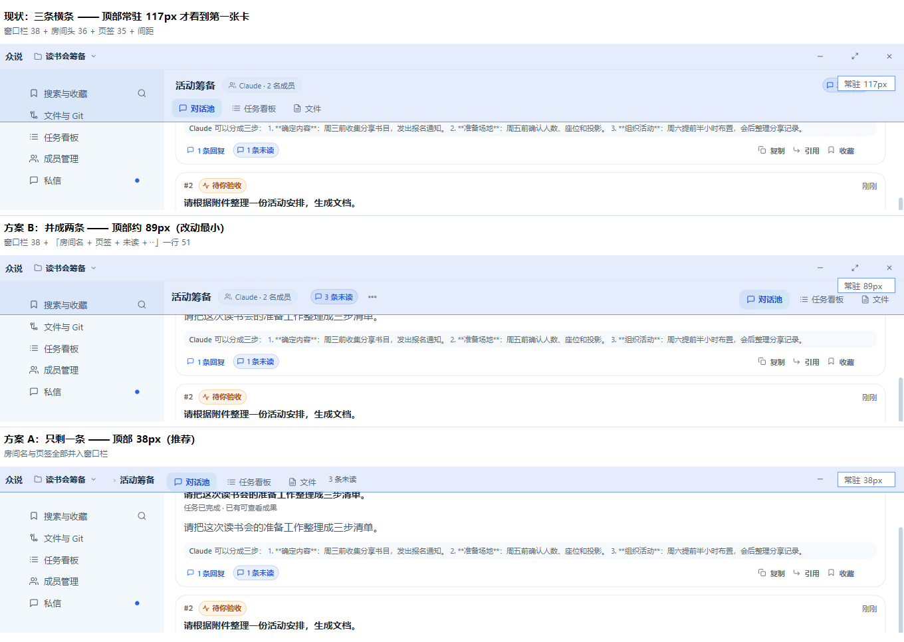

# 标题栏与顶部区域设计（R158 提案）

> 状态：**提案，先不开发**。用户反馈「整个软件的顶部栏重重叠叠，有点丑」，本文只讨论顶部区域的层级与形态，不改代码。
> 适用范围：Windows 桌面版（无边框窗口 + 自绘标题栏）。相关截图见 `docs/user-guide/images/02-workspace.png`、`06-reply-thread.png`、`23-settings-general-dark.png`。

**三种布局的真实界面对比图**（同一房间、同一窗口宽度，蓝色区域=顶部常驻高度）：



> 说明：对比图由真实界面 + 合成数据截图，B/A 两种形态是临时改 DOM 得到的**示意**（不是已实现的效果），用于说明「哪些横条会消失、内容上移多少」。

---

## 1. 现状与问题

### 1.1 现在到底叠了几层

先说清楚一件事：用户口中的「房间头部」在代码里叫 `.pool-head`（不是 `room-head`），它和页签行都**在右侧内容列内部**，不在窗口层。所以顶部不是「一条标题栏 + 一条页面栏」，而是「窗口栏 + 内容列里的 1–2 条栏」再叠提示条。

| # | 横条 | 真实元素 | 高度（1360×920 实测/按样式推算） | 为什么存在 | 出现时机 |
|---|---|---|---|---|---|
| 1 | 自绘窗口标题栏 | `.zs-titlebar` | **38px**（含 1px 下边线） | 无边框窗口的窗口控制（最小化/最大化/关闭）、拖动区、品牌「众说」、当前项目入口、断线等异常状态 | 常驻 |
| 2 | 房间头部 | `.pool-head` | **≈38px**（上内边距 12 + 内容 26） | 当前房间身份（房间名）、成员/协调者入口、未读数、预览重开、房间 ⋯ | 常驻（房间页） |
| 3 | 页签行 | `.thread-tabs` | **≈34px + 8px 间距** | 房间内视图切换：对话池 / 任务看板 / 文件 | 常驻（房间页） |
| 4 | 回复串导航 | `.thread-nav` | **≈42px**（含 1px 下边线） | 收起/返回主池、回复/成果/详情视图、⋯ | 打开回复串时（**右列**） |
| 5 | 私信会话头 | `.thread-head` | **≈48px**（含 1px 下边线） | 会话标题、执行态、停止执行/继续队列、⋯ | 私信页常驻 |
| 6 | 提示条 | `.thread-pending`、`.single-region-switch` | 每条 **≈40px** | 真实待处理（待验收/阻塞/失败）、窄窗单区域说明 | 条件出现 |
| 7 | 列表页筛选行 | `.page-filters` | **≈44px**（吸顶 + 底部投影） | 看板/搜索/归档的筛选 | 部分页面 |

补充两个对照：

- **设置页反而是最干净的一页**：只有标题栏 + 内容区里的 `.settings-head`（标题 + 副标题 + 搜索，≈45–65px，窄窗换行时更高，**无底色、无边线**），靠 20px 留白分层。说明「不叠条」在本项目里已经做得到。
- **侧栏从标题栏下沿直接开始**，顶部内边距 8px；右侧房间头的上内边距 12px —— 两列第一行的基线本身就不齐。

### 1.2 叠起来有多高

房间页（未开回复串）：38 + 38 + 42 ≈ **118px** 才看到第一张卡片。
打开回复串后（左右并排）：左列第一张卡片仍在 **118px**，右列消息 **80px** 就开始了 —— 两条内容流的起点相差约 38px，这正是「左卡右消息不在一条水平线上」的来源。

> 口径说明：这里比的是「第一张卡片 / 第一条消息」的可见起点，不是容器顶边。两列的容器都从 38px 开始，但左列被自己的房间头与页签推低了 80px。

### 1.3 线框图（现状）

```
┌──────────────────────────────────────────────────────────────────────────────┐
│ 众说  📁 读书会筹备 ▾              [     拖动区     ]            ─   □   ×   │ 38  ← 标题栏（1px 下边线）
├───────────────────────────┬──────────────────────────────────────────────────┤
│                           │ 活动筹备   👥 Claude·2 名成员   3 条未读   ⋯      │ ≈38 ← 房间头（无底色，只靠留白）
│ 搜索与收藏            ⌕   │  ┌对话池┐  任务看板   文件                        │ ≈34 ← 页签行（+8 间距）
│ 文件与 Git                ├──────────────────────────────────────────────────┤
│ 任务看板                  │  #1 卡片（待你验收）                             │
│ 成员管理                  │  1 条回复   1 条未读                             │
│ 私信                  ●   │                                                  │
│                           │  #2 卡片（等你处理）                             │
│ 项目                      │  …                                               │
│ ▾ 读书会筹备              │                                                  │
│   ○ 活动筹备              │                                                  │
│   资料整理                │                                                  │
│ 打开/切换项目             │                                                  │
│                           │                                                  │
│ 待我处理                  │                                                  │
│ 设置                      │                                                  │
└───────────────────────────┴──────────────────────────────────────────────────┘
   左列（侧栏 246px）              右列（房间内容）
```

打开回复串后（右列再多一条，且比左列起点高 38px）：

```
┌──────────────────────────────────────────────────────────────────────────────┐
│ 众说  📁 读书会筹备 ▾              [ 拖动区 ]                    ─  □  ×     │ 38
├───────────────────────────┬──────────────────────────────────────────────────┤
│ 活动筹备  👥…  3 条未读 ⋯ │ ‹收起   💬回复 1   成果   详情   ⋯               │ ← 右列从 38 就开始
│ ┌对话池┐ 任务看板  文件    │  （消息从这里开始）                              │
│                           │                                                  │
│  #1 卡片（从这里才开始）   │                                                  │
└───────────────────────────┴──────────────────────────────────────────────────┘
```

### 1.4 视觉问题（逐条点名）

1. **层数过多**：房间页正常态 3 条横条，打开回复串后 4 条；私信页 2 条（标题栏 + 会话头）+ 条件提示条。
2. **左右不对齐**：左列被「房间头 + 页签」推低 80px，右列只有一条导航，两条内容流的第一行相差约 38px。
3. **每条都有分隔线或底色**：标题栏 1px 下边线、回复串导航 1px 下边线、私信头 1px 下边线、列表页筛选行吸顶投影 —— 深色主题下 `#1e242e` 的线叠在 `#151a22` 的面上，对比比浅色更明显，看起来像「表格线」。
4. **信息重复**：项目名同时出现在标题栏、侧栏项目行、侧栏分组标题「项目」；房间名出现在房间头，而页签行又紧贴在它下面重复「当前在哪个房间的哪个视图」这一层语义。
5. **拖拽区被挤压**：1360px 宽时拖拽区约 84% 宽，但 ≤1040px 时项目按钮收窄到 220px、三个窗口按钮各 44px，640px 宽时拖拽区只剩约 33% —— 低于 Windows 用户对「顶部空白都能拖」的预期。
6. **身份入口分散**：「我在哪个项目 / 哪个房间 / 哪个视图」分别落在三处（标题栏项目按钮、房间头、页签），扫一眼要跨三行。
7. **条件信息挤占常驻高度**：待验收/阻塞提示条插在导航与消息之间，出现时又把内容整体下推一次。

---

## 2. 设计原则

1. **一屏只留一条主横条**：窗口身份与页面身份尽量合并到标题栏；内容区顶部不再有第二条「带底色/带线」的常驻条。
2. **层级靠面差与留白，不靠线**：同一屏最多保留 1 条发丝线（标题栏下沿）；其余用 12–16px 留白与 1 档面差（白 / 极浅灰）区分。
3. **窗口控制与页面动作同排**：右侧 44px 三键固定不动，页面级动作（未读、⋯）排在它左边，永远不换行、不被挤掉。
4. **可拖拽区域连续且够大**：拖动区不得被控件切断，宽度 ≥ 窗口宽度的 40%；窄窗优先收文字，不收拖动区。
5. **身份唯一、真实状态不藏**：项目名只出现一次，房间/会话名只出现一次；断线、待验收、阻塞等事实仍要可见 —— 但不许为此新增常驻横条。

---

## 3. 三个可选方案

### 方案 A（推荐）：单行合并 —— 窗口栏吸收页面身份

标题栏内从左到右：品牌（窄窗只留图标）→ 项目 › 房间（单行、可截断）→ 页签（对话池/任务看板/文件）→ 拖动区 → 未读/⋯ → 三个窗口按钮。房间页的 `.pool-head` 与 `.thread-tabs` 整体消失，页面级动作并入标题栏右侧。

```
┌──────────────────────────────────────────────────────────────────────────────┐
│ 众说 │ 读书会筹备 › 活动筹备   对话池 任务看板 文件   [3 条未读] ⋯  ─ □ ×     │ 38
├──────────────────────────────────────────────────────────────────────────────┤
│ #1 卡片（待你验收）                                                          │
│ 1 条回复   1 条未读                                                          │
│                                                                              │
│ #2 卡片（等你处理）                                                          │
└──────────────────────────────────────────────────────────────────────────────┘
```

打开回复串时，右列保留自己的 `.thread-nav`（它是「列内视图切换」，不属于窗口身份），但去掉下边线，与左列内容同高起步：

```
┌──────────────────────────────────────────────────────────────────────────────┐
│ 众说 │ 读书会筹备 › 活动筹备   对话池 任务看板 文件   [3 条未读] ⋯  ─ □ ×     │ 38
├──────────────────────────────────────────┬───────────────────────────────────┤
│ #1 卡片                                  │ ‹收起  💬回复 1  成果  详情  ⋯    │ ≈42
│                                          │ 消息…                             │
└──────────────────────────────────────────┴───────────────────────────────────┘
```

- **优点**：**全宽**常驻横条只剩 1 条；身份与视图一行读完；左列内容多出约 80px 高度；设置页/看板页与房间页的顶部语言终于一致；左列第一张卡片与右列导航顶边都在 38px，不再出现「左列被自己两条横条推低」的错位。
- **缺点**：标题栏信息密度上升，项目名 + 房间名 + 页签 + 未读 + ⋯ 在 900px 以下必须取舍（项目名收成图标、页签可横向滚动）；「窗口栏 = 业务身份」对不熟悉产品的用户需要一次适应；错误边界降级条（最小壳）要同步改；右列仍保留一条列内导航（≈42px），因此右列消息比左列首卡低约 42px —— 这是面板级工具条、不是页面级横条，若要求两列完全同高，需要把回复串的「回复/成果/详情」也收进标题栏（可选变体 A+，代价是窄窗更挤）。
- **改动范围**：标题栏组件与样式、房间页头部与页签的挂载位置、私信会话头的动作上移、设置页标题与搜索的归属、启动前的最小壳样式（高度与拖动区）、手册截图（02 / 06 / 07 / 23）。
- **对现有测试的影响**：中等偏大。`.pool-head` / `.thread-tabs` 从内容区移入标题栏后，任何按「页面内第几条横条 / 元素 y 坐标」断言的 UI 校验都要改（R152 的标题栏与设置布局校验、R135 的侧栏几何校验都是 rect 断言）。窗口栏相关契约（`.zs-tb-project`、`.zs-tb-project-name`、`.zs-tb-drag`、`.zs-winbtn`、`data-zs-titlebar-rendered`）必须原样保留，否则 R90 标题栏契约测试会失败。R153 的导航校验按菜单文案与命令调用断言，但私信头的 ⋯ 入口会被移动，需复核其选择器仍能命中。

### 方案 B：双层但去线 —— 保留两层，只去重复与多余分隔

标题栏只放窗口身份（品牌 + 项目 + 拖动 + 窗口按钮）；页面头部**压成一行**：房间名在左、页签在中、未读/⋯在右；两条横条都去掉下边线，靠 12px 留白与一档面差分层。房间页 = 标题栏 38 + 一行 36 + 内容。

```
┌──────────────────────────────────────────────────────────────────────────────┐
│ 众说 │ 读书会筹备 ▾                    [   拖动区   ]            ─  □  ×     │ 38
├──────────────────────────────────────────────────────────────────────────────┤
│ 活动筹备   👥 2 名成员      对话池  任务看板  文件      3 条未读   ⋯         │ 36
├──────────────────────────────────────────────────────────────────────────────┤
│ #1 卡片（待你验收）                                                          │
└──────────────────────────────────────────────────────────────────────────────┘
```

- **优点**：改动最小、风险最低；仍保留「窗口栏 / 页面栏」的职责分离；房间页从 3 条降到 2 条；左右错位消失（右列导航与页面栏同高）。
- **缺点**：仍是两条横条，内容区只多出约 42px；「项目 + 房间」仍分两行读；房间名与页签同排后，窄窗（<900）需要把页签折叠进「⋯」。
- **改动范围**：房间头部与页签合并到同一行、去掉两处下边线、私信头同样去线、调整间距与面差。
- **对现有测试的影响**：小。`.pool-head` 与 `.thread-tabs` 仍在同一列内、类名不变，选择器可用；只有按高度/坐标断言的几何校验需要更新（页签行从第二行变成第一行的一部分）。

### 方案 C：沉浸式 —— 标题栏自动隐藏，最大化只留极窄条

最大化时标题栏压到 8–12px 的拖拽条，鼠标移到顶部才展开；非最大化时正常显示。页面身份与页签放到内容区顶部，随滚动淡出。

```
┌──────────────────────────────────────────────────────────────────────────────┐
│ ‹8px 拖拽条›                                                                 │ ← 仅拖拽，悬停才展开窗口按钮
├──────────────────────────────────────────────────────────────────────────────┤
│ 活动筹备  👥…  3 条未读 ⋯          对话池 任务看板 文件                      │ 36（随滚动淡出）
├──────────────────────────────────────────────────────────────────────────────┤
│ #1 卡片…                                                                     │
```

- **优点**：内容可视面积最大，视觉上最「现代」。
- **缺点（也是不推荐的理由）**：
  1. **窗口控制不可见**：最小化/关闭要悬停才出现，用户找不到出口；Windows 用户对右上角三键有强肌肉记忆。
  2. **拖拽区只剩 8–12px**，命中率低；最大化时几乎无法拖动窗口。
  3. 自动隐藏条与侧栏、滚动吸顶、右键菜单、输入法候选框都会打架，状态难以预测。
  4. 可访问性差：键盘用户与高对比度模式下几乎不可用；与产品「本地、可核对、不藏东西」的调性相反。
  5. 测试成本最高：所有依赖窗口按钮可见性与标题栏几何的校验都要重写，且要新增「悬停展开」的时序断言。
- **改动范围**：窗口壳、标题栏、所有页面顶部、最小壳、动画与降级路径。
- **对现有测试的影响**：大。R152 的拖动区/窗口按钮断言、R90 的标题栏契约、以及所有以「标题栏高度 38px」为前提的页面几何校验都要改。

---

## 4. 推荐与取舍

**推荐方案 A**，但分两批落地，第一批就是方案 B 的内容：

- **第一批（低风险，先做）**：去掉重复信息与多余分隔线 —— 房间头与页签合并成一行；标题栏、页面行、回复串导航三处只保留标题栏 1 条发丝线；私信头同步去线；修正左右两列首行错位。这一步不改变任何入口，只改「线与间距」，可单独发版验证。
- **第二批（A 的合并）**：把项目 › 房间身份与页签收进标题栏，房间页变成「标题栏 + 内容」两层；页面头部只保留右侧动作（未读、⋯）。此时再评估是否需要把「设置页标题」也收进标题栏。

**为什么不是 B 直接收尾**：B 只是把三条压成两条，信息仍然分散在「项目」「房间」两行；而用户抱怨的是「叠」，两层只是缓解。B 作为 A 的过渡态是合适的，长期形态仍建议 A。

**为什么不做 C**：见上，窗口控制可发现性与拖拽命中率是硬约束，收益（多出 38px）与风险不成比例。

**取舍清单**：

| 取舍点 | A 的选择 | 说明 |
|---|---|---|
| 项目名 | 只在标题栏 | 窄窗收成文件夹图标 + 悬停全名 |
| 房间名 | 只在标题栏（方案 A 第二批） | 超长截断，悬停显示全名 |
| 页签 | 标题栏内、房间名右侧 | 窄窗可横向滚动，不换行 |
| 未读/⋯ | 标题栏右侧、窗口按钮左边 | 永不换行 |
| 提示条 | 仍留在内容区顶部 | 不新增常驻横条，出现时用留白而非线分隔 |
| 回复串导航 | 保留（列内） | 去掉下边线，与左列同高起步 |

---

## 5. 验收标准（可截图 / 可几何断言）

1. **横条数量**：房间页（未开回复串）**全宽**常驻横条 ≤ 2（方案 A 第二批后为 1，方案 B 为 2）；打开回复串后，右列允许 1 条列内导航（**无底色、无下边线**），不得再叠第二条。
   **对齐**：左列第一张卡片与右列导航的顶边相差 **≤ 2px**；若采用 A+ 变体（回复串视图也收进标题栏），则左右两列的消息/卡片起点相差 **≤ 2px**。
2. **高度**：标题栏 **38px**（含 1px 下边线）；窗口按钮 **44×38px**；页面行（若保留）**≤ 40px**。
3. **拖拽区**：宽度 **≥ 窗口宽度的 40%**，且是连续区域（中间不被按钮切断）；640 / 900 / 1100 / 1440 / 3440 五档都要满足。
4. **线**：深色与浅色主题下，顶部区域横条之间**只有 1 条发丝线**（标题栏下沿）；页面行、页签、回复串导航不再有下边线或吸顶投影。
5. **身份唯一**：项目名在界面中只出现 1 次（标题栏）；房间名只出现 1 次（标题栏或页面行，按批次）。
6. **不遮挡**：内容区第一行不被吸顶元素覆盖；滚动时页签（若仍在内容区）吸顶后不出现「半行透出」。
7. **钩子保留**：`[data-zs-titlebar-rendered]`、`.zs-tb-project`、`.zs-tb-project-name`、`.zs-tb-drag`、`.zs-winbtn`、`.thread-tabs`、`.thread-tab`、`[aria-label="回复串视图"]`、`.settings-single`、`[data-settings-section]` 全部仍在（可改父容器，不可改名）。
8. **窗口控制**：最小化/最大化/关闭的行为、aria-label、悬停红色关闭态与现状一致。
9. **主题与缩放**：浅色/深色 × 3440/1920/1440/1280/1100/900/640 七档无横向溢出、无文字竖排、无按钮换行。
10. **截图证据**：房间页（浅色、深色）、打开回复串、私信页、设置页各 1 张，人工目视确认「顶部只剩一条主横条」。

---

## 6. 风险与不做的事

**风险**

- **信息密度**：合并后标题栏要同时容纳项目、房间、页签、未读、⋯、三键，900px 以下必然取舍；需要明确「先收文字、再收页签、最后才动拖动区」的降级顺序。
- **降级路径**：标题栏有错误边界降级条与启动前的最小壳（两处都写死了 38px 与拖动区），改形态必须同步，否则启动瞬间会跳一下。
- **两列布局**：回复串导航仍在右列，若右列与左列的内容起点没对齐，错位会从「38px」变成「页签高度」，需要几何断言兜住。
- **测试改造面**：几何类校验（R152 的标题栏/设置布局、R135 的侧栏，以及若干截图脚本）要跟着改；改动越靠后（方案 A 第二批、方案 C）改造面越大。
- **习惯成本**：把「房间名 + 页签」放进窗口栏，对老用户是一次位置迁移，需要一版说明。

**本轮明确不做**

- 不改窗口控制行为（最小化/最大化/关闭仍走既有窄桥与优雅停机链），不引入自绘阴影、渐变、毛玻璃或自定义窗口圆角。
- 不改 daemon、协议、命令面；不动侧栏宽度与项目区结构。
- 不为「好看」隐藏真实状态：断线、待验收、阻塞仍必须可见。
- 不做自动隐藏标题栏（方案 C）、不做窗口贴边/分屏等系统级交互。
- 不在本轮改手册以外的产品文案；截图与手册随实现批次同步更新。

---

## 附：三方案对比一览

| 维度 | 现状 | A 单行合并（推荐） | B 双层去线 | C 沉浸式 |
|---|---|---|---|---|
| 房间页全宽常驻横条 | 3 条 | **1 条** | 2 条 | 0–1 条（可隐藏） |
| 顶部全宽占用高度 | ≈118px | **38px** | ≈74px | ≈20–46px |
| 左右两列首行对齐 | 错位 38px（首卡 vs 首条消息） | **对齐**（首卡与右列导航同高；消息低一条导航，或 A+ 完全同高） | 对齐 | 对齐 |
| 窗口控制可发现性 | 好 | 好 | 好 | **差** |
| 拖拽区 | 84%（宽窗）/33%（640） | 需保证 ≥40% | 同现状 | **极窄** |
| 改动范围 | — | 大 | 小 | 极大 |
| 测试改造面 | — | 中 | 小 | 大 |
| 建议 | — | **先做 B，再演进到 A** | 第一批落地 | 不做 |
