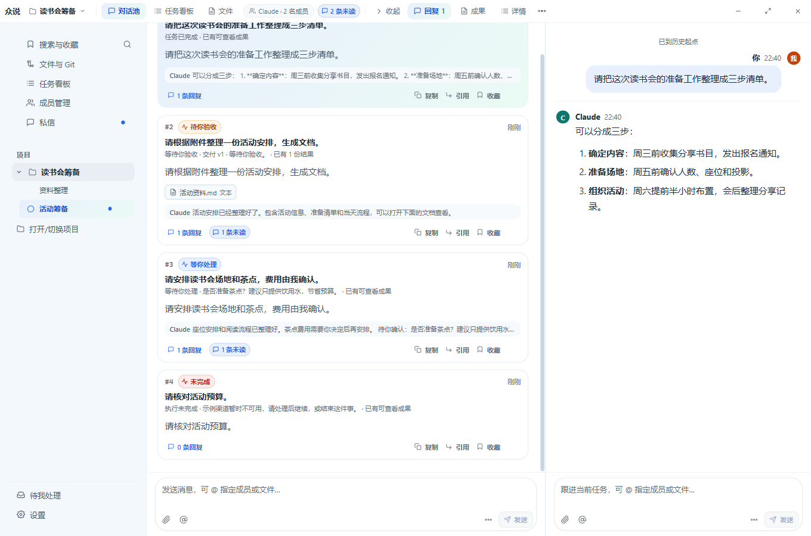

# 单条命令栏方案评估（用户 R164 提案）

> 状态：**评估，不开发**（另一个 AI 正在修 bug）。本文只回答「这个方案行不行、代价多大、哪里要补规则」，不改产品代码。
> 提案来源：用户 2026-11-02 的描述 + 手绘条（`众说 · 项目 ▾ | 房间页签 | 成员/未读 | 回复串页签 | 窗口按钮`）。

## 0. 结论先说

**方向对、可以做**，它比 R158 提案里的「方案 A」更彻底：一条栏承载全部导航，内容区从 38px 开始，房间页能多出约 80px 可视高度。真实界面里已经按这个形态临时搭出来验证过（见下图），1360/1280/1100 三档都放得下。

**但必须补一套「折叠规则」**：900px 宽时按现在的排法会溢出 46px，**窗口按钮会被挤出屏幕**（下图第二张）。所以「窗口按钮永远可见」要写成硬约束，中间部分按固定顺序逐级折叠。

> 两张图都是**临时改 DOM 的示意**（不是已实现效果），数据来自真实界面：1360 档栏内合计 1284px（余 76），1280 档 1204（余 76），1100 档 1024（余 76），900 档 946（**超 46**）。

## 1. 你的 5 个状态逐条对照

| 状态 | 你写的排法 | 实测/评估 |
|---|---|---|
| 打开对话串 | 品牌·项目 ｜ 房间页签 ｜ 未读/成员 ｜ 收起·回复·成果·详情 ｜ 窗口按钮 | ✅ 1360 放得下（1284px）；1100 也够；900 需要折叠 |
| 没有对话串 | 品牌·项目 ｜ 房间页签 ｜ 未读/成员 ｜ 窗口按钮 | ✅ 余量最大，1280 以下只折叠项目名即可 |
| 左对话串 + 右文件 | 品牌·项目 ｜ 主池·回复·成果·详情 ⋯ ｜ 文件1/2/3 ｜ ⋯/放大/收起/窗口按钮 | ⚠️ **放不下**：预览标签 509 + 预览操作 94 再加进来 ≈1887px，必须把文件标签折成「当前文件 + N」 |
| 左房间 + 右文件 | 品牌·项目 ｜ 房间页签 ｜ 未读/成员 ｜ 文件1/2/3 ｜ ⋯/放大/收起/窗口按钮 | ⚠️ 同上，1360 会挤到只剩图标 |
| 文件放大预览 | 品牌·项目 ｜ 文件1/2/3 ｜ ⋯/放大/收起/窗口按钮 | ✅ 余量充足，但左侧没有房间/项目上下文（见 §3-D） |

## 2. 建议的折叠顺序（从最不痛到最痛）

| # | 折叠项 | 收起前 → 收起后 | 触发 |
|---|---|---|---|
| 1 | 未读 | 「3 条未读」71 → 数字徽标 22 | < 1280 |
| 2 | 成员 | 「Claude · 2 名成员」196 → 头像堆叠 + 2（仍点开房间设置） | < 1180 |
| 3 | 项目名 | 「读书会筹备 ▾」113 → 截断 60 → 只留图标 32 | < 1100 |
| 4 | 房间页签 | 图标+文字 232 → 只留图标 96 | < 1000 |
| 5 | 回复串导航 | 收起 + 回复/成果/详情 300 → 只留图标 120 | < 1000 |
| 6 | 预览标签 | 3 个标签 509 → 当前标签 + “+2” 160 | 任何时候 > 2 个 |
| 7 | 预览操作 | 放大/收起 94 → 收进分组 ⋯ 24 | < 1100 |

**硬约束**：窗口按钮（3×44=132）与拖动区（≥40px）永不让位；折叠到最后一档仍溢出时，中间分组改为横向滚动（`overflow-x: auto`，滚动条隐藏）。

## 3. 需要你拍板的 5 个点

- **A. 房间名去掉后，怎么知道在哪个房间？**
  你的排法里没有房间名。建议保留一段可截断的「项目 › 房间」（空间不足先截房间、再截项目、最后只留图标），或者接受「只能靠侧栏高亮判断」。
- **B. 房间 ⋯ 去掉后，归档去哪？**
  现在房间 ⋯ 里是「房间设置 / 归档房间（或取消归档）」。点成员 chip 打开房间设置已经覆盖「房间设置」，归档可以只留在房间设置弹窗的归档区块里——请确认可以接受。
- **C. 对话串的 ⋯ 保留吗？**
  它现在装的是「关注 / 静音 / 跳转首条未读 / 复制链接」四个动作。建议在回复串分组右侧保留一个 ⋯（你的第 3 个状态里已经画了），否则这四个动作没有新家。
- **D. 文件放大预览时，左侧要不要留上下文？**
  放大后只剩文件标签，用户不知道自己在哪个项目/房间。建议左侧保留一个 `‹ 返回` 或项目名。
- **E. 私信栏放什么？**
  私信没有房间页签，建议：`众说 · 项目 ▾ ｜ 私信 › 对方名 ｜ ⋯（重命名/归档/导出/任务记录）｜ 窗口按钮`。

## 4. 落地建议（分三步，每步可单独验收）

1. **第一步：单区**（房间无对话串、私信）。把房间头 + 页签搬进栏内，实现 §2 的折叠 1–4 档；7 档窗口截图验收。风险最低，能先看观感。
2. **第二步：双区**（对话串 / 文件预览）。把回复串导航与预览标签、预览操作搬进栏内，引入「分组 + 分组内 ⋯」；实现折叠 5–7 档。
3. **第三步：窄窗与收尾**。900 以下改横向滚动/更激进折叠，重采手册 02/06/07/23 四张截图。

**实现方式建议**：把标题栏改成「命令栏」——栏内分左（品牌/项目/房间）、中（前台 pane 的页签）、右（状态 chips + 分组 ⋯ + 窗口按钮）三段；各 pane 通过 React portal 往槽位注册自己的控件（项目里已有 portal 到 `#zs-titlebar` 的先例），`data-zs-*` 钩子全部保留，避免测试选择器失效。

## 5. 风险与工作量

| 项 | 说明 |
|---|---|
| 拖拽区 | 现在约 84% 宽度可拖；合并后会被控件填满。建议整条栏可拖（`-webkit-app-region: drag`）+ 控件 `no-drag`，并保留 ≥40px 空隙 |
| 状态机 | 栏内要显示「前台 pane」的页签（房间 / 对话串 / 预览），需要 pane 注册 + 前台判定；这是本轮最大的复杂度 |
| 测试影响 | R152（标题栏几何/对比度）、R90（标题栏契约）、R135（侧栏）、R153（导航）按坐标断言的部分要改；`.pool-head` / `.thread-tabs` / `.thread-nav` 从内容区移走，相关选择器与截图脚本要同步 |
| 工作量 | 约 2–3 轮（每轮含测试改造与手册截图重采）；第一步单独发版约 1 轮 |
| 不建议 | 不要为了腾空间去掉窗口按钮或缩小到 32px——Windows 用户对右上角三键的肌肉记忆很强，且这是唯一的关闭出口 |

## 6. 验收标准（可截图/可几何断言）

1. 房间页顶部只有一条 38px 栏，内容区第一张卡片顶边 ≤ 40px。
2. 3440/1920/1440/1280/1100/900/640 七档：窗口三键完整可见、可点击，无横向滚动条。
3. 任何档位下拖动区宽度 ≥ 40px，且整条栏空白处都能拖动。
4. 900 档：项目名、房间页签、回复串导航按 §2 折叠，文字不出现「一字一竖排」。
5. 对话串/文件双区时，两组的当前项高亮各自独立，⋯ 只作用于自己那一组。
6. 深色主题下栏内只有 1 条发丝线（栏底），不出现第二条分隔线。
7. 现有 `data-zs-*` 钩子（`data-zs-titlebar-rendered`、`data-zs-project-menu-btn`、`data-zs-dm-ops`、`data-zs-execution-action` 等）全部保留。
