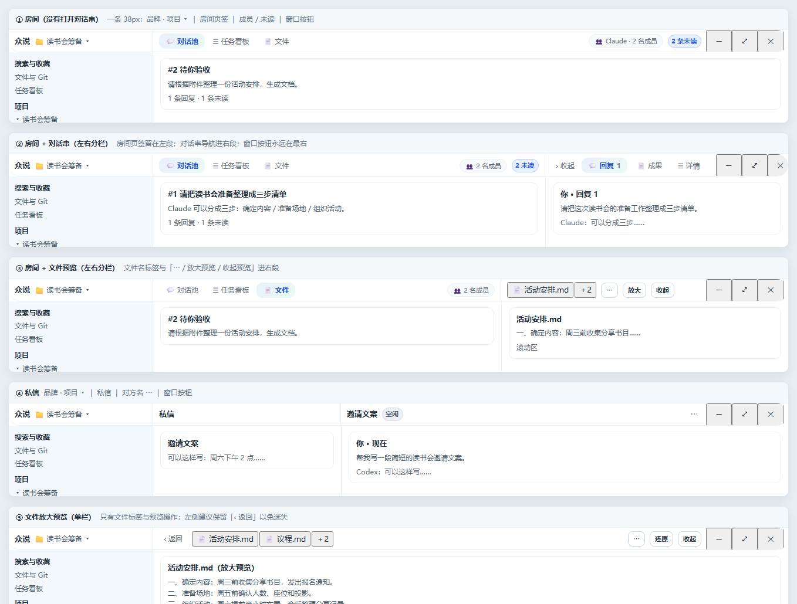

# 顶栏=各栏的头（R165 修正版示意）

> 状态：**评估/示意，不开发**（另一个 AI 正在修 bug）。
> 上一版（R164）我理解错了：我把它做成了「一条栏里并排放几组控件」。用户要的是——**房间 / 对话串 / 私信的头本身占住状态栏的位置**：栏按列分段，每段与它下面的分栏对齐，就像参考图里「左边文档头 + 右边标签/窗口按钮」。本文按这个重新出图。

## 1. 五张示意（同一形态，按列对齐）

| 图 | 状态 | 顶栏分段（左→右） |
|---|---|---|
| ① | 房间，没有打开对话串 | 众说·项目 ▾ ｜ 对话池/任务看板/文件 ｜ 成员·未读 ｜ ─ □ × |
| ② | 房间 + 对话串（左右分栏） | 众说·项目 ▾ ｜ 房间页签+成员 ｜ 收起/回复·成果·详情 ｜ ─ □ × |
| ③ | 房间 + 文件预览（左右分栏） | 众说·项目 ▾ ｜ 房间页签 ｜ 文件标签(当前+2)/⋯/放大/收起 ｜ ─ □ × |
| ④ | 私信 | 众说·项目 ▾ ｜ 私信 ｜ 对方名 ⋯ ｜ ─ □ × |
| ⑤ | 文件放大预览（单栏） | 众说·项目 ▾ ｜ ‹返回 ｜ 文件标签 ｜ ⋯/还原/收起 ｜ ─ □ × |

要点：
- **栏高 38px，只有一条**；下面的内容直接从 38px 开始（房间页能多出约 80px 可视高度）。
- **分段与分栏对齐**：左段宽度 = 左侧内容列宽度，右段 = 右侧内容列宽度；窗口按钮永远在最右段的最右。
- 分段之间用 1px 竖线（与下面的分栏线对齐），一眼看出「这块属于左边还是右边」。
- 房间名不再出现（侧栏已高亮当前房间）；对话串/私信的身份由「右段 = 收起·回复·成果·详情」或「对方名」表达。

## 2. 按用户拍板逐条落实

| 拍板 | 落实方式 |
|---|---|
| 侧栏已有房间高亮，房间名去掉 | ① 左段只留房间页签 + 成员/未读 |
| 不做房间 ⋯（无快速归档需求） | 归档只在「房间设置」弹窗里（点成员 chip 进入），顶栏不再有房间 ⋯ |
| 对话串 ⋯ 不保留 | 顶栏不再有；但原 ⋯ 里的四个动作要有去处（见 §3-①） |
| 放大预览留返回 | ⑤ 左端保留「‹ 返回」 |
| 私信写法 | ④ 完全按 `众说·项目 ▾ ｜ 私信 ｜ 对方名 ⋯ ｜ ─ □ ×` |

## 3. 还需要你定的两件事

- **① 对话串 ⋯ 里那四个动作去哪？** 现在装的是「关注 / 静音 / 跳转首条未读 / 复制链接」。建议：
  - 「跳转首条未读」→ 直接并到「未读」chip 上（点未读就跳过去）；
  - 「关注 / 静音 / 复制链接」→ 移进「详情」页签顶部；
  - 或者你认为没人用，直接去掉。
- **② 私信 ⋯ 保留吗？** 私信现在的 ⋯ 里有「重命名 / 归档 / 导出会话 / 任务记录」。④ 里我按你的写法保留了它（只有一个 ⋯），确认一下是否保留。

## 4. 必须补的工程规则（否则窄窗会坏）

1. **折叠顺序**：成员数 → 头像+数字；项目名 → 截断 → 只留图标；房间页签 → 只留图标；对话串导航 → 只留图标；文件标签 → 当前 + N；最后才动分段竖线。
2. **窗口三键与拖动区永不让位**：上一版实测 900px 会溢出 46px 把 ✕ 挤出屏幕；新形态下窗口按钮必须在最右段内固定，中间部分可横向滚动。
3. **前台判定**：栏要知道哪一栏是「前台」（决定显示房间页签还是对话串/文件标签）；双栏都显示时靠分段区分，不需要前台。
4. **拖拽**：整条栏背景可拖，控件 `no-drag`，并保留 ≥40px 空隙。

## 5. 实施顺序（等 bug 修完即可开工）

1. **单栏**：①④⑤ —— 房间页签/成员/未读/文件标签搬进栏，落 38px + 折叠 1–2 档。风险最低，先发一版看观感。
2. **双栏**：②③ —— 加入分段对齐、1px 竖线、右段页签/操作。
3. **窄窗收尾**：七档窗口验收 + 手册 02/06/07/23 截图重采。

## 6. 验收标准

1. 房间页 38px 一条栏，内容第一行顶边 ≤ 40px；没有第二条常驻横条。
2. 3440/1920/1440/1280/1100/900/640 七档：窗口三键完整可见可点，无横向溢出。
3. 双栏时分段边界与下面分栏边界对齐（误差 ≤1px）。
4. 拖动区 ≥40px 且空白处可拖。
5. 深色主题只有栏底 1 条发丝线。
6. `data-zs-*` 钩子全部保留（`data-zs-titlebar-rendered`、`data-zs-project-menu-btn`、`data-zs-dm-ops` 等）。
