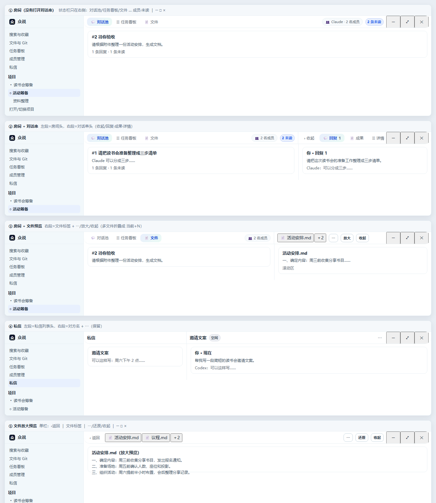

# 顶栏=各栏的头（R166 定稿示意）

> 状态：**示意，不开发**（另一个 AI 正在修 bug）。本文是 R165 的定稿版：按用户 2026-11-02 的最后两条决定与新增需求重画。

## 与上一版的差别

- **左侧栏改成通高**：从窗口顶端到底部都是侧栏；侧栏顶部 38px 单独一条，只放「众说」logo。
- **窗口栏里不再有「众说 · 读书会筹备 ▾」**：品牌与项目切换回到侧栏（侧栏「项目」区 + 底部「打开/切换项目」已有入口）。
- 状态栏因此只覆盖**右侧内容区**，按列分段，与下面的分栏一一对齐。

## 用户已定的两条

1. **对话串 ⋯ 的四个动作（关注 / 静音 / 跳首条未读 / 复制链接）没有用 → 直接去掉**，顶栏与对话串头都不再出现 ⋯。
2. **私信 ⋯ 保留**（重命名 / 归档 / 导出会话 / 任务记录），见示意图 ④。

## 五种状态

| 图 | 状态 | 状态栏分段（从侧栏右缘开始） |
|---|---|---|
| ① | 房间，没有打开对话串 | 对话池/任务看板/文件 …… 成员·未读 ｜ ─ □ × |
| ② | 房间 + 对话串 | 房间页签 …… 成员/未读 ｜ 收起/回复·成果·详情 ｜ ─ □ × |
| ③ | 房间 + 文件预览 | 房间页签 …… 成员 ｜ 文件标签(当前+N)/⋯/放大/收起 ｜ ─ □ × |
| ④ | 私信 | 私信 ｜ 对方名 ⋯ ｜ ─ □ × |
| ⑤ | 文件放大预览 | ‹返回 ｜ 文件标签/⋯/还原/收起 ｜ ─ □ × |

## 还差一个决定：项目切换入口

窗口栏里去掉「读书会筹备 ▾」之后，快速切换项目目前只剩侧栏两条路：侧栏「项目」列表和底部「打开/切换项目」。两种做法可选：

- **A（示意图现状）**：完全靠侧栏，品牌区只放 logo。最干净，但切项目要多一次点击（展开侧栏 → 找项目）。
- **B**：侧栏顶部 logo 右边保留一个小「▾」，点开就是项目菜单（视觉上仍只有 logo + 一个箭头）。

## 工程规则（不变）

1. 状态栏 38px 一条，内容从 38px 开始。
2. 分段边界与下面分栏边界对齐（±1px），用 1px 竖线分开。
3. 窗口三键固定在最右段最右，永不被挤出；中间按「成员数→头像+数字、项目名/房间名→省略、页签→只留图标、文件标签→当前+N」逐级折叠，必要时横滚。
4. 整条栏空白处可拖（`-webkit-app-region: drag`），控件 `no-drag`，保留 ≥40px 拖拽空隙。
5. 深色主题只保留栏底 1 条发丝线。
6. `data-zs-*` 钩子全部保留（`data-zs-titlebar-rendered`、`data-zs-dm-ops` 等），R152/R90/R135 的选择器不失效。

## 实施顺序

1. **单栏**：①④⑤（房间页签/成员/未读、私信、放大预览）→ 先发一版看观感。
2. **双栏**：②③（分段对齐 + 右段页签/操作）。
3. **窄窗收尾**：七档窗口验收，重采手册 02/06/07/23。
