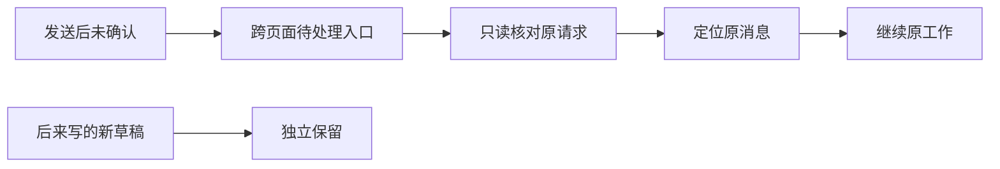

# 我对52项体验问题的逐项决定与原型说明

日期：2026-10-25。状态：**设计建议，待用户评审；未修改正式程序。**

我的主张是：先让要求、实际执行和完成结果一致；再让人能直接找到下一步。保留已有编排、恢复和权限机制，把断开的入口接起来。普通路径直接完成，歧义或真正可能丢内容时才增加处理。

先看 [52项决策速查表](overview.md)，也可按下方编号直接看细节。

本文件逐项给出我的推荐、两位评审的意见与分歧、具体改法、理由、验收及原型入口。DeepSeek逐项评审了52条；GLM提交的是重点评审，**未单列的项写“未单列”，不当成赞同**。所有优先级是我本轮的推荐；52条不等于52个新功能，也不是授权立即施工。

评审原文：[DeepSeek](../../reviews/peer-usability-deepseek-flash-20261025.md)、[GLM](../../reviews/peer-usability-glm-5.3-flash-20261025.md)；[原排查与源码证据](../../reviews/project-wide-usability-audit-20261025.md)。

## 最关键的取舍

| 分歧 | 我的推荐 | 选择原因 |
| --- | --- | --- |
| 顺序要自然理解，还是每次先选模式 | 默认自然表达，能看见预计安排，可展开调整；真正有歧义才确认顺序 | 保留聊天习惯，又能纠正安排；第一期只保证明确的两人先后，不假装能理解所有复杂依赖 |
| 发送找回要不要完整新历史页 | 在现有待处理里汇总未确认发送，并复用近期引用与搜索 | 补上跨页面入口，避免复制一套全量历史；不能只让人回原串查 |
| 看板先改名还是纳入私信 | 原看板加房间／本人私信来源，不另开一套看板 | 用户找的是工作，不应先猜它在哪种聊天里；后端必须按本人可见范围聚合 |
| AI准备状态是否值得早做 | 在已有状态上归并一个可操作主结论 | 不重建系统，也不制造“模型已验证”的假绿灯 |
| 弹窗与键盘要先大改还是后置 | 改到哪里就同时达标，脏表单才保护 | 不拖住核心修复，也不在最后补一轮无障碍返工 |
| 混合保存方式是否要统一 | 保留适合各控件的保存方式，统一状态反馈 | 用户要知道是否生效，不需要所有开关再点一次保存 |
| 已有恢复能力要不要重写 | 接通现有撤销命令，展示部分成功、冲突与续跑 | 当前缺口是正式入口，不是恢复引擎不存在 |

## 先后顺序

- **先修：** U02、U17–U20、U26、U35、U49。分别保证恢复线索、收件与计划、原始意图、文字完整性和错误反馈。可拆成小改动，不相互等大型重构。
- **一起打通：** U24/U25/U30的准确落点，U22/U31/U33/U34的成果—修改—恢复，U28/U29/U30的跨页异常找回。
- **独立升级批次：** U04/U06，程序入口和数据位置一起验收。
- **随后小改：** 可发现性、列表查找、说明与偏好。全文索引、全量发送历史、新编排器、新恢复引擎不进入首期。
- **贯穿各批：** U47/U48/U51；手册U08随最终交互更新。

## 原型怎么对应

对话中的工作台是可点击示意，使用虚拟示例，不连接真实项目、不发送模型请求、不保存或删除真实文件。它包含下面11种页面和相关弹窗；页面切换展示不同使用场景，不代表这些改动已经实现。

| 原型 | 看什么 | 对应问题 |
| --- | --- | --- |
| P01 项目主页与建房 | 项目主页 → 当前数据位置 | U04、U07、U09、U11 |
| P02 成员、权限与配置表单 | 成员 → 添加AI／加入当前串 | U12、U13、U14、U15、U16、U47、U48 |
| P03 房间、顺序协作与状态动作 | 房间输入 → 查看本次收件 | U17、U18、U19、U20、U24、U26、U27、U29、U50、U52 |
| P04 待我处理与跨页发送恢复 | 待我处理 → 发送待确认 → 核对是否收到 | U28、U30、U42、U45、U49 |
| P05 当前成果、修改、比较与恢复 | 成果 → 提出修改 → 提交并开始修改 | U22、U25、U31、U33、U34 |
| P06 文件查找、预览与引用 | 文件预览 → 留下评论／引用到任务 | U23、U32、U35、U36 |
| P07 搜索、返回与快捷查找 | 搜索 → 范围选择 | U10、U37、U38、U39 |
| P08 私信列表与独立上下文 | 私信 → 搜索会话／新建 | U21 |
| P09 任务看板与来源筛选 | 任务看板 → 来源 → 本人私信 | U41 |
| P10 归档继续查找 | 归档 → 继续查找更早内容 | U40 |
| P11 启动、数据、通知、设备与帮助 | 设置 → 数据与退出 → 关闭窗口 | U01、U02、U03、U05、U06、U08、U43、U44、U46、U51 |

原型只演示入口、布局和关键状态，不实现完整后端语义、迁移、全量列表或真实权限变更；具体上线要求以每项验收为准。

第二个输入区对照给出“自然输入后调整（我推荐）”和“先选顺序（对照）”两种完整设计，帮助判断U18，不是要求两套同时上线。

## 启动、数据与帮助

### U01 关闭时说明正在进行的工作

**我的决定：P1 · 调整后做**

| 需要看清的事 | 我的具体意见 |
| --- | --- |
| DeepSeek | 只在有活动工作时提示，降为P1，不新增后台模式。 |
| GLM | 未单列该项。 |
| 分歧与取舍 | 原审计P0过重；空闲关闭不应被打断。 |
| 怎么改 | 保留普通关闭语义。有执行、排队或待核对事项时，列出数量，主按钮“最小化继续工作”，次按钮“仍然退出”；关闭提示本身可以取消。 |
| 为什么这样改 | 人需要知道关掉后是否还会做，不需要每次退出都回答一道题。 |
| 怎么验收 | 空闲直接退出；活动退出前看到影响；最小化与退出效果分清，未知状态不冒充已安全完成。 |
| 看原型哪里 | P11 启动、数据、通知、设备与帮助 → 设置 → 数据与退出 → 关闭窗口 |

### U02 清理草稿不删除待确认发送

**我的决定：P0 · 先修**

| 需要看清的事 | 我的具体意见 |
| --- | --- |
| DeepSeek | 清理不能连带删发送恢复账本，保留待确认项。 |
| GLM | 同意分离普通草稿与未确认发送。 |
| 分歧与取舍 | 核心结论一致；不必先做完整草稿管理系统才能止损。 |
| 怎么改 | 先拆开清理范围：只清普通草稿，未确认发送永久排除。确认区列出所选草稿数量；待确认发送单独显示但不可随这次清理勾选。 |
| 为什么这样改 | “草稿”应只指没发出的内容，点清理不能损失已发送请求的找回线索。 |
| 怎么验收 | 清理、取消、重开三种路径均保留待确认请求及其原身份；不修改服务端正在执行的任务。 |
| 看原型哪里 | P11 启动、数据、通知、设备与帮助 → 设置 → 数据与退出 → 管理草稿 |

### U03 保留隔天继续写的草稿

**我的决定：P1 · 做最小保留规则**

| 需要看清的事 | 我的具体意见 |
| --- | --- |
| DeepSeek | 保留到发送或主动删除，不另建同步服务。 |
| GLM | 赞成长保留，但需要容量和主动清理边界。 |
| 分歧与取舍 | 分歧在保留成本，不在是否应静默丢字。 |
| 怎么改 | 取消24小时自动不恢复；按项目与会话保留未发送正文和附件引用。设置中给出草稿条数、容量、更新时间与逐条清理；达到容量时告知处理，不能悄悄删。 |
| 为什么这样改 | 周末回来接着写是正常场景；保留内容也不等于无上限复制附件。 |
| 怎么验收 | 三天后的草稿可继续；附件原件与引用区分；容量不足明确报错，未确认发送仍独立保留。 |
| 看原型哪里 | P11 启动、数据、通知、设备与帮助 → 设置 → 数据与退出 → 继续编辑三天前草稿 |

### U04 一个日常入口继续原数据

**我的决定：P1 · 单独升级批次**

| 需要看清的事 | 我的具体意见 |
| --- | --- |
| DeepSeek | 高后果，应统一启动入口并核实旧数据。 |
| GLM | 未单列该项。 |
| 分歧与取舍 | 这不是改个按钮即可完成，程序入口和数据位置必须一起核对。 |
| 怎么改 | 日常只保留“启动众说”。优先使用已选定数据位置；首次识别旧包时展示来源与目标，复制核对后再切换；缺目录时提供定位和恢复，不能静默建空项目。 |
| 为什么这样改 | 用户更新的是程序，不应被迫分辨多个启动器或记住旧包路径。 |
| 怎么验收 | 项目、成员、历史、草稿与附件保持同一身份；迁移失败留在原位置；旧数据目录未确认前不删除。 |
| 看原型哪里 | P01 项目主页与建房 → 项目主页 → 当前数据位置 |

### U05 能取消固定启动项目

**我的决定：P2 · 小改**

| 需要看清的事 | 我的具体意见 |
| --- | --- |
| DeepSeek | 提供欢迎页、上次项目、指定项目。 |
| GLM | 未单列该项。 |
| 分歧与取舍 | 没有需要引入的新配置中心。 |
| 怎么改 | 启动设置用三项单选：欢迎页、上次使用的项目、指定项目；选指定项目才出现路径与选择按钮；保存后说明下次启动生效。 |
| 为什么这样改 | 让人能明确恢复默认，不靠清空后猜空值含义。 |
| 怎么验收 | 三种选择可保存和回读；指定目录缺失时可重新定位；不触发模型。 |
| 看原型哪里 | P11 启动、数据、通知、设备与帮助 → 设置 → 启动 → 选择欢迎页 |

### U06 备份完成后找得到文件

**我的决定：P1 · 做**

| 需要看清的事 | 我的具体意见 |
| --- | --- |
| DeepSeek | 保存目标位置并提供打开、恢复入口。 |
| GLM | 未单列该项。 |
| 分歧与取舍 | 这不是备份成功提示多写一句，应保存可持续查到的回执。 |
| 怎么改 | 最近备份展示完成时间、保存目录和核对结果，给“打开备份文件夹”“从此备份恢复”；来源、备份和当前数据位置分列。 |
| 为什么这样改 | 备份的价值在真正需要时能够找到，而不是当时记住一个系统目录。 |
| 怎么验收 | 重开后仍有准确位置；中断、失败与成功不混；恢复前仍核验副本并保留原件。 |
| 看原型哪里 | P11 启动、数据、通知、设备与帮助 → 设置 → 数据与退出 → 最近备份 |

### U07 只在未准备好时给下一步

**我的决定：P2 · 收窄后做**

| 需要看清的事 | 我的具体意见 |
| --- | --- |
| DeepSeek | 已有缺配置提示，避免强制首次使用向导。 |
| GLM | 准备状态分散，用户仍需要一眼看到下一步。 |
| 分歧与取舍 | 不做每次打开都走的向导；补一个有条件出现的准备摘要。 |
| 怎么改 | 项目未就绪时显示目录、房间、AI配置三项摘要，每个缺项直达修复；已有可用配置时不出现。没有真实调用证据时只称“配置预检通过”。 |
| 为什么这样改 | 帮助卡应只回答卡住的那一步，熟练用户不应反复受教学。 |
| 怎么验收 | 未配置时两步内到对应修复项；已就绪时不占主区；不会偷偷启动连通性模型测试。 |
| 看原型哪里 | P01 项目主页与建房 → 项目主页 → 检查AI配置 |

### U08 应用内有完整操作手册

**我的决定：P2 · 补完整指南**

| 需要看清的事 | 我的具体意见 |
| --- | --- |
| DeepSeek | 现手册重点是近期功能，不足以指导整个产品。 |
| GLM | 未单列该项。 |
| 分歧与取舍 | 不仅补链接，也补从打开项目到返工恢复的完整内容。 |
| 怎么改 | 帮助页提供“开始使用”“日常任务”“多人协作”“文件与返工”“查找与恢复”“备份升级”；各功能帮助直达对应章节，标适用版本。 |
| 为什么这样改 | 人应在需要时找到答案，而不需要先去程序目录翻文件。 |
| 怎么验收 | 离线可读；两步内到对应章节；未来交互变化同步更新，不能把未来功能写成现有能力。 |
| 看原型哪里 | P11 启动、数据、通知、设备与帮助 → 设置 → 帮助 → 操作手册 |

## 项目与房间

### U09 项目名切换、箭头展开

**我的决定：P1 · 做**

| 需要看清的事 | 我的具体意见 |
| --- | --- |
| DeepSeek | 同意拆开名称与展开动作。 |
| GLM | 未单列该项。 |
| 分歧与取舍 | 项目名称打开记住的工作位置，主页另留明确入口。 |
| 怎么改 | 箭头只展开房间，名称打开该项目上次房间；首次打开或无房间则进主页。顶部项目名、左侧当前项与发送目标同步。 |
| 为什么这样改 | 点一个项目应该进入它，不能只让人看到它展开却仍在旧上下文。 |
| 怎么验收 | 跨项目快速切换不串草稿；返回各自阅读位置；当前项目与发件目标一致。 |
| 看原型哪里 | P01 项目主页与建房 → 侧栏 → 文档项目，再回众说 |

### U10 范围明确，保留合理默认

**我的决定：P2 · 保留规则改表达**

| 需要看清的事 | 我的具体意见 |
| --- | --- |
| DeepSeek | 不同页面默认合理，不应强行统一。 |
| GLM | 未单列该项。 |
| 分歧与取舍 | 撤回“默认不同就是问题”的定性。 |
| 怎么改 | 搜索保留当前项目、待办保留全部可访问、看板保留明确范围。统一用词并记住该页选择；范围收窄且有被排除项目时提供可见的切回入口。 |
| 为什么这样改 | 不同工作目的可以有不同默认，但人必须知道自己在看哪一部分。 |
| 怎么验收 | 隐藏导航不被解释为删除数据；“全部可访问”和“侧栏项目”不混称全部；选择可恢复。 |
| 看原型哪里 | P07 搜索、返回与快捷查找 → 搜索 → 范围选择 |

### U11 建房保持快速，成员可选调整

**我的决定：P2 · 可选小改**

| 需要看清的事 | 我的具体意见 |
| --- | --- |
| DeepSeek | 名称一项快速创建，建后调成员即可。 |
| GLM | 未单列该项。 |
| 分歧与取舍 | 我保留快速创建，同时让想建小房间的人可在创建前展开调整，避免先加再移。 |
| 怎么改 | 主表单仍只有房间名；下方一行“默认加入3位AI · 调整”。不点调整直接创建，点后展开成员与协调者选项。 |
| 为什么这样改 | 大多数人不多一步，小房间也不用先保存再回头改。 |
| 怎么验收 | 成员调整不是必填；名单与选择一致；不可用成员有原因，不猜协调者。 |
| 看原型哪里 | P01 项目主页与建房 → 项目主页 → 新建房间 → 调整 |

### U12 讲清三层成员范围

**我的决定：P2 · 合并信息，不再造页面**

| 需要看清的事 | 我的具体意见 |
| --- | --- |
| DeepSeek | 添加表单已列加入房间，真正缺的是三层关系说明。 |
| GLM | 未单列该项。 |
| 分歧与取舍 | 更正“影响范围完全未展示”；重点是避免加进项目就以为本次会收件。 |
| 怎么改 | 沿用已有加入房间摘要，统一短语“房间可用”“本串参与”“本次收件”；当前串需要加人时提供就地添加并说明只影响哪一层。 |
| 为什么这样改 | 不应要求用户根据三个页面自行推导谁会收到当前消息。 |
| 怎么验收 | 新增AI不暗改旧任务；当前发件摘要与正式名单一致；没有重复的范围确认弹窗。 |
| 看原型哪里 | P02 成员、权限与配置表单 → 成员 → 添加AI／加入当前串 |

## AI成员、配置和权限

### U13 归并AI准备状态

**我的决定：P1 · 在现有状态上归并**

| 需要看清的事 | 我的具体意见 |
| --- | --- |
| DeepSeek | 已有不少状态，偏向P2术语归并。 |
| GLM | 这是重要准备缺口，用户需要一眼判断。 |
| 分歧与取舍 | 我保留P1，但不重建状态系统，不把预检变成真实模型认证。 |
| 怎么改 | 卡片先给“配置预检通过／需选模型／程序未找到／读取失败”，下方显示模型与有效权限；历史真实响应单独标注。每个问题配修复入口。 |
| 为什么这样改 | 能分清“配置看起来齐了”与“这个渠道实际回过话”，比一个含糊绿色可用更可信。 |
| 怎么验收 | 保存、预检、真实响应不混；读取失败保留事实；验证连接若有调用需明确用户发起。 |
| 看原型哪里 | P02 成员、权限与配置表单 → 成员 → 查看Codex配置 |

### U14 以当前有效权限解释授权

**我的决定：P1 · 做表达和影响预览**

| 需要看清的事 | 我的具体意见 |
| --- | --- |
| DeepSeek | 现有说明正确但散，应展示有效范围。 |
| GLM | 未单列该项。 |
| 分歧与取舍 | 不更改默认权限，不把项目授权开关伪装成总开关。 |
| 怎么改 | 成员与任务显示实际权限一句话；项目按钮写“项目编辑档授权”，旁边说明对CLI完整权限和已创建任务的影响。来源细节折叠。 |
| 为什么这样改 | 用户关掉一个开关时必须知道哪些能力真的变化。 |
| 怎么验收 | 显示范围与后端一致；撤销窄授权不能显示所有写入已禁用；不自动提权。 |
| 看原型哪里 | P02 成员、权限与配置表单 → 成员 → 查看有效权限 |

### U15 保存配置后说明新旧任务边界

**我的决定：P2 · 小改，按需展开**

| 需要看清的事 | 我的具体意见 |
| --- | --- |
| DeepSeek | 每次列全部任务过重，一句摘要和可展开数量即可。 |
| GLM | 未单列该项。 |
| 分歧与取舍 | 采纳精简；不做批量迁移旧任务的新流程。 |
| 怎么改 | 保存回读成功后显示“后续任务使用新配置；1个未结束任务保持原配置”，提供查看。旧任务要采用新配置时走该任务正式继续入口。 |
| 为什么这样改 | 人需要理解为何新聊天可用、旧任务仍不能继续。 |
| 怎么验收 | 历史身份与冻结权限不变；配置失败保留表单；旧任务不会被自动重放。 |
| 看原型哪里 | P02 成员、权限与配置表单 → 成员 → AI设置 → 保存 |

### U16 停用明确为停止接新任务

**我的决定：P2 · 改名加在途入口**

| 需要看清的事 | 我的具体意见 |
| --- | --- |
| DeepSeek | 同意停止接新任务，不批量停止。 |
| GLM | 未单列该项。 |
| 分歧与取舍 | 无需为了停用新增一个强制确认步骤。 |
| 怎么改 | 主按钮改“停止接新任务”；正在执行的数量保持可见并可查看；恢复按钮写“允许接新任务”。停止现有工作仍在具体任务处理。 |
| 为什么这样改 | 停接单与停工是两个目的，按钮应直接说清。 |
| 怎么验收 | 停用后在途仍如实显示；新请求不再选它；不暗中中止或取消已有工作。 |
| 看原型哪里 | P02 成员、权限与配置表单 → 成员 → 停止接新任务 |

## 输入与多人协作

### U17 中文提及与正式名单一致

**我的决定：P0 · 先修**

| 需要看清的事 | 我的具体意见 |
| --- | --- |
| DeepSeek | 中文相邻提及漏人已确认。 |
| GLM | 同意，同时需要中文输入法实测。 |
| 分歧与取舍 | 核心一致；不能只改一个正则就宣称所有场景正确。 |
| 怎么改 | 支持中文相邻的明确姓名，识别成带身份的成员标签；疑似提及未识别时就地提示。保留邮箱、代码和引用屏蔽，覆盖粘贴、输入法和同名成员。 |
| 为什么这样改 | 人看见叫了Codex，程序就必须把它作为明确收件人或明确告诉人没识别。 |
| 怎么验收 | 原句含两位正式成员；未识别不静默当普通字；不会误唤醒邮件或引用中的名字。 |
| 看原型哪里 | P03 房间、顺序协作与状态动作 → 房间输入 → 查看本次收件 |

### U18 自然表达接入已有顺序计划

**我的决定：P0 · 修接线，保留可调整顺序**

| 需要看清的事 | 我的具体意见 |
| --- | --- |
| DeepSeek | 用现有AUTO和依赖计划，自然输入后展示。 |
| GLM | 倾向显式顺序选项，首期只做线性两人。 |
| 分歧与取舍 | 我选默认自然输入、安排可调整；有歧义才要求选择，不让每次多@都先选模式。 |
| 怎么改 | 明确两人先后要求带入已有计划；输入区标“预计：Claude→Codex”，可展开调整顺序。程序接受结构化依赖后才标已安排；覆盖不了要求时就地澄清，不悄悄改单人。 |
| 为什么这样改 | 用户可以自然表达，又有可观察的实际计划；无需再造编排器或承诺理解任意依赖。 |
| 怎么验收 | 后一步绑定前一步本次交付；普通多人请求不被强制串行；预计与已接受不同；失败有明确步骤原因。 |
| 看原型哪里 | P03 房间、顺序协作与状态动作 → 房间 → 调整安排；下方两种输入设计可对照 |

### U19 整项完成绑定已接受要求

**我的决定：P0 · 先修入口与收口契约**

| 需要看清的事 | 我的具体意见 |
| --- | --- |
| DeepSeek | 正式计划已有完成门，不能扫描任意历史补任务。 |
| GLM | 同意只绑定已接受步骤。 |
| 分歧与取舍 | 不新增无限自然语言验收器；原请求漏人的缺口必须在受理时暴露。 |
| 怎么改 | 接受时保存本次明确收件和必要依赖；沿用已有计划完成门。Claude完成而Codex未核对时显示步骤进度与未完成原因；全部必要步骤满足才结束整项或等验收。 |
| 为什么这样改 | 一位成员回答完，不等于用户交代的整件事办完。 |
| 怎么验收 | 缺必要步骤时无整项完成状态和通知；无关历史风险不被扩大成本次必做工作。 |
| 看原型哪里 | P03 房间、顺序协作与状态动作 → 房间 → 查看正在核对和未完成状态 |

### U20 把当前安排放到看得见的位置

**我的决定：P1 · 复用现有信息提升层级**

| 需要看清的事 | 我的具体意见 |
| --- | --- |
| DeepSeek | 实际计划在详情已有，需提升可发现性。 |
| GLM | 顺序场景需要可见安排。 |
| 分歧与取舍 | 不另造协作结果页；输入前摘要不是已派发证明。 |
| 怎么改 | 输入区一行当前收件与预计安排；串顶一行实际接受的步骤与状态，点击展开已有协作详情。无多人安排时只显示成员名，不占多行。 |
| 为什么这样改 | 发送前能纠错，发送后知道谁接了，而不用悬停和翻详情。 |
| 怎么验收 | 摘要与服务端事实一致；普通消息无确认弹窗；小屏也可见收件人。 |
| 看原型哪里 | P03 房间、顺序协作与状态动作 → 房间 → 当前安排 |

## 私信和修改

### U21 私信可辨认但仍独立

**我的决定：P2 · 轻量改善**

| 需要看清的事 | 我的具体意见 |
| --- | --- |
| DeepSeek | 更倾向默认继续最近会话，避免每次询问。 |
| GLM | 未单列该项。 |
| 分歧与取舍 | 我不改变“新建”的含义：点击新建仍创建独立上下文，不偷偷复用旧私信。 |
| 怎么改 | 私信列表补标题、最近时间和搜索；新建弹窗可给“继续最近会话”快捷入口，但新建按钮始终新建。不强制命名、不自动合并。 |
| 为什么这样改 | 找得到想继续的那条，同时尊重用户刻意隔离上下文。 |
| 怎么验收 | 同名成员多条会话可分辨；搜索只在本人可见范围；新建与继续不会混用。 |
| 看原型哪里 | P08 私信列表与独立上下文 → 私信 → 搜索会话／新建 |

### U22 提交修改意见就真正开始修改

**我的决定：P1 · 做一次主动作**

| 需要看清的事 | 我的具体意见 |
| --- | --- |
| DeepSeek | 主动作提交并开始，另留仅保存。 |
| GLM | 未单列该项。 |
| 分歧与取舍 | 不再要求用户保存后猜还要不要点执行。 |
| 怎么改 | 主按钮“提交并开始修改”完成版本绑定、意见保存与派发；次级“仅保存意见”。有新版本冲突时保留意见并要求选当前版本，不制造半成功。 |
| 为什么这样改 | 用户点“让AI修改”应产生实际执行；想先写意见也有清楚选择。 |
| 怎么验收 | 单击主动作有真实执行且幂等；意见与版本不串；只保存明确显示尚未开始。 |
| 看原型哪里 | P05 当前成果、修改、比较与恢复 → 成果 → 提出修改 → 提交并开始修改 |

### U23 文件评论与让AI处理分开

**我的决定：P2 · 暂缓新模式，先补快捷入口**

| 需要看清的事 | 我的具体意见 |
| --- | --- |
| DeepSeek | 评论只记录是合理规则，直接派工属增强。 |
| GLM | 未单列该项。 |
| 分歧与取舍 | 不把评论改成自动派发，也不新加全局评论模式。 |
| 怎么改 | 保留评论仅记录；选区附近增加“引用到当前任务”，把文件版本、原文与要求带入现有输入框，用户选择成员后发送。暂不做评论自动触发模型。 |
| 为什么这样改 | 复用已有发件流程即可减少复制动作，不改变留言的含义。 |
| 怎么验收 | 留言不调用模型；引用后仍可编辑且未自动发送；私信来源不变公共可见。 |
| 看原型哪里 | P06 文件查找、预览与引用 → 文件预览 → 留下评论／引用到任务 |

## 当前状态与动作

### U24 操作名称和当前位置一致

**我的决定：P1 · 与U25合并**

| 需要看清的事 | 我的具体意见 |
| --- | --- |
| DeepSeek | 当前串不再显示打开自己，目的地要准确。 |
| GLM | 同意修错误落点。 |
| 分歧与取舍 | 这是上下文动作规则，不是把一个按钮简单改名。 |
| 怎么改 | 外部卡片显示“查看回复”；同串回复页隐藏自我打开动作；“运行详情”只去运行详情。按来源保存返回位置，恢复与验收仍有各自入口。 |
| 为什么这样改 | 点完应到人刚才预期的地方，不能让他再找一遍。 |
| 怎么验收 | 房间、串、私信与跨项目入口逐一核对文案与页签；返回不丢草稿。 |
| 看原型哪里 | P03 房间、顺序协作与状态动作 → 房间 → 运行详情 → 返回回复 |

### U25 完成优先看当前结果

**我的决定：P1 · 与U24合并**

| 需要看清的事 | 我的具体意见 |
| --- | --- |
| DeepSeek | 和U24同根，不能分别做两套优先级。 |
| GLM | 未单列该项。 |
| 分歧与取舍 | 结果已在当前页时不再放重复跳转。 |
| 怎么改 | 完成且有交付时主动作“查看当前成果”；待验收时“验收当前版本”；仅普通回答则定位本次回复。历史版本折叠但可读。 |
| 为什么这样改 | 人回来最常做的是看结果或验收，不是看运行概况。 |
| 怎么验收 | 动作针对有效交付；验收不被通用导航抢走；无文件回答不伪造文件成果。 |
| 看原型哪里 | P05 当前成果、修改、比较与恢复 → 当前成果 → 查看文件／确认当前版本 |

### U26 继续任务不悄悄变只读

**我的决定：P0 · 先修**

| 需要看清的事 | 我的具体意见 |
| --- | --- |
| DeepSeek | 应提高到P0，关系原意与信任。 |
| GLM | 同意名称、意图与行为一致。 |
| 分歧与取舍 | 不能为匹配文案直接提高写权限；继续仍需原有前置条件满足。 |
| 怎么改 | 只有保持原请求边界时才提供“继续原任务”。只读替代写入必须独立按钮“改为仅分析”，点击前明确不会完成修改。阻塞原因提供具体修复入口。 |
| 为什么这样改 | 少做了用户要求却显示继续成功，比慢一步更难发现。 |
| 怎么验收 | 原写请求不静默只读；只读不自动提权；过时版本或保护仍被拒绝且解释清楚。 |
| 看原型哪里 | P03 房间、顺序协作与状态动作 → 房间 → 前置条件未满足 → 查看处理选项 |

### U27 能直接找到占用自己的任务

**我的决定：P2 · 小改**

| 需要看清的事 | 我的具体意见 |
| --- | --- |
| DeepSeek | 真实但条件较低频，给现有等待卡加链接。 |
| GLM | 未单列该项。 |
| 分歧与取舍 | 不增加另一个全局运行监控页。 |
| 怎么改 | 等待卡展示占用任务名、归属和“查看占用任务”；未知结果直接定位相关恢复项。查看不会自动停止占用者或释放保护。 |
| 为什么这样改 | 解决等待的前提是知道在等谁，不应再去多个项目翻。 |
| 怎么验收 | 跨项目定位准确；保留本任务输入；不能拿房间同号任务猜身份。 |
| 看原型哪里 | P03 房间、顺序协作与状态动作 → 房间 → 等待另一任务 → 查看占用任务 |

## 发送恢复

### U28 在别的页面也能找回未确认发送

**我的决定：P1 · 缩小后做**

| 需要看清的事 | 我的具体意见 |
| --- | --- |
| DeepSeek | 只汇总异常项，不建全量发送历史副本。 |
| GLM | 支持待我处理跨项目按时间摘要找回。 |
| 分歧与取舍 | 我保留跨页入口；先汇总未确认及已有近期引用，正常历史继续走搜索，不做新索引系统。 |
| 怎么改 | 待我处理顶部“发送待确认”列目标、摘要、时间、状态；可只读核对。命令面板可搜这些待处理项。已确认近期引用可做轻量定位，不复制全量历史。 |
| 为什么这样改 | 人在不知道发到哪里时才最需要找回，不能要求先找到原串。 |
| 怎么验收 | 不在原项目也可访问；多条分别核对；不自动重发、不增加模型调用。 |
| 看原型哪里 | P04 待我处理与跨页发送恢复 → 待我处理 → 发送待确认 → 核对是否收到 |

### U29 成功后收起异常面板

**我的决定：P2 · 与U28/U30合并**

| 需要看清的事 | 我的具体意见 |
| --- | --- |
| DeepSeek | 已确认不再占恢复大块。 |
| GLM | 未单列该项。 |
| 分歧与取舍 | 全局入口补齐前不直接删除原恢复能力。 |
| 怎么改 | 成功且消息可见时收起蓝色查询块；未知、拒绝或中断才显示就地说明，解决后归为历史。新增草稿与旧请求分列。 |
| 为什么这样改 | 正常聊天应安静；异常提示只在还需处理时占位置。 |
| 怎么验收 | 完成后无常驻查询块；未知项仍可找；旧查询不清新内容与新错误。 |
| 看原型哪里 | P03 房间、顺序协作与状态动作 → 房间 → 正常完成状态 |

### U30 找回就定位到那条消息

**我的决定：P1 · 与U28/U29合并**

| 需要看清的事 | 我的具体意见 |
| --- | --- |
| DeepSeek | 优先消息身份，不能先落概况。 |
| GLM | 同意原消息突出、保留后续草稿。 |
| 分歧与取舍 | 定位不了就明说最近可用位置，不假装成功。 |
| 怎么改 | 找到后按钮叫“查看这条消息”，进入对应回复页或私信并短暂高亮原消息；仅没有消息身份时才回退任务或会话。 |
| 为什么这样改 | 用户想确认刚才那条，不是研究任务详情。 |
| 怎么验收 | 跨项目可定位原消息；失效有说明；任务数、消息数和调用数不增加。 |
| 看原型哪里 | P04 待我处理与跨页发送恢复 → 核对成功 → 查看这条消息 |

## 文件、成果与恢复

### U31 旧任务成果不误报为空

**我的决定：P1 · 修条件缺陷**

| 需要看清的事 | 我的具体意见 |
| --- | --- |
| DeepSeek | 按任务查，不受项目最近100份窗口影响。 |
| GLM | 同意优先修成果读取。 |
| 分歧与取舍 | 后台读取也要改，仅改空态文案不够；尚未造大数据验证。 |
| 怎么改 | 先按任务读取当前有效交付；历史版本按任务分页。尚未读全时显示读取进度或继续入口，不能写没有成果。 |
| 为什么这样改 | 做过的工作不能因为后来又做了很多事就像消失。 |
| 怎么验收 | 隔离数据超过100份后仍找到旧交付；当前版本和历史版本身份正确。 |
| 看原型哪里 | P05 当前成果、修改、比较与恢复 → 成果 → 展开历史版本 |

### U32 先做文件名与路径查找

**我的决定：P1 · 做查找，暂缓全文索引**

| 需要看清的事 | 我的具体意见 |
| --- | --- |
| DeepSeek | 文件名刚需，全文索引是另一规模。 |
| GLM | 全文索引应单独设计可见性。 |
| 分歧与取舍 | 不把没搜正文说成查找坏了；不先做大索引工程。 |
| 怎么改 | 文件树顶端“查文件名或路径”，结果直接打开文件并定位目录；明确当前搜索范围。正文搜索只在已加载文本内提供。 |
| 为什么这样改 | 知道文件名就应很快找到，不必逐层翻目录。 |
| 怎么验收 | 深目录可定位；未索引、无权限、不存在分清；不扩大文件可见范围。 |
| 看原型哪里 | P06 文件查找、预览与引用 → 文件 → 输入报告或路径 |

### U33 看得懂改动，也能继续读完整列表

**我的决定：P1 · 复用差异阅读器**

| 需要看清的事 | 我的具体意见 |
| --- | --- |
| DeepSeek | 高亮文本差异、过滤和继续读取。 |
| GLM | 未单列该项。 |
| 分歧与取舍 | 不做新编辑器；先保证冻结版本对比正确。 |
| 怎么改 | 默认仅看改动行，支持前后对照；文件列表可搜索、加载更多。二进制给版本和原件预览，不强行转成文本差异。 |
| 为什么这样改 | 人核对改动需要知道哪行变了，不是手工比较两块长原文。 |
| 怎么验收 | 前后都是所选交付快照；超过100路径可继续；查看不产生写入。 |
| 看原型哪里 | P05 当前成果、修改、比较与恢复 → 成果 → 查看变更 → 前后对照 |

### U34 把已有恢复能力接到正式界面

**我的决定：P1 · 接已有链，不重写引擎**

| 需要看清的事 | 我的具体意见 |
| --- | --- |
| DeepSeek | 复核后确认正式撤销及续跑已有。 |
| GLM | 同意缺的是正式详情与恢复中心入口。 |
| 分歧与取舍 | 此前“撤销能力不存在”的理解已纠正；多个文件恢复可能部分完成，不能冒充整体成功。 |
| 怎么改 | 正式改动详情增加“恢复这些文件”，确认区列可还原、冲突、需人工项；调用现有撤销命令，逐文件展示结果，未收口给“继续恢复”。恢复中心直达该改动集。 |
| 为什么这样改 | 用户应该能用到已有能力，并知道哪些文件没有被动到。 |
| 怎么验收 | 后续外部修改不覆盖；重复点击不重复破坏；部分失败可续跑，文件状态与页面同步。 |
| 看原型哪里 | P05 当前成果、修改、比较与恢复 → 查看变更 → 恢复这些文件 |

### U35 引用多少文字就说清多少

**我的决定：P1 · 先修静默截断**

| 需要看清的事 | 我的具体意见 |
| --- | --- |
| DeepSeek | 完整引用或明确限长与省略量。 |
| GLM | 同意超限明确长度并可选择摘录。 |
| 分歧与取舍 | 首期不承诺任意大文本都能内联；支持范围内完整引用，超限保留文件定位。 |
| 怎么改 | 选区浮条显示选中字数与目标；范围内完整带入原文。超限时明确“仅摘录前N字／引用文件及选区位置”，不能悄悄截400字。 |
| 为什么这样改 | 漏掉后半段要求会改变用户意思。 |
| 怎么验收 | 选600字不默变400字；省略量、目标和版本可见；发送前仍能编辑。 |
| 看原型哪里 | P06 文件查找、预览与引用 → 文件预览 → 引用选区 → 看输入框 |

### U36 保存当前预览版本还是磁盘新版

**我的决定：P2 · 后续小改**

| 需要看清的事 | 我的具体意见 |
| --- | --- |
| DeepSeek | 低频条件，版本语义应明确。 |
| GLM | 未单列该项。 |
| 分歧与取舍 | 不把当前明确提示的阻止保存说成静默替换。 |
| 怎么改 | 旧字节还在时提供“另存当前预览v2”，旁边“打开磁盘新版”；没有旧字节则说明无法取得原件。新版不会替换已固定的引用。 |
| 为什么这样改 | 人需要保存正在看的那份，而不是被迫先换版本。 |
| 怎么验收 | 另存字节与标注版本一致；缺字节不伪造；不会改磁盘原件。 |
| 看原型哪里 | P06 文件查找、预览与引用 → 预览旧版 → 另存当前预览／打开新版 |

## 搜索和归档

### U37 看完搜索结果能回来接着找

**我的决定：P1 · 保留查找现场**

| 需要看清的事 | 我的具体意见 |
| --- | --- |
| DeepSeek | 先存URL参数，完整滚动恢复可后做，倾向P2。 |
| GLM | 未单列该项。 |
| 分歧与取舍 | 我保留P1：连续查多条是日常动作；先保留条件与页码，不依赖恢复旧网络缓存。 |
| 怎么改 | 关键词、范围、类型、会话与页码进入稳定阅读状态或URL；看完返回恢复条件，并在结果就绪后定位上次那条。精确像素滚动可后补。 |
| 为什么这样改 | 一遍遍重填条件会直接打断调查工作。 |
| 怎么验收 | 查看两条结果无需重搜重填；数据位置和用户隔离；失效筛选明确提示。 |
| 看原型哪里 | P07 搜索、返回与快捷查找 → 搜索 → 打开结果 → 返回搜索结果 |

### U38 搜索会话筛选包含本人私信

**我的决定：P1 · 在现有筛选里补齐**

| 需要看清的事 | 我的具体意见 |
| --- | --- |
| DeepSeek | 可先改名房间，私信筛选后做。 |
| GLM | 未单列该项。 |
| 分歧与取舍 | 我选择在同一个筛选里分组房间与本人私信，单改名字未解决用户找私聊内容的需求。 |
| 怎么改 | 当前项目会话下拉分房间和私信，私信带标题、成员、最近时间；沿用会话身份过滤，不另造聊天搜索页面。 |
| 为什么这样改 | 这个项目里自己的私信和房间都属于要找的工作内容。 |
| 怎么验收 | 多条同成员私信可分辨；别人私信不可选不可搜；范围变更时清楚处理旧筛选。 |
| 看原型哪里 | P07 搜索、返回与快捷查找 → 搜索 → 会话 → 与Codex的方案核对 |

### U39 快捷查找点谁就到谁

**我的决定：P1 · 小改直达与截断**

| 需要看清的事 | 我的具体意见 |
| --- | --- |
| DeepSeek | 成员直达详情，分组并提供全部结果。 |
| GLM | 未单列该项。 |
| 分歧与取舍 | 不重做搜索引擎，修现有聚合排序与实体定位。 |
| 怎么改 | 成员结果携带项目和成员身份并直达详情；每类展示合理数量与“查看全部”，不能所有类别拼接后统一截24条。 |
| 为什么这样改 | 快捷入口不能把用户送到另一个列表再找一次。 |
| 怎么验收 | 同名成员不串；大量房间不吞任务和消息；鼠标与键盘都能直达。 |
| 看原型哪里 | P07 搜索、返回与快捷查找 → 搜索 → 快捷查找 → Codex |

### U40 归档查找不要假装查完

**我的决定：P2 · 先改善继续查找**

| 需要看清的事 | 我的具体意见 |
| --- | --- |
| DeepSeek | 现已披露已读范围，全归档搜索暂缓。 |
| GLM | 未单列该项。 |
| 分歧与取舍 | 保留现有分页；先补一个明确的继续检索动作。 |
| 怎么改 | 关键词无命中且有更多时显示“已查200条，还有更早内容”，提供“继续查找余下内容”；只在用户发起后继续读取，保留项目和位置。 |
| 为什么这样改 | 让用户知道没找到是范围有限还是确实没有。 |
| 怎么验收 | 不会把局部无命中写成全部无结果；不自动加载无限历史；归档状态不变。 |
| 看原型哪里 | P10 归档继续查找 → 归档 → 继续查找更早内容 |

## 看板与待处理

### U41 原看板里找全自己的任务

**我的决定：P1 · 补来源筛选，不另建看板**

| 需要看清的事 | 我的具体意见 |
| --- | --- |
| DeepSeek | 先改名房间任务；若要全部工作需另评估。 |
| GLM | 未单列该项。 |
| 分歧与取舍 | 我更推荐扩现有看板：房间／本人私信来源筛选，不再新增一套“我的全部工作”页面。 |
| 怎么改 | 保留任务看板名称，明确项目范围；增加来源、关键词、负责人筛选，后台仅聚合本人有权看的房间根任务与私信任务，子任务仍从父任务展开。 |
| 为什么这样改 | 人在找工作时不该先猜它是在房间任务还是私信记录里。 |
| 怎么验收 | 本人私信可找到、别人私信不可见；父子不重复统计；筛选与数据来源明确，不靠拖卡改真实状态。 |
| 看原型哪里 | P09 任务看板与来源筛选 → 任务看板 → 来源 → 本人私信 |

### U42 待处理条目可辨认、同串不重复

**我的决定：P1 · 做**

| 需要看清的事 | 我的具体意见 |
| --- | --- |
| DeepSeek | 用标题来源摘要合并关注与未读标记。 |
| GLM | 未单列该项。 |
| 分歧与取舍 | 合并显示不能合掉真实独立行动。 |
| 怎么改 | 每行显示任务名、项目／房间或私信、时间、摘要；同串关注和未读变标记。验收、需补充、阻塞先于普通新消息，主按钮直达要处理的对象。 |
| 为什么这样改 | 不用点进去才知道是哪件事，也不会一件事占两条一样的提醒。 |
| 怎么验收 | 同串可合并，独立提醒和验收仍保留；行动不只标成已读；无权条目不泄露。 |
| 看原型哪里 | P04 待我处理与跨页发送恢复 → 待我处理 → 待验收条目 |

## 设置、通知和连接

### U43 设置搜索稳定找到实际控件

**我的决定：P2 · 小型动作表修正**

| 需要看清的事 | 我的具体意见 |
| --- | --- |
| DeepSeek | 稳定目标ID加别名，不做复杂自动索引框架。 |
| GLM | 未单列该项。 |
| 分歧与取舍 | 接受降级和小修，不能只改搜索结果文字。 |
| 怎么改 | 由小型设置定义表绑定控件目标，补头像、通知、草稿、备份等词；跳转后等控件读取就绪再定位，不用当前中文标题做身份。 |
| 为什么这样改 | 搜到了却跳不到比没有搜索更让人困惑。 |
| 怎么验收 | 改控件显示名不丢定位；异步页面正确聚焦；没有的功能不伪装成命中。 |
| 看原型哪里 | P11 启动、数据、通知、设备与帮助 → 设置 → 搜索头像 |

### U44 通知默认和静音例外分清

**我的决定：P2 · 例外管理加按需选择**

| 需要看清的事 | 我的具体意见 |
| --- | --- |
| DeepSeek | 不要让设置变成第二个完整任务列表。 |
| GLM | 未单列该项。 |
| 分歧与取舍 | 我保留设置中直接添加静音的能力，但只按需搜一个目标，不常驻全任务列表。 |
| 怎么改 | 顶部说明完成和需处理默认提醒；下方只列静音例外，用任务名与项目名。添加例外时按需选择目标；投递计数折叠到诊断。 |
| 为什么这样改 | 用户能在设置做完设置，不用先回原串，同时也不会看到另一份看板。 |
| 怎么验收 | 默认不是全局关闭；可取消静音；静音不停止任务；读取失败不冒充保存成功。 |
| 看原型哪里 | P11 启动、数据、通知、设备与帮助 → 设置 → 通知 → 添加静音例外 |

### U45 通知回来就能做对应的事

**我的决定：P1 · 按事件定位**

| 需要看清的事 | 我的具体意见 |
| --- | --- |
| DeepSeek | 认可，真实系统点击待测。 |
| GLM | 同意路由和真实点击分开验收。 |
| 分歧与取舍 | 原型只展示落点，不代表已修好Windows通知。 |
| 怎么改 | 完成通知到当前结果，待验收到当前验收，需补充到具体问题，异常到原因及处理入口；保留来自何项目、哪件事的名称。 |
| 为什么这样改 | 人被提醒回来，是为了看结果或处理事情，不是阅读任务概况。 |
| 怎么验收 | 四类事件各有准确目标；过时版本不误验收；原生显示和点击必须独立实测。 |
| 看原型哪里 | P04 待我处理与跨页发送恢复 → 通知预览 → 查看当前成果 |

### U46 设备配对给具体下一步

**我的决定：P2 · 单页简化，不做大向导**

| 需要看清的事 | 我的具体意见 |
| --- | --- |
| DeepSeek | 增加复制地址和接续步骤，保留安全细节。 |
| GLM | 未单列该项。 |
| 分歧与取舍 | 不自动开启远程访问，也不把证书判断藏成一个假成功。 |
| 怎么改 | 按仅本机／另一设备说明范围；启用后显示地址、配对码和剩余有效时间，可复制；明确另一设备填什么，过期后重新生成。高级证书信息折叠。 |
| 为什么这样改 | 人要连另一台设备，不应该先理解监听和指纹协议。 |
| 怎么验收 | 用户主动启用；码过期明确失效；地址不可用要解释；认证与证书不绕过。 |
| 看原型哪里 | P11 启动、数据、通知、设备与帮助 → 设置 → 设备连接 |

## 通用交互与表达

### U47 只保护真正会丢内容的表单

**我的决定：P1 · 按脏状态和提交状态保护**

| 需要看清的事 | 我的具体意见 |
| --- | --- |
| DeepSeek | 与焦点管理一起改共享组件。 |
| GLM | 先高风险表单，反对全局都加守卫。 |
| 分歧与取舍 | 我选共同底层能力、按需开启：有未保存修改或提交中才保护，不无差别弹确认。 |
| 怎么改 | 成员配置、长评论、修改意见有脏状态；Esc或外点时就地给继续编辑／放弃。提交中能否关闭及结果位置明确，关闭不代表取消已发命令。 |
| 为什么这样改 | 既防误关丢字，也不让每个小窗口都多一道题。 |
| 怎么验收 | 无修改一键关；有修改可保留；提交结果不丢且同请求不会换身份重发。 |
| 看原型哪里 | P02 成员、权限与配置表单 → AI设置 → 改名称 → 取消或点击外侧 |

### U48 键盘与焦点随改动同步修

**我的决定：P1 · 作为本批质量门**

| 需要看清的事 | 我的具体意见 |
| --- | --- |
| DeepSeek | 基础缺陷，应随共享组件先修。 |
| GLM | 不应先做全站键盘大重构。 |
| 分歧与取舍 | 改到的组件同步补，其他页面分批验收；不最后补，也不一次重写所有页面。 |
| 怎么改 | 弹窗有名称、初始焦点、Tab约束与关闭回焦；卡片用链接或按钮支持键盘；嵌套Esc仅关最上层。建立可复用最小组件。 |
| 为什么这样改 | 人的键盘操作不该因为换一个页面就失效。 |
| 怎么验收 | 本批涉及页面仅用键盘可完成；关闭回触发处；小屏焦点不跑到不可见背景。 |
| 看原型哪里 | P02 成员、权限与配置表单 → 键盘操作AI设置弹窗与成员卡片 |

### U49 新错误不会被旧计时器消掉

**我的决定：P1 · 可独立先修**

| 需要看清的事 | 我的具体意见 |
| --- | --- |
| DeepSeek | 明确时序条件缺陷，关键错误可回看。 |
| GLM | 建议早做唯一身份与取消旧计时器。 |
| 分歧与取舍 | 不必等整体方案；也不应把所有成功提示永久堆在屏幕。 |
| 怎么改 | 提示绑定唯一身份，新提示取消旧计时器。成功短暂显示；当前操作失败就地持久给原因、重试和关闭，不能靠四秒弹条承载关键信息。 |
| 为什么这样改 | 人需要足够时间理解错误，不应因为另一个操作提前失去提示。 |
| 怎么验收 | 连续两条提示不互相提前清除；错误可读可重试；无重复永久成功面板。 |
| 看原型哪里 | P04 待我处理与跨页发送恢复 → 待确认发送 → 模拟查询失败后重试 |

### U50 一条主状态加按需细节

**我的决定：P2 · 整理层级**

| 需要看清的事 | 我的具体意见 |
| --- | --- |
| DeepSeek | 不同位置有用途，不能全部删到一个全局区。 |
| GLM | 未单列该项。 |
| 分歧与取舍 | 每个工作区域各一条主状态，而不是全应用只有一条。 |
| 怎么改 | 房间卡片简要状态，串顶主状态含成员和当前阶段；具体工具与等待细节展开。相对时间为主，跨日有日期，明确本轮和历史活动。 |
| 为什么这样改 | 人要快速判断在做、在等还是等我，不想读三段近似状态。 |
| 怎么验收 | 等待模型不冒充工具动作；没有假百分比；跨日和旧回合不造成刚有活动的错觉。 |
| 看原型哪里 | P03 房间、顺序协作与状态动作 → 房间 → 展开执行细节 |

### U51 保持保存习惯，统一成功反馈

**我的决定：P2 · 反馈统一，不强改保存方式**

| 需要看清的事 | 我的具体意见 |
| --- | --- |
| DeepSeek | 不同控件保存模式合理，补状态即可。 |
| GLM | 未单列该项。 |
| 分歧与取舍 | 不做全站自动保存改造。 |
| 怎么改 | 开关即时保存给处理中／已保存／失败；需手动保存的表单给未保存标记和主按钮；数字失焦或Enter提交，失败保留输入并可重试，标明何时生效。 |
| 为什么这样改 | 用户只需要明确有没有生效，不必所有控件都变成同一种操作。 |
| 怎么验收 | 回读成功才称已保存；失败内容保留；离开未保存长表单可处理，普通开关无额外确认。 |
| 看原型哪里 | P11 启动、数据、通知、设备与帮助 → 设置 → 启动 → 修改并保存 |

### U52 预算用次数和后果解释

**我的决定：P2 · 只改可见表达**

| 需要看清的事 | 我的具体意见 |
| --- | --- |
| DeepSeek | 保留内部模式名，只改主文案。 |
| GLM | 未单列该项。 |
| 分歧与取舍 | 不把调用次数包装成金额，不改用户当前预算开关。 |
| 怎么改 | 显示本次最多N次调用、已用次数和到上限后的处理；用单人处理、自动分工、多人研讨解释，技术名放详情；关闭时清楚写只计数不按次数拦截。 |
| 为什么这样改 | 人关心这次会用几次以及停在哪里，不需要先学模式缩写。 |
| 怎么验收 | 与正式计数一致；失败和补交计数说明可查；无费用、token或账户余额的虚假推算。 |
| 看原型哪里 | P03 房间、顺序协作与状态动作 → 房间 → 本次运行设置 → 调用次数上限 |

## 三条必须一起通过的使用故事

不能跳过收件人和计划，只凭一位成员答完就显示整项完成；计划有歧义时在本次请求中澄清，不从历史风险清单无限补任务。

查询不新增任务；清理普通草稿不删发送记录；找到了必须能直接到那条消息。

人需要看见上次要求与新版本的关系。程序不把模型自报全部解决当作逐条认证，也不能让保存意见冒充已经开始修改。

## 实现与验收边界

本轮只做决策文档与示意原型。原型中的状态、列表、路径和按钮反馈都是示例，不能替代正式命令、权限校验、版本绑定和真实系统能力。

实施后必须分别核对：功能事实、当前页面实际可用、键盘与缩放、原生通知、真实数据保全。尚未做的实机检查继续沿用原审查V01–V12，不把原型能点通写成产品已修复。
