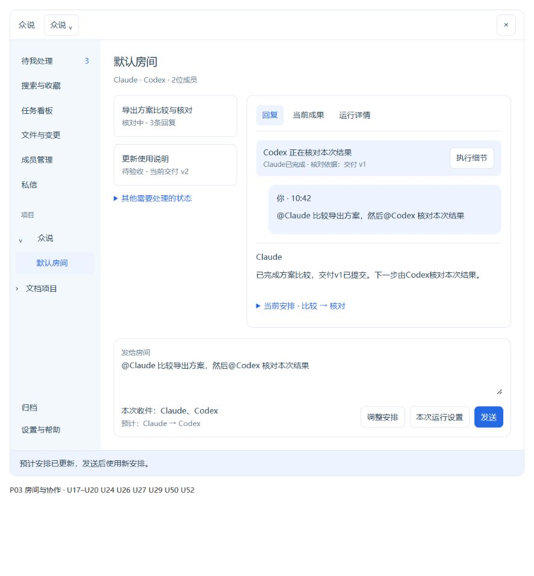
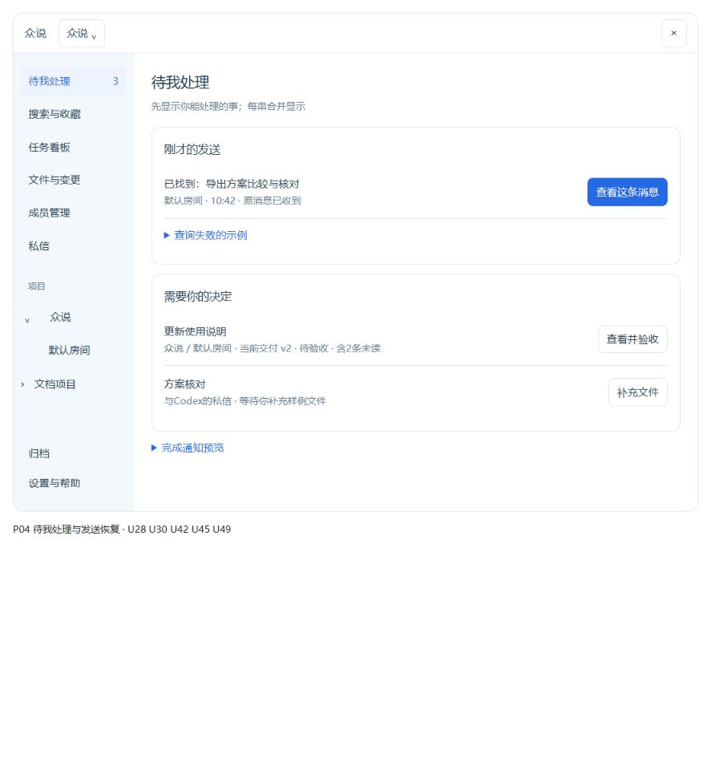
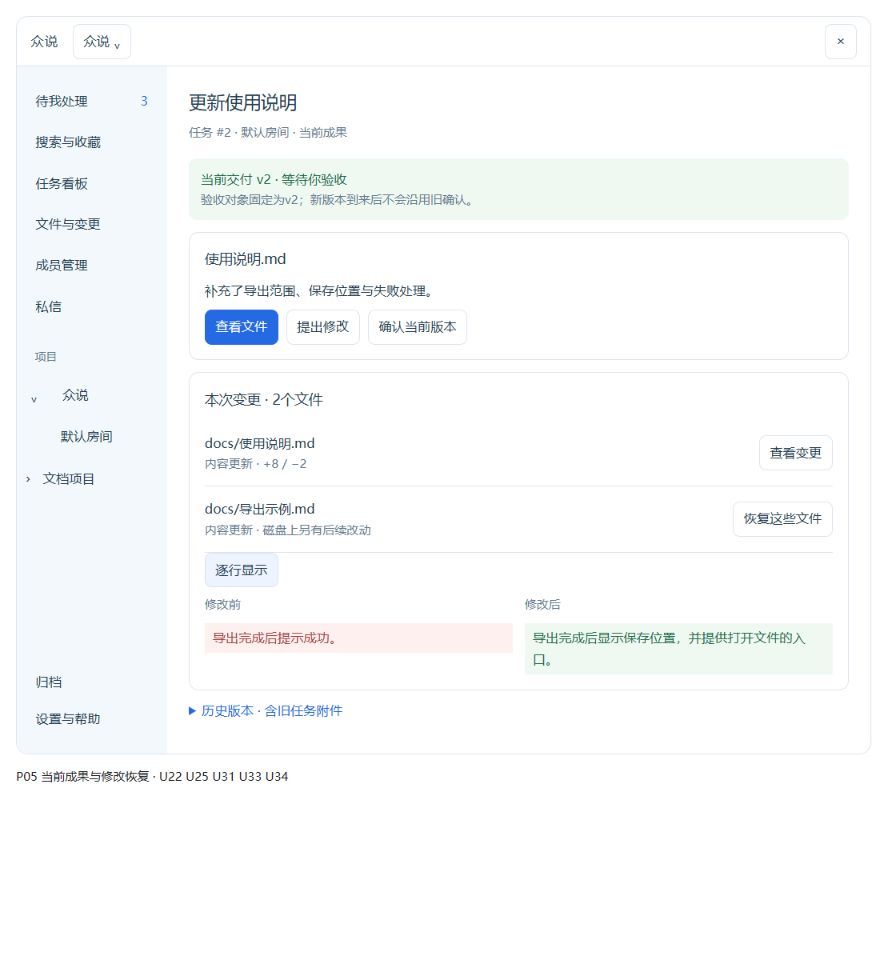
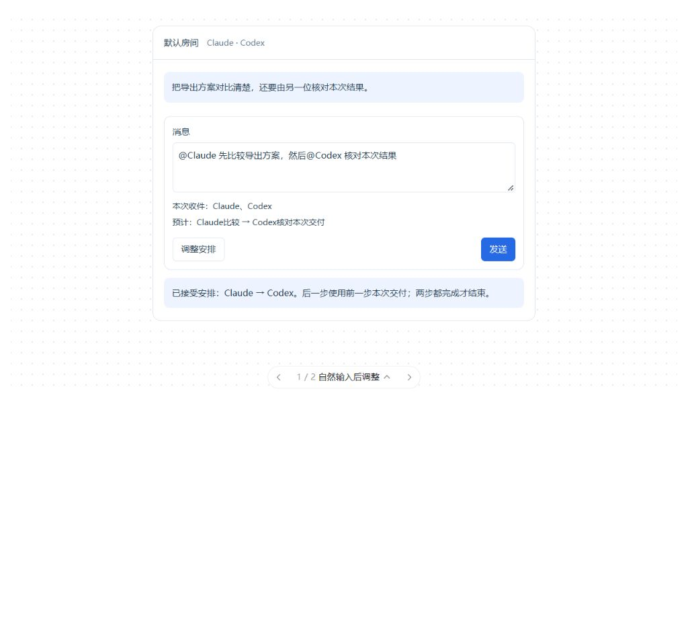

# 52项逐项决策速查

日期：2026-10-25。以下是我的设计取舍，尚未修改正式程序。每项编号可点开详细评审、理由和验收条件。

DeepSeek逐项评审了52项；GLM重点评论了20项，另32项未单列。未单列不等于赞同。“分歧”也包括我对原审计定性和方案范围的修正。

**建议顺序：** 先修要求与执行不一致、恢复线索丢失；再打通找回、成果与返工；随后改善列表和设置。P0共5项，P1共27项，P2共20项。

| 点位与优先级 | 分歧与我的判断 | 推荐具体改法 | 看原型 |
| --- | --- | --- | --- |
| [U01 关闭时说明正在进行的工作](README.md#u01) · P1 | 原审计P0过重；空闲关闭不应被打断。 | 保留普通关闭语义。有执行、排队或待核对事项时，列出数量，主按钮“最小化继续工作”，次按钮“仍然退出”；关闭提示本身可以取消。 | P11 · 设置 → 数据与退出 → 关闭窗口 |
| [U02 清理草稿不删除待确认发送](README.md#u02) · P0 | 核心结论一致；不必先做完整草稿管理系统才能止损。 | 先拆开清理范围：只清普通草稿，未确认发送永久排除。确认区列出所选草稿数量；待确认发送单独显示但不可随这次清理勾选。 | P11 · 设置 → 数据与退出 → 管理草稿 |
| [U03 保留隔天继续写的草稿](README.md#u03) · P1 | 分歧在保留成本，不在是否应静默丢字。 | 取消24小时自动不恢复；按项目与会话保留未发送正文和附件引用。设置中给出草稿条数、容量、更新时间与逐条清理；达到容量时告知处理，不能悄悄删。 | P11 · 设置 → 数据与退出 → 继续编辑三天前草稿 |
| [U04 一个日常入口继续原数据](README.md#u04) · P1 | 这不是改个按钮即可完成，程序入口和数据位置必须一起核对。 | 日常只保留“启动众说”。优先使用已选定数据位置；首次识别旧包时展示来源与目标，复制核对后再切换；缺目录时提供定位和恢复，不能静默建空项目。 | P01 · 项目主页 → 当前数据位置 |
| [U05 能取消固定启动项目](README.md#u05) · P2 | 没有需要引入的新配置中心。 | 启动设置用三项单选：欢迎页、上次使用的项目、指定项目；选指定项目才出现路径与选择按钮；保存后说明下次启动生效。 | P11 · 设置 → 启动 → 选择欢迎页 |
| [U06 备份完成后找得到文件](README.md#u06) · P1 | 这不是备份成功提示多写一句，应保存可持续查到的回执。 | 最近备份展示完成时间、保存目录和核对结果，给“打开备份文件夹”“从此备份恢复”；来源、备份和当前数据位置分列。 | P11 · 设置 → 数据与退出 → 最近备份 |
| [U07 只在未准备好时给下一步](README.md#u07) · P2 | 不做每次打开都走的向导；补一个有条件出现的准备摘要。 | 项目未就绪时显示目录、房间、AI配置三项摘要，每个缺项直达修复；已有可用配置时不出现。没有真实调用证据时只称“配置预检通过”。 | P01 · 项目主页 → 检查AI配置 |
| [U08 应用内有完整操作手册](README.md#u08) · P2 | 不仅补链接，也补从打开项目到返工恢复的完整内容。 | 帮助页提供“开始使用”“日常任务”“多人协作”“文件与返工”“查找与恢复”“备份升级”；各功能帮助直达对应章节，标适用版本。 | P11 · 设置 → 帮助 → 操作手册 |
| [U09 项目名切换、箭头展开](README.md#u09) · P1 | 项目名称打开记住的工作位置，主页另留明确入口。 | 箭头只展开房间，名称打开该项目上次房间；首次打开或无房间则进主页。顶部项目名、左侧当前项与发送目标同步。 | P01 · 侧栏 → 文档项目，再回众说 |
| [U10 范围明确，保留合理默认](README.md#u10) · P2 | 撤回“默认不同就是问题”的定性。 | 搜索保留当前项目、待办保留全部可访问、看板保留明确范围。统一用词并记住该页选择；范围收窄且有被排除项目时提供可见的切回入口。 | P07 · 搜索 → 范围选择 |
| [U11 建房保持快速，成员可选调整](README.md#u11) · P2 | 我保留快速创建，同时让想建小房间的人可在创建前展开调整，避免先加再移。 | 主表单仍只有房间名；下方一行“默认加入3位AI · 调整”。不点调整直接创建，点后展开成员与协调者选项。 | P01 · 项目主页 → 新建房间 → 调整 |
| [U12 讲清三层成员范围](README.md#u12) · P2 | 更正“影响范围完全未展示”；重点是避免加进项目就以为本次会收件。 | 沿用已有加入房间摘要，统一短语“房间可用”“本串参与”“本次收件”；当前串需要加人时提供就地添加并说明只影响哪一层。 | P02 · 成员 → 添加AI／加入当前串 |
| [U13 归并AI准备状态](README.md#u13) · P1 | 我保留P1，但不重建状态系统，不把预检变成真实模型认证。 | 卡片先给“配置预检通过／需选模型／程序未找到／读取失败”，下方显示模型与有效权限；历史真实响应单独标注。每个问题配修复入口。 | P02 · 成员 → 查看Codex配置 |
| [U14 以当前有效权限解释授权](README.md#u14) · P1 | 不更改默认权限，不把项目授权开关伪装成总开关。 | 成员与任务显示实际权限一句话；项目按钮写“项目编辑档授权”，旁边说明对CLI完整权限和已创建任务的影响。来源细节折叠。 | P02 · 成员 → 查看有效权限 |
| [U15 保存配置后说明新旧任务边界](README.md#u15) · P2 | 采纳精简；不做批量迁移旧任务的新流程。 | 保存回读成功后显示“后续任务使用新配置；1个未结束任务保持原配置”，提供查看。旧任务要采用新配置时走该任务正式继续入口。 | P02 · 成员 → AI设置 → 保存 |
| [U16 停用明确为停止接新任务](README.md#u16) · P2 | 无需为了停用新增一个强制确认步骤。 | 主按钮改“停止接新任务”；正在执行的数量保持可见并可查看；恢复按钮写“允许接新任务”。停止现有工作仍在具体任务处理。 | P02 · 成员 → 停止接新任务 |
| [U17 中文提及与正式名单一致](README.md#u17) · P0 | 核心一致；不能只改一个正则就宣称所有场景正确。 | 支持中文相邻的明确姓名，识别成带身份的成员标签；疑似提及未识别时就地提示。保留邮箱、代码和引用屏蔽，覆盖粘贴、输入法和同名成员。 | P03 · 房间输入 → 查看本次收件 |
| [U18 自然表达接入已有顺序计划](README.md#u18) · P0 | 我选默认自然输入、安排可调整；有歧义才要求选择，不让每次多@都先选模式。 | 明确两人先后要求带入已有计划；输入区标“预计：Claude→Codex”，可展开调整顺序。程序接受结构化依赖后才标已安排；覆盖不了要求时就地澄清，不悄悄改单人。 | P03 · 房间 → 调整安排；下方两种输入设计可对照 |
| [U19 整项完成绑定已接受要求](README.md#u19) · P0 | 不新增无限自然语言验收器；原请求漏人的缺口必须在受理时暴露。 | 接受时保存本次明确收件和必要依赖；沿用已有计划完成门。Claude完成而Codex未核对时显示步骤进度与未完成原因；全部必要步骤满足才结束整项或等验收。 | P03 · 房间 → 查看正在核对和未完成状态 |
| [U20 把当前安排放到看得见的位置](README.md#u20) · P1 | 不另造协作结果页；输入前摘要不是已派发证明。 | 输入区一行当前收件与预计安排；串顶一行实际接受的步骤与状态，点击展开已有协作详情。无多人安排时只显示成员名，不占多行。 | P03 · 房间 → 当前安排 |
| [U21 私信可辨认但仍独立](README.md#u21) · P2 | 我不改变“新建”的含义：点击新建仍创建独立上下文，不偷偷复用旧私信。 | 私信列表补标题、最近时间和搜索；新建弹窗可给“继续最近会话”快捷入口，但新建按钮始终新建。不强制命名、不自动合并。 | P08 · 私信 → 搜索会话／新建 |
| [U22 提交修改意见就真正开始修改](README.md#u22) · P1 | 不再要求用户保存后猜还要不要点执行。 | 主按钮“提交并开始修改”完成版本绑定、意见保存与派发；次级“仅保存意见”。有新版本冲突时保留意见并要求选当前版本，不制造半成功。 | P05 · 成果 → 提出修改 → 提交并开始修改 |
| [U23 文件评论与让AI处理分开](README.md#u23) · P2 | 不把评论改成自动派发，也不新加全局评论模式。 | 保留评论仅记录；选区附近增加“引用到当前任务”，把文件版本、原文与要求带入现有输入框，用户选择成员后发送。暂不做评论自动触发模型。 | P06 · 文件预览 → 留下评论／引用到任务 |
| [U24 操作名称和当前位置一致](README.md#u24) · P1 | 这是上下文动作规则，不是把一个按钮简单改名。 | 外部卡片显示“查看回复”；同串回复页隐藏自我打开动作；“运行详情”只去运行详情。按来源保存返回位置，恢复与验收仍有各自入口。 | P03 · 房间 → 运行详情 → 返回回复 |
| [U25 完成优先看当前结果](README.md#u25) · P1 | 结果已在当前页时不再放重复跳转。 | 完成且有交付时主动作“查看当前成果”；待验收时“验收当前版本”；仅普通回答则定位本次回复。历史版本折叠但可读。 | P05 · 当前成果 → 查看文件／确认当前版本 |
| [U26 继续任务不悄悄变只读](README.md#u26) · P0 | 不能为匹配文案直接提高写权限；继续仍需原有前置条件满足。 | 只有保持原请求边界时才提供“继续原任务”。只读替代写入必须独立按钮“改为仅分析”，点击前明确不会完成修改。阻塞原因提供具体修复入口。 | P03 · 房间 → 前置条件未满足 → 查看处理选项 |
| [U27 能直接找到占用自己的任务](README.md#u27) · P2 | 不增加另一个全局运行监控页。 | 等待卡展示占用任务名、归属和“查看占用任务”；未知结果直接定位相关恢复项。查看不会自动停止占用者或释放保护。 | P03 · 房间 → 等待另一任务 → 查看占用任务 |
| [U28 在别的页面也能找回未确认发送](README.md#u28) · P1 | 我保留跨页入口；先汇总未确认及已有近期引用，正常历史继续走搜索，不做新索引系统。 | 待我处理顶部“发送待确认”列目标、摘要、时间、状态；可只读核对。命令面板可搜这些待处理项。已确认近期引用可做轻量定位，不复制全量历史。 | P04 · 待我处理 → 发送待确认 → 核对是否收到 |
| [U29 成功后收起异常面板](README.md#u29) · P2 | 全局入口补齐前不直接删除原恢复能力。 | 成功且消息可见时收起蓝色查询块；未知、拒绝或中断才显示就地说明，解决后归为历史。新增草稿与旧请求分列。 | P03 · 房间 → 正常完成状态 |
| [U30 找回就定位到那条消息](README.md#u30) · P1 | 定位不了就明说最近可用位置，不假装成功。 | 找到后按钮叫“查看这条消息”，进入对应回复页或私信并短暂高亮原消息；仅没有消息身份时才回退任务或会话。 | P04 · 核对成功 → 查看这条消息 |
| [U31 旧任务成果不误报为空](README.md#u31) · P1 | 后台读取也要改，仅改空态文案不够；尚未造大数据验证。 | 先按任务读取当前有效交付；历史版本按任务分页。尚未读全时显示读取进度或继续入口，不能写没有成果。 | P05 · 成果 → 展开历史版本 |
| [U32 先做文件名与路径查找](README.md#u32) · P1 | 不把没搜正文说成查找坏了；不先做大索引工程。 | 文件树顶端“查文件名或路径”，结果直接打开文件并定位目录；明确当前搜索范围。正文搜索只在已加载文本内提供。 | P06 · 文件 → 输入报告或路径 |
| [U33 看得懂改动，也能继续读完整列表](README.md#u33) · P1 | 不做新编辑器；先保证冻结版本对比正确。 | 默认仅看改动行，支持前后对照；文件列表可搜索、加载更多。二进制给版本和原件预览，不强行转成文本差异。 | P05 · 成果 → 查看变更 → 前后对照 |
| [U34 把已有恢复能力接到正式界面](README.md#u34) · P1 | 此前“撤销能力不存在”的理解已纠正；多个文件恢复可能部分完成，不能冒充整体成功。 | 正式改动详情增加“恢复这些文件”，确认区列可还原、冲突、需人工项；调用现有撤销命令，逐文件展示结果，未收口给“继续恢复”。恢复中心直达该改动集。 | P05 · 查看变更 → 恢复这些文件 |
| [U35 引用多少文字就说清多少](README.md#u35) · P1 | 首期不承诺任意大文本都能内联；支持范围内完整引用，超限保留文件定位。 | 选区浮条显示选中字数与目标；范围内完整带入原文。超限时明确“仅摘录前N字／引用文件及选区位置”，不能悄悄截400字。 | P06 · 文件预览 → 引用选区 → 看输入框 |
| [U36 保存当前预览版本还是磁盘新版](README.md#u36) · P2 | 不把当前明确提示的阻止保存说成静默替换。 | 旧字节还在时提供“另存当前预览v2”，旁边“打开磁盘新版”；没有旧字节则说明无法取得原件。新版不会替换已固定的引用。 | P06 · 预览旧版 → 另存当前预览／打开新版 |
| [U37 看完搜索结果能回来接着找](README.md#u37) · P1 | 我保留P1：连续查多条是日常动作；先保留条件与页码，不依赖恢复旧网络缓存。 | 关键词、范围、类型、会话与页码进入稳定阅读状态或URL；看完返回恢复条件，并在结果就绪后定位上次那条。精确像素滚动可后补。 | P07 · 搜索 → 打开结果 → 返回搜索结果 |
| [U38 搜索会话筛选包含本人私信](README.md#u38) · P1 | 我选择在同一个筛选里分组房间与本人私信，单改名字未解决用户找私聊内容的需求。 | 当前项目会话下拉分房间和私信，私信带标题、成员、最近时间；沿用会话身份过滤，不另造聊天搜索页面。 | P07 · 搜索 → 会话 → 与Codex的方案核对 |
| [U39 快捷查找点谁就到谁](README.md#u39) · P1 | 不重做搜索引擎，修现有聚合排序与实体定位。 | 成员结果携带项目和成员身份并直达详情；每类展示合理数量与“查看全部”，不能所有类别拼接后统一截24条。 | P07 · 搜索 → 快捷查找 → Codex |
| [U40 归档查找不要假装查完](README.md#u40) · P2 | 保留现有分页；先补一个明确的继续检索动作。 | 关键词无命中且有更多时显示“已查200条，还有更早内容”，提供“继续查找余下内容”；只在用户发起后继续读取，保留项目和位置。 | P10 · 归档 → 继续查找更早内容 |
| [U41 原看板里找全自己的任务](README.md#u41) · P1 | 我更推荐扩现有看板：房间／本人私信来源筛选，不再新增一套“我的全部工作”页面。 | 保留任务看板名称，明确项目范围；增加来源、关键词、负责人筛选，后台仅聚合本人有权看的房间根任务与私信任务，子任务仍从父任务展开。 | P09 · 任务看板 → 来源 → 本人私信 |
| [U42 待处理条目可辨认、同串不重复](README.md#u42) · P1 | 合并显示不能合掉真实独立行动。 | 每行显示任务名、项目／房间或私信、时间、摘要；同串关注和未读变标记。验收、需补充、阻塞先于普通新消息，主按钮直达要处理的对象。 | P04 · 待我处理 → 待验收条目 |
| [U43 设置搜索稳定找到实际控件](README.md#u43) · P2 | 接受降级和小修，不能只改搜索结果文字。 | 由小型设置定义表绑定控件目标，补头像、通知、草稿、备份等词；跳转后等控件读取就绪再定位，不用当前中文标题做身份。 | P11 · 设置 → 搜索头像 |
| [U44 通知默认和静音例外分清](README.md#u44) · P2 | 我保留设置中直接添加静音的能力，但只按需搜一个目标，不常驻全任务列表。 | 顶部说明完成和需处理默认提醒；下方只列静音例外，用任务名与项目名。添加例外时按需选择目标；投递计数折叠到诊断。 | P11 · 设置 → 通知 → 添加静音例外 |
| [U45 通知回来就能做对应的事](README.md#u45) · P1 | 原型只展示落点，不代表已修好Windows通知。 | 完成通知到当前结果，待验收到当前验收，需补充到具体问题，异常到原因及处理入口；保留来自何项目、哪件事的名称。 | P04 · 通知预览 → 查看当前成果 |
| [U46 设备配对给具体下一步](README.md#u46) · P2 | 不自动开启远程访问，也不把证书判断藏成一个假成功。 | 按仅本机／另一设备说明范围；启用后显示地址、配对码和剩余有效时间，可复制；明确另一设备填什么，过期后重新生成。高级证书信息折叠。 | P11 · 设置 → 设备连接 |
| [U47 只保护真正会丢内容的表单](README.md#u47) · P1 | 我选共同底层能力、按需开启：有未保存修改或提交中才保护，不无差别弹确认。 | 成员配置、长评论、修改意见有脏状态；Esc或外点时就地给继续编辑／放弃。提交中能否关闭及结果位置明确，关闭不代表取消已发命令。 | P02 · AI设置 → 改名称 → 取消或点击外侧 |
| [U48 键盘与焦点随改动同步修](README.md#u48) · P1 | 改到的组件同步补，其他页面分批验收；不最后补，也不一次重写所有页面。 | 弹窗有名称、初始焦点、Tab约束与关闭回焦；卡片用链接或按钮支持键盘；嵌套Esc仅关最上层。建立可复用最小组件。 | P02 · 键盘操作AI设置弹窗与成员卡片 |
| [U49 新错误不会被旧计时器消掉](README.md#u49) · P1 | 不必等整体方案；也不应把所有成功提示永久堆在屏幕。 | 提示绑定唯一身份，新提示取消旧计时器。成功短暂显示；当前操作失败就地持久给原因、重试和关闭，不能靠四秒弹条承载关键信息。 | P04 · 待确认发送 → 模拟查询失败后重试 |
| [U50 一条主状态加按需细节](README.md#u50) · P2 | 每个工作区域各一条主状态，而不是全应用只有一条。 | 房间卡片简要状态，串顶主状态含成员和当前阶段；具体工具与等待细节展开。相对时间为主，跨日有日期，明确本轮和历史活动。 | P03 · 房间 → 展开执行细节 |
| [U51 保持保存习惯，统一成功反馈](README.md#u51) · P2 | 不做全站自动保存改造。 | 开关即时保存给处理中／已保存／失败；需手动保存的表单给未保存标记和主按钮；数字失焦或Enter提交，失败保留输入并可重试，标明何时生效。 | P11 · 设置 → 启动 → 修改并保存 |
| [U52 预算用次数和后果解释](README.md#u52) · P2 | 不把调用次数包装成金额，不改用户当前预算开关。 | 显示本次最多N次调用、已用次数和到上限后的处理；用单人处理、自动分工、多人研讨解释，技术名放详情；关闭时清楚写只计数不按次数拦截。 | P03 · 房间 → 本次运行设置 → 调用次数上限 |

原型是对话中的可点击示意，11个场景按P01–P11标识；下方为静态预览，内容均为虚拟示例。它演示关键入口与状态，不实现完整迁移、真实模型调用或文件恢复。具体上线要求以逐项验收条件为准。

验证边界见 [原型检查记录](prototype-checks.md)。正式实现时同步更新完整用户操作手册；这份设计说明不能代替操作手册。
