# 众说操作手册

**Windows 桌面版 · 图文入门 · 更新于 2026-10-28**

第一次用众说，可以跟着本手册做一次：打开项目 → 添加 AI → 发消息 → 看回复。本手册用“读书会筹备”举例，你可以换成自己的工作、资料或代码项目。

**怎么看图：** 截图中的蓝色 **①②③** 标出了点击位置，下面的步骤与编号对应。打开 **设置 → 操作手册**，随时可以回来查。

## 1. 第一次打开：从一个项目开始

打开众说后，先选择你要工作的文件夹。这个文件夹在众说里叫作 **项目**。

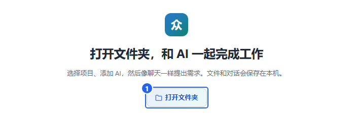

1. 点图中 **① 打开文件夹**。
2. 在弹出的窗口中，选择自己的工作文件夹。例如，先新建一个“读书会筹备”文件夹，把活动资料放进去，再选择它。
3. 选择后，左侧会出现项目名和房间。接着按 [第 3 章添加 AI](#members)，然后 [发出第一条消息](#chat)。

**完成后会看到：** 项目出现在左侧，点击房间就能进入聊天页面。

以后再打开众说，在左侧点原来的项目和房间，就能继续之前的聊天。

### 先认识三个词

| 界面上的名称 | 可以这样理解 | 例子 |
| --- | --- | --- |
| 项目 | 一份工作及其文件夹 | 读书会筹备 |
| 房间 / 对话池 | 这份工作里的一个讨论区域 | 活动筹备、资料整理 |
| 对话串 | 围绕一件具体事情的来回讨论 | “整理活动安排”这件事的要求、回复和追问 |

### 最小化和退出

- 点窗口右上角的 **—**：收起窗口，AI继续工作。
- 点右上角的 **×**：出现确认框；点 **退出** 关闭众说，点 **取消** 留在应用中。

## 2. 认识界面，切换项目和房间

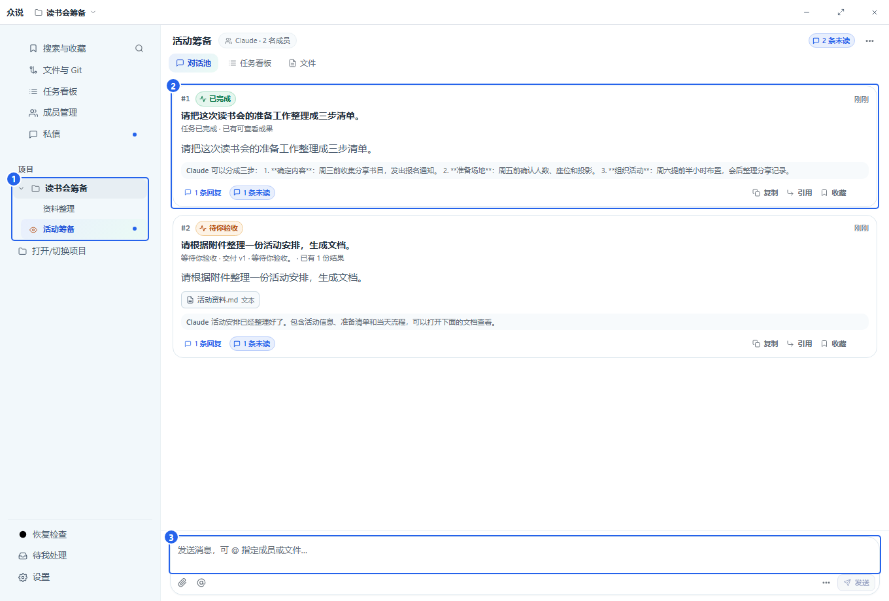

1. **① 左侧项目和房间**：点房间名称切换讨论区域。不同项目分别保存各自的聊天和文件。
2. **② 中间卡片**：每张卡片对应一件事。点卡片或下面的回复数，打开它的完整对话。
3. **③ 底部输入框**：在这里交代一件新的事情。

**切换项目：** 点左侧另一个项目下的房间。要打开新项目，点左侧 **打开/切换项目**，再选择文件夹。

### 新建一个房间

在左侧把鼠标移到项目名称上，点右侧的 **＋**，打开新建窗口。

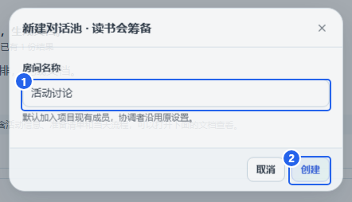

1. 在 **① 房间名称** 中填写名字，例如“活动讨论”。
2. 点 **② 创建**。

**完成后会看到：** 新房间出现在这个项目下，并自动打开。项目已有的AI会加入新房间，可以直接开始聊。

## 3. 添加 AI：先让一位助手能回复

点左侧 **成员管理**，再点页面右上方的 **添加 AI**。

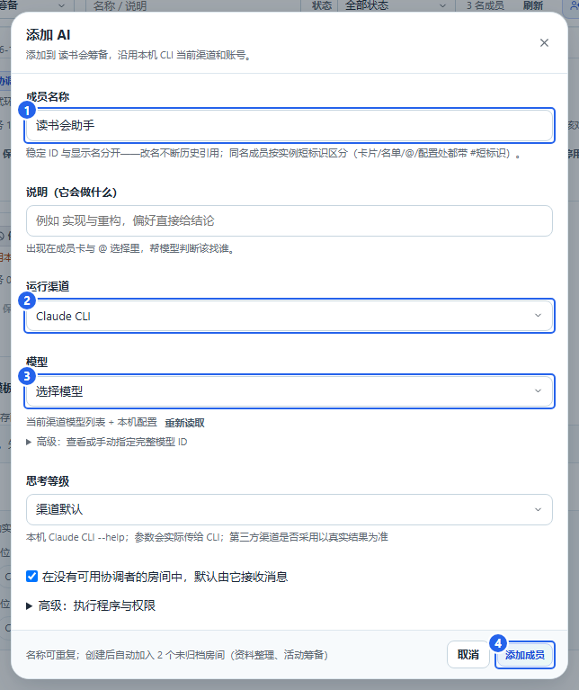

1. **① 成员名称**：给助手起一个你认得的名字，例如“读书会助手”。
2. **② 运行渠道**：选这台电脑上已经安装并登录的 Claude 或 Codex。
3. **③ 模型**：点下拉框，从列表里选一个模型。第一次使用时，其他项目可以保持默认。
4. 点 **④ 添加成员**，回到房间聊天。

**完成后会看到：** 成员列表里出现新助手，房间也能使用它。发一句“你好，请介绍一下你能帮我做什么”，就可以开始对话。

### 渠道、模型和名称有什么区别

| 项目 | 用来做什么 |
| --- | --- |
| 成员名称 | 你在聊天里看到的名字，也用来指定谁来做事。 |
| 运行渠道 | 众说连接AI所用的程序，例如 Claude 或 Codex。账号登录在对应程序中完成。 |
| 模型 | 这个渠道提供的具体AI，添加时从下拉框选择。 |

**模型列表为空时：** 先在对应的 Claude 或 Codex 程序中完成安装和登录，再回到这里点 **重新读取**，选择模型。

### 修改已有AI

进入 **成员管理**，在对应成员卡片上点 **AI设置…**。修改渠道或模型后，点 **保存 AI 设置**。

只需要阅读和解释资料时，可以展开 **高级：执行程序与权限**，选择只读模式；需要修改文件时，选择对应的编辑权限。

## 4. 发消息、看回复，再接着问

### 发出第一条消息

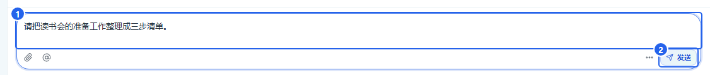

1. 在 **① 输入框** 写清楚要做什么。例如：**“请把读书会的准备工作整理成三步清单。”**
2. 点 **② 发送**。
3. 中间会出现一张新卡片，AI的回复会放在这件事的对话里。

还可以这样说：

> 帮我把这段通知改得更简短，语气亲切一点。

> 阅读附件，列出时间、地点和需要准备的物品。

### 打开完整回复，在原处追问

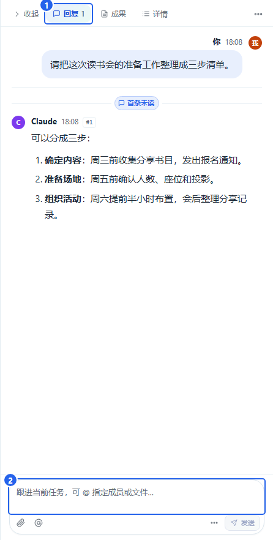

1. 在房间点卡片或回复数，打开右侧对话。在 **① 回复** 页签阅读AI的完整答复。
2. 读完答复后，在 **② 右侧输入框** 补充要求，例如：**“把第二步再拆细一点。”**
3. 点右侧的 **发送**，新的回复会接在同一串里。

**记住这一区别：** 房间底部输入框用来开始新事情；右侧对话串的输入框用来继续当前这件事。

### 指定谁来做，或让多人配合

点输入区的 **@** 选择成员，再写要求。例如：

> @Claude 先整理活动方案，然后请 Codex 核对时间安排有没有冲突。

> 请你们分别给一个建议，最后把相同点和分歧整理给我。

普通提问直接发送即可。需要谁先做、谁再检查，把顺序写在要求里。

## 5. 私信：和一位AI单独聊

点左侧 **私信**，进入一对一聊天。

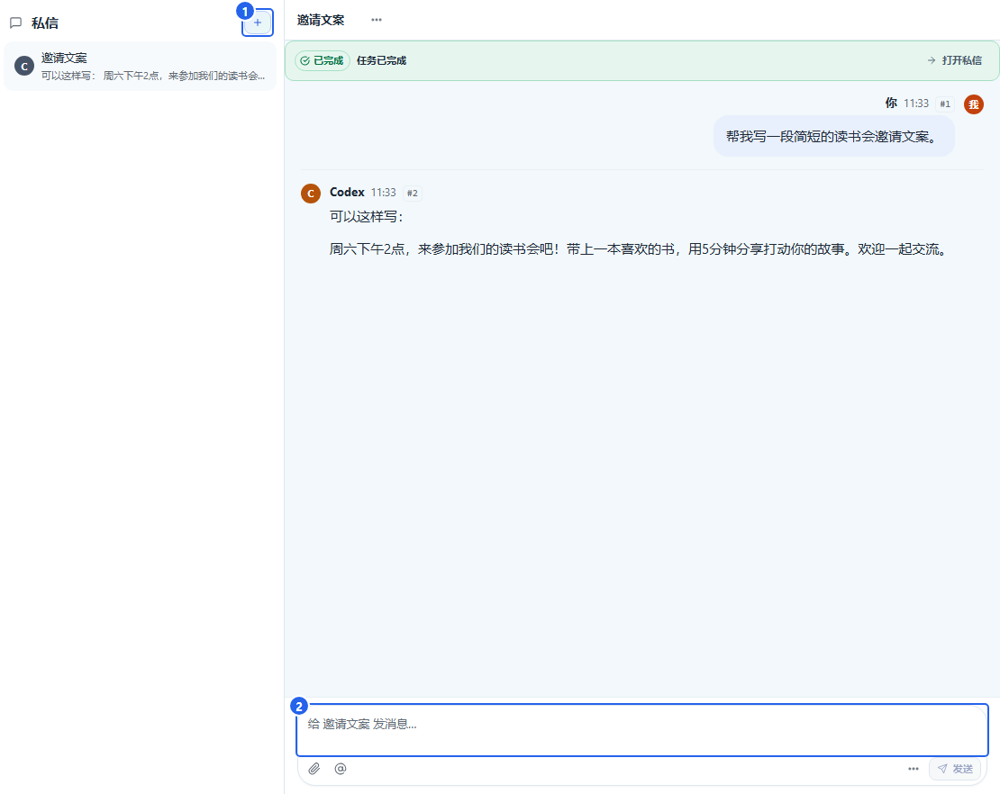

1. 点 **① ＋**，选择一位成员，再点 **创建**。
2. 在 **② 底部输入框** 写问题，点 **发送**。
3. 以后继续同一话题，点私信列表中的这条会话。

**什么时候用私信：** 想单独请一位AI改文案、解释问题或讨论想法时。

每次新建私信都是独立话题。想让AI接着之前的内容做，就回到之前那条私信中继续说。

## 6. 看进展、停止任务和继续任务

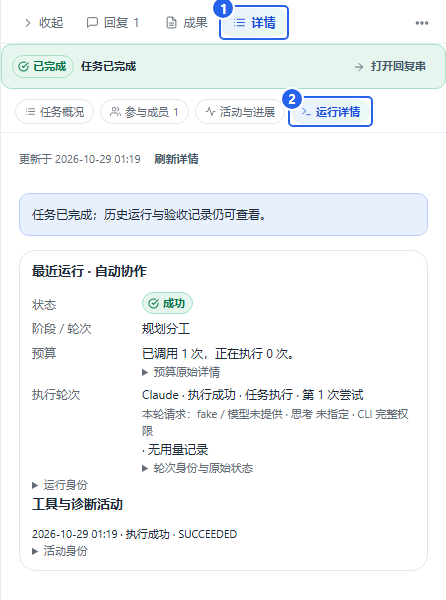

1. 打开这件事的对话串，点 **① 详情**。
2. 点 **活动与进展** 看最近做了什么；点 **② 运行详情** 看当前执行情况。

先看状态，再决定下一步：

| 状态 | 下一步 |
| --- | --- |
| 正在执行、排队中、等同伴 | 等待回复；想看进度时打开活动与进展。 |
| 等你处理 | 读任务提出的问题，在原串补充信息。 |
| 等待你验收 | 打开成果，检查后确认或提出修改意见。 |
| 已完成 | 阅读回复和成果；还想调整就继续追问。 |
| 未能开始、未完成 | 查看原因，处理后点“按原请求继续”。 |
| 已停止 | 已有内容可以继续查看，需要时再继续任务。 |

### 想让AI停下来

执行过程中，在这件事的输入区点 **停止任务**，等待状态变为 **已停止**。

### 想继续做

打开原任务，点 **按原请求继续**。如果要调整要求，也可以在原对话串里直接补充说明。

## 7. 找回旧内容：搜索、收藏和任务看板

### 按关键词找

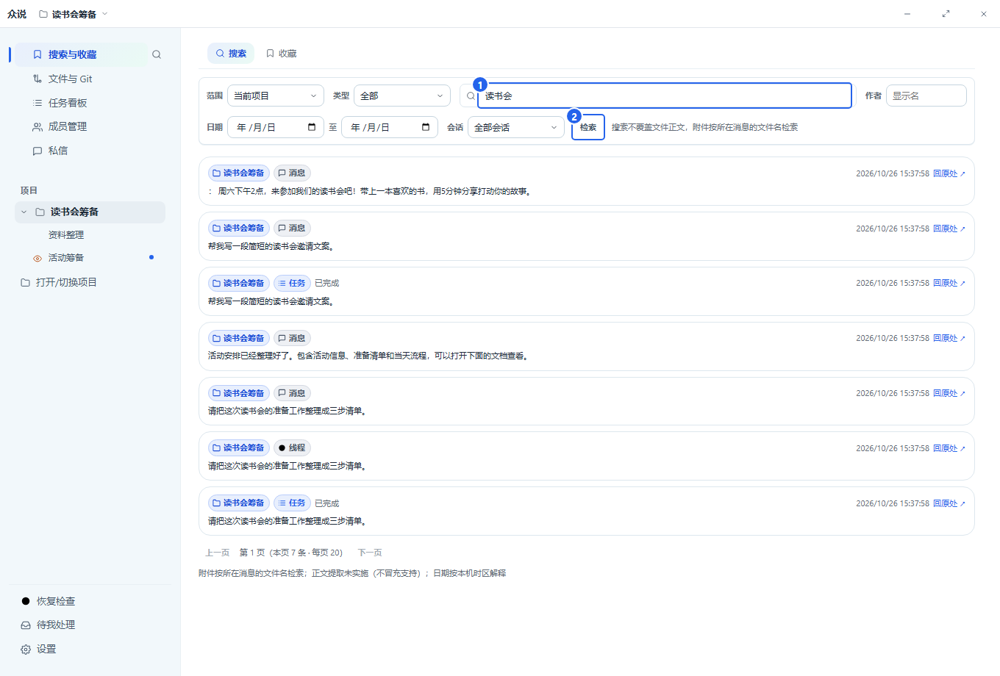

1. 点左侧 **搜索与收藏**。
2. 在 **① 搜索框** 输入记得的词，例如“读书会”。
3. 点 **② 检索**，或按回车。
4. 点结果，回到那条消息、任务或文件。

结果太多时，用上方的项目、作者、日期或会话选项缩小范围。常用消息可以在消息下方点 **收藏**，以后到收藏页找。

### 一起看所有任务

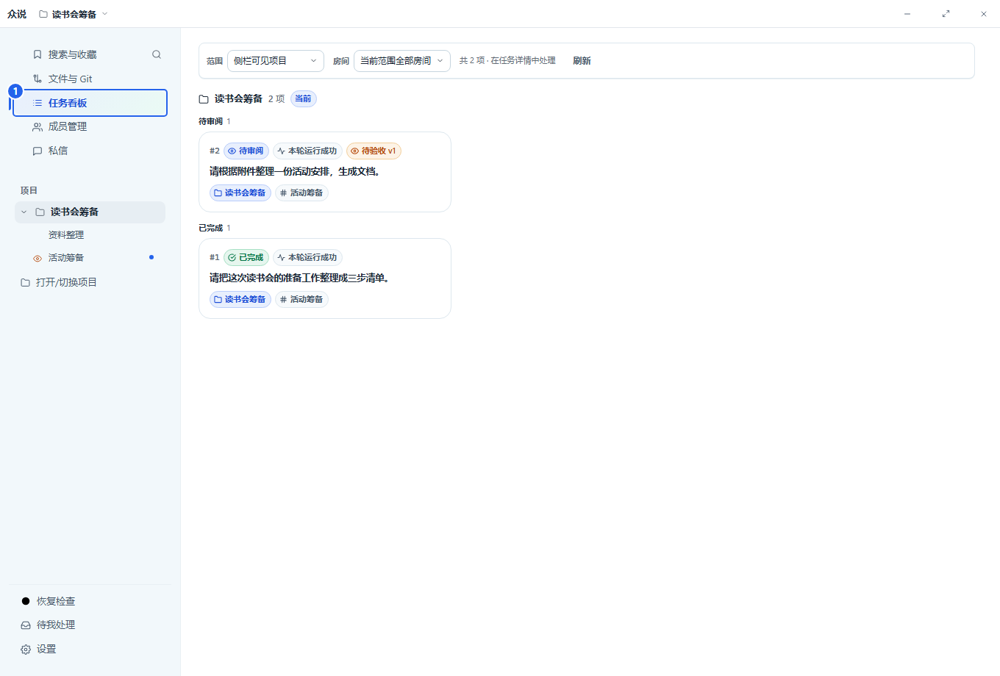

点左侧 **任务看板**，按状态看任务，点卡片打开。左侧 **待我处理** 集中显示需要你回答或验收的事情。

**快捷找入口：** 按 **Ctrl+K**，输入成员、任务或页面名称，用方向键选中后按回车。

## 8. 查看成果、保存文件和要求修改

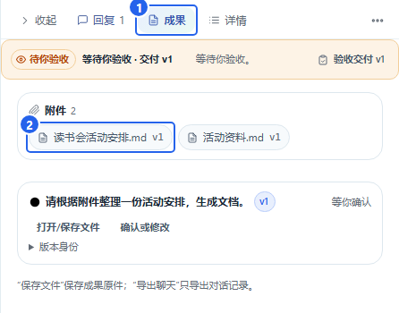

1. 在原对话串里点 **① 成果**。
2. 点 **② 文档名称**，打开文件预览。
3. 阅读内容；要保存到电脑时，点预览右上角的 **下载原文件** 图标，选择保存位置并点 **保存**。

**完成后会得到：** 一份保存到你所选位置的文件，可以在众说之外打开和使用。

### 内容还想改

回到原对话串的输入框，直接说明修改点。例如：

> 请把活动流程改成表格，再加一列“负责人”，其他内容保留。

### 出现“等待你验收”时

点 **验收交付** 或成果中的 **确认或修改**，先看文件，再选择：

- 满意：点 **确认完成**。
- 需要调整：点 **按这些意见修改**，填写具体修改要求并提交。

## 9. 发附件、预览文件和引用文字

### 把资料交给AI

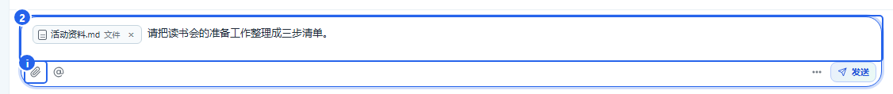

1. 点 **① 回形针**，选择文件；也可以把文件拖进输入框。
2. 等文件名出现在输入区，表示附件准备好了。
3. 在 **② 输入框** 写要求，例如：**“请根据附件整理活动安排。”**
4. 点 **发送**。

### 看文件，保存或引用其中一段

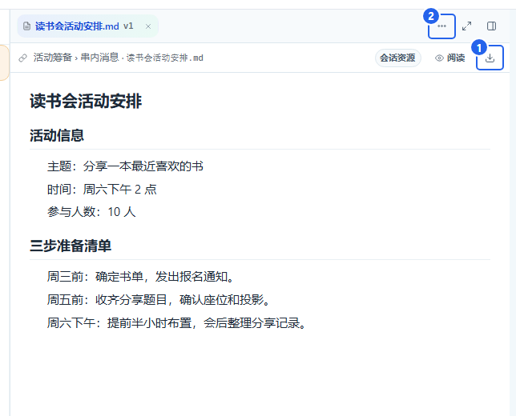

点消息或成果中的文件名，就能打开预览。

- **保存文件：** 点图中 **① 下载图标**，选择保存位置，再点 **保存**。
- **问其中一段：** 先选中文字，再使用 **引用**，补上问题后发送。例如：“这段能不能改得更简短？”
- **其他操作：** 点 **② 更多文件操作**，找到引用和评论等入口。要请AI修改时，把要求发到原对话串。

## 10. 浏览项目文件

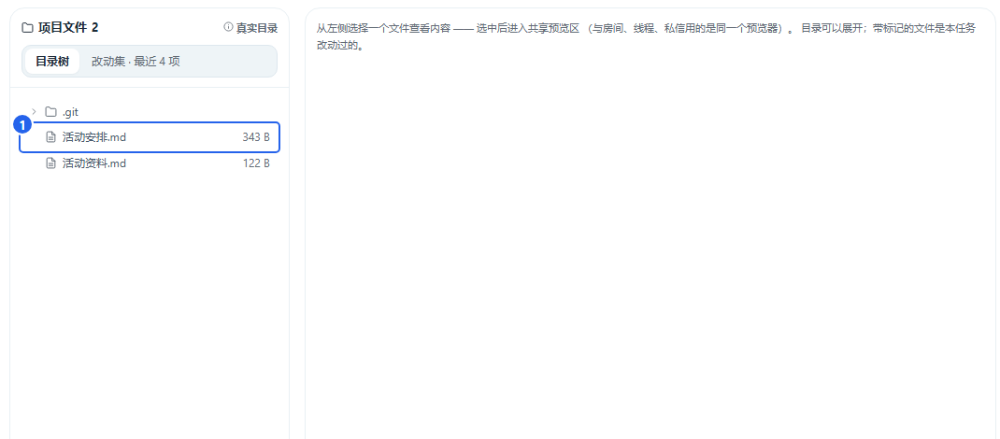

1. 点左侧 **文件与Git**。
2. 在 **① 文件列表** 找文件；点文件名查看内容。
3. 要请AI处理某个文件，回房间说明文件名和要求，例如：“阅读活动资料.md，整理一份准备清单。”

**Git是做什么的：** 如果你的工作文件夹使用Git管理版本，这里还可以查看代码改动、提交记录和分支。日常整理资料、聊天和写文案，可以先使用文件浏览部分。

## 11. 调整外观、通知和调用预算

点左侧 **设置**，选择要调整的项目。

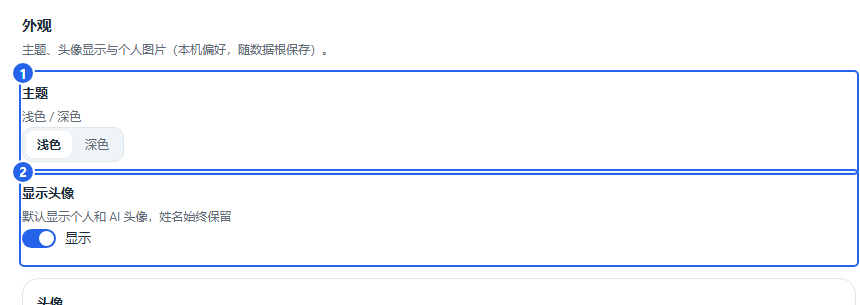

1. 点 **外观**，在 **① 主题** 选择浅色或深色。
2. 在 **② 显示头像** 调整成员头像是否显示。

**通知：** 到 **设置 → 通知** 查看任务提醒和静音设置。收到任务完成的通知后，点通知即可打开对应内容。

只想让某条对话安静一些，可以在那条对话的通知入口静音；想找使用方法，点设置中的 **操作手册**。

### 限制一次请求的 AI 调用次数

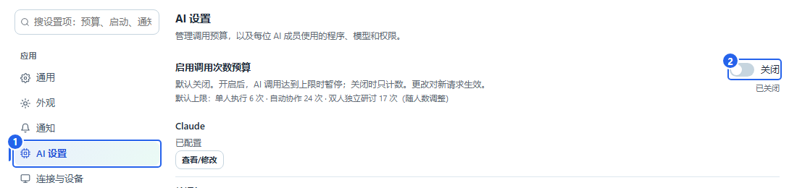

1. 进入 **设置 → ① AI 设置**。也可以在设置搜索框输入“调用预算”。
2. 需要限制次数时，打开 **② 启用调用次数预算**。返回房间、回复串或私信，输入框旁会显示本次的次数上限。
3. 不需要限制时，关闭这个开关。输入框会隐藏预算提示，可以直接发消息。

开关默认关闭。设置对新发出的请求生效，已经开始的任务沿用开始时的设置。

## 12. 备份、恢复和收起旧项目

### 备份聊天与资料

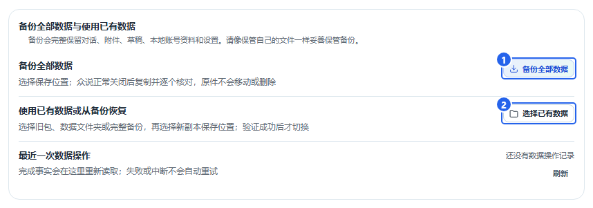

1. 进入 **设置 → 数据与存储**。
2. 点 **① 备份全部数据**，选择保存备份的位置。
3. 按提示关闭众说，等待复制完成。

### 使用备份或已有数据

1. 在同一页面点 **② 使用已有数据或从备份恢复**。
2. 选择已有数据或完整备份，再选择新副本的保存位置。
3. 复制完成后，重新打开众说，查看项目和历史。

### 收起不常用的项目或房间

在项目或房间的菜单里选择 **归档**。需要重新使用时，到 **设置 → 数据与存储 → 归档管理** 恢复。

其他设备连接的入口在 **设置 → 连接与设备**；按页面显示的地址和配对步骤连接。

## 13. 点了发送后，该看哪里

<strong>① 看消息</strong>自己的消息已经出现<b>继续等AI回复</b>

<strong>② 看查询入口</strong>出现“查询刚才的发送”<b>点它查找这条消息</b>

<strong>③ 看任务详情</strong>消息已收到，AI还没答<b>看活动与进展</b>

- **自己的消息已经出现在对话里：** 说明已经收到，接着看这件事的状态。
- **出现“查询刚才的发送”：** 点这个按钮。找到后会跳到原消息，继续在那里聊。
- **出现明确错误：** 根据提示处理，例如完成账号登录或重新选择可用模型，再回原任务继续。

普通历史消息可以用左侧 **搜索与收藏** 查找。

## 14. 常见问题：从这里继续操作

### 想随时打开这份手册

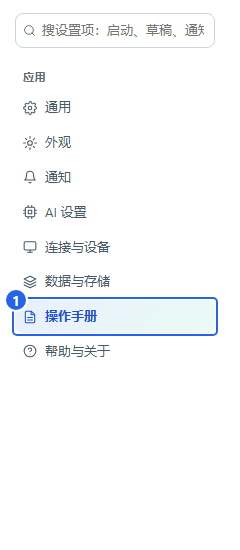

点 **设置 → 操作手册**，按左侧章节目录查找。也可以在设置搜索框输入“手册”或“教程”。

### AI还没回复

打开原对话串，点 **详情 → 活动与进展**，看它正在处理什么。需要补充信息时，在原串回答；需要停止时点 **停止任务**。

### 提示模型或渠道不能用

进入 **成员管理 → AI设置…**，检查所选渠道和模型。账号登录失效时，在对应渠道重新登录，再回原任务点 **按原请求继续**。

### 想让AI真正修改文件

在原串写清楚文件名和修改目标，例如：**“请修改活动安排.md，把开始时间改成下午3点。”** 到成员的 **AI设置… → 高级：执行程序与权限**，选择允许编辑项目的权限。

### 关闭后再打开，怎么接着聊

在左侧点原来的项目和房间，再打开原卡片。私信则从左侧 **私信** 列表进入原会话。

### 换了一台电脑，怎样带上聊天

先在原电脑按 [第 12 章](#optional) 备份，再在新电脑的 **设置 → 数据与存储** 中选择恢复。恢复完成后即可看到原项目和历史。

### 需要反馈一个问题

截下出问题的界面，写清楚“点了哪个按钮、出现了什么、希望得到什么”。版本信息在 **设置 → 帮助与关于**。
