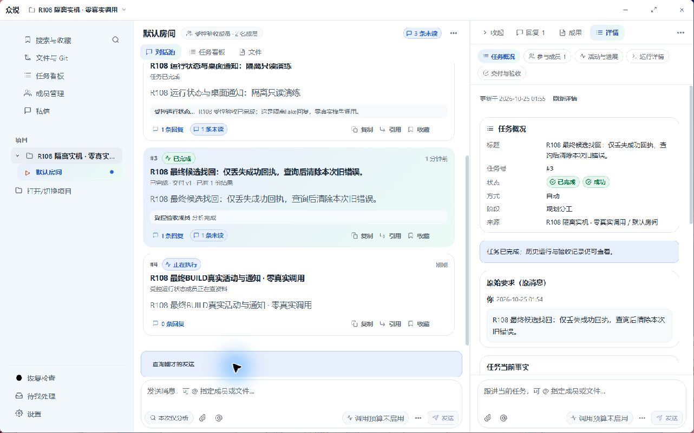
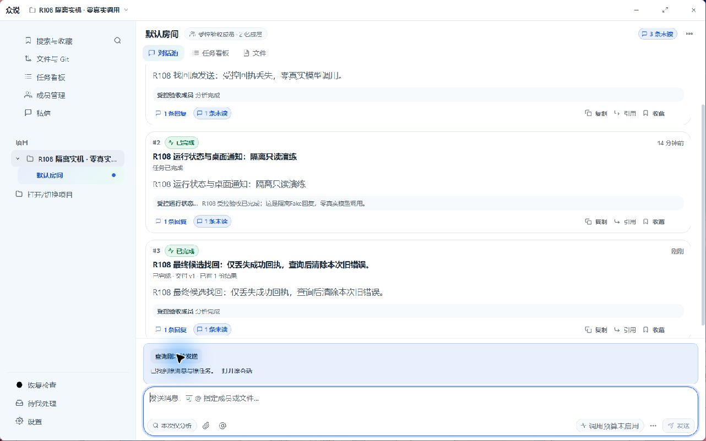
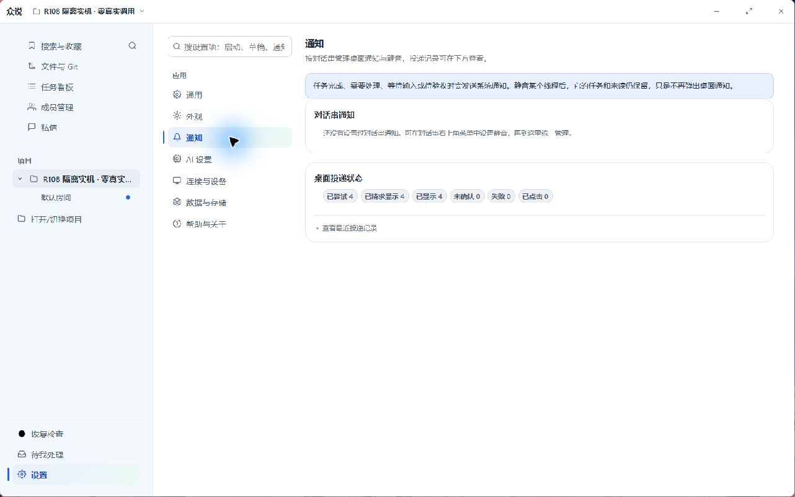

# 众说 V51 操作手册

适用版本：V51 / R108 · 更新日期：2026-10-25

这份手册教你从哪里进入、点什么、看到结果后怎么办。本次新增的三项功能是**执行状态、找回刚才的发送、任务桌面通知**；同时修复了**原答与补交版重复展示**的问题。

## 按你现在的问题找入口

| 你想做什么 | 直接看这里 |
| --- | --- |
| 打开程序，继续原来的项目和聊天 | [1. 打开与日常使用](#start) |
| AI 没说话，想知道它在干什么 | [2. 看懂执行状态](#status) |
| 点过发送，但不知道发出去没有 | [3. 找回刚才的发送](#send) |
| 做完了提醒我，或者关闭某个任务的提醒 | [4. 桌面通知与静音](#notifications) |
| 同一回答出现两遍，想分清当前版本 | [5. 原答与补交版本](#repair) |
| 跟着操作一遍 | [6. 完整使用示例](#example) |
| 遇到异常，不知道下一步点什么 | [7. 常见问题](#help) |

## 1. 打开与日常使用

### 继续你原来的数据

1. 打开最终 V51 文件夹：`desktop-daily-win-v51-r108-usability-final-20261025`。
2. **双击 `start-existing-data.vbs`**。这个入口沿用你原来的项目、聊天、成员和附件。
3. 在左侧展开项目，点它下面的房间；要找一对一聊天，点左侧的 **私信**。

这份 V51 的原数据仍保存在旧 V44 包的 `server-data` 中。请保留那个目录。`start-desktop.vbs` 使用另一个数据位置；从它进入可能看到空项目，不能据此判断原聊天丢失。

如果是全新使用、没有旧数据，才从 `start-desktop.vbs` 开始，通过左侧 **打开/切换项目** 选本地文件夹，再到 **成员管理** 核对可用 AI。

### 发任务、看回复、继续追问

1. 在房间底部输入你的要求。需要指定 AI 时，输入 `@`，从列表选成员。
2. 点 **发送**。房间中出现一张任务卡片。
3. 点卡片或 **回复**，在右侧打开这件事的对话串。这里会集中显示它的回复、成果和详情。
4. 要继续同一件事，在右侧的 **跟进当前任务** 输入框追问。房间底部用于另起话题。
5. 看结果时切到 **成果**；想核对执行情况时切到 **详情**。如果要求人工验收，按界面里的验收入口检查当前交付，再决定确认还是要求修改。

房间是多件事的总览，对话串是其中一件事的完整记录。房间里的长内容会缩略；点进对话串，需要时再点 **展开全文**。收起右侧对话串、切换房间或最小化窗口，都不会因此停止任务。

## 2. 看懂执行状态：AI 没说话时先看这里

**用途：分清“正在干活”“等别人”“等你处理”和“未能开始”，减少盲等与重复发送。**

### 从哪里看

- **房间总览**：看任务卡片标题附近的状态，以及标题下方的成员活动或等待原因。
- **任务对话串**：点开任务，看顶部状态条；需要更多信息再切到 **详情**，查看 **活动与进展** 或 **运行详情**。
- **私信**：左侧 **私信** → 选对应聊天，看消息区上方的状态。

例如，“Codex 正在查资料；Claude 等待结果”表示 Codex 还在工作，Claude 正在等它。这种情况下，暂时没有聊天回复不等于任务没执行。

### 每种状态该怎么处理

| 看到的状态 | 是什么意思 | 你接下来怎么做 |
| --- | --- | --- |
| 正在执行 | 某位成员已经开始处理任务 | 看成员活动，等待结果；想知道具体过程就打开详情 |
| 排队中 | 请求已登记，等待安排执行 | 等待即可，不用再发相同要求 |
| 等待另一任务 | 同一成员忙，或另一任务正在修改同一位置 | 看等待原因；先处理占用它的任务，或等其结束 |
| 等同伴 | 当前成员正在等另一位成员的结果 | 看成员名字，判断在等谁 |
| 等你处理 | 需要你补充信息、处理权限或其他前置条件 | 阅读状态条的原因和按钮，完成它要求的步骤 |
| 待你验收 | 已有一版交付，等你决定是否接受 | 点 **验收交付 vN**，查看当前版本后确认或提修改意见 |
| 已完成 | 当前任务已完成；可能有回复，也可能有文件成果 | 看回复和成果；要继续修改就在原对话串跟进 |
| 未能开始 | 执行前就被拦住了，尚未进入正常工作 | 打开详情找原因，处理成员、配置或前置条件后再按界面继续 |
| 未完成 | 已尝试执行，但这次没有正常完成 | 看运行详情与已有结果，再决定如何继续 |
| 待核对 | 还不能确认上次执行的结果 | 先看左下角 **恢复检查**；不要靠反复发送来判断 |
| 正在停止 | 已提出停止，但执行端还没确认停下 | 等待状态变为已停止或出现进一步说明 |
| 已停止 | 本次执行已经停止 | 查看保留下来的回复与成果，再决定是否继续 |
| 未开始 | 当前尚无已开始执行的记录 | 查看详情中的安排；不要把它当作正在运行 |

`vN` 指当前交付的版本号，例如 `v2`。**待你验收**仍需要你的决定，不能当成已经验收。

状态依据程序能确认的活动显示。“正在查资料”“正在处理文件”“正在执行命令”对应已收到的活动；只有“正在处理任务”时，程序没有更多可展示的细节。这里没有预计完成时间，也不会凭等待时长推算完成百分比。

*图 1：隔离演示项目中的真实界面。留意卡片里的“正在执行”和成员活动说明。点击图片可查看大图。*

## 3. 找回刚才的发送：不确定发出去时先查询

**用途：找到上一次发送对应的原消息和原任务，避免再建一个相同任务。查询本身不会发起 AI 工作。**

适合这种情况：点过发送后界面报连接错误、一直没回执，或者重新打开程序后不确定刚才那条发到了哪里。

### 操作步骤

1. 回到刚才发送的房间或私信，找到对应输入框。
2. 在输入框上方点 **查询刚才的发送**。按钮会暂时显示 **正在查询原发送…**。
3. 如果出现 **已找到原消息与原任务** 或 **已找到原消息与原会话**，点旁边的 **打开原会话**。
4. 在原会话里看执行状态与回复，继续在那里跟进。

找到后，只会清掉与这次发送对应的旧错误提示；你后来另写的草稿和后来的错误不会被一并清空。正常关闭重开、继续使用同一份数据，仍可以查询保留的发送记录。

*图 2：查询成功后的蓝色提示区。下一步点“打开原会话”，无需把同一段话重新发一次。*

### 查询结果怎么读

| 查询结果 | 含义 | 下一步 |
| --- | --- | --- |
| 已找到原消息与原任务／原会话 | 原发送已经被接收，位置已找到 | 点 **打开原会话** |
| 尚未查到原发送回执 | 暂时没查到，**不代表确定没发出去** | 先核对原会话历史，必要时稍后再查询 |
| 原回执正文已过期 | 回执详细内容已过保存期，不会因此重新执行 | 到原会话核对消息与任务记录 |
| 上次发送已明确拒绝 | 上次发送没有被正常接受，界面会说明原因 | 按原因处理后，再决定发送 |
| 查询未确认 | 查询本身失败，例如连接暂时不可用 | 保留现场，连接恢复后再查；原请求没有被重新发送 |

### “查询”“重发原内容”“放弃”有什么区别

| 操作 | 实际会做什么 | 什么时候用 |
| --- | --- | --- |
| 查询刚才的发送 | 只核对原发送的回执和位置，不创建新任务、不调用模型 | 发送结果不确定时，先用它 |
| 重发原内容 | 再提交同一次请求：如果原请求已接受，不会再建第二份；如果之前未接受，可能从这里开始执行 | 已看过查询结果，明确决定继续提交这次原请求时 |
| 放弃 | 清除本地这次待处理发送提示，**不会停止服务端已经开始的任务** | 确定不再从这个提示处理时；要停任务，需进入原任务使用停止入口 |

“重发原内容”和“放弃”只会在有待确认发送时出现。不要把复制文字后重新点 **发送** 当成查询；那可能是另一条新请求。

这个入口针对**当前输入框保留的最近一次发送**，不是全项目历史搜索。找更早的内容，可在原房间、私信历史或 **搜索与收藏** 中查找。

## 4. 桌面通知：不用一直盯着任务

**用途：任务完成，或需要你补信息、处理问题、验收时，用系统通知提醒你回来。**

### 正常怎么用

1. 发任务后保持众说运行，可以最小化窗口去做别的事。
2. 任务完成或需要你处理时，程序会尝试显示桌面通知。
3. 回到原任务，查看回复、成果或待处理事项。

不需要为每个新任务先建一条提醒。关闭并退出整个程序后，不能依靠它继续运行任务或即时提醒。重开时也不会把旧历史通知成批再弹一次；后续确实发生新的完成或待处理事件，仍可以产生新通知。

点击系统通知的设计行为是回到对应任务或对话。**这一点击定位尚未在本机完成实测**；如果没有跳转，可从左侧项目、房间或私信进入原会话。

### 只关闭某个对话串的提醒

1. 打开那件事的对话串。
2. 点对话串右上角 **…**，选择 **静音**。
3. 想恢复时，再从同一菜单选 **取消静音**。

静音不会停止任务或删除回复；任务和待办仍然保留。需要停止执行时，要使用任务的 **停止任务** 入口。

也可以到左下角 **设置 → 通知 → 对话串通知**，统一管理已经有设置记录的对话串。开关显示 **已静音** 时表示关闭该串提醒，显示 **通知** 时表示允许提醒。

如果这里写着“还没有设置过对话串通知”，表示暂时没有保存过单独设置，**不是全局通知被关闭**。先在某个对话串菜单里设置静音，就能在这里统一管理。

### 没看到弹窗，去哪里核对

进入 **设置 → 通知 → 桌面投递状态**，需要细节时展开 **查看最近投递记录**。

| 显示项 | 告诉你的事情 |
| --- | --- |
| 已尝试 | 程序尝试投递过多少条通知 |
| 已请求显示 | 已经向桌面通知接口提出显示请求 |
| 已显示 | 收到了通知显示的回报；不能据此保证你亲眼看到了弹窗 |
| 未确认 | 请求后还没有可靠的显示结果 |
| 失败 | 投递发生错误，可看最近记录中的说明 |
| 已点击 | 记录到多少次通知点击 |

这些是**通知投递情况**。例如“已显示 4”表示通知的显示回报数量，不能用它判断四个任务的成果是否合格。

若没看到通知，依次检查：程序是否仍运行 → 该串是否静音 → 最近投递记录是否失败或未确认 → Windows 是否允许众说显示通知、是否处于勿扰模式。即使没有弹窗，也可以从原会话或左侧 **待我处理** 查看任务。

*图 3：设置 → 通知。上方管理静音，下方核对通知投递；图中数量来自隔离演示项目，不是你的任务统计。*

## 5. 原答与补交版本：分清现在该看哪一份

**用途：AI 补交了一份有效回答时，把旧版本收起来，避免两段相似长文同时占满屏幕。**

有时 AI 已经输出一段文字，但程序没能将它确认为有效交付，例如回复格式不符合要求。之后补交成功，原答和补交版都会留下记录。

### 现在怎么读

1. 在右侧对话串中，优先看带 **补交** 标签、绿色 **补交版本** 提示的回答。
2. 旧回答默认折叠为 **原答已补交 · 查看历史原文**。
3. 想对照原答时，点这行文字展开；正文仍很长时，再点 **展开全文**。
4. 看完后再点摘要收起。原答的复制、引用、收藏入口仍保留。

下面是阅读方式示意，可以在 HTML 手册中点开试试，**它不是你的实际聊天记录**：

原答已补交 · 查看历史原文

这里保留原回答。需要比较前后内容时再打开阅读。

<strong>补交版本</strong>
这里展示当前补交的有效回答。平时从这一份开始看。

只在能明确对应、且补交成功时才这样展示。补交仍在进行、失败或结果不明时，不会凭文字相似就把原答隐藏。两条文字相近、但没有上述标识的回复，不能仅凭本功能判定为同一份补交。

这次处理的是显示方式：**原消息没有删除，也没有重新执行你之前的任务**。

## 6. 完整示例：发出任务后没有及时看到回复

假设你刚发了“帮我整理这份文档”，随后界面出现连接错误。

1. **先别把原话再发一次。** 在刚才输入框上方点 **查询刚才的发送**。
2. 查到原任务后，点 **打开原会话**。
3. 看状态：如果是“Codex 正在查资料”，说明已开始处理；如果是“等你处理”，读旁边的原因并处理。
4. 保持程序运行，可以最小化去做别的事。完成或需要你处理时会尝试通知。
5. 回来查看回复与 **成果**。如果显示 **待你验收**，检查交付后再确认，或提出修改意见。
6. 若看到 **原答已补交**，默认读绿色 **补交版本**；只有需要对照时才展开旧回答。
7. 需要继续修改，就在这件事的右侧对话串输入意见，方便保留上下文。

整个过程里，查询负责“找回位置”，状态负责“说明进度”，通知负责“叫你回来”，版本折叠负责“让你看清当前回答”。

## 7. 常见问题

### 我找不到“查询刚才的发送”

回到真正发出那条消息的房间、私信或任务输入框。只有该输入框保存了发送记录时才显示；还没发送过的新会话没有这个按钮。如果刚换了启动入口，先核对是不是进入了另一份数据。

### 查询说没找到，可以马上重发吗？

“尚未查到”不等于“确定没发送”。先核对原会话历史，连接恢复后再查询。如果最终决定提交原请求，使用界面保留的 **重发原内容**，不要把相同文字当新任务连发。

### AI 很久不回，但状态仍是“正在执行”

点开原任务看成员活动和 **详情**。最近一次活动只表示已收到的进展，不保证此刻仍在持续产出。想停止就使用任务的停止入口；显示 **正在停止** 时等执行端确认。若变为 **待核对**，到 **恢复检查** 按说明处理。

### 显示“未能开始”或“缺少必要的前置成果”怎么办？

打开 **详情 → 活动与进展／运行详情**，确认具体拦截原因。先处理成员可用性、配置、权限或前置成果；再使用该任务实际提供的继续入口。

如果原要求只是查资料、比较或分析，并且界面提供 **按原请求继续**，可按提示继续。**它不能用来保证文件修改任务会执行写入**；有些可写任务仍可能被文件基线等条件拦住，应按详情中的实际原因处理。

### 任务完成了，我还要点验收吗？

看状态。如果显示 **待你验收** 或有 **验收交付 vN**，需要你检查当前交付并作决定。普通对话回答、自动完成的任务不要求每次额外点击验收。

### 静音后任务会不会不做了？

不会。静音是对话串的通知偏好；执行名单和任务仍保留。需要停止工作，进入原任务点 **停止任务**。

### 为什么设置里没有列出我所有的对话？

**对话串通知** 展示的是已保存的订阅设置，不是全部聊天列表。直接到目标串右上角 **…** 设置静音即可，之后再来统一管理。

### 为什么旧回答还在？

旧回答保留作历史。看到 **原答已补交 · 查看历史原文** 就说明它已经折叠；当前先读 **补交版本**。你仍可以主动展开旧内容、复制或引用。

### 我从新包打开后，原项目没了

先退出该窗口，再从最终 V51 的 **`start-existing-data.vbs`** 进入。这个入口沿用原数据；普通 `start-desktop.vbs` 的数据位置不同。不要为了找聊天先删除任何旧包的 `server-data`。

### 还是不对，反馈什么最有用？

说明你用的版本、启动文件名、哪个项目和房间／私信、发生时间、刚才点了什么，并附上状态条或 **详情** 的截图。如果是发送问题，再附上 **查询刚才的发送** 的结果。不要只写“没反应”，这些信息能帮助区分未发送、等待、执行失败和显示问题。

---

手册内截图来自隔离演示项目，用于指认界面入口。实际成员名字、任务数量和状态以你的程序为准。本手册随桌面包提供；后续新增功能或改动入口时，应同步更新对应操作说明。
