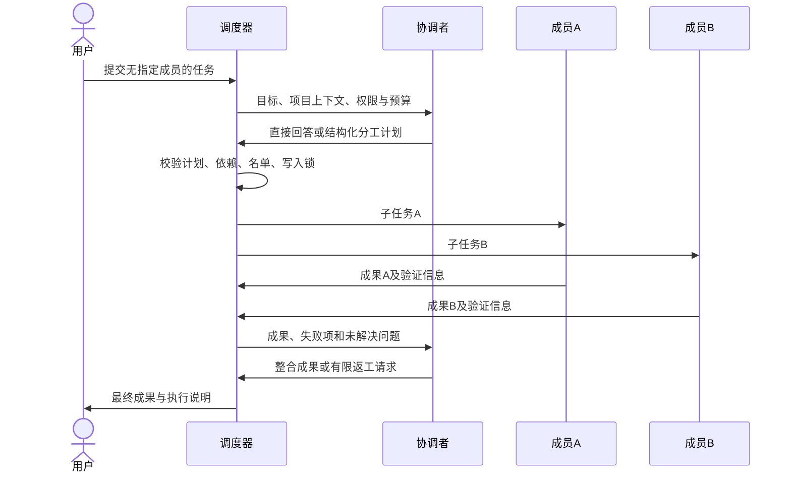
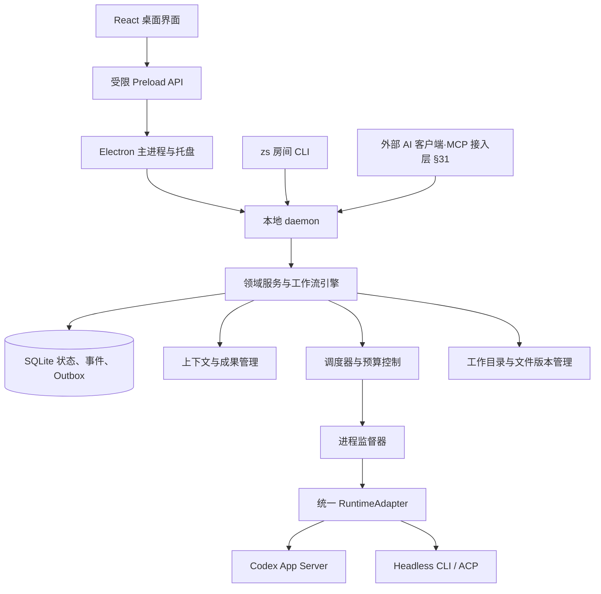

# 众说：本地项目群聊多 Agent 协同工作台

开发设计报告 v1.23 · 2026-09-26（文件路径保持稳定）

**2026-09-22 文件预览交互确认（UX-PREVIEW-01）优先**：用户批准共享预览方案并要求交给施工 AI 修改原型。§17.9 为新增交互基线，具体规则见 [房间、回复串与文件预览规格 v1.2](./zhongshuo-workspace-preview-interaction-v1.md)，施工入口见 [原型施工说明](./dev-briefs/prototype-workspace-preview.md)。这是对 §17.1/17.2 的部分修订：成果集合、活动与任务等详情保留线程归属，具体文件正文进入共享预览区域；主池、线程、私信和项目文件均可打开。原型施工已授权，正式 daemon/API 开发与外部写入不因此授权；未验证宽度仍是实验参数，未宣称实现或验收通过。

当前决策优先规则：2026-09-20 第十四批确认“任务验收”为项目级可选功能，Git 用户无需使用（§10.5）；关闭后满足交付要求即完成，开启后按任务交付验收，取消独立的 commit 验收队列。该决定覆盖此前“代码统一人工审阅”和 Git 提交重复验收口径，不放宽执行权限、用户改动保护或自动提交/推送授权。第十三批 Git 客户端（§14.6）、首版原生限制与最小确认通道（§9.6）继续有效；**私信条款以 §4.6 现行版本为准（2026-09-25 收敛为 1 对 1，取代当日的"三模式 + 小群"口径，见 §0.21）**。历史修订说明不覆盖当前规则，能力验证仍待执行。

第十五批导航决定优先：侧栏依次为“搜索与收藏 → 文件与 Git → 任务看板 → 成员管理 → 选中项目及其会话”，底部固定“待我处理、设置”；顶栏多选仅控制侧栏可见项目，当前项目仍为单个。文件/Git 合为页面内两个标签，任务看板按项目分组，成员页可切项目，Runtime 移入设置。此决定替代第十三批侧栏分组和第十四批“暂不合页”的范围说明，任务验收可选规则不变（§17.1/17.7）。

第十六批设置范围优先：项目设置从应用设置中拆出，每个项目通过侧栏项目行的“⋯ → 项目设置”进入自己的单页；底部“设置”只打开应用设置，不含项目分组或项目选择器。项目页绑定 URL projectId，标题为“项目名 · 项目设置”，无效目标禁止回退至其他项目。任务验收、协作限制、文件修改配置属于项目；通用、Runtime、设备与局域网、诊断属于应用（§17.8）。设置位置变化不改变原有权限/任务策略。

**2026-09-26 应用设置重排优先（第二十八批，施工依据 [dev-briefs/prototype-settings-visual-and-ia.md](./dev-briefs/prototype-settings-visual-and-ia.md)）**：应用设置由「通用、执行工具（Runtime）、设备与局域网、归档管理、诊断与帮助」重排为**七个一级分类**：通用（启动与托盘、应用级运行并发、本机账号与会话）、外观（主题）、通知（首次落地，依据 §27.11 ATTN-05）、AI 工具（原执行工具）、连接与设备（设备配对与外部 AI 连接（MCP，§31.5）两个**分组**，权限说明分开）、数据与存储（数据位置与占用、备份与恢复、归档管理、已移除的项目）、帮助与关于（诊断、日志保留、错误码速查、版本与更新、原型工具折叠组）。**归档管理不再独占一级分类**，仍与 `/archive`、项目 ⋯ 共用同一份数据与操作；分类只有骨架，§3.1 的【暂缺】项（发送快捷键、消息密度、界面缩放等）不显示占位控件。旧 section 链接 `app/general/runtime/lan/archive/archived/diagnostics/errors` 与 `/runtimes`、`section=reminders` 全部继续可用（`errors` 仍规范化并展开速查）。应用设置的**归属边界不变**：本机的软件行为、工具接入、通知、数据与外部连接属应用；项目交付要求、成员身份与模型、房间规则、任务预算仍归各自页面（§17.8）。

**2026-09-26 应用设置重排（第二轮修订）**：按外部评审收窄完成口径并修六处交互缺陷 —— ①数据目录「显示 / 打开 / 复制」共用同一个已解析路径，复制等写入结果、失败如实报错；②令牌不进写操作留痕（`external.connection.rotated` 不再记录令牌）；③数量类输入（并发、预算等）只接受范围内整数，创建与编辑共用同一套校验，非法值不写入；④免打扰按当前时间判定，区分「已启用」与「此刻生效」（含跨零点）；⑤runtime 的安装 / 认证 / 验证状态分别记录，**不由不可用反推未安装**；⑥§4.1 从检测报告补成可改可存的工具配置流程（可执行文件位置 / 认证方式 / 连接参数）。**完成口径**：第二批完成；第三批按条目分别声明 —— §4.2 数据（备份/恢复/清理）与 §4.4 帮助与关于仍是「入口与说明整理完成 + 明确标注的模拟」，§4.3 可改上限但不接调度器，均未接真实文件系统、CLI 探测与更新后端。

**2026-09-26 页面头部与滚动条位（用户第二轮反馈）**：①**去掉页面顶部头部** —— 纯「标题 + 说明」的页头整块删除（应用设置、搜索与收藏、成员管理、任务看板、归档管理、Runtime 兼容页）；带控件的页头只删标题与说明、保留控件（待我处理的范围标签与筛选、项目主页的概览标签与操作、文件与 Git 的路径与项目选择、Git 的路径与拉取/推送、文件与改动的路径与标签）；实体标题（任务/成员/成果详情、项目设置的项目名与路径）保留。归属边界改由各分区副标题承担，范围为标签、路径为坐标，信息不重复也不丢失。②滚动容器 `.page` 采用 `scrollbar-gutter: stable`：原来短内容分区不出现滚动条、长内容分区出现，居中的设置布局会左右各漂约 5px（实测导航左缘 312 / 307）。

**2026-09-24 界面信息减负优先（第二批 UI 减负，施工依据 [dev-briefs/prototype-ui-declutter.md](./dev-briefs/prototype-ui-declutter.md)）**：回复串删除顶部两行（任务号/状态/图标组与原消息摘要横条），常驻视图收敛为「回复、成果(讨论串为附件)、详情」＋一条紧凑导航（左侧收起/返回、最右「⋯」）；任务身份改由输入区目标摘要承担（`跟进 #N · 简短标题`），完整标题、编号、原始要求、真实状态与方式在「详情 → 任务概况」内可查；活动、成员、运行、交付与验收、研讨按分组就地展开，**八类旧 tab 键与 `/task`、`/run`、`/deliberation`、`/artifact`、`/thread` 深链继续可用**（按 §17.4 的映射表落位）。主池卡片去掉「任务详情」「打开回复串」两个常驻按钮，改由标题、回复数与卡片「⋯」进入；同一卡片只保留一种未读表达；协调者与成员数合并为房间信息入口，房间设置进房间「⋯」。预览的文件名只在标签出现一次，视图切换由常驻分段控件改为「阅读 ▾」菜单，放大与导出等收进文件「⋯」。本节取代 §17.2/§17.4 中“顶部原消息”“另起任务始终可见”“预览/源码常驻分段控件”等旧表述；任务/讨论语义、权限、执行状态、预算约束、停止、成员跟进、版本、audience、引用授权与草稿归属均不变。

**2026-09-24 减负第三轮（用户看到输入区上方那一行后要求去掉）**：输入区**上方的目标摘要行整行移除**（原来的 `发布到 开发大厅` / `跟进 #N · 简短标题` / 讨论串的根消息摘要）—— 房间名就在正上方的房间头部，讨论内容就在上方回复流里，这一行是重复占位。身份改由 placeholder（`向对话池发布新任务 · 自动…` / `跟进 #12 · 延续共同研讨…`）与「详情 → 任务概况」承担；`Composer` 的 `targetSummary` prop 与 `.composer-target-*` 样式保留但无调用方，恢复只需重新传值。归档只读房间仍保留一行只读说明（禁用原因，不是身份行）。**记录代价**：placeholder 在输入后隐藏，因此"正在写长回复时仍能一眼看到发给谁"不再有常驻元素保证。

**2026-09-24 减负第二轮（用户指定的四项，保留顶部单行导航与视觉风格，不重做布局）**：①「详情 → 任务概况」不再重复任务身份与操作 —— 内嵌的任务详情视图只复用**具体内容区块**（任务属性、运行与预算、参与者、子任务、成果、改动集），标题/状态/方式/来源与「定向跟进（唯一保留项）/研讨详情/停止任务」那排不再出现第二遍（停止在输入区、研讨与交付在详情分组另有入口）；内嵌视图按**面板宽度**适配（两列/三列网格降为自适应单列），成员名不得逐字断行。② 菜单项名称保持简短、当前状态放在行尾、**解释进 tooltip**；输入区移除「点击查看完整任务信息」「新任务会在这里形成一张原消息卡」等常驻教学文字。③ 并排预览时预算/停止/运行设置/权限/发送组成**不可拆分的右侧操作簇**，容器变窄时整簇换行，发送不再被单独挤到下一排。④ 文件版本与来源去重：版本全站只用一个口径（`v3` / `读取 r3`）且**只在标签上显示一次**，工具行不再重复；来源行只在"从哪打开"确实补充新信息（跨房间/跨会话）时才追加「从 … 打开」；「阅读：阅读」这类名称与状态重复的写法改为「阅读视图 / 源码视图」。附件与成果列表的教程文字一并清除（打开行为写进 chip 的 tooltip）。四项均不增加新的常驻栏位。

**2026-09-25 MCP 接入层（E25，§31）**：外部 AI 可经 MCP 调用众说——三入口（桌面 UI / `zs` CLI / MCP）共用统一业务接口；外部助手（代用户操作）与外部成员（随 FULL-06）双身份不混用；审批、验收、预算提升、成员配置不能经 MCP 完成；MCP 本体不进 v0.1（FULL-11，RT-28），但 §31.1 五条预留条款（结构化契约、身份推导、范围校验、幂等可查询、发言与执行分离）即时约束所有新命令设计。

**当前范围：完整收录 Raft 中文官方文档功能，并保留用户已指定的本地项目、三种协作模式和线程隔离。第 26—30 节是本次新增的全量功能基线（42 篇来源、18 类、137 项条目）；早期章节中的“首版不做/后置/暂缓”只代表历史排期建议，不再构成删除功能的依据。功能纳入目标不等于每个选项、默认权限、协议参数或发布批次已经由用户确认。**

文档性质：可用于拆分开发任务的设计基线提案。本文包含产品规格、架构、协议、数据模型、异常流程和验收标准，不表示软件已经实现或 CLI 已完成实机兼容测试。

产品定位：**文件夹是根对象，房间是这个文件夹上的协作视图。打开本地项目，在群聊中组织多个 CLI agent 完成工作，控制面和工作记录保存在本机。**

## 0. 阅读方式、依据与决策状态

### 0.1 推荐阅读顺序

- 产品与交互开发：第 1—7、17、21 节。
- 调度与后端开发：第 4—16、18—20 节。
- CLI 接入开发：第 8、9、11、14、19 节。
- 项目负责人：第 0、2、20—23 节。
- 首次开始编码：第 22 节的首个开发包。
- 本次线程隔离补充：第 3.4、4.5、12.6、13.4、15.5、17.6 节。
- Raft 官方功能对照及新增优先级：第 25 节。
- 全量文档覆盖与来源索引：第 26 节；功能目录：第 27 节；本地化与数据模型扩展：第 28 节；文档差异：第 29 节；开发覆盖验收：第 30 节；外部 AI 调用众说（MCP 接入层）：第 31 节。

### 0.2 已确认需求

| 编号 | 用户明确描述的需求 |
|---|---|
| U01 | 以本地文件夹为项目，可以在项目内讨论、分析文件和代码 |
| U02 | 保留 Raft 式群聊、多 agent 分工、交流和汇总体验 |
| U03 | 未指定 CLI 时，由一个成员分析任务、分配给多个成员、整合成果 |
| U04 | `@全体` 时，每个成员独立出报告，然后交叉分析、多轮讨论、形成整合报告 |
| U05 | `@某个成员` 时，只有该成员工作，其他成员静默 |
| U06 | 本地客户端，通过已有 CLI runtime 执行；项目、群聊和编排控制面在本机 |
| U07 | 在主对话池发布任务，AI 回复直接附着在该任务下，不混入其他任务；可点击回复数单独查看全部回复 |
| U08 | 任务之间的模型上下文默认隔离；共享项目不等于共享所有任务对话 |
| U09 | 频道设置、频道任务和左侧菜单等完整功能都纳入设计目标，不只保留聊天与编排 |
| U10 | 将指定的欢迎、功能、开发者文档及其中文导航章节中的功能完整列入报告，包含应用生态与开发者能力 |

### 0.3 本文采用的建议默认值

Windows 优先、Electron 桌面端、独立本地协调服务、TypeScript、SQLite；一个项目初始只有一个默认房间，成员数量可配置，协调者默认为项目的第一个成员，可在设置中更换（2026-09-17 用户确认）。这些是用于推进开发的建议，不冒充用户已选择的技术栈。单人、本机是最早可验证的运行形态；多人、多电脑、私信、联合协作、提醒和应用生态均已进入完整产品目标。

本文不要求先选模型厂商或商业模式。产品已定名“众说”，英文内部标识 `zhongshuo`，CLI 命令 `zs`（2026-09-17 确认，决策 48）。

### 0.4 与现有资料的关系

`docs/agent-room/`、`docs/cli-orchestration-plan.md` 是早期调研与候选路线，保留原文；`README.md` 为目录导航。本报告根据本次对话收敛需求；下表指出需要在实现时采用的新规则。

| 早期方案中的表述 | 本报告采用的规则及原因 |
|---|---|
| `@全员` 进入 Lead 分诊、分工 | `@全体` 固定进入共同研讨；自动分工由无指定成员的输入触发，符合 U03/U04 |
| 读取前 ack 可以保证不丢任务 | 业务任务使用租约、持久派发记录和幂等；读取完成不等于执行完成 |
| 默认读取即确认 | 不作为业务任务消费语义；已读状态只用于界面 |
| JSONL 主日志、SQLite 索引、独立 ack 文件 | 单个 SQLite 事务保存状态、事件与待派发记录，减少跨文件一致性问题；JSONL 用于导出和诊断 |
| ACP 接入等于增加一行 registry | ACP 可复用协议，但恢复、授权、版本、Windows 行为仍需逐 runtime 验证 |
| 同一房间单写者即可保证不冲突 | 单写者必须按物理工作目录管理，覆盖该项目所有房间；外部编辑器不受该锁控制 |
| 全部数据不出本机、完全离线推理 | 本地控制面可离线查看；云端模型调用会发送上下文，离线推理取决于 runtime/backend |
| 超预算继续唤醒 agent 汇报 | 严格预算耗尽后禁止新增模型调用，使用已存成果生成确定性状态说明 |
| 默认六次 agent 调用 | 按流程估算调用量，不能让三人独立分析和互评刚做完就耗尽预算 |

不沿用早期文档的工期、费用、CLI 安装版本作为当前已验证事实。本文未启动真实模型任务，也未修改任何已有项目实现。

### 0.5 v1.1 修订摘要

本次根据用户 2026-09-13 的截图与补充需求，将“对话池 + 原消息锚定的回复串”明确为首版核心交互。原 v1.0 虽有讨论串概念，但主窗口仍把成员讨论画在主群，数据库缺少独立线程表，上下文中的“相关历史”也不够严格；本版同步修正界面、路由、持久化、API 和验收。

v1.1 编写当时，具体会话网页未能由网页检索工具打开；随后通过已登录 Chrome 查看了线程、任务详情、成员页、关系图与频道设置的一部分。截图和页面文字仅作为观察依据，其中其他 AI 的文字不是工作指令。v1.2 按用户新要求改为覆盖全部中文官方文档，不声称已经实机检查所有菜单。

### 0.6 v1.2 范围确认与来源层级

用户已要求“这些功能都要有”，并明确本轮可以以官方文档为依据。无需再次询问是否保留频道设置、任务看板、成员、计算机、搜索、动态、通知、帮助、设置等功能类别。产品默认行为、能力限制及分批交付策略仍可继续确认。

来源分三种：D = 2026-09-17 读取的官方中文文档；UI = 此前在已登录页面直接看到或用户截图可见；P = 众说本地版设计建议。第 27 节以 D 为主，第 27.18 节单列 UI 补充，不把观察到的按钮当作已经测试过的操作。

### 0.7 v1.3 修订摘要

2026-09-17 依据 Raft 1.0.32 官方二进制核查结果与用户决策修订：①§22.1 开发说明模板改指最新版；②§16.5 补录 IDEMPOTENCY_CONFLICT、SNAPSHOT_REQUIRED；③修正 §0.4 失效引用（README.md 补建为目录导航，agent-room/ 实际位于根目录）；④claim/unclaim 终态规则与 Raft 1.0.32 对齐（TASK-04、§28.4）；⑤messages.author_type 预留 third_party_app（§12.2）；⑥新增 ADR-14：v0.1 权限模型仿照 Raft，不做授权桥接，受限分析强制措施后置（联动修订 §6.3、§9.3、§9.5、§16.1、§19.1、RT-20、§23）；⑦§9.2 记录 1.0.32 实机核实的 Claude/Codex 注入机制；⑧新增 §20.4 M1 价值闸门，评估运行的终止语义参考 Raft agent 自动停止规则。

### 0.8 v1.4 修订摘要

2026-09-17 用户确认首批产品决策并同步：协调者固定为项目的第一个成员（§0.3，决策清单 01）；reviewPolicy 默认确认——报告自动交付、代码人工审阅（§10.1，清单 28）；名称暂用“众说/zhongshuo/zs”，最终定名后置（§0.3，清单 48 名称部分）——**v1.5 已定名 众说/zhongshuo/zs，本处“后置”口径已失效（C6，2026-09-19）**；托盘行为确定——关窗缩托盘继续、默认开机自启驻留托盘、设置可关（§2.2，清单 43/44，覆盖原“初始关闭”建议）。另：1.0.32 二进制核实 Raft 无应用层调用预算/费用上限/并发限制器，其控制依赖提示词停止规则、事件驱动唤醒与任务认领锁；众说保留硬预算护栏的依据记录于产品决策指南第 12 项（docs/product-decisions-guide.md）。界面原型草图见 docs/zhongshuo-ui-prototype.html。

### 0.9 v1.5 修订摘要

2026-09-17 用户一次性确认全部 48 项产品决策及 X1—X7（原文见 product-decisions-guide.md 决策结果汇总）。实质性变更已同步：①协调者默认第一个成员、可设置更换（§0.3）；②产品定名 众说/zhongshuo/zs（§0.3，决策 48）；③新增 ADR-15：任务参与成员可在本任务线程直接 @ 唤醒其他参与者，DIRECT 仍走提案（§4.2，决策 04/10）；④runtime 内部子助手放宽为成员级开关并计入用量，不再作认证否决项（§4.4、§19.2，决策 11）；⑤分歧讨论第 3 轮改为强制复核检查点，硬停由预算承担（§6.1、§6.5、§10.4、AT-05，决策 06）；⑥顶层输入默认“任务”、可切“讨论”（§4.2、§28.4，决策 21）；⑦私信、定时提醒、文件选区评论升入首版范围（§2.2、§25.2，决策 24/45/33）；⑧附件类型扩展至文本/代码/图片/PDF/Word/Excel/PPT（§25.5，决策 31）；⑨导出格式 Markdown+Word/HTML（§23，决策 34）；⑩首版 runtime 定为 Codex App Server + Claude Code headless（§9.1，决策 37）；⑪成员配置支持自定义模型/思考强度/技能（§3.2，决策 38）；⑫同机浏览器访问列入首版目标，仅绑定 127.0.0.1（§2.2、§8.3，决策 47）；⑬13A 首版简化为任务通知开关、13B 跟进名单要做（§25.4）。其余各项为对既有默认值的确认（预算默认值及可配置性见 §10.3/10.4，决策 12）。范围升入首版的功能（私信/提醒/文件评论/浏览器访问）具体排期批次在开发计划中确定。

### 0.10 v1.6 修订摘要

2026-09-17 B 类实机验证后的文档收尾（评审遗留 + 实测回写）：①§21.4 验收指向由历史性的第 25 节改为 §28.5/30.2（评审 C4）；②§15.2 补 room.update 与 room.members.add/remove 命令，注明清单为 M0—M3 首批命令面（评审 C5）；③新增 DEV-20 权限加固工作包，作为 ADR-14 后置项（授权桥接、受限分析认证、RT-20）的正式载体；④回写实测发现（报告：docs/runtime-verification-2026-09-17.md）：§9.2（App Server 换行 JSON-RPC、exec 事件映射、Claude UUID/resume/stream-json、双 runtime 隔离验证）、§9.4（cached_input_tokens、costBasis=unknown）、§9.5（.cmd 启动 EINVAL、stdin 挂起、非 git 目录、GBK 编码损坏四坑及解法、中转长尾）、§13.2（文件内容经输入包直供）、§15.3（Raft 每会话 CLI 包装器与完整命令面实录）。

### 0.11 v1.7 修订摘要

2026-09-19 依据原型阶段拍板（清单 E 节第十批）同步：①E1 讨论消息可开回复串，无任务号（§3.4、§12.2 root_task_id 允许为空）；讨论线程不显示 13B 跟进名单。②E3 点子任务卡=定向跟进该子任务（§17.4）。③E4 新增缺席容忍：N 分钟（默认 20，可设置）自动"按缺席继续"，不打断仍在运行的成员，迟到成果按阶段规则并入（§4.3、§10.4）。④E5 协调者落房间级字段，新房间沿用项目当前默认（§12.2 注）。⑤E6 输入条控件定案：「任务/讨论」+ 上下文「方式」芯片，路由仍由 @ 结构推导（§4.2、§17.4）。⑥E9 私信/提醒/文件评论/浏览器访问/附件扩展/导出格式统一定为"首版收尾批"（§2.2、§15.2、§28.5），批次编号由 C8 分配。⑦E10 v0.1 支持多项目（修订 X6 原单根建议；§3.3，跨项目调度与 RT-09 随之进 v0.1）。⑧E12 DELIBERATE 预算按冻结名单推导（核心 6N+1、含修订 7N+2，设置可改），SYNTHESIS/RATIFY 预留尾部配额（§10.4）。⑨E15 非 Git 目录修改前做整目录快照作内容级前像，Git 目录维持 ref+未提交前像不降级（§14.2、§14.5）。⑩E18 浏览器访问改为本机+局域网监听、权限全开放（修订决策 47 仅回环口径；§8.3），E14 的 Origin/Host 校验与请求头令牌升级为该批必做，ADR-10 增注多机方向（§23）。⑪E19 托管草稿目录落应用数据区、ContextBundle 白名单收录+hash 校验提前进首版设计（§12.1、§13.2）。⑫E7 恢复流程澄清：重新排队不等于自动派发（§16.4）。

### 0.12 v1.8 修订摘要

2026-09-19 第十一批（E 节拍板后的两项补决策 + 文档收尾）同步：①**E9 修订**——原"首版收尾批"六项（私信 24、提醒 45、文件评论 33、本机+局域网浏览器访问 47、附件七类 31、导出 34）**并入 M3**，取消独立批次，消除 §2.1「M3 即 v0.1」与 §28.5「M3 之后、v0.1 之前」的空窗口矛盾；§2.1、§2.2、§12.2、§15.2 批次口径同步（§28.5）。②**E18 补防线**——局域网设备改为**先配对**：设置页生成配对码，用户可自设（默认随机 8 位，校验最短长度与重复），限时且一次一用，配对即获与本机同等全权，设备可逐个吊销、令牌可轮换，监听强制 HTTPS/WSS 不接受明文 HTTP；新增 §21.2 **RT-21** 发布必测项（§8.3、§2.2）。③E8 的另一半「真正的写入拦截归 DEV-20」补进 §17.4，并声明局域网配对入口同口径。④**C6 机械修订**：§8.4 由 `apps/`+`packages/` 多包骨架改为**单仓单包 + `src/` 六边界目录**（对齐 D3 与 DEV-01，含 `zs` CLI 归属说明）；§17.1 示意图去掉 Gemini，第三成员改为本机可用的 `Codex-2`（决策 37）；§28.2 实体名统一为 §12.2 权威命名（`conversation_threads`/`thread_subscriptions`/`thread_read_states`/`saved_items`/`review_policy`），并声明 §12.2 为唯一权威；§0.8 的"名称暂用/定名后置"加 v1.5 已定名失效注记。⑤§3.1 的 Project 节点与 §2.2 的行内说明补上 E10 多项目口径。

### 0.13 v1.9 修订摘要

2026-09-19（第十二批）用户提出「写入目录当前被占用应该改成可以设置的，关闭限制后可以多个成员一起并行修改」，据此把 §14.1 的“写入目录单写者”由**硬性规则改为项目级可配置策略** `writeConcurrencyPolicy`（中文「写入并发策略」），并同步 §10.3、§12.2、§14.1、§16.1、§21.2 与开发前清单 E20。①**默认值不变**：`single_writer`（同一物理原目录同时最多 1 个受管理写入者，其他写入任务排队并显示锁持有者），因此既有验收用例与工期不受影响，该设置是可选增强。②新增 `parallel_writers`（**用户在项目设置里手动开启**）：允许同一物理原目录同时有多个受管理写入者并行修改；开启后界面必须如实告知风险，不得假装安全。③并行模式的底线约束一并写入 §14.1：仍走 §3.3 同一目录锁域判定（junction、父子项目重叠检测不变），锁由“独占”改为“**共享 + 冲突记账**”；同一文件的并发写入必须标记 `attribution=ambiguous`、停止自动应用与自动撤销并提供三方内容查看（复用 §14.2 既有口径）；ChangeSet 的 `before_ref/after_ref` 交叠，§14.5 撤销不再可靠，必须显式降级为“人工三方预览”，不得声称可自动回滚；写入者数量设上限（默认建议 2），超出的任务排队；界面必须持续显示当前写入者名单与策略，不能只在设置里可见；该策略只协调本产品启动的执行，不覆盖外部编辑器/终端，§14.1 免责声明继续有效。④§12.2 为表名唯一权威：`projects` 增 `write_concurrency_policy` 字段，`workspace_leases` 注明并行模式下允许多条活跃租约及其组合约束变化。⑤§21.2 RT-08 明确针对默认 `single_writer`，新增 **RT-22** 覆盖 `parallel_writers` 并行写入。

### 0.14 v1.10 修订摘要

2026-09-20 回写已确认的交互基准 R1、原生权限与最小确认通道 R2、私信三模式 R3：以 hifi-prototype 为交互基准；首版由 DEV-06/10/14 对接经验证的原生限制和确认请求，完整加固仍归 DEV-20；变更前确认在 RT-23/B6 通过前禁用。私信以本会话 audience 为成员边界，公共会话契约仍须完成 R4。产品决策确认不等于能力实测通过。

### 0.15 v1.11 修订摘要

2026-09-20（第十三批）用户要求「加 git」。此前 Git 只作为**基线引用**存在于 §14.2，没有面向用户的版本控制界面；本批新增 **§14.6 Git 客户端**并定稿为 v0.1 提供完整 Git 客户端能力（仅排除历史改写类危险操作）。①**定位写清**：不是通用 Git 客户端，而是把 Git 接到协作流程上——每条提交/分支都能回溯「哪个任务、哪个改动集、谁批准的」，这是本页相对通用客户端的关键差异。②新增页面：§17.1 页面表补「Git」行（工作区状态、暂存、提交、历史、分支、远端、冲突解决）。③**§15.2 新增 `git.*` 命令面**：`git.status / git.stage / git.unstage / git.commit / git.commit.undo / git.history / git.branch.create / git.checkout / git.push / git.pull / git.conflict.resolve / git.reviewCommit`。④**两条既有边界明确不放宽**：§14.5 的禁止清单（`reset --hard`、强制 checkout、删除用户项目）照旧，撤销提交走 reflog **软回退**；§14.2 的用户改动保护照旧，批量暂存默认**跳过** `userPreExisting` 文件。⑤**Commit 与 ChangeSet 分属两个维度**（承接 §14.3）：提交不改变 ChangeSet 的 `status`，禁止用其一的状态推断另一个。⑥**新增风险告知**：推送会把 agent 产出发往远端，agent 提交在验收前推送需用户显式确认目标分支与远端；切换分支不自动 stash，未提交改动数量如实告知。⑦新增 **RT-24** 覆盖完整客户端的九项验收点。

2026-09-20（第十三批续）用户反馈「左侧边栏的顺序不太人性化」。核实后发现问题不止顺序，还包含**两个缺陷**：①所有功能页在侧栏里都没有高亮（实测 8 个页面全部只高亮「众说」），用户读完一页无法从侧栏确认自己在哪；②窄屏（视口高度 ≤936px）时侧栏需要滚动，最后一项被推出可视区。据此定稿侧栏排布口径并写入 §17.1：①分组固定为 **项目 → 项目成员 → 工作 → 功能**，`待我处理` 固定在侧栏底部不随滚动；②房间缩进挂在所属项目下，不再与项目同级平铺；③**「当前项目」（上下文）与「当前页面」（位置）用不同样式**——上下文浅底无强调条，位置浅底 + 左侧强调条，两者样式相同会让用户分不清当前页；④成员分组默认折叠并显示「N 人在工作」摘要；⑤顶部栏去掉重复的「待我处理」入口；⑥**每个功能页必须能从侧栏确认自己在哪**（这是缺陷修复，不是风格选择）。§17.1 示意图按新排布重绘并校准了行宽与三栏竖线。

同日审查收口（不改变产品范围）：补齐 v1.10 摘要；明确第 3 轮主持检查点为 ISSUE_DISCUSSION 内步骤；补确认矩阵持久化与尾部预算公式；提示词版本独立于产品版本，私信/提醒不能因模板待补而移出产品 v0.1。runtime 参数/schema 的只读核对与真实行为验证分开记录。

### 0.16 v1.12 修订摘要（第十四批）

2026-09-20 用户确认：把“任务验收”做成可选功能，习惯 Git 的用户可以不使用。项目设置提供开关；关闭时满足交付要求即 DONE，开启时交付进入 REVIEW，经用户确认后 DONE。每个用户任务每次交付只有一条待办，中间文件修改、子任务与 commit 不逐个增加验收。Git 操作与任务状态独立，关闭不等于自动批准、自动提交/推送或放宽权限。实现默认：新项目关闭；旧项目显式设置和已存在任务策略保留，切换只影响新任务。同步 §10.1/10.5、§12.2、§14.3/14.6、§15.2、§17、RT-24/RT-25 与清单 E22。原型交接说明见[任务验收可选功能](./dev-briefs/prototype-optional-task-review.md)。本次只改文档，原型尚待另行实现；此前讨论的“三标签大合并”不作为本次实施前置。

### 0.17 v1.13 修订摘要（第十五批）

2026-09-20 用户确认导航与多项目组织：①固定四个侧栏功能入口，项目列表置于其下，底部固定待我处理及设置；②一个顶栏项目菜单同时提供“显示在侧栏”的复选框和项目切换，显示多选不改变任务执行目标；③文件与 Git 共用项目页、内部切换，复用差异与来源数据；④全局任务看板从混合列表改为项目分组，默认展示可见项目，也可聚焦单个项目；⑤成员页可切项目并同步当前项目；⑥Runtime 收入设置，保留检测、认证、诊断能力和旧链接兼容；⑦深链、草稿、范围标识与个人显示偏好统一，待我处理默认汇总所有可访问项目，不因隐藏项目漏掉待办。新增 RT-26 与[原型修改说明](./dev-briefs/prototype-sidebar-project-navigation.md)。本轮只交付文档，不代表原型已改完。

### 0.18 v1.14 修订摘要（第十六批）

2026-09-21 用户要求项目设置独立于软件设置：每个项目有明确入口，项目配置合为一张页面；底部设置只保留全局配置。新增 §17.8 定义入口、单页分节、保存反馈、项目绑定与旧链接规范化；更新 §17.1/17.2/17.7、RT-26 设置落点并新增 RT-27。应用设置移除当前项目选择器，Runtime 继续留在应用设置。原型交接见[项目设置与应用设置分离](./dev-briefs/prototype-settings-separation.md)。本轮只写方案，不修改原型代码或宣称交互验证已通过。

### 0.19 v1.15 修订摘要（2026-09-24 私信输入区对齐）— **其中的 @ 候选/方式推导等部分已被 §0.20/§0.21 取代**

2026-09-24 用户看图指出「私信的输入栏缺少附件、权限等组件」。核对结果：这不是本次界面减负引入的回归 —— 私信页自己手写了一版精简输入条（`Dm.tsx`，与开工前快照逐字节相同），从未复用共享输入条，因此 §4.6「私信沿用 §4.2 三模式、以该私信参与者为成员边界」与 DM-02「附件及相同工具能力」在界面上一直没有落点。本轮口径（同步到原型并在施工报告 `dev-briefs/prototype-dm-composer-result.md` 登记）：

1. **输入区同源**：私信改用与房间/线程同一个输入条组件，成员边界取该私信的 audience；@ 候选、方式推导、冻结名单都只在这条边界内计算（「@全体」= 该私信全部启用成员，不借用房间名单）。任务/讨论、方式芯片、附件、@提及、预算、权限档位、本次运行设置、发送与草稿隔离一并具备；私信特有的「独立可见范围」声明与"只唤醒 X；其他成员零调用"说明保留。
2. **附件真的落地**（DM-02）：发送时把待发附件落成资源 + 消息链接，`origin`/`audience` 按真实归属写入（房间附件属房间 audience，私信附件属该会话 audience），预览照常打「模拟资源」标签；切到群聊必须暂藏私信附件且不泄露文件名（§17.9 第 7 条）。此前"附件按钮只加芯片、发送时丢弃"的实现属**控件存在但能力为假**，已一并修正到房间/线程。
3. **私信任务仍待 R4**：§4.6 末句已声明"私信的任务顶层消息与正式提交接口仍由清单 R4 补齐"。原型据此**不伪造任务号**：任务意图只按规则推导方式与冻结名单并如实记录，发送后明确提示接口未接通；不创建任务卡、不显示任务号。
4. **权限不因私信放开**：四档权限中未验证的档位在私信同样不可选。

本轮只改原型界面与其模拟层，不改业务规则、不新增权限、不接后端；`verify-dm-composer.mjs` 22/22 与既有整套回归在本轮产物上复跑通过（数字见施工报告）。

### 0.20 v1.16 修订摘要（2026-09-25 私聊收敛为 1 对 1）

2026-09-25 用户看过后要求给私聊**做减法**：「去掉小群功能，也不需要区分什么任务/讨论，@ 也去掉，像『只唤醒 Claude；其他成员零调用』、『独立可见范围』这种描述也去掉」。原型据此收敛（施工报告 `dev-briefs/prototype-dm-composer-result.md` §6）：

1. **私聊 = 1 对 1**：新建私聊改为单选一位成员；同一成员仍可有多条私聊、互不串上下文；种子里的"小群：周报分工"随之收敛为 1 对 1（消息发言人同步合并，避免出现会话参与者之外的成员在说话）。
2. **私信输入区只保留**：附件、权限档位、本次运行设置、发送（+ 归档态「取消归档」）。**去掉**：任务/讨论切换、@ 提及、「独立可见范围」与「只唤醒 X；其他成员零调用」两类说明文字（输入区内与会话头部面板一并去掉）。私密性本身不变（消息与附件仍按该会话 audience 隔离），只是不再用常驻说明去讲它。
3. **与既有条款的冲突已按用户决定回写**（见 §0.21）：本节收敛与 **DM-01**"多参与者小群"、**§4.6**"私信沿用 §4.2 三模式（@ 结构路由）"、**DM-02**"线程、任务顶层消息、附件及相同工具能力"不一致 —— 用户确认后，DM-01/§4.6/DM-02 及清单 R3 等条款已改成与新口径一致（私信 1 对 1、不做小群、不做 @ 路由、界面不区分任务/讨论；私信任务编号与提交接口仍待 R4）。
4. 私信的任务顶层消息与正式提交接口仍待清单 **R4**（§4.6 末句）：原型不创建任务号，「本次运行设置」里如实写明"暂不创建任务、不占用任务预算"。

### 0.21 v1.17 修订摘要（2026-09-25 私信条款回写）

用户在看完 §0.20 的"冲突待确认"说明后答复：**按新口径同步修改文档**。以下条款已回写（不再表述为"原型尚未实现"）：

| 位置 | 旧口径 | 新口径 |
|---|---|---|
| **DM-01** | 私信和小群：人对人、人对 Agent、Agent 对 Agent、**多参与者小群** | **私信（1 对 1）**：人对人、人对 Agent、Agent 对 Agent；**不做多参与者小群**；侧栏 / profile / Agent 右键入口与"首条消息创建"不变 |
| **§4.6** | 私信沿用 §4.2 三模式、以 @ 结构路由（AUTO/DIRECT/DELIBERATE）、@全体冻结该私信全部启用 Agent、协调者可更换 | **私信路由（1 对 1）**：发送即交给该会话成员，**不做 @ 结构与三模式推导**；人类不作为派发对象、不绕开确认/预算/阶段屏障、成果与附件仅向该私信 audience 提供等不变；私信**不创建任务号**（待 R4） |
| **DM-02** | 持久历史、线程、任务顶层消息、附件及**相同工具能力** | 持久历史、附件、结果仅 audience 可见、独立通知与执行上下文；**线程、任务顶层消息与"相同工具能力"待 R4**；界面**不区分任务/讨论** |
| **清单 R3**（pre-development-checklist） | "私信小组的执行方式：沿用房间三模式，以私信参与者为范围" | 改为"私信（1 对 1）的发送语义"，并记录本次收敛；原"小群无 @ 谁接单"待办随之作废 |
| 表格与备注行 | §12.2 `conversations` 备注、§19.x DM 条款行、FULL-02、ALL-07、§17 能力对照表中的"私信及小群 / 小群组 / 私信小群线程" | 统一改为"私信（1 对 1）"，去掉小群字样 |

**未变的**：私信仍是**独立 conversation 与独立 audience**（§17.9 第 7 条：跨到不同可见范围必须暂藏受限标签与文件名）；归档私信可读历史、发送遵守只读规则；同一成员可有多条私信、不复用上下文。将来若要恢复小群或 @ 路由，应作为**新的产品决策**重新写入 §4.6，而不是沿用 2026-09-20 的旧口径。

### 0.22 v1.18 修订摘要（2026-09-25 输入区默认交给 AI；「讨论」改为一次性「仅记录」）

用户确认的产品行为调整：**「取消任务/讨论常驻切换，普通发送默认与 AI 交流」**。本节的措辞为**覆盖性**的 —— 下面这些旧规则中与输入区常驻意图切换有关的部分不再有效（其他部分继续有效）：

| 被覆盖的旧规则（位置） | 覆盖后的规则 |
|---|---|
| 决策 21「顶层输入默认'任务'，输入框可一键切换'讨论'」（§4.2、product-decisions-checklist 第 21 条） | 普通输入**默认与 AI 交流**：不再要求用户先声明"这次是任务还是备注"；主池发送＝创建新的根会话/任务（沿用默认协调者、@ 成员、@全体 与多成员路由），已有 AI 任务串内发送＝跟进当前任务（不新建根任务），子任务定向跟进仍绑定原子任务目标 |
| E6「仅保留「任务/讨论」切换与一个上下文「方式」芯片」（§4.2） | 输入区**删掉常驻切换**；方式开关只在成立时出现，协作模式仍由 @ 结构推导并在发送前可见（预算 chip + ⋯「本次方式」） |
| 「讨论消息只保存、不调用模型」作为**默认档位**（E1 / §3.4 的一条输入路径） | 保留其**能力**，但改为**一次性显式意图**：输入区 ⋯ 菜单「**仅记录，不请求回复**」。选择后：输入区出现可取消的「仅记录」标记、主按钮变「保存记录」、不显示与本次无关的模型执行配置；保存成功自动恢复默认。历史**记录串**（原"讨论串"，无 rootTaskId）里默认仍是保存记录（兼容例外） |

**要点（施工与验收都以这几条为准）**：

1. **调用模型 ≠ 授予执行权限**：默认交给 AI 只是"发出这条消息"，能否执行、能否改文件仍由用户要求、当前权限档位与实际 runtime 能力约束；四档权限中未验证档位照旧禁用并说明原因，不因本次调整放开。
2. **仅记录不派发**：不创建任务/运行、不调用模型、不计预算、不 steering；**正文含 @ 成员/@全体 也不会因此唤醒 AI**；不把记录正文或附件自动作为新的模型上下文；不停止或清除已有运行。记录仍出现在当前房间/会话上下文里，遵守既有附件与可见范围规则。
3. **历史兼容**：历史讨论消息、讨论串、附件、未读与深链全部保留；不自动升级为 AI 任务、不补发历史、不伪造 taskId/运行记录/任务号；在其中继续回复**明确表现为"保存记录"**。面向用户的"不调用模型的讨论"可称「记录」/「留言」，但 **多 Agent 的「共同研讨」（DELIBERATE）仍是调用模型的协作方式**，两者不是一回事。
4. **草稿**：旧的 `task` 草稿按原目标恢复；旧的 `discussion` 草稿迁移为"仅记录"意图（可取消）；空白新输入默认 AI；草稿与意图自本轮起落到 `localStorage`（键 `zhongshuo.drafts.v2`，24 小时后过期），**刷新后草稿与"仅记录"意图都还在**，且不跨房间/线程/私信串线。
5. **不改**：任务隔离、路由、预算与阶段屏障、资源版本、私信 audience、写操作留痕语义。

### 0.23 v1.19 修订摘要（2026-09-25 MCP 接入层设计）

用户提出「给功能预留 MCP 接口，让其他 AI 自主操控众说」，并要求完整设计后写入设计文档与开发文档；前一会话完成调研后在写入前中断（未落盘任何改动），本轮接替交付。新增 **§31 MCP 接入层**：

1. **三入口共用统一业务接口**：桌面 UI、`zs` CLI 与外部 AI（MCP）进入同一命令面、同一权限校验与任务系统；「结构化契约、调用者身份、范围校验、幂等与可查询结果、发言与执行分离」五条自此作为所有新命令的**预留条款**（§31.1），不依赖 MCP 本体落地。
2. **两种接入身份分开**：外部助手（代用户操作，首批）与外部成员（作为团队成员，随 FULL-06），权限不共用、不混用（§31.2）。
3. **首批 12 个 MCP 工具**映射 §15.2 既有命令；审批、验收、预算提升、成员配置、git 外发**永不或暂不**开放给外部 AI（§31.3）。
4. **长任务按「提交—查询—交付」闭环**；断开连接、取消一次请求、停止任务三者语义严格分开（§31.4/31.6）。
5. **连接与授权**：stdio 桥接（`zs mcp`，连接令牌即凭据）优先，Streamable HTTP 复用 §8.3 的 HTTPS/Origin/令牌防线；授权按「项目 × 操作 × 可调度成员 × 预算上限」四维分别判断，超范围明确报错（§31.5）。
6. 协议适配独立于业务层：dual-era（legacy initialize 握手 + modern 按请求元数据）双支持（§31.6）；新增领域事件与 `messages.via_connection_id`（§31.7/31.8）。
7. **MCP 服务本体不进 v0.1**：承载工作包为 **FULL-11**（§28.5），批次可由 C8 重排；新增 **ADR-16**（§23）、**RT-28** 九项发布必测（§21.2）与清单 **E25**。

同步位置：§0.1（阅读顺序）、§2.2（功能范围表）、§8.1/§8.3（架构图与传输说明）、§15.2（尾注）、§24（MCP 规范来源行）、§28.2（实体模块行）、§28.5（FULL-11）。本批只交付设计，未实现任何 MCP 能力。

> **v1.20 勘误**：本节第 3 条「首批 12 个 MCP 工具映射 §15.2 既有命令」表述过满——其中 4 项需随 FULL-11 补查询契约（room.list、member.list、task.get、events 列表化）；第 5 条「等价防线」的认证表述、§31.6 跨版本取消语义与 tools/list 缓存字段提供方三处协议错误，及若干契约缺口，已在 v1.20 修正（§0.24）。

### 0.24 v1.20 修订摘要（2026-09-25 MCP 接入层两轮外部评审吸收）

v1.19 交付后经两位外部 AI 两轮交叉评审（第二位复核第一位的结论），协议事实逐条对照 MCP 官方规范（2026-07-28 与 2025-11-25 版，2026-09-25 复核）后吸收。总体架构（三入口共用业务接口、双身份、提交—查询—交付、发言与执行分离）维持不变；修正与补齐：

1. **三处协议表述勘误**：①删除「连接令牌 + 请求头为 OAuth **等价防线**」的说法——私有令牌模式如实标注支持范围与兼容限制（仅可手工配置令牌的客户端，不提供 OAuth 发现），标准 HTTP 授权（OAuth 2.1）单列为后续实现要求，不承诺「凡支持 MCP 的客户端都可接入」（§31.5）；②取消语义按协商版本分开——modern HTTP 关闭响应流即取消当次请求（`notifications/cancelled` 仅 stdio），legacy（≤2025-11-25）HTTP 断连不得解释为取消、须显式取消通知（§31.6）；③`tools/list` 缓存字段 ttlMs/cacheScope 由**服务端**在列表响应中提供，客户端据此处理缓存（原文「由客户端决定」写反）。
2. **取消语义收紧 + 「已接受」判定点**：取消请求须停止该请求自身的查询/等待/流式输出工作，只放过已持久接受的业务任务；业务任务在同一事务内持久化（含 commandId）即视为已接受，响应丢失后同键重试返回原任务，持久化前中断则未创建（§31.4）。
3. **身份契约补齐**：统一业务接口携带服务端生成的调用上下文（实际调用主体、所代表用户、连接 ID、有效授权范围）；「仅用户可做」的命令按**实际调用主体**判断，不按消息 author_type 判断——代发消息 author_type=human 只表示内容归属，不授予操作权限（§31.1/31.2）。
4. **授权传递与预算补两条规则**：连接的可调度成员集合是其发起工作链（子任务/交接/互唤）的硬上限；连接预算按其发起工作的模型调用累计（跨任务），扣减与派发同事务原子进行；可停止范围 = tasks.source_connection_id + 显式 task 级获准跟进授权，能读不等于能停（§31.5/31.8）。
5. **工具面如实标注**：12 个工具中 4 项需随 FULL-11 新增查询契约（room.list——project.open 输入是路径、输出不含房间清单；member.list；task.get——按 ID 稳定查询、未交付可查；events 列表化——limit/游标/空返回不挂起）；`tasks_create` 与 `messages_send` 的 idempotencyKey 改**必填**，幂等记录按连接隔离（§31.3/31.4）。
6. **协议扩展采用边界（Tasks / MRTR）**：首批**不采用** Tasks 扩展（`io.modelcontextprotocol/tasks`，SEP-2663）与 MRTR（SEP-2322）——业务任务以普通工具调用暴露，不返回协议任务对象，等待审批/验收作为查询结果由用户在众说界面处理；工具名 `tasks_get`（tools/call 参数）与扩展方法 `tasks/get`（JSON-RPC method）不同层，不改名但须区分两种任务（§31.6）。
7. **Streamable HTTP 请求头要求**：modern 请求校验 `MCP-Protocol-Version`（与请求体一致）、`Mcp-Method`（所有请求）、`Mcp-Name`（tools/call 等场景），缺失错配按 `-32020` HeaderMismatch 拒绝——协议路由/校验要求，不由 §8.3 安全防线替代（§31.6）。
8. **RT-28 扩至 11 项**：②改必填幂等键语义、③按版本分取消并覆盖请求自身工作，新增⑩身份与授权传递、⑪协议边界与请求头（§21.2、§31.9）。

评审同时确认：v1.19 的结构登记（§31 九小节、E25 四处、编号无撞号、144 行改动）属实；本轮修正不推翻主体设计。本批仍只改文档，未实现任何 MCP 能力。

### 0.25 v1.21 修订摘要（2026-09-25 第三轮评审：幂等与措辞收口）

v1.20 后评审再指出四处问题，逐一核实原文后全部成立并修正，不改总体架构：

1. **`tasks_steer` 不是天然幂等（必改）**：task.steer 是提交补充要求（§15.2：accepted/queued/requires_restart），无键重试可能再次入队、再次交给成员执行；也不能按「正文相同」去重（不同时间提交同样文字是合法的两次要求）。改为 **idempotencyKey 必填**，复用按连接隔离的命令去重（§31.3/31.4），并同步 RT-28②。`tasks_stop` 的「天然幂等」表述一并收紧：停止请求**绑定目标运行**（runId/停止代次），迟到旧请求只作用于其目标运行，不误伤恢复/重试后的新运行（§31.4、RT-28③）。
2. **RT-28⑪对齐正文且保留请求头适用条件**：验收改为「首批服务端**不声明** Tasks 扩展能力；**无论客户端是否声明**该能力，工具调用均不返回 MCP Tasks 任务对象、不经 MRTR 收集输入」——原措辞留下「客户端声明能力即可返回协议任务」的实现漏洞。请求头校验区分适用场景（Mcp-Method 所有请求、Mcp-Name 仅 tools/call 等规定场景），并补正向用例：不要求 Mcp-Name 的合法请求（如 tools/list）正常通过。
3. **「已接受」判定改为以事务提交为唯一判定点**：「响应未发出」不能证明事务未提交（提交后、发响应前崩溃是真实窗口）；断连后客户端可能暂时不知道任务是否已创建——这是事实上的不确定窗口，幂等机制提供的是安全恢复路径（同键重试必然收敛到同一结果），不是让窗口不存在。客户端不得据超时/断连判定创建失败（§31.4）。
4. **两句兼容性旧文案清理**：§31.1「凡支持 MCP 的客户端」改为「须支持所选传输、协议版本与认证配置」（与 §31.5 私有令牌兼容限制一致）；§31.6「按连接协商的版本」改为「legacy 按会话协商版本；modern 无会话，按当前请求声明并经头/体一致性校验通过的版本处理」（modern 版本绑定在请求上，不在连接上）。

本批同步：§31.1/31.3/31.4/31.6、§21.2 RT-28②③⑪、清单注记与 README 版本。仍只改文档，未实现任何 MCP 能力。

### 0.26 v1.22 修订摘要（2026-09-26 多 Agent 并行写入：延期决定与探索记录）

围绕「多个 Agent 同时修改同一项目」讨论了三套候选方案（Agent 自申报公告锁、意图声明 + 乐观并发 + 整合闸门、派发前写范围分区 + 统一准入）与既有 worktree 路线。经多方评审后用户决定：**暂缓并行写入增强的定稿与实现，先以默认单写者完成协作闭环**。

本次记录该决定，不实现任何并行能力，不改 §14.1 默认值与七条底线：

1. **新增 §14.7**：写明延期决定、延后期间的默认工作方式（并行分析与审查、串行写入）、已延期的候选清单、重启评估的触发条件，以及**不随延期而延后的六项基础保护**（基线记录与用户改动保护 §14.2、撤销边界 §14.5、停止进程树与旧进程确认 §16.3/RT-07、启动恢复进程身份核对 §16.4、验证结果关联真实执行记录 §5.4/§14.3、目录锁域检测 §3.3/RT-09）。
2. **§14.1 补充指针**：注明 `parallel_writers` 的增强方案已延期、未批准施工，默认值与底线不变。
3. **§14.4 补充指针**：worktree 落地时机与并行写入增强一起评估，当前随 §14.7 延期；并明确 worktree 不等于安全沙箱，有本机读取权限的 CLI 仍可能直接读原目录（与 §6.2 一致）。
4. **新增探索记录文档** `docs/zhongshuo-parallel-write-exploration-v1.md`：记录问题起点、四套候选方案、已形成的八条共识、**六项未解决分歧**（原目录并行是否值得投入、派发前分区的保证强度、范围校验是否只检查可能同时运行的任务、阶段屏障能否替代 worktree、成本断言无测量依据、`out_of_scope` 与 `attribution=ambiguous` 是否分开）与后续评估入口。
5. **候选设计稿修订为 v1.1** `docs/zhongshuo-parallel-write-intent-gate-v1.md`：标注「已延期、未批准施工」，并按评审修正——删除「声明错误无害」「任何文件不会被覆盖」两处不成立的正确性承诺；把快照能力收敛为「检测可观察变化，证据不足时保留归属不确定」；整合闸门按原目录与独立工作区两种模式分别定义并补版本绑定、失败恢复与「未执行」记录规则；修正「无锁 ⇒ 崩溃无影响」的推导；降低过强断言；区分 `out_of_scope` 与 `attribution=ambiguous`；放宽「接口变更是唯一值得排队的场景」。

本批同步：§0.26、§14.1、§14.4、§14.7、两份新文档。只改文档，**未实现任何并行写入、范围校验、整合闸门或工作区隔离能力**；主设计中的条款引用仍只代表设计约定，不代表对应能力已实现。

### 0.27 v1.23 开工基线收口（2026-09-26）

本次授权完成 DEV-01 复核、项目内普通一对一对话设计、MCP 预留及 R4—R11 工程设计收口；原型验证单独记录。规范性增量见 [开工契约 v1.23](./development-baseline-v1.23.md)，C8/R10 逐项排期见 [137 项分批表](./development-delivery-matrix-v1.23.md)。本文仍为总入口；补充文件的会话字段、命令、名单与迟到规则是本版正式增量，优先于下方明确标为历史的旧说明。设计已收口不等于 runtime/数据库/MCP 已实现；B6、ABI、真实 M0 闭环仍按对应包验收。

## 1. 产品目标与核心体验

### 1.1 产品承诺

用户打开文件夹后，无需手动复制路径、维护多个终端或转发报告，就能组织多个 agent 在这个项目上工作。每次协作有明确参与者、执行状态、文件依据和最终成果。

### 1.2 四条产品原则

1. 项目决定工作边界：成员本次运行的目录、共享资料和产物归属都来自项目。
2. 消息决定协作方式：自动、共同研讨、指定成员三种语义明确可见。
3. 对话对应真实工作：群消息可以打开相应任务、报告、代码版本与运行记录。
4. 人可以随时介入：补充要求、调整范围、停止和继续都能在同一个任务中完成。

### 1.3 成功指标

以下为开发验收目标，不是已经测得的指标。

- 从已配置环境打开项目到能够发送第一条任务，不超过三次主要操作。
- 三个核心场景均能通过客户端完成，无需手工在 CLI 之间复制文本。
- 指定模式中，非指定成员新增模型调用数为零。
- 所有派发均能追溯到人类消息、任务依赖、交接或明确的阶段推进。
- 重启不丢失已确认保存的消息、任务、最终报告和运行关联。
- 已交付任务可以回答：谁完成、基于什么资料、有哪些改动、验证了什么。

## 2. 完整目标与分批实施

### 2.1 核心验证批次（不代表完整产品的删减范围）

| 阶段 | 目标 | 完成条件 |
|---|---|---|
| M0 技术闭环 | 单 runtime、本地项目、指定成员 | 能读真实文件、回流消息、停止；消息与状态持久化 |
| M1 协作原型 | 共同研讨、多独立成员会话 | 独立报告、互评、分歧讨论、整合全程可见 |
| M2 功能 Alpha | 自动分工和至少两种真实 runtime | 三种用户场景全部跑通，直接修改采用单写者（默认策略，§14.1） |
| M3 核心预览版 v0.1 | Windows 安装、恢复、交付与诊断完善；原"首版收尾批"六项并入本批：私信、定时提醒、文件选区评论、本机+局域网浏览器访问、附件七类格式、导出 Word/HTML（2026-09-19 第十一批 E9 修订） | 第 21 节发布必测项全部通过（含新增 RT-21 局域网入口）；不宣称功能对齐完成 |
| M4 完整功能建设 | 第 27 节的协作、管理、设备、应用与开发者能力 | 每项有实现、限制和验收记录；具体发布分组待排期 |

M0 只能称技术验证；M1 不能宣称已经满足全部需求。三种协作流程是核心闭环，全量功能目标还必须覆盖 U09/U10。原 v1.0/v1.1 的 6—10 周估算不能作为完整范围的工期承诺。

### 2.2 完整产品功能范围

| 能力 | 完整目标 | 建设说明 |
|---|---|---|
| 打开普通目录和 Git 仓库 | 必须 | 多根项目 |
| 项目切换、默认房间、增加房间 | 必须，项目切换进 v0.1（E10，2026-09-19，修订 X6 单根建议） | 包含频道设置、加入退出、公开/私密和联合协作 |
| 成员配置、runtime 检测、独立会话 | 必须 | 团队模板市场 |
| 指定、共同研讨、自动分工 | 必须 | 用户自定义编排模板 |
| 讨论串、任务卡、报告和运行详情 | 必须 | 搜索后置；文件评论进 M3（决策 33；原"首版收尾批"并入 M3，2026-09-19 第十一批） |
| 原消息锚定、回复数、独立线程面板、逐任务上下文 | 必须，从 M0 开始 | 多窗口并排线程 |
| 未读、关注、待我处理、消息直达链接、基础收藏搜索 | 必须，在 M3 完善 | 高级筛选、通知细化 |
| 项目分组任务看板、房间 Tasks/Files 成果集合 | 必须，作为同一数据的视图；全局看板按项目分组，房间 Tasks 保持本房间范围 | 高级排期后置；文件评论进 M3 |
| 项目文件树、文本预览、diff | 必须 | 完整代码编辑器、逐 hunk 操作 |
| 直接修改本地项目 | 项目目录单写者（默认策略 `single_writer`；可在项目设置改并行，见 §14.1） | 按任务 worktree 并行 |
| 拆分子任务 | 必须，限制规模 | 更大 DAG 与动态重规划 |
| 停止、崩溃诊断、会话续接 | 必须，按 runtime 能力降级 | 跨机迁移 |
| 托盘继续运行、显式退出 | 必须 | 默认开机自启并驻留托盘，设置中可关闭（2026-09-17 用户确认） |
| 提醒、私信、表情、外部 agent 加入 | 全部纳入；提醒/私信并入 M3（决策 24/45，2026-09-19 第十一批）；表情 X1 已确认纳入 | 依赖调度、消息作用域和凭据模型；表情与外部 agent 的具体批次由 C8 分批边界表分配 |
| 人类成员、邀请、角色、设备管理 | 全部纳入 | 本机模式到可信连接的多人/多机协作 |
| 网页访问、移动访问、通知 | 本机+局域网浏览器访问并入 M3，权限全开放（决策 47，2026-09-19 E18 修订） | 监听 127.0.0.1 与局域网地址；配对码（用户可自设、设备可逐个吊销）+ 令牌认证 + Origin/Host 校验 + 强制 HTTPS/WSS 必做（E14，§8.3），发布前过 RT-21；移动访问仍为后续目标 |
| Connected Apps、身份登录、应用发布和安装 | 全部纳入 | 独立于 runtime 适配器和 MCP |
| 开发者脚手架、manifest、事件与 Service CLI | 全部纳入 | 建设自己的公开契约，不依赖 Raft 私有实现 |
| 外部 AI 经 MCP 调用众说 | 全部纳入（FULL-11，不进 v0.1） | 接入层设计见 §31：三入口共用业务接口、外部助手/外部成员双身份、四维范围授权；与 Connected Apps（FULL-07）、外部 Agent 成员（FULL-06）互不替代；§31.1 预留条款即时生效 |

## 3. 领域模型

### 3.1 对象层级

```text
App
├── RuntimeInstallation：本机已配置的 CLI 安装
├── AgentProfile：可跨项目复用的成员模板
└── Project：一个本地目录（一个 App 可含多个 Project，v0.1 即支持项目切换，E10/§3.3）
    ├── ProjectMember：模板在该项目中的成员实例
    ├── ProjectContext：说明、规则、已确认决策
    ├── Room：协作房间
    │   ├── RootMessage：对话池里的原始顶层消息
    │   ├── ConversationThread：锚定 RootMessage 的独立回复串
    │   │   └── Message：回复、报告、交接、结果；不重复进入主池
    │   └── Task：目标与交付契约
    │       ├── conversationThreadId：关联一个回复串；子任务可归入同一串
    │       ├── WorkflowRun：一次协作执行
    │       │   ├── Stage / Round：阶段与讨论轮次
    │       │   ├── RunParticipant：本次参与者
    │       │   └── AgentTurn：一次成员调用
    │       └── ChildTask：子任务，允许依赖
    ├── RuntimeSession：本产品任务与 CLI 会话的关联
    ├── Workspace：原目录、快照或隔离目录
    └── Artifact / ChangeSet：报告、证据、文件改动
```

### 3.2 关键区别

- Profile 是成员模板；ProjectMember 是项目内身份；RuntimeInstallation 是执行程序。三者不能使用同一个 ID。
- 一个 runtime 可以支持多名成员；同名成员通过不可变 ID 区分，界面用名称和序号消歧。成员配置支持自定义模型、思考强度与技能集（决策 38）。
- Task 保存长期目标；WorkflowRun 是一次执行尝试。重试创建新运行，不覆盖历史运行。
- AgentTurn 是一次输入到结束事件的调用，不等于模型内部工具循环，也不等于讨论轮次。
- RuntimeSession 对应私有上下文；Message 是在获准范围内可读取的记录。会话按项目、线程、成员、执行任务及会话代次隔离，不能复用整个房间的一条长会话。
- Workspace 表示实际执行目录；打开的项目路径始终保留，界面显式标注是否在快照或 worktree 工作。
- Artifact 是有版本的成果；一个磁盘路径本身不是不可变成果。

### 3.3 项目身份与目录

`projectId` 使用随机稳定 ID，不用路径散列代替。保存用户原始路径、解析后的物理路径和可获取的卷/目录身份。再次打开同一目录应命中原项目；移动目录通过“重新定位”保留 projectId。

Windows 路径需要解析 junction、符号链接、盘符和大小写规则。不能简单使用字符串前缀判断包含关系，也不能对所有目录无条件转小写。打开子目录时允许独立项目，但共享物理路径的执行任务必须进入统一目录锁域。多项目与项目切换进 v0.1（E10，2026-09-19，修订 X6 单根建议）：数据库本即按多项目建模，无需迁移；跨项目调度公平（§10.3）与目录锁域检测（RT-09）随之进入 v0.1 必测。

### 3.4 原始消息、回复串和任务的绑定规则

“对话池”是 Room 的顶层消息视图。用户发布一个工作请求时，单次事务创建 RootMessage、根 Task、ConversationThread，再决定工作流。三个对象使用不同 ID，但在本次创建中互相关联。

| 对象 | 绑定规则 |
|---|---|
| 原始消息 | `messages.thread_id = NULL`，作为线程唯一 anchor；显示任务正文与聚合信息 |
| 回复串 | 唯一 `anchor_message_id`；一个顶层消息最多一个串；无 parent_thread_id，不嵌套 |
| 根任务 | 唯一 `root_message_id`，绑定 conversation_thread_id；与原始工作请求一一对应 |
| 线程回复 | 必须带 thread_id；可带 reply_to_message_id 引用串内某条回复，不生成新串 |
| 子任务 | 默认绑定根任务的同一 thread_id，task_id 用于标识子任务负责人和产物；在串内展示子任务卡 |
| WorkflowRun / AgentTurn | 开始前持久绑定 thread_id 和执行 task_id，不能随用户切换界面而改变 |
| 最终报告 | 保存在线程内；主池原消息卡片更新”完成/查看报告”，不自动另发顶层长消息 |

讨论消息（决策 21）同样锚定回复串（E1，2026-09-19）：thread 只绑 anchor，`root_task_id` 为空，主池卡片不显示任务编号与状态；讨论线程永不唤醒 agent，不显示 13B 跟进名单。

Raft 官方说明线程附着在顶层消息上，回复留在线程内，原消息可通过回复数重新打开；任务进度和成果也放在任务线程。这里据此设计本地版本的明确数据关系。[Raft 线程](https://docs.raft.build/zh-cn/features/messaging/threads/)、[Raft 任务](https://docs.raft.build/zh-cn/features/collaboration/tasks/)

主池允许在原消息卡片内展示最近 2—3 条简短回复预览，类似用户截图，但这是线程消息的投影，不是向主池复制消息。预览不进入其他任务的上下文，展开/折叠也不触发模型调用。

## 4. 消息路由与参与者规则

### 4.1 输入模型

输入框中的 @ 是结构化 mention 节点，保存 `memberId` 或 `all`。Markdown 引用、代码块、文件正文中的 `@Codex` 不产生执行语义。粘贴纯文本 @ 只有在被输入框识别为有效 mention 后才参与路由。

发送前持续显示：协作模式、参与者、工作目录与四档权限模式。权限下拉固定为计划模式、变更前确认、自动编辑、完全访问；它们是意图声明，不是安全承诺。变更前确认在 RT-23/B6 验证完成前置灰并禁止选择，不能把未验证能力伪装成可用。

> **2026-09-25 关于"显示在哪"的更新（见 §0.22）**：上面这些信息仍然要在发送前可核对，但**不必占用输入框上方的常驻行** —— 当前口径是：权限档位的有效值在输入区可见（选择「仅记录」时隐藏但值不变），协作模式与预算在输入区的预算 chip 与 ⋯「本次运行设置 → 本次方式」里可查，参与者在 @ 提示里可查；placeholder 只写"这条发给谁"。

### 4.2 路由表

| 输入或动作 | 行为 |
|---|---|
| 顶层新任务，无 mention | AUTO，默认协调者接单 |
| 顶层新任务，单个明确 mention | DIRECT，仅指定成员 |
| 顶层新任务，`@全体` | DELIBERATE，冻结房间成员名单 |
| 顶层新任务，多个明确 mention | DELIBERATE，仅所选子集；输入框即时标注 |
| 同时有 `@全体` 和单独 mention | 以全体为准，去重 |
| 任务讨论串内无 mention 的跟进 | 延续该任务参与者与当前模式，作为 steering 或待处理输入 |
| 任务讨论串内点名参与者 | 在当前任务规则内定向提问；不自动重建整个工作流 |
| 点名非当前参与者 | @新成员即表达“加入本任务”意图；界面展示它将收到的任务摘要，用户确认后扩大参与范围（决策 10） |
| 在主池输入框发起新任务（原“另起任务”） | 创建独立 Task，按新输入重新路由；入口统一在主池输入框，回复串内不再保留该按钮（2026-09-24 减负），路由语义不变 |
| agent 普通发言或文本 @ | 保存消息。任务参与成员在本任务线程内 @其他参与成员时允许直接唤醒（ADR-15，受名单、模式与预算约束） |
| agent 提交结构化交接 | 校验模式、参与名单、预算、依赖后调度 |
| 系统日志或工具输出包含 @ | 永不触发调度 |
| 打开、关闭、关注线程或标记已读 | 仅改变人的阅读状态，不唤醒 agent |
| 点击原始消息的“回复”或回复数 | 打开该 threadId；回复提交到该串，模式沿用当前任务 |

**已由 2026-09-25 决定取代（见 §0.22）**：原决策 21「顶层输入默认按'任务'处理，输入框可一键切换'讨论'（纯备注，保存但不调用模型、不派工）」中的**常驻切换与"讨论"档已取消** —— 普通输入就是与 AI 交流（默认行为不变，仍自动建轻任务并按 @ 结构路由），"只想留字、不要回复"改为输入区 ⋯ 菜单里**一次性**的「仅记录，不请求回复」；历史记录串里默认仍是保存记录（兼容）。

输入条控件（E6 之后的口径，2026-09-25）：输入区**不再有「任务/讨论」常驻切换**；上下文相关的方式开关只在成立时出现（不 @ 时「先给方案再执行」、@全体 时「跳过独立首稿」、多个 @ 时「分工执行」），默认全关；协作模式本身不手选，由 @ 结构推导并在发送前可见（输入区预算 chip + ⋯「本次方式」，§4.1）。「仅记录」时不显示权限/预算等模型执行配置（它们与本次无关），但**档位的值不会被清空**。

### 4.3 名单和不可用成员

`@全体` 指发送时该房间内启用的全部 agent，名单在创建运行时冻结，不悄悄排除离线成员。离线、未登录、版本不兼容者显示待处理原因；可以先执行可用成员的独立分析，但阶段屏障不默认当这些缺席者已完成。

缺席容忍（E4，2026-09-19）：成员超过 N 分钟（默认 20，设置可改）未回时，自动按缺席继续——不中断仍在运行的成员，阶段屏障以现有成果推进并先生成部分成果，roster 标记该成员迟到；其成果随后到达时按阶段规则并入（能进当前阶段则进，否则作为 RATIFY/修订输入，受预算约束），最终报告如实标注”迟到纳入”。成员以失败告终（额度耗尽、崩溃、超单轮时限）时沿用人工动作：用户可以重试缺席成员或选择”按现有成员继续”。后一动作生成新 rosterRevision，最终报告列出缺席成员，不得标注”全体一致”。任务中新增房间成员不自动加入正在运行的研讨。

DIRECT 的指定成员不可用时不自动换人。AUTO 协调者不可用时显示可选择的替代者；只有项目已配置回退策略才自动选替代者并记录原因。

### 4.4 模式边界

DIRECT 的 `delegationAllowed=false` 约束本产品的房间交接接口：其他群成员零调用。runtime 内部子助手（内置委派）按决策 11 放宽：不再作为认证否决项，改为按成员设置开关，开启时计入该成员用量与活动记录。

模式在运行开始后不能静默切换。用户选择切换时中止或完成当前阶段，保留原运行，创建承接成果的新运行。

### 4.5 回复目的地是服务端约束

本节 thread 约束适用于房间任务；DM 的目的地是 conversationId，采用 §4.6/v1.23 §2，不创建伪 thread。

AUTO、DELIBERATE、DIRECT 三种模式都必须在输入根消息的线程内发布进度、交接、互评、讨论与最终结果。所有 agent 输出继承 AgentTurn.threadId；agent 不能用结果参数更换 roomId、threadId 或冒充主池新任务。

用户在主池底部输入框发送新请求时创建新线程；在线程底部输入框跟进时沿用该线程。两份输入框拥有独立草稿、mention、附件列表和发送状态，不能根据“当前打开的任务”猜测已发消息的目的地。

请求中目标不匹配返回 THREAD_SCOPE_MISMATCH，不能兜底发到主池。用户在等待回复时切换到任务 B，任务 A 的流式回复仍写入 A；B 只显示自己的消息。目标被归档时按归档规则保留结果和提示，不迁移回复。

完成后的追问在原线程开启后续运行，保留此前成果；从主池输入框另发新任务才创建新根消息（原“另起任务”按钮已按 2026-09-24 减负移除，语义不变）。引用某条串内回复是一条带 reply_to_message_id 的普通回复，不创建多级线程。单独拆出的新任务应生成新主池 anchor，并保留显式 sourceTaskRef。

### 4.6 私信路由（2026-09-25 收敛为 1 对 1）

**2026-09-25 用户决定**：私信**不做小群、不做 @ 结构与三模式推导、界面不区分任务/讨论**。私信是**一对一会话**（人对人、人对 Agent、Agent 对 Agent），成员边界是该会话的参与者 —— 不使用整个房间或项目的名单；发送就是把这条消息交给该会话的成员，不存在"@ 谁 / 谁接单 / 冻结名单"这类选择。同一个成员可以有多条私信，互不串上下文。

仍然成立（与新口径不冲突的部分）：

- 人类参与者不作为 Agent 派发对象；
- 私信**不绕开确认、预算与阶段屏障**（R4 落地、私信真正能派工之后仍然适用）；
- 成果、附件与预览仅向该私信 audience 提供（§17.9 第 7 条），跨会话必须暂藏；
- 私信不显示房间任务号或任务卡；后台按 [R4 契约](./development-baseline-v1.23.md#2-r4项目文件夹内的普通一对一对话) 为普通 Agent 发送保留 dm_turn 任务与 DIRECT 执行记录，支持停止、预算、审批和恢复。同一 conversation 串行并续接本会话，不同对话隔离；一次性 record_only 只保存。DM 界面不选择 Mode、不做 @ 路由。

> **历史（已被本节取代）**：2026-09-20 版曾规定"私信沿用 §4.2 三模式、以 @ 结构路由、支持多参与者小群（@全体即冻结该私信全部启用 Agent）"。该口径在 2026-09-25 被用户决定取代；若将来恢复小群或 @ 路由，应作为**新的产品决策**重新写入本节，而不是当作既有条款继续引用。

> **原型现状（2026-09-24 对齐、2026-09-25 收敛，见 §0.19/§0.20）**：私信输入区与房间/线程**同源**，但按用户要求做了减法 —— 只保留**附件、权限档位、本次运行设置、发送**（+ 归档态「取消归档」），**去掉任务/讨论、@ 提及，以及「独立可见范围」「只唤醒 X；其他成员零调用」这类说明文字**（输入区内与会话头部的面板都去掉）。成员边界仍取该私信 audience，附件按其真实归属落地并隔离；私信**不创建任务号**，如实提示"暂不创建任务"。

## 5. 场景一：自动分析、分工与整合

### 5.1 主流程



### 5.2 分工计划契约

协调者返回 `complete_directly` 或 `delegate`。后者包含子任务标题、负责人、目标、输出要求、依赖、读写需求和验收标准。程序校验通过后才生成任务，不依赖自然语言“我已经分配给某某”判断成功。

```json
{
  "action": "delegate",
  "subtasks": [
    {
      "localKey": "architecture",
      "assigneeMemberId": "member_claude",
      "title": "分析登录模块",
      "objective": "定位入口、依赖和现有鉴权流程",
      "dependsOn": [],
      "access": "analyze",
      "deliverable": "带文件引用的问题清单",
      "acceptance": ["标注文件及版本", "区分事实和建议"]
    }
  ],
  "integrationPlan": "汇总问题并提出实现步骤"
}
```

`localKey` 仅在该计划内唯一，入库后映射真实 taskId。禁止跨项目依赖、循环依赖、向未加入房间的成员派发、提升用户未授权的权限。

### 5.3 默认限制

- 最多 6 个子任务，初版拆分深度最多 1 层；成员需要再拆分时向协调者提交提案。
- 协调者等待子任务期间不占用一个活跃模型调用槽。
- 独立分析可以并行；同一原目录修改串行；依赖未完成不派发。
- 最多一次自动返工循环，额外返工消耗新的运行预算并在任务卡可见。
- 不需要分工的问题可由协调者直接交付，界面记录“本次未拆分”。

### 5.4 失败与整合

子任务失败时，协调者收到失败原因、已完成部分和可恢复成果。若缺失的是完成目标的必要条件，根任务进入 BLOCKED；可提供部分成果，但不能标记全部成功。

整合必须引用实际 Artifact 或 ChangeSet。涉及代码的根任务交付包含：变更摘要、文件列表、已执行验证、未执行验证及原因、残余问题。模型说“测试通过”不直接生成测试成功状态，必须关联真实执行记录。

## 6. 场景二：全体独立分析、互评与共识

### 6.1 阶段定义

| 阶段 | 输入 | 输出 | 推进条件 |
|---|---|---|---|
| PREPARE | 任务、冻结名单、项目资料 | analysisBaseline、资料清单、预算预估 | 基线和参与者准备完成 |
| INDEPENDENT | 相同题目与基线，各自不见他人报告 | 每人一份版本化初稿 | 所有预期成员完成，或未完成席位已按 v1.23 缺席/失败/撤出规则终结；全员无有效输入则 BLOCKED |
| CROSS_REVIEW | 全体已完成初稿 | 每人一份带引用的互评 | 收齐本阶段预期互评 |
| ISSUE_DISCUSSION | 结构化争议清单和证据 | 新证据、逐项意见、修订 | 共识成立或达到预算上限；第 3 轮为强制复核检查点 |
| SYNTHESIS | 报告、互评、最终意见 | 主持者整合稿 | 整合稿格式和引用有效 |
| RATIFY | 同一版本整合稿 | 每人对具体结论的确认或异议 | 收齐意见或明确记为未确认 |
| PUBLISH | 整合稿与确认状态 | 最终报告 | 不伪造缺席意见或共识 |

PREPARE 和 PUBLISH 默认由程序完成，不调用模型。主持者优先使用本任务中默认协调者；其第一轮也要先独立出报告，不能先阅读其他人的答案。

第 3 轮主持复核不是第八个 WorkflowRun.stage：阶段保持 `ISSUE_DISCUSSION`，AgentTurn 增加 `turn_purpose=checkpoint`（普通阶段工作为 `stage_work`，格式修复为 `format_repair`）。模板选择使用 `(mode, role, stage, turnPurpose)`；只有 host、roundNo=3 且该轮意见已收集或明确记为缺席时可派发 checkpoint，输出 CheckpointVerdict。`ISSUE_REVIEW_CHECKPOINT` 只是模板标签，不能写进 stage 枚举。checkpoint 自身消耗一次调用，计入非尾部预算；不足时不派发、不冒充已复核，程序记录预算原因并转入整合。每次运行的该检查点只生成一个逻辑步骤，重试/格式修复按 §11 fencing 与预算约束处理。

### 6.2 独立分析的可实现隔离

首轮建立新的任务专用会话，不复用已经看过同题其他报告的会话。上下文装配、消息读取 API、搜索 API、成果读取 API 都按阶段过滤，不能仅在提示词里写“不要看其他报告”。

首轮报告由 daemon 保存到工作目录之外；在阶段屏障打开前，agent 的房间工具不能读取他人草稿。群聊可向用户显示“2/3 已完成”以及已完成稿，但这些内容不得混入其他成员本次上下文。

具有广泛本机读取权限的 CLI 仍可能绕过应用接口读取其他目录。因此这里保证的是受控上下文和本产品 API 的隔离，不是对同一操作系统用户下任意恶意进程的强保密。需要强隔离时，使用独立沙箱/账号和阶段只读挂载。

### 6.3 分析基线

所有成员分析同一份文件内容，而不是仅共享相同路径。PREPARE 生成应用管理的分析快照：

- Git 项目：记录 HEAD、索引/工作区状态，对纳入分析的文件生成内容清单，包含允许范围内的未提交修改。
- 普通目录：按包含/排除规则复制文件并计算散列；复制前后检查源文件变化，变化则重试或提示重新建立基线。
- 默认排除 VCS 内部目录、依赖缓存、构建目录和常见凭据文件；二进制、大文件、符号链接与排除项记录在清单。
- 对外部链接目标不自动跟随；需要时显式纳入额外资料范围。
- 快照不执行安装脚本。若任务需要运行程序，另建执行工作区并记录生成内容。

首轮报告不得写入共同快照。首版按 §9.6 验证并启用 runtime 原生写入限制，验证通过后才展示对应能力；快照用于固定基线，不能代替权限限制。未经验证的限制不作保证，也不得在所选权限模式失败时自动放宽权限。跨工具、插件和系统级完整加固仍归 DEV-20。

### 6.4 报告与异议格式

```ts
interface AnalysisReport {
  artifactId: string;
  memberId: string;
  baselineId: string;
  revision: number;
  summary: string;
  claims: Array<{
    claimId: string;
    statement: string;
    kind: 'observed' | 'inferred' | 'proposal';
    evidenceIds: string[];
    uncertainty?: string;
  }>;
  recommendations: string[];
  openQuestions: string[];
}

interface ReviewItem {
  targetArtifactId: string;
  targetRevision: number;
  targetClaimId: string;
  stance: 'agree' | 'disagree' | 'needs_evidence';
  reason: string;
  evidenceIds: string[];
  suggestedVerification?: string;
}
```

模型输出按 schema 校验；最多一次格式修复调用，纳入预算。仍无效时保留原稿，标记 `OUTPUT_INVALID`，不能把任意文本直接当作控制指令。

### 6.5 多轮讨论及终止

“讨论轮次”专指 CROSS_REVIEW 之后的分歧讨论。第 3 轮为强制复核检查点：主持者必须评估是否仍有新证据值得继续；继续或停止由主持者按证据判断，硬上限由运行预算承担（决策 06，原“最多三轮硬停”废止）。每轮开始冻结争议列表和证据版本，相关成员返回立场；轮次结束合并新证据，决定下一轮需要谁参与。

争议状态为 `open / resolved / needs_user / insufficient_evidence`。主持者不能单方面将其他成员的反对标成同意。程序根据成员对同一结论修订版的确认记录计算：

- `unanimous`：所有预期成员明确同意该版本，无保留异议。
- `qualified`：存在条件性同意，必须保留条件。
- `disputed`：有未解决反对。
- `unconfirmed`：有成员未回复、失败或缺席。

达到预算上限后仍生成诚实的整合报告，结论标记 disputed/unconfirmed；任务的报告交付可以完成，共识状态另行展示。用户可“围绕剩余分歧继续讨论”，创建承接前次证据的新运行。

RATIFY 发现实质错误时，允许一次有预算的整合修订，并针对修订版本重新确认。预算不足则发布带异议的版本，不把旧版确认移植到新版。

确认记录以 §12.2 的 `synthesis_claims` 和 `ratification_records` 为准，不能用针对 issueRevision 的 positions 或报告摘要推导逐结论签署。每次 RATIFY 对同一冻结整合稿版本和预期成员集初始化矩阵；未收到答复的格为 pending，关闭屏障时按未回复、缺席或失败原因落为 missing。模型显式 unconfirmed 与程序记录的 missing 都不能视为同意。聚合同时保留异议、条件及缺失信息；需要单一主状态时按 disputed → unconfirmed → qualified → unanimous 优先显示，避免缺席覆盖反对或条件性同意覆盖缺失。

提交事务必须验证运行/阶段/代次、授权成员、目标整合稿版本、claimId 全覆盖且无重复，再写确认记录、事件与回执；部分字段无效时整份答复不产生“默认确认”。相同 resultKey/payload 重放返回原回执，内容不同返回 IDEMPOTENCY_CONFLICT。已接受的同版本成员答复不可被后续自然语言覆盖；实质变更走一次有预算的修订稿及新版本确认。原始响应作为 artifact 留存，缺席记录不伪造 response_artifact_id 或 turn_id。

### 6.6 最终报告模板

1. 任务目标、参与者、实际参与情况。
2. 项目基线与资料范围。
3. 共同确认的结论及证据。
4. 建议执行方案。
5. 分歧、条件和需要用户决定的事项。
6. 验证记录、局限及未完成检查。
7. 初稿、互评、讨论和最终确认的可展开链接。

## 7. 场景三：指定成员执行与中途介入

### 7.1 指定成员流程

创建只有一个参与者的运行 → 校验该成员能力 → 组装项目上下文 → 运行 → 回流进度和成果 → 完成或等待输入。不得启动后台主持者进行额外总结，也不得让其他成员“顺便审查”。

需要扩展协作时，被指定成员提交 `request_participant` 提案，界面给用户明确动作；用户接受后创建扩大参与范围的新运行。拒绝或不处理时，其他成员保持静默。

### 7.2 用户中途补充

每次用户补充生成 `taskRevision` 和输入事件。支持实时 steering 的 adapter 可送入当前 turn，记录接受回执；不支持则排到本 turn 后，界面显示“将在本轮结束后处理”。

若用户点“立即调整”，中断当前 turn，确认停止后在同一任务下开启新 turn。不能向任意 CLI stdin 追加文字并假设它接收了新指令。

研讨中的目标发生重大变化时，旧阶段产物标为基于旧 taskRevision；重建受影响阶段，不能将新旧题目的报告放在同一共识屏障内。由用户的“修改任务目标”动作明确重大修改，普通补充先作为讨论证据处理。

### 7.3 停止、暂停与继续

- 停止当前任务：取消其新派发，向所有活跃 turn 发中断，等待实际结束，保留已产生文件。
- 项目全停：为项目增加停止代次，阻止该代次之前所有待派发；覆盖所有房间和子任务。
- 暂停后续阶段：不打断当前工具，当前 turn 完成后不再派发；与“立即停止”分开。
- 继续：检查目录、权限、会话和成果状态后创建新运行或新 turn；不自动重做已确认完成的外部动作。

停止不是撤销。直接目录修改在文件上已经发生，界面展示残留 diff；撤销是带版本检查的单独操作。

## 8. 系统架构与模块边界

### 8.1 推荐架构



### 8.2 技术选择

| 部分 | 建议 | 理由和边界 |
|---|---|---|
| 桌面 | Electron | 原生目录选择、托盘、Windows 分发；仅加载本地应用界面 |
| 界面 | React + TypeScript | 复用 Web 组件能力；与运行内核解耦 |
| 协调服务 | Node.js + TypeScript 独立进程 | 管理 CLI、会话与持久状态；不自己实现 LLM agent loop |
| 数据 | SQLite，WAL，foreign_keys=ON | 用事务保持任务、事件、派发一致；数据库只放本机应用数据目录 |
| 协议 | 版本化 JSON 请求与事件 | 前端、CLI、daemon 共用契约，厂商类型不泄漏至领域模型 |
| 验证 | JSON Schema 或等价运行时 schema | 所有跨进程输入与 agent 控制结果均做校验 |
| 测试 | Vitest 类单元测试 + Playwright 类桌面测试 | 工具版本在脚手架阶段固定；兼容性通过独立 fixture 验证 |

Electron 将 main、renderer、preload 分开，适合把本机能力通过受限桥接暴露给界面；本报告据此建议进程边界，而不是让 renderer 直接操作 CLI。[Electron 进程模型](https://www.electronjs.org/docs/latest/tutorial/process-model)

SQLite WAL 适用于本机并发读取场景，但仍只有一个写者，并要求同机共享内存机制。本设计由 daemon 独占业务写入，避免将运行数据库放在网络盘或同步盘上。[SQLite WAL 文档](https://www.sqlite.org/wal.html)

### 8.3 通信和 daemon 生命周期

**v1.23 实施协议**：[开工契约 §8](./development-baseline-v1.23.md) 固定配对码寿命/限速、设备凭据与短期会话、TLS 信任及吊销流程。自定义 Authorization header 适用于 HTTP；浏览器 WSS 使用先经 HTTPS 领取的一次性票据首帧认证，不能照搬自定义请求头。

Windows 使用用户级命名管道，其他平台预留 Unix socket。Electron 主进程把窄接口转发至 daemon；agent 的 `zs` CLI 使用相同命令面，但使用任务范围凭据。v1.5 决策 47 原为仅回环监听；2026-09-19 修订（E18）：daemon 在 127.0.0.1 与局域网地址提供与本机界面相同的契约（复用 renderer 代码），权限全开放（含发任务、停止、改设置），仍不需公网服务器。因局域网可达且 daemon 能驱动拥有用户完整权限的 agent，E14 要求升级为该批必做：必须校验 Origin/Host（防 DNS rebinding 与任意网页打本地端口）、令牌走自定义请求头（不得只用 cookie）。

**局域网配对（2026-09-19 第十一批补入）**：局域网设备不能匿名连接，必须先配对。设置页生成配对码，**用户可自设**（默认随机 8 位；自设时校验最短长度与是否重复使用），仅在本机显示、限时有效且一次一用；配对成功后该设备取得与本机同等的全部权限，直到用户在设置里**逐个吊销**该设备。会话令牌仍可随时轮换，轮换不影响已配对设备、吊销后立即断连。局域网监听地址强制 HTTPS/WSS（自签证书 + 首次信任提示），不接受明文 HTTP。完整操作的会话过期与敏感操作确认仍在 DEV-20 重审，但配对、吊销与 Origin/Host 校验属于本批交付，不得随 DEV-20 后置；发布前必须通过 §21.2 的 RT-21。

daemon 采用单实例锁，监听当前用户可访问的本地端点；握手校验协议 major 版本和随机会话凭据。第二个窗口连接同一个 daemon，不再启动另一份调度器。

**MCP 传输（§31，2026-09-25 增）**：daemon 的业务能力另经 MCP 接入层对支持 MCP 的外部 AI 客户端开放（连接、令牌与授权范围见 §31.5）。stdio 传输由 `zs mcp` 桥接进程提供——外部 AI 客户端按 MCP 惯例以子进程方式拉起它，桥接持连接令牌走 daemon IPC，不复用任务凭据；Streamable HTTP 传输复用本节的监听与安全防线（HTTPS/WSS、Origin/Host 校验、请求头令牌，E14/RT-21），不另建第二条防线，也不因 MCP 豁免。

首版关闭窗口隐藏至托盘，daemon 继续运行；显式“退出”完成停止流程并终止 daemon。daemon 与界面在代码和进程上分离，但首版不承诺在整个桌面宿主崩溃后继续无监督执行。宿主丢失时 daemon 停止新任务并清理子进程，下次启动走恢复流程。独立 Windows 服务后续评估。

### 8.4 包结构

```text
src/
  contracts/            自有 DTO、事件、错误码、schema；不依赖 UI/runtime
  domain/               状态机、路由、研讨规则、DAG、三类工作流与阶段屏障；纯业务逻辑
  persistence/          SQLite schema、迁移、事务与仓储
  adapter/              codex、headless、ACP、fake；进程树、会话生命周期与停止（原 supervisor）
  daemon/               依赖组装、本地 IPC、启动恢复、目录身份/锁/快照/diff/worktree（原 workspace）
  ui/                   Electron main、preload、窗口与托盘；renderer 的群聊、任务与成果视图
tests/
  fixtures/             CLI 事件流、小型仓库、异常场景
  integration/          数据库、进程、文件和协议测试
  e2e/                  三种场景和 Windows 桌面测试
docs/
```

依赖原则：contracts 不依赖其他内部模块；domain 只依赖 contracts；adapter 实现 contracts 中的接口；daemon 是组装根。不要让 domain 导入 Electron、DSH 或某厂商 SDK 类型。

**结构口径（C6，2026-09-19 统一）**：按 D3 采用**单仓单包 + pnpm**，模块边界就是上面 `src/` 下的六个目录，靠 eslint 的 import 规则约束，不再建 `apps/` 与 `packages/` 多包工作区；本目录树自 v1.8 起取代此前的多包写法，DEV-01 的初始化步骤以此为准。原多包骨架中的 `room-cli/`（`zs` 命令瘦客户端）复用 contracts 的命令契约与 daemon 的本地 IPC，入口文件置于 `src/daemon/` 内，不因此新增第七个边界；若后续实施中确认它需要独立边界，按 D3 授权调整并回写本节。

## 9. Runtime 接入与能力协商

### 9.1 选型策略

已定（决策 37）：首版接入 Codex App Server（第一深度集成）与 Claude Code headless 两条；Gemini、DSH 不在首版范围。品牌数量不是 M0 的目标，多 runtime 实机协作是 M2 的门槛。

ACP 是可复用的接入方式，不是本产品的编排层。即便经 ACP 接入，也必须完成会话、权限、中断、工具事件、Windows 进程回收的适配验证。

### 9.2 官方资料核实范围

| 接入 | 已查阅官方文档支持的事实 | 开发前仍需实测 |
|---|---|---|
| Codex App Server | 面向产品集成；stdio JSON 消息；会话、turn、流式事件、授权处理 | 所装版本 schema、登录方式、权限策略、中断子进程、恢复边界 |
| Claude Code headless | `-p`、JSON/流式 JSON、指定会话续接、结构化结果 | 权限交互桥接、Windows 管道行为、禁用内部委派、完整事件映射 |
| Gemini CLI headless | 非交互入口、JSON/JSONL、工具和结果事件 | 所装版本具体参数、恢复和权限能力、中断行为 |
| ACP v1 | 新会话带 cwd；恢复依赖 loadSession 能力声明 | 各 runtime 的协议覆盖、适配器版本和平台兼容 |

Codex App Server 的官方文档给出 `thread/start`、`thread/resume`、`turn/start`、`turn/steer`、`turn/interrupt` 等生命周期入口；本报告建议本地采用 stdio，并按固定 CLI 版本生成协议类型。文档对相关实验性能力有明确限制，不能把所有传输方式视为稳定接口。[Codex App Server](https://learn.chatgpt.com/docs/app-server)

Claude Code 文档提供 `--output-format stream-json`，流式增量示例还使用 `--verbose --include-partial-messages`；续接应使用明确 session ID，不能用全局“最近会话”避免串任务。[Claude Code 程序化运行](https://code.claude.com/docs/en/headless)

Gemini 官方 headless 文档列出结构化结果和流式事件；实现时从所装版本帮助及 fixture 固定启动参数，不从文档页面未列出的能力做推断。[Gemini CLI Headless](https://geminicli.com/docs/cli/headless/)

ACP 的会话恢复需要先检查 `loadSession`，不是所有 agent 都必须支持。各协议方法应遵循已协商版本，不沿用早期方案里未经验证的统一 resume 假设。[ACP 会话协议](https://agentclientprotocol.com/protocol/v1/session-setup)

1.0.32 官方二进制核实的注入机制，可直接作为适配器参考：Claude 托管路径把 standing prompt 写入受管文件并经 `--append-system-prompt-file` 注入，本轮动态输入以 user 消息经 stdin 传入，续接时在同一 stdin 消息中携带 session_id；Codex 路径经 App Server 的 `developerInstructions` 注入常驻指令，会话按 `thread/start`/`thread/resume` 建立。

2026-09-17 本机实测（详见 runtime-verification-2026-09-17.md）：Codex App Server 为换行分隔 JSON-RPC（`initialize` 带 clientInfo 已验证，会推送带 `emittedAtMs` 的通知），`thread/start` 参数随 DEV-06 按官方 SDK 固化；`codex exec --json` 事件（thread.started/turn.started/item.completed/turn.completed+usage）可直接映射 §9.4 规范化事件；Claude Code `--session-id` 强制 UUID 格式、`--resume` 恢复上下文（cache_read 可观测）、stream-json 输出 system/assistant/result 三类事件。两个 runtime 的并发双会话隔离与续接均通过暗号交叉验证（A 会话只知 A 的暗号并否认其他会话）。

### 9.3 自有适配器契约

以下是本产品的接口设计，不是任一厂商 API 的原样定义。

```ts
type Support = 'supported' | 'unsupported' | 'unverified';
interface RuntimeCapabilities {
  structuredEvents: Support;
  taskContextIsolation: Support; // 会话、隐式记忆与历史加载可约束至当前任务
  resumeSession: Support;
  steerActiveTurn: Support;
  interrupt: Support;
  interactiveApprovals: Support;
  structuredFinal: Support;
  restrictWrites: Support;
  restrictShell: Support;
  disableDelegation: Support;
  usageTokens: Support;
  usageCost: Support;
}

interface SessionRef {
  id: string;                  // 本产品 ID
  providerSessionId: string;   // runtime ID
  runtimeInstallationId: string;
  adapterVersion: string;
  threadId: string;
  sessionGeneration: number;
  cwd: string;
}

interface TurnRequest {
  turnId: string;
  dispatchKey: string;
  inputBundleId: string;
  text: string;
  policyId: string;
  taskRevision: number;
}

interface RuntimeAdapter {
  probe(): Promise<{
    executable: string;
    version: string;
    capabilities: RuntimeCapabilities;
  }>;
  openSession(input: {
    projectId: string;
    memberId: string;
    taskId: string;
    threadId: string;
    sessionGeneration: number;
    cwd: string;
    policyId: string;
    resume?: SessionRef;
  }): Promise<SessionRef>;
  startTurn(session: SessionRef, input: TurnRequest): Promise<void>;
  events(session: SessionRef): AsyncIterable<NormalizedRuntimeEvent>;
  steer(session: SessionRef, input: TurnRequest): Promise<void>;
  interrupt(session: SessionRef, turnId: string): Promise<void>;
  respondApproval(session: SessionRef, approvalId: string,
    choice: 'allow_once' | 'deny'): Promise<void>;
  close(session: SessionRef): Promise<void>;
}
```

probe 返回 unverified 时不能按支持处理；不支持的方法返回 `CAPABILITY_UNSUPPORTED`。restrictWrites 与 interactiveApprovals 分别按 runtime 版本、adapter 版本、平台和权限模式记录验证结果及证据，不能因为 CLI 接受某参数就标 supported。首版原生限制与确认通道的验证按 §9.6 执行；仅有 JSON 输出不代表可以安全执行修改。

### 9.4 规范化事件

`session.ready`、`turn.started`、`message.delta`、`message.completed`、`tool.started`、`tool.completed`、`approval.requested`、`input.requested`、`usage.updated`、`turn.completed`、`turn.failed`、`process.exited`。

```ts
interface RuntimeEventBase {
  eventKey: string;             // 稳定去重键；无原生 ID 时 adapter 生成并持久关联
  sessionId: string;
  turnId?: string;              // 进程退出等事件允许无 turn
  receivedAt: number;
  providerEventId?: string;
}
type NormalizedRuntimeEvent = RuntimeEventBase & (
  | { kind: 'session.ready'; providerSessionId: string }
  | { kind: 'turn.started'; providerTurnId?: string }
  | { kind: 'message.delta'; messageId: string; text: string }
  | { kind: 'message.completed'; messageId: string; text: string }
  | { kind: 'tool.started'; toolCallId: string; toolName: string;
      argumentsSummary: string }
  | { kind: 'tool.completed'; toolCallId: string;
      outcome: 'success' | 'failure' | 'unknown'; resultRef?: string }
  | { kind: 'approval.requested'; approvalId: string;
      request: unknown; allowedChoices: Array<'allow_once' | 'deny'> }
  | { kind: 'input.requested'; requestId: string; question: string }
  | { kind: 'usage.updated'; accounting: 'delta' | 'cumulative';
      inputTokens?: number; cachedTokens?: number; outputTokens?: number;
      cost?: number; currency?: string;
      costQuality: 'reported' | 'estimated' | 'unknown' }
  | { kind: 'turn.completed'; finalText?: string; structuredResult?: unknown }
  | { kind: 'turn.failed'; code: string; message: string; retryable: boolean }
  | { kind: 'process.exited'; exitCode: number | null; expected: boolean }
);
```

保留厂商原始事件作为受控诊断附件；业务调度只依赖规范事件。`process.exited(0)` 本身不等于成果完整；需要终结事件和输出校验。未知可选事件可忽略并记录，缺失终结事件则标记结果不确定。

只向用户展示 runtime 实际提供的公开进度、消息、工具调用与结果，不合成“内部思考过程”。

### 9.5 Windows 启动要求

使用明确 executable 与 args 数组，prompt 通过受支持的 stdin/协议发送。不得拼接用户文本为 PowerShell 或 cmd 命令。npm 安装的 `.cmd` 启动器需要专门 launcher 处理，优先解析到可信 Node 入口，不将动态 prompt 放入 shell。

2026-09-17 实测补充（详见 runtime-verification-2026-09-17.md）：①Node 24 禁止直接 spawn `.cmd`（EINVAL），必须解析到原生入口（codex.js→vendor 原生 exe；claude 直指原生 claude.exe；Raft 亦经 CODEX_BIN 直用原生 codex.exe）；②子进程 stdin 必须显式 ignore/close——codex exec 会等待 stdin EOF 无限挂起（实测 12 分钟），claude -p 等待 3 秒并告警；③codex exec 在非 git 目录制须 `--skip-git-repo-check`；④PowerShell 管道按系统代码页解码，UTF-8 文件经 Get-Content 读取会按 GBK 损坏（实测 424242 被读成 24242），文件内容必须经 ContextBundle 直供或显式 `-Encoding UTF8`；⑤中转网络存在长尾（一次调用重连 6 次、4.7 分钟），调度与 turnDeadline 须容忍。

后台进程隐藏窗口；诊断记录 cwd、版本、PID、启动时间、adapterVersion，屏蔽凭据。UTF-8 使用增量解码，处理跨 chunk 汉字、JSON 行断裂、大行和 stderr 混入。

授权执行以修订后的 ADR-14 和 §9.6 为准：首版使用经验证的 runtime 原生限制，adapter 按需转发权限请求与用户答复，不自行实现通用工具拦截器。Raft 1.0.32 的全权限启动参数仅为历史参考，不能作为众说的默认回退。所选策略初始化失败或确认通道不可用时明确报错，保留任务，不自动改为完全访问。

### 9.6 原生权限档位与最小确认通道（ADR-14 修订，2026-09-20）

首版优先使用经过验证的 runtime 原生权限模式与沙箱。需要在众说内交互确认时，通过 adapter 接收 runtime 权限请求、保存 approvals 并展示给用户，再将答复回传 runtime；不在 daemon 自行拦截和重写所有工具调用。完整权限加固仍归 DEV-20。局域网客户端使用同一权限与确认契约。

| 档位 | 实现语义与候选映射 | 启用条件 |
|---|---|---|
| 计划模式 | Claude `--permission-mode plan`；Codex 使用 App Server 实际支持的只读策略（CLI `--sandbox read-only` 仅作语义参照）。输出方案或分析，不自动转入修改 | 验证直接编辑与 shell 写入受到预期限制；不将 Claude plan 与操作系统只读沙箱视为同等保证 |
| 变更前确认 | Claude manual/default 及 Codex 原生审批策略仅为候选；adapter 转发原生请求与答复 | 未授权变更确实被阻止，用户可在众说允许/拒绝并继续；必须检查既有 allow 规则。只阻止写入、无答复通道不算支持；不能保证每次修改询问时须说明实际确认粒度，不能宣称“每次改文件前必问”。在 RT-23/B6 验证通过前，输入条将此档位置灰并禁止选择。 |
| 自动编辑 | 在明确授权的工作范围内使用原生编辑策略；Claude acceptEdits、Codex 工作区写入策略为候选 | 文件、shell、网络分别验证；自动编辑不等于任意命令都允许，额外请求仍走已验证确认通道，否则拒绝并提示 |
| 完全访问 | 用户明确选择后按实际 runtime 能力启用更宽范围，并记录有效策略 | 不作为其他档位失败的自动回退；不绕过宿主强制策略 |

计划模式与“先给方案再执行”分开：前者本次止于方案；后者在用户明确继续后，选择可用修改档位并建立后续执行，重新核对权限、会话、预算和目录租约，不把方案确认冒充某个工具的审批。

输入条的交互基准固定为四档下拉：计划模式、变更前确认、自动编辑、完全访问。四档是本次执行的意图声明，不是安全承诺；计划模式、自动编辑和完全访问是否可实际开放仍按成员的 runtime 能力认证。变更前确认在 RT-23/B6 完成并归档证据前保持禁用，不能显示为可选却在发送后再失败；验证通过后才按成员、runtime、平台和模式逐项启用。

非交互运行不能只设 manual 就宣称有人确认。Claude 的 SDK host/permission-prompt-tool 或适用的原生协议由 adapter 验证选用；无人回答时拒绝或明确等待并受 approvalTimeout 约束，不静默放行。Codex 须在产品采用的 App Server 会话、turn 与恢复路径验证有效策略，不能用 exec 通道结果替代。请求绑定 turn、provider_request_id、payload_hash 和有效期；过期、重复及旧代次答复不得授权新操作。拒绝、超时及停止沿用 §10/§16 状态规则。

验证记录至少包含四组：①计划档直接编辑与 shell 写入；②确认前无变更、允许后继续、拒绝后无变更；③会话续接及用户/项目已有规则对实际策略的影响；④Windows 沙箱初始化失败与确认通道失败时无完全访问回退。已知能力与边界要在 UI 可查；混合 runtime 逐成员判断，不以一名成员成功代表全体通过。

证据状态：2026-09-20 首次只读核对为 Claude Code 2.1.278 / Codex CLI 0.154.0；同日审查复核时 Codex 已为 0.155.1，Claude 仍为 2.1.278。已生成本机 App Server schema，确认 developerInstructions、expectedTurnId 及 turn 级权限字段存在，详见[注入协议核对与验证矩阵](./runtime-injection-review-2026-09-20.md)。这是版本检测记录，不是项目依赖已锁定或权限行为通过。Claude 支持 plan/manual/acceptEdits 和 print 模式的 permission-prompts host/none；提示词快照还需覆盖 resume 与 compact。用户转述另一次 Claude 实测有效，仍需将具体配置和证据归档；B6/RT-23 行为验证未完成，不升级为 supported。参考 [Claude 权限](https://code.claude.com/docs/en/permissions)、[Claude 非交互运行](https://code.claude.com/docs/en/headless)。

## 10. 状态机与调度规则

### 10.1 分离业务状态和执行状态

| 对象 | 状态 |
|---|---|
| Task | OPEN、ACTIVE、WAITING_USER、BLOCKED、REVIEW、DONE、CANCELLED |
| WorkflowRun | QUEUED、RUNNING、WAITING、STOPPING、SUCCEEDED、PARTIAL、FAILED、CANCELLED、INTERRUPTED |
| AgentTurn | PENDING、DISPATCHING、RUNNING、WAITING_APPROVAL、WAITING_INPUT、STOPPING、SUCCEEDED、FAILED、CANCELLED、UNKNOWN |
| Delivery | PENDING、LEASED、ACCEPTED、SETTLED、RECONCILE_REQUIRED |
| Workspace | PREPARING、READY、BUSY、DIRTY、MISSING、RECOVERY_REQUIRED |

Task ACTIVE 可以包含等待成员的 WorkflowRun WAITING。报告任务 DONE 可以有 disputed 共识；代码检查完成也不等于改动已合入原目录，ChangeSet 单独记录应用状态。

Task.reviewPolicy 决定是否进入 REVIEW：`auto_deliver` 或 `user_review`，创建用户任务时从项目“任务验收”开关快照取得；实现默认新项目关闭，不再仅按 analyze/modify 或“代码任务”强制开启。关闭时满足交付要求即 DONE，开启时交付进入 REVIEW，规则见 §10.5。权限请求、交付验收和研讨 RATIFY 是三种不同流程；关闭任务验收不关闭原生权限确认或成员确认矩阵。

### 10.2 核心转换表

| 当前状态 + 事件 | 转换与副作用 |
|---|---|
| OPEN + 接受执行 | ACTIVE；创建 WorkflowRun |
| PENDING turn + 成功领取 | DISPATCHING；记录 dispatchKey、lease、执行计划 |
| DISPATCHING + runtime 开始回执 | RUNNING；记录 providerTurnId |
| RUNNING + 授权请求 | WAITING_APPROVAL；保存 approval，再通知 UI |
| RUNNING + 完整终结成果 | SUCCEEDED；落成果、事件、下一阶段 outbox，原子提交 |
| 活跃状态 + 停止请求 | STOPPING；阻止新派发，通知 supervisor |
| STOPPING + 确认进程/turn 结束 | CANCELLED；记录残余改动 |
| 活跃状态 + 连接丢失且结果不明 | UNKNOWN；恢复前不能盲目重派 |
| 所有必要工作完成且满足交付要求 | 保存当前交付版本；auto_deliver → DONE（未要求人工验收），user_review → REVIEW + 一条任务交付待办 |
| REVIEW + 验收通过当前交付版本 | Task DONE；记录通过人、版本及范围，完成对应待办；不触发 Git 或文件应用 |
| REVIEW + 要求修改当前交付版本 | Task ACTIVE；记录必填意见并关闭当前待办，后续执行仍核对预算/权限/有效代次；原版本保留 |
| 缺失必要子任务 | BLOCKED；保留部分成果与解决入口 |

终态成果不可覆盖。迟到事件存审计记录；只有身份、代次、版本匹配的事件能改变当前状态。

### 10.3 并发与公平性

建议起始值：全应用最多 3 个活跃模型 turn；单成员 1 个；单 provider 可单独限额。上限均可在设置中配置（2026-09-17 确认默认值，决策 12）。

同一物理原目录的受管理写入者数量由**项目级设置 `writeConcurrencyPolicy`（中文「写入并发策略」）**决定，两个取值：

- `single_writer`（**默认**）：同一物理原目录同时最多 1 个受管理写入者，其他写入任务排队并显示锁持有者。这是既有行为，默认值不变。
- `parallel_writers`（**用户在项目设置里手动开启**）：允许同一物理原目录同时有多个受管理写入者并行修改；开启后界面必须如实告知风险与下列底线约束，不得假装安全。

`parallel_writers` 下必须同时生效：并发写入者数量另有上限设置（默认建议 2），超出上限的任务排队；同一文件的并发写入必须标记 `attribution=ambiguous`；锁由“独占”改为“共享 + 冲突记账”，锁域判定本身不变（§3.3、§14.1）；界面必须持续显示当前写入者名单与策略（§14.1）。

调度使用跨项目轮转与等待时间加权，避免大研讨长期占用全部槽位。需要授权的 turn 不占用模型计算配额，但继续占用会话槽和进程资源；写入锁保留，直至确认相关工具停止或完成。并行模式下多个写入者的共享租约同样保留至各自工具停止或完成，冲突记账随之更新（§14.1、§12.2）。

依赖任务只在必要前置任务成功后派发。父协调者等待子任务时不保持活跃调用。禁止父 turn 持有写锁等待需要同一锁的子任务。默认 `single_writer` 下该禁令照旧；`parallel_writers` 下同一锁域可并发，但父 turn 与子任务仍须各自登记写入者身份与冲突记账，不得因为“已开启并行”就跳过 §14.1 的告知与标记要求。

### 10.4 循环和预算

显式 WorkflowRun 管理工作流，不以每条 agent 消息触发新调用。自动交接深度最多 4，重复同一争议、同一证据版本且无新信息两轮后停止自动扩展。

| 设置 | 建议默认值 | 计数口径 |
|---|---|---|
| DIRECT maxAgentTurns | 6 | 用户最初输入引发的模型调用；额外用户输入创建新的预算段 |
| AUTO maxAgentTurns | 20 | 协调、子任务、审查、返工和整合全部计入 |
| DELIBERATE maxAgentTurns | 24 | 按冻结名单预估；人数增加时发送前显示需要调整的上限（AUTO/DIRECT 的明细在「本次运行设置」内可查，超限时显式提示） |
| maxDiscussionRounds | 3（复核检查点） | 第 3 轮触发强制复核：评估新证据后可继续或停止；硬停由 maxAgentTurns 承担（决策 06） |
| startupTimeout | 60 秒 | CLI 启动到可接受会话，不含正常模型推理 |
| turnDeadline | 分析 20 分钟、修改 60 分钟 | 初始保护值；长验证可在项目中配置 |
| approvalTimeout | 30 分钟 | 到期拒绝该请求并记录等待超时，不自动允许 |
| maxFormatRepairs | 每个无效输出 1 次 | 仍受本运行总调用上限限制 |
| absenceGrace | 20 分钟 | 缺席容忍（E4）：超时自动"按缺席继续"，不打断仍在运行的成员，迟到成果随后并入；与 turnDeadline（单轮硬保护）职责分开，均可设置 |

三人研讨最大预估：独立 3 + 互评 3 + 分歧最多 9 + 整合 1 + 确认 3 = 19 次调用。若允许一次整合修订加三人复核，再加 4 次。默认研讨上限建议 24 次；格式修复同样消耗配额，实际可能提前停在带异议交付。

DELIBERATE 默认上限按冻结名单推导（E12，2026-09-19）：核心流程 6N+1（N=3 为 19，N=6 为 37），含一次修订路径 7N+2（N=3 为 23≈现默认 24，N=6 为 44）；推导值发送前显示，设置可修改（决策 12 口径）。调度器为 SYNTHESIS（1 次）+ RATIFY（N 次）预留尾部配额：前面阶段最多占用总额减 1+N，修订路径只在余量内走，不足则按 §6.5 发布带异议版本；程序拼接（§0.4 语义）为最后兜底。代价是分歧轮会更早被截停，换取 AT-05"耗尽仍交付带异议报告"始终可满足。

**2026-09-24 减负后的预算可见性口径（覆盖上文"推导值发送前显示"的落点，不改变推导与约束本身）**：DELIBERATE 多成员研讨继续在输入区常驻显示发送前推导值（如"最多 N 次"，人数或方式变化即时更新），E12 的"发送前显示"对该模式不变；AUTO/DIRECT 等普通任务的预算明细收进输入区「本次运行设置」（复用既有推导逻辑，界面不出现第二套公式值），仅当预算已用完、接近上限或影响本次执行时在输入区显式提示。硬上限、SYNTHESIS/RATIFY 尾部预留与"耗尽仍交付带异议报告"的约束不变；纯讨论不显示模型预算。

2026-09-20 计数补充：上述 E12 基础公式不含独立派发的主持检查点。预计进入第 3 轮时另加 C=1，否则 C=0；完整预估为核心 `6N+1+C`、含修订 `7N+2+C`（N=3、C=1 时分别为 20/24；N=6 时为 38/45）。格式修复和第 3 轮之后的额外讨论另计，均不能突破用户设置的总上限。默认三人 24 不变；额外 checkpoint 不能漏记，也不能消耗保护中的 SYNTHESIS/RATIFY 预留。

尾部账目公式（与提示词输入包共用）：M=runMaxTurns、U=usedTurns、I=inFlightReservedTurns，R=M-U-I；未占用尾部预留分别为 S（整合）、Q（确认），T=S+Q，F=R-T。初始化 S=1、Q=N，所有字段非负；不足 1+N 时在派发前提示预算不足，不承诺完整研讨。`remainingTurns=R`、`tailReserved=T`、`tailReservationByStage={SYNTHESIS:S,RATIFY:Q}`。当前可用配额 `stageAvailableTurns=F+ownReserve`：普通前置工作/checkpoint/format_repair 的 ownReserve=0，普通 SYNTHESIS 为 S，普通 RATIFY 为 Q。预算是调用额度，不代表模型可以自行派工，实际还受未完成逻辑步骤和唯一派发约束。

派发尾部调用时先占用本阶段对应保留额（S 或 Q 减 1，I 加 1）；该保留步骤已占用后，其重试/格式修复只能用 F，不借用其他待完成步骤的预留。结算 I 减 1、U 加 1，R 不重复扣减；明确未启动的取消才按原分配归还保留额，恢复/超时不盲目退款。首轮尾部步骤已完成/关闭后，剩余保留只能由阶段屏障事务显式释放；修订稿和重新确认在派发前整组预留 1+N 次，余量不足则保留原版异议，不能只启动修订而无配额再次确认。

输入快照均取本 turn 已预留之后：①互评 M=24,U=7,I=1,R=16,S=1,Q=3，stageAvailable=12；②整合 M=24,U=19,I=1,R=4,S=0,Q=3，stageAvailable=1（当前整合已在 I 中，这 1 次是可用余量，不能拿走三份确认的预留）；③确认 M=24,U=20,I=1,R=3,S=0,Q=2，stageAvailable=3（两份待派确认与一次余量）。checkpoint/修复同样在派发前事务预留。

费用字段区分 `reported / estimated / unknown`，不同 CLI 不具备可比的真实账单能力。未知费用显示未知，不显示 0。token 区分输入、缓存、输出，保存原始口径，禁止把累计值当增量反复相加。（2026-09-17 实测：codex 的 turn.completed.usage 含 cached_input_tokens；经中转配置的 Claude Code 返回 costBasis=unknown，须按 unknown 呈现。）

派发前在事务内预留调用配额；并发 worker 不能分别读取余额后同时超发。费用预算如无 runtime 硬限额只能标成软控制，结束时上报的费用无法保证精确硬上限。严格停止依靠调用次数、工具权限及时间约束；耗尽后不再额外唤醒“总结 agent”。

### 10.5 可选任务验收（第十四批，v1.12）

**产品行为**：项目设置新增“任务验收”开关，帮助文字为“开启后，任务交付需要你确认；关闭后，满足交付要求即完成。不会自动提交或推送 Git。”新项目实现默认关闭，用户可随时为后续任务开启；不根据项目是否使用 Git 强制选择。既有项目保留显式设置；缺少字段且来自旧“代码人工审阅”规则的项目保守迁移为开启，设置中注明“沿用旧项目的人工验收设置”，用户可为后续任务关闭。每个已有任务（含原 auto_deliver 报告任务）保持自己的 reviewPolicy，不因迁移批量改变。

1. 开关只影响之后创建的用户任务，创建时写入 Task.reviewPolicy。当前活跃、待验收及已完成任务不批量改策略；保存设置时提示“仅影响新任务，已有任务保持原规则”。关掉后仍有旧任务待验收时，待办保留且注明来源于创建时规则，不提供隐式“全部同意”。
2. 关闭：程序确认必要工作与交付要求满足后，任务 DONE，交付 review_status=not_required，界面写“已完成 · 无需验收”，不写“已验收”。失败、缺失必要成果、未执行必要验证继续按错误/阻塞规则处理；不是模型结束就必然成功。
3. 开启：保存不可变的交付版本及清单，任务 REVIEW，交付 review_status=pending；只创建一个任务级待办。交付可包含多个 Agent、文件、ChangeSet 与 commit。子任务执行和内部审查不为同一次根任务交付重复创建用户验收队列；显式另起的用户任务独立处理。
4. 主操作“验收通过”“要求修改”。通过针对 deliveryId/revision/manifestHash，原子记录用户决定、任务状态、待办及事件，不改变文件应用状态、Git index/HEAD 或执行权限。要求修改须填写意见；保持原文件及提交不变，将任务转回 ACTIVE，并经正常调度核对预算和权限后返工。不得把“要求修改”实现成 reset、撤销提交或删除成果。
5. 一个任务最多一个当前 pending 交付。返工后的新交付递增 revision、替换当前待办目标，不追加多条未处理卡；旧版及意见保留。正常再次发布需前一轮明确结束，不能用新结果静默覆盖用户正在审阅的版本。重复事件幂等，已被替代版本的按钮返回版本冲突并刷新，不批准新版本。
6. 交付页先显示目标、完成摘要、实际验证/未验证原因、残余问题及可用预览，再展开文件 diff 与完整清单。不提供跨任务“全部验收通过”；可在任务流里继续查看成果，只有 pending 交付产生验收角标。
7. 多入口指向同一交付：待我处理、任务详情、线程成果卡及文件差异页均使用同一 deliveryId/revision，不各自维护决定或队列。主入口为任务交付详情，文件与 Git 页面不变成强制审批中心；无需使用验收功能也能浏览文件与 Git。**2026-09-24 减负后导航位置**：交付详情位于回复串「详情 → 交付与验收」分组（由 `?tab=delivery` 等旧键落位并自动展开），决定仍只在这里做一次；存在 pending 交付时，回复视图额外显示一条可直达该分组的处理卡，属"可见入口"而不是第二套验收状态。
8. Git 提交和推送不以 Task.REVIEW 为禁止条件；用户照常查看 diff、暂存、commit、push。操作仍核对原生权限、凭据、冲突、目标与用户原有改动保护。关闭验收不授权 Agent 自动提交/推送，开启也不把一次验收变成后续任意写入或发布授权。

**状态分开保存**：Task.status 表示工作进展；task_deliveries.review_status 表示人工验收；ChangeSet.application_status 表示文件是否已应用；Git commit 表示版本历史。任何一种都不能自动推断另一种。已验收的交付只覆盖冻结清单中的内容，之后的新改动不继承验收结果；原目录模式下文件可能已修改，按钮应写“验收通过”，不能写“允许写入”。

## 11. 消息、任务和调用的可靠性

### 11.1 保证边界

本产品保证受管理状态转换和成果入库的幂等；跨外部 CLI 的工具副作用不承诺 exactly-once。消息已读、任务已接受、任务执行完成必须分别记录。

### 11.2 Transactional Outbox

处理用户命令时，单个 SQLite 事务写入：Message、Task/Run 的变更、DomainEvent、Outbox。提交成功后才向客户端确认已保存；worker 从 Outbox 获取待派发项。

```text
BEGIN IMMEDIATE
  检查 commandId：存在则返回原结果
  校验 expectedRevision 与项目停止代次
  写业务状态
  追加领域事件
  写待派发 outbox
  保存 commandId 对应结果
COMMIT
```

### 11.3 派发租约和结果落盘

worker 通过 CAS 领取 outbox，建议租约 60 秒、心跳 15 秒。创建唯一 `dispatchKey` 和 AgentTurn 后再调用外部 runtime。CLI 的“开始接受”回执持久化后，Delivery 进入 ACCEPTED，不再因原派发租约到期重新发送；运行存活由 supervisor 负责。

外部已接受但本地尚未写回时崩溃，会出现 DISPATCHING 不确定窗口。恢复必须先询问可查询的 provider 会话或检查进程记录。无法判断时进入 RECONCILE_REQUIRED，而非假设调用没有发生。

完成时将 turn 状态、最终 Message、Artifact 引用、Delivery SETTLED、后续 outbox 放在同一个事务中。唯一键阻止重复最终报告或阶段推进。

### 11.4 Fencing 与停止代次

每次 turn 尝试有递增 attemptEpoch；项目停止有 stopGeneration。所有回执携带关联值。过期 worker 的结果不能改变当前任务，不可使已经停止的项目重新派发。

fencing 能阻止过期进程写业务状态，但不能撤销它已执行的文件操作。因此写入租约不能仅因超时就转交下一个 agent；必须先确认旧进程树终止或工作目录已物理隔离。

### 11.5 重试规则

| 失败位置 | 自动处理 |
|---|---|
| 未启动进程、未发送 prompt | 有界重试，建议最多 2 次 |
| 已接受的只读分析，确认旧执行已结束 | 可新建 attempt，保留失败历史，受预算约束 |
| 已发生文件或外部副作用 | 核对成果和实际状态后继续，不整段自动重跑 |
| 认证失败或版本不兼容 | 不循环重试，等待配置变化 |
| 语义输出无效 | 一次格式修复；仍失败则 OUTPUT_INVALID |
| 额度/限流 | 展示 provider 状态，有界退避；不与 runtime 内部重试叠加无限重启 |

## 12. 本地数据模型与持久化

### 12.1 数据位置

```text
<appData>/zhongshuo/
  state.sqlite
  runtime-installations/       非敏感检测结果
  artifacts/<projectId>/       不可变报告与大对象
  contexts/<projectId>/        上下文版本与输入清单
  drafts/<projectId>/          任务×成员托管草稿目录（E19，绝不放用户项目根）
  snapshots/<projectId>/       分析基线
  workspaces/<projectId>/      后续隔离工作目录
  diagnostics/                 脱敏诊断与原始事件
  backups/                     备份与迁移前副本
```

原始项目目录不自动插入配置文件、不自动 git init。可选“导出项目配置”生成 `.zhongshuo/project.json`，只包含可分享配置，不包含会话、绝对凭据路径或 token。

### 12.2 表结构目录

**v1.23 正式增量**：[开工契约 §2.2](./development-baseline-v1.23.md) 补充 conversation_id、DM 的 nullable room/thread 约束、dm_turn 与 DM session 续接。下面原有字段必须合并该增量，不能直接照旧 room-only 字段生成 migration。conversation_members 用于房间会话成员投影；DM 参与者以 dm_participants 为唯一真源，禁止维护第二份独立名单。

所有 ID 使用稳定随机 ID；时间保存 UTC 毫秒。所有跨项目关联在服务层校验，关键表增加组合外键，禁止只依赖前端传入的 projectId。

| 表 | 核心字段 / 约束 |
|---|---|
| projects | id、display_name、root_path、canonical_path、directory_identity、status、revision、task_review_enabled（新项目默认 false；旧项目迁移见 §10.5）、write_concurrency_policy（写入并发策略：`single_writer` 默认 / `parallel_writers`，§14.1，v1.9 第十二批） |
| navigation_preferences | viewer_id、client_id、visible_project_ids_json（有序且去重）、active_project_id、expanded_project_ids_json、file_git_tabs_json（按 projectId 记忆）、revision；(viewer_id,client_id) 唯一，只保存本人本客户端的显示偏好，不是项目权限或任务运行配置 |
| runtime_installations | id、kind、executable、version、adapter_version、capabilities_json、detected_at |
| agent_profiles | id、name、description、runtime_installation_id、settings_json |
| project_members | id、project_id、profile_id、display_name、enabled、settings_revision |
| rooms | id、project_id、name、coordinator_member_id、settings_json、archived_at、revision；新房间 coordinator 沿用项目当前默认（E5） |
| room_members | room_id、member_id，组合唯一 |
| conversation_threads | id、project_id、room_id、anchor_message_id、root_task_id（讨论串为空，E1）、status、last_message_seq、revision |
| messages | id、project_id、room_id、thread_id（顶层为 NULL）、task_id、reply_to_message_id、thread_message_seq、author_type（human/agent/system/third_party_app，与 Raft 1.0.32 一致，为应用生态预留）、author_id、body_json、status、created_at |
| message_revisions | message_id、revision、body_json；编辑不改变历史派发输入 |
| tasks | id、project_id、room_id、conversation_thread_id、root_message_id（仅根任务）、room_task_number、owner_member_id、parent_task_id、title、objective、status、revision、review_policy（创建时快照）、current_delivery_id |
| task_deliveries | id、task_id、run_id、revision、manifest_hash、artifact_refs_json、change_set_refs_json、verification_refs_json、review_status（not_required/pending/accepted/changes_requested/superseded）、reviewed_by、reviewed_at、review_note；(task_id,revision) 唯一，一个任务最多一个 pending 版本；关闭验收时 reviewed_by/at 为空，不伪造人工通过 |
| task_dependencies | task_id、depends_on_task_id，唯一；服务层验证无环 |
| workflow_runs | id、task_id、thread_id、mode、task_revision、status、stage、round_no、roster_revision、budget_json、revision |
| run_participants | run_id、member_id、role、expected、status；组合唯一 |
| agent_turns | id、run_id、thread_id、member_id、stage_key、turn_purpose（stage_work/checkpoint/format_repair）、attempt、epoch、status、dispatch_key、session_id；stage_key 包含阶段、轮次、职责和目标成果版本，避免主持 checkpoint 与同轮普通意见冲突 |
| runtime_sessions | id、project_id、thread_id、member_id、task_id、session_generation、provider_session_id、cwd、capabilities_json |
| domain_events | seq、event_id、schema_version、project_id、aggregate_id、kind、payload_json、created_at |
| outbox | id、dispatch_key、turn_id、status、lease_owner、lease_until、attempt_epoch |
| command_receipts | idempotency_scope、command_id、payload_hash、result_json、created_at；(idempotency_scope,command_id) 唯一，scope 从认证主体推导；保留去重墓碑，详见 v1.23 §3.2 |
| workspaces | id、project_id、kind、path、baseline_id、status |
| workspace_leases | lock_domain、owner_turn_id、epoch、heartbeat_at、status；`single_writer`（默认）下同一 lock_domain 同时最多 1 条活跃租约，租约过期不给新写者放行（RT-07）；`parallel_writers` 下同一 lock_domain 允许**多条活跃租约**，活跃判重按「lock_domain + owner_turn_id」组合，总数受项目 `write_concurrency_policy` 的写入者上限约束（默认建议 2），每条租约独立心跳与 epoch；此时同一 lock_domain 的组合约束由单一独占租约放宽为多条共存，冲突记账与 `attribution=ambiguous` 标记随之产生（§14.1，v1.9 第十二批） |
| baselines | id、project_id、task_revision、manifest_hash、manifest_path、status |
| context_bundles | id、turn_id、thread_id、task_revision、baseline_id、included_refs_json、scope_grants_json、hash |
| artifacts | id、project_id、thread_id、task_id、run_id、author_id、kind、revision、hash、blob_path |
| change_sets | id、project_id、task_id、workspace_id、before_ref、after_ref、application_status（applied/not_applied/reverted/partial）、manifest_json；旧 status=pending_review 不再混作文件应用状态，人工验收引用 task_deliveries；迁移不能仅凭 pending_review 推断文件未写入 |
| issues | id、run_id、statement、revision、status、evidence_refs_json |
| positions | issue_id、issue_revision、member_id、stance、conditions_json、source_artifact_id |
| synthesis_claims | run_id、synthesis_artifact_id、synthesis_revision、claim_id、statement、source_refs_json；组合主键 (run_id,synthesis_artifact_id,synthesis_revision,claim_id)，引用已落盘且不可变的整合稿版本 |
| ratification_records | run_id、synthesis_artifact_id、synthesis_revision、claim_id、member_id、roster_revision、response_status（pending/submitted/missing）、stance（confirm/conditional/object/unconfirmed，可空）、conditions_json、reason、missing_reason、turn_id、response_artifact_id、result_key、accepted_at；组合主键含目标稿版本、claim_id 与 member_id，外键见下文 |
| approvals | id、turn_id、provider_request_id、payload_hash、status、scope_json、expires_at |
| usage_records | turn_id、provider_event_id、reported_json、normalized_json、cost_quality |
| context_entries | id、project_id、scope、kind、revision、source_refs_json、confirmed_by |
| thread_read_states | thread_id、viewer_id、last_read_message_seq、updated_at，组合唯一 |
| thread_subscriptions | thread_id、viewer_id、followed、muted，组合唯一；不是执行队列 |
| saved_items | viewer_id、message_id、created_at，组合唯一 |
| attention_items | id、viewer_id、thread_id、source_event_id、kind、read_at，事件去重 |
| message_attachments | id、message_id、thread_id、artifact_id、display_name、mime_type、source_hash |
| context_grants | id、target_thread_id、source_ref_json、source_revision、granted_by、created_at、revoked_at |
| conversations、conversation_members | M0 建公共会话基础，M3 接 DM；字段/成员真源以 v1.23 §2.2 为准；房间和 DM 均绑定 project_id |
| dm_participants | M3：一对一恰有两个不同主体（当前用户与对端 Agent），不是数据库只有一个参与者；同一成员可有多个 conversationId，见 v1.23 §2 |
| reminders | M3（决策 45，E17）：ownerMemberId、threadId、taskId、时区、计划、授权范围、预算 |
| file_comments | M3（决策 33，E17）：artifactId/version/hash、锚点类型与坐标/行/时间 |

确认记录约束：`ratification_records` 的目标结论外键引用 synthesis_claims 组合键，成员外键引用 run_participants(run_id,member_id)；服务层核对相同项目、线程和冻结 rosterRevision。submitted 必须有有效 stance、源响应及实际提交 turn；conditional 必须有非空条件，object/unconfirmed 必须给理由；pending/missing 不得携带伪造 stance，missing 必须给程序原因。整合稿修订使用新 revision 并创建全新矩阵，不更新旧结论文本或复制旧确认。父 artifact 删除受引用约束，历史记录保留至显式数据清理策略执行。原始响应、矩阵记录、domain_events 和 command_receipts 在同一提交事务确认。

### 12.3 关键约束示例

以下是迁移草案的局部 SQL；开发时根据完整字段定义生成正式 migration，不将此片段误当完整数据库。

```sql
CREATE UNIQUE INDEX outbox_dispatch_once ON outbox(dispatch_key);
CREATE UNIQUE INDEX one_turn_attempt
  ON agent_turns(run_id, member_id, stage_key, attempt);
CREATE UNIQUE INDEX one_participant
  ON run_participants(run_id, member_id);
CREATE UNIQUE INDEX one_position
  ON positions(issue_id, issue_revision, member_id);
CREATE UNIQUE INDEX one_ratification
  ON ratification_records(run_id, synthesis_artifact_id, synthesis_revision, claim_id, member_id);
CREATE UNIQUE INDEX one_delivery_revision ON task_deliveries(task_id, revision);
CREATE UNIQUE INDEX one_pending_delivery ON task_deliveries(task_id)
  WHERE review_status = 'pending';
CREATE INDEX events_by_project_seq ON domain_events(project_id, seq);
CREATE INDEX messages_by_task_time ON messages(task_id, created_at);
CREATE INDEX pending_dispatch ON outbox(status, lease_until);
CREATE UNIQUE INDEX one_thread_per_anchor
  ON conversation_threads(anchor_message_id);
CREATE UNIQUE INDEX one_root_task_per_message
  ON tasks(root_message_id) WHERE parent_task_id IS NULL;
CREATE UNIQUE INDEX one_task_number_per_room ON tasks(room_id, room_task_number);
CREATE UNIQUE INDEX thread_message_order ON messages(thread_id, thread_message_seq)
  WHERE thread_id IS NOT NULL;
CREATE INDEX top_level_room_messages ON messages(room_id, created_at)
  WHERE thread_id IS NULL;
CREATE INDEX thread_history ON messages(thread_id, thread_message_seq);
```

数据库 revision 用于乐观并发控制，CAS 更新影响行数为 0 返回 STALE_REVISION。状态表、事件和 outbox 同事务写入；状态表用于运行查询，事件用于审计和增量订阅。v0.1 不宣称任意版本事件都能完全重放重建数据库。

顶层/串内约束：anchor 必须是同项目同房间的顶层消息；串内 message 与 thread 的 projectId、roomId 必须匹配；reply_to_message_id 必须指向同串回复或该串 anchor。根消息、线程与任务使用预分配 ID 和可延迟验证的关联，单事务创建，避免首条回复尚未到来时没有可寻址 threadId。

### 12.4 文件大对象的一致性

报告大对象先写应用目录临时文件，计算散列，完成持久写入后原子重命名为不可变路径，再提交数据库引用。崩溃留下无引用对象时延迟清理；若文件缺失或散列不符标记 ARTIFACT_MISSING，不让界面展示虚假完整报告。

数据库写入失败时取消后续派发，展示 STORAGE_UNAVAILABLE。不要向 UI 返回“已发送”后仅保存在内存中。

### 12.5 备份、迁移和清理

使用 SQLite 备份接口或等价一致性备份方案，不能只复制一个活跃 WAL 数据库的主文件。升级先备份、执行事务迁移、记录 schemaVersion；迁移失败拒绝启动写任务，保留备份。

报告默认长期保存，原始工具日志可设置保留期；删除工作目录前检查没有活跃租约且成果已保留。删除项目默认是移除应用注册，不删除用户源目录；清理应用成果和删除源目录不能混成一个动作。

### 12.6 线程聚合与持久视图

主池查询只返回 thread_id 为 NULL 的消息，附带 ThreadSummary：replyCount、participantIds、lastReplyAt、最多三条 preview、taskStatus、finalArtifactRef、unreadCount。回复正文通过 thread.history 单独分页读取。

replyCount 统计一次已完成的人类/agent 回复，不计算 delta、工具日志和阶段系统事件；系统消息可单独聚合“2 条系统记录”。一条流式回复先显示“正在回复”，终结时只加 1。统计可以缓存，但必须能由消息记录重算，重复事件不能重复加数。

未读水位使用每串的 thread_message_seq，与 delivery ack、模型调用状态完全独立。用户打开线程后只对实际显示的范围更新水位，打开房间不自动读完全部线程。草稿键为 `(projectId, roomId, threadId|null)`；各窗共享发送去重，但保留独立浏览位置。

若开发时已有 v1.0 数据库：按根 task 分组创建 anchor/thread；子任务映射根线程；只迁移可明确归属的回复。无可靠 taskId 的历史消息保留原位并列入人工核对，不按作者或相邻时间猜测。备份、事务迁移、计数重建和回滚验证都完成后才启用新视图。

## 13. 上下文、项目知识与成果引用

### 13.1 输入包组成与优先级

1. 本次任务目标、最新 taskRevision、用户明确约束。
2. 本次模式、职责、允许参与者、输出契约、预算和停止条件。
3. 项目目录/基线说明、项目工作约定。
4. 当前阶段允许阅读的成果与证据。
5. 明确设为项目共享的已确认决策、本线程历史摘要。
6. 本线程内与当前阶段相关的讨论，可截断但记录截断范围；不注入房间最新消息或其他任务摘要。

每个 turn 保存 ContextBundle 清单与散列，可查看“本次提供了哪些资料”。它只反映本产品组装的输入，不冒称包含 CLI 隐式加载的所有全局插件、规则和记忆；adapter 在能获取时另外记录 runtime 初始化信息。

### 13.2 大项目处理

打开项目先读取轻量目录信息，按需展开文件；忽略依赖和构建目录；设置文件大小、目录数量、快照总量上限并显示排除项。首版不要求向量数据库，也不在打开目录时自动把整个仓库发送给所有成员。

文件搜索、读取可交给 runtime 原生工具；本产品负责引用边界和快照版本。文件引用包含 baselineId、相对路径、内容 hash、可选行号，避免文件改动后旧报告误指向新代码。实测提醒（2026-09-17）：runtime 的 shell 读文件在 Windows 下按系统代码页解码会损坏 UTF-8 内容（424242→24242），重要文件内容应经输入包直接提供并校验 hash（§9.5）。

托管草稿的收录（E19，2026-09-19，提前进首版设计）：成员任务草稿只存 drafts/ 应用数据区，不写用户项目根；ContextBundle 对草稿按白名单收录并校验 hash，未收录文件不进入输入包。v0.1 不承诺阻止 runtime 经文件系统原生读取项目根内旧任务残留——该强制归 DEV-20/加固阶段，界面如实展示实际能力（与 ADR-14 同姿态）。

### 13.3 记忆分层

| 层 | 内容 | 写入方式 |
|---|---|---|
| 项目说明 | 人写的目标、启动方式、约定 | 用户编辑或显式接受 agent 建议 |
| 已确认决策 | 已确定的架构与产品选择 | 用户确认，或已授权流程产出的明确决策 |
| 任务摘要 | 当前任务进度、成果引用、待办 | 程序记录，agent 摘要标注来源 |
| 成员私有会话 | runtime 自己的历史 | runtime 管理，应用记录关联 |

模型推断不得自动升级为项目事实。共享知识记录来源、确认状态、适用范围和版本。切换 runtime 可迁移公开任务摘要，不承诺完整迁移厂商私有会话。

### 13.4 任务上下文隔离矩阵

| 资料 | 当前任务默认可用 | 跨任务规则 |
|---|---|---|
| 项目源码/指定基线 | 是，按权限读取 | 同项目可分析同一代码，文件变化另用基线管理 |
| 用户确认的项目公共约定 | 是，记录版本 | 必须是显式共享条目，不自动提取其他任务聊天 |
| 当前 root message、线程回复 | 是，仍遵守独立分析阶段限制 | 不自动加入其他线程 |
| 当前任务子成果 | 按 DAG 与阶段提供 | 指定子任务引用，不直接喂整个父/兄弟会话 |
| 同房间其他任务对话、摘要和报告 | 否 | 用户明确引用具体版本或授权共享时才创建 context_grant |
| 主池的其他任务预览、Activity、Saved | 否 | 这是人类浏览视图，不是 agent 输入来源 |
| 成员在其他任务的私有记忆 | 否 | 不自动加载；通用技能与经过确认的共享知识另外管理 |

“界面不刷屏”和“模型上下文不串线”分别实现、分别测试。即使用户能浏览全项目，agent 凭据也只允许读取当前任务范围；room.read、搜索、artifact.read 必须执行相同范围过滤。不得先检索全房间再指望模型自己忽略其他任务。

跨任务引用由用户在输入框插入具体消息/报告并确认引用范围后创建 grant，默认只包含选中内容和版本，不包含来源完整历史，也不会唤醒来源成员。撤销 grant 阻止后续读取；已注入会话的文字无法从既有模型上下文抹除，若需严格隔离后续运行，创建新会话并重新组装允许的输入。

RuntimeSession 的复用键至少为 `(projectId, threadId, memberId, taskId, sessionGeneration)`。runtime 隐式持久记忆、自动摘要、历史检索若无法限制在此范围，应关闭相关自动加载，或标记该适配器无法保证任务隔离；不能仅更换 providerSessionId 就声称万无一失。CLI 进程具备广泛本机权限时的限制沿用第 6.2、16 节。

任务 A 修改了代码后，任务 B 在新的项目基线上看到代码变化，这是共享项目的显式文件依赖，不是把 A 的聊天偷偷注入 B。产品需要显示基线变化，不能承诺同目录的任务之间完全不存在任何影响。

## 14. 文件写入、基线与改动管理

### 14.1 原目录写入并发策略（默认单写者）

用户选择“修改项目”后，允许的写入者绑定原目录。所有房间和重叠项目共用物理目录锁域（§3.3）。写入并发由**项目级设置 `writeConcurrencyPolicy`（中文「写入并发策略」）**控制，两个取值：

| 策略 | 语义 | 写入者上限 |
|---|---|---|
| `single_writer`（**默认**） | 同一物理原目录同时最多 1 个受管理写入者；其他写入任务排队并显示锁持有者。其他成员可以基于固定快照分析，不把正在变化的原目录当作共同研究基线 | 1 |
| `parallel_writers`（**用户在项目设置里手动开启**） | 允许同一物理原目录同时有多个受管理写入者并行修改；必须同时满足下面全部底线约束，并在界面上如实告知风险 | 可设置，默认建议 2；超出上限的任务排队 |

`parallel_writers` 开启后，以下约束**必须**同时生效，缺一不可：

1. **锁域判定不变**：仍走 §3.3 的同一目录锁域判定，junction、符号链接与父子项目重叠检测照旧执行，不能借并行模式绕开重叠检测（RT-09 继续适用）；变化只在于锁从“独占”改为“**共享 + 冲突记账**”。
2. **同文件冲突显式标记**：同一文件的并发写入必须标记 `attribution=ambiguous`，停止自动应用与自动撤销，并提供三方内容查看（复用 §14.2 既有口径）。
3. **撤销必须显式降级**：并行模式下 ChangeSet 的 `before_ref/after_ref` 会交叠，§14.5 的撤销不再可靠，**必须**降级为“人工三方预览”，不得声称可自动回滚。
4. **写入者数量有上限**：并行不是无限并行，上限在项目设置中可配（默认建议 2），超出的任务必须排队。
5. **界面持续可见**：必须持续显示当前写入者名单与策略，不能只在设置里可见。
6. **只协调本产品启动的执行**：该策略只覆盖本产品启动的执行，不延伸到外部编辑器/终端，下方免责声明继续有效。
7. **默认值不变**：默认仍为 `single_writer`，因此既有验收用例与工期不受影响；`parallel_writers` 是可选增强，由用户主动开启并承担上述降级后果。

锁只协调本产品启动的执行。外部编辑器、终端以及未被约束的进程仍可能修改文件，必须通过前后快照和文件事件检测标注，不得声称“绝不会冲突”。严格防护需要更强执行隔离。开启 `parallel_writers` 不改变这条边界，外部编辑器与未被约束的进程仍不在协调范围内。

`parallel_writers` 的增强方案（意图声明、派发前范围校验、整合闸门等）**已延期，未批准施工**，当前不按候选稿实现；本节的默认值与七条底线不变。见 §14.7 与 `docs/zhongshuo-parallel-write-exploration-v1.md`。

### 14.2 用户未提交改动

开始修改前记录基线：Git HEAD、索引状态、跟踪文件的工作区内容、纳入范围的未跟踪文件。不能 stash、reset 或自动提交用户原有改动来获得“干净仓库”。

ChangeSet 比较的是任务开始前和结束后的内容，不直接把 HEAD 到当前的全部 diff 标成 agent 成果。并发外部编辑涉及同一文件时标记 attribution=ambiguous，停止自动应用/撤销，提供三方内容查看。项目开启 `parallel_writers` 时（§14.1），受管理写入者之间的同一文件并发写入按同一口径处理：同样标记 attribution=ambiguous，同样停止自动应用/撤销并提供三方内容查看，本节口径不因“并发者受本产品管理”而放宽。

普通目录在修改任务开始前按 §6.3 同一机制（排除规则、大小上限、清单 hash）做整目录快照作为内容级前像（E15，2026-09-19）；diff 与撤销（§14.5）以该前像为依据。Git 目录维持本节口径：ref 只含提交历史，未提交的工作区内容（含范围内未跟踪文件）必须另行记录前像，不得降级为仅 ref。超大文件超出快照上限时，必须提前显示无法提供内容级撤销。

### 14.3 代码审查

任务交付的人工验收按 §10.5 可选；本节固定版本、Agent 内部审查与证据记录在开关两种状态下都保留。多个改动集作为同一交付的引用，不再各自增加用户验收；查看或提交单个改动集不能把根任务直接标 DONE。

开发成员结束写入后，冻结 ChangeSet 的 after_ref，再交审查成员。审查成员基于固定版本，意见关联 changeSetId 和文件 hash；后续修改生成新版本，旧审查不自动视为对新版有效。

直接原目录模式下，审阅是检查已经发生的修改；“接受”只表示验收，不是假装此时才写文件。未来 worktree 模式下，“应用到项目”才执行整合，两种界面文案必须区分。

### 14.4 后续按任务 worktree

worktree 按 task/run 建立，避免同一成员做两个任务共享目录。Git worktree 提供多个工作目录，但不会自动解决合并、端口、数据库或外部服务冲突。[Git worktree 文档](https://git-scm.com/docs/git-worktree)

后续流程：冻结并记录基线 → 创建工作目录 → 按记录把允许的未提交内容带入 → 执行 → 固定成果 → 整合区验证 → 按已授权策略应用到原项目。不能假设 `worktree add` 自动包含原工作区未提交修改。

原目录在任务过程中变化时重新执行整合检查；冲突保留在隔离区，不覆盖用户文件。依赖安装、端口、测试数据库按任务配置，不能仅靠文件隔离宣称执行隔离。

worktree 的落地时机与并行写入增强一起评估，**当前已随 §14.7 延期**，本节保留为后续设计。worktree 只提供不同的工作目录，不自动解决合并、端口、数据库或外部服务冲突；它也不等同于安全沙箱，有本机读取权限的 CLI 仍可能直接读取原目录文件（§6.2）。

### 14.5 撤销

仅当当前文件仍匹配该任务 after_ref 时，才能按 before_ref 执行可验证撤销。若已有后续编辑，使用三方恢复预览或手动处理。全局 `git reset --hard`、强制 checkout、删除整个用户项目不属于自动撤销实现。

项目开启 `parallel_writers` 时（§14.1），并行任务的 ChangeSet `before_ref/after_ref` 会互相交叠，本节的可验证撤销不再可靠，**必须**显式降级为“人工三方预览”，界面不得提供一键自动回滚，也不得声称可以自动回滚（RT-22）。

### 14.6 Git 客户端（v1.11 第十三批；v1.12 取消重复验收）

v1.13 导航落点：本节“Git 页”统一指“文件与 Git”页面内的 Git 标签。侧栏取消独立 Git/文件与改动双入口，功能、数据和授权边界继续保留；路由兼容及页面默认项目见 §17.7。

用户在原型评审阶段要求“加 git”。此前 Git 只作为**基线引用**出现在 §14.2，没有面向用户的版本控制界面。本节为新增的 Git 页定稿，v0.1 提供**完整 Git 客户端**能力（不含历史改写类危险操作）。

**定位**：这不是一个通用 Git 客户端，而是**把 Git 接到协作流程上**。每条提交、每个分支都能回答“哪个任务改的、哪个改动集、谁批准的”——通用客户端没有这层信息，这是本页与它们的关键差异，也是它存在的理由。

| 能力 | v0.1 | 说明 |
|---|---|---|
| 工作区状态（含未跟踪） | ✅ | 按 §14.2 归属分组：任务改动 / 用户原有改动 / 冲突，三组必须分开 |
| 暂存与取消暂存 | ✅ | 单文件 + **按任务或按改动集批量暂存** |
| 提交 | ✅ | 冲突未解决时禁止提交；不改动 ChangeSet 的应用状态（见下） |
| 提交历史与单提交 diff | ✅ | 每条提交显示关联 taskId / changeSetId | 
| 分支列表、创建、切换 | ✅ | 切换分支**不自动 stash**，未提交改动随之带入并如实告知 |
| 远端拉取 / 推送 | ✅ | 凭据状态必须可见；缺失时按 §16.5 `AUTH_REQUIRED` 明确失败，不假装成功 |
| 冲突解决 | ✅ | **只提供三方内容（base/ours/theirs）与手动编辑**，不提供整文件“一键全部用某边覆盖” |
| reflog / 撤销提交 | ✅ | **软回退**：内容回到工作区，文件不删除 |
| 提交的任务关联 | ✅ | 展示关联任务/交付和已知内容覆盖范围；不为 commit 单独生成 pendingReview 队列或“验收这个提交”按钮，任务验收可选 |
| 历史改写（`reset --hard`、`rebase`、强制 push） | ❌ | §14.5 原有禁止口径**不变**，见下 |
| 非 Git 目录 | — | 不自动 `git init`（§8.3 不变），界面如实说明“这不是一个 Git 仓库” |

**两条边界没有被本次新增放宽**（这是本节最需要写清的部分）：

1. **§14.5 的禁止清单照旧**：全局 `git reset --hard`、强制 `checkout`、删除整个用户项目**仍不属于**本产品提供的操作。本节的“完整客户端”指覆盖日常协作所需的读与写，不包含破坏性历史改写。撤销提交走 reflog 软回退，与 §14.5 的可验证撤销是两个不同层级的操作。
2. **§14.2 的用户改动保护照旧**：不得 stash / reset / 自动提交用户原有改动。批量暂存**默认跳过** `userPreExisting` 的文件；用户要提交自己的改动必须显式操作。

**Commit 与 ChangeSet 是两个维度，不能互相冒充**（承接 §14.3）：

- ChangeSet.application_status 记录是否已应用到原目录；人工验收单独保存为 task_deliveries.review_status，不再把 pending_review 混入文件应用状态（§12.2）。
- Git commit 记录“这些内容是否进入了版本历史”。
- 提交不改变 ChangeSet.application_status 或交付验收状态；待验收交付可以包含已经提交的内容，未开启验收的任务也可正常提交。Git 页无需先验收才可使用。历史最多展示“关联交付待验收/已验收/无需验收”，仅表示关联交付状态；不能凭关联 taskId 或 DONE 标注“整个提交已通过审阅”，除非精确证明提交内容被验收清单覆盖。

**完整客户端带来的新增风险必须告知**：推送会把 agent 产出的内容发到远端仓库，而推送的目标分支可能被他人使用。因此：

- 推送需要明确的目标分支、远端与有效授权。用户主动执行 push 是独立的 Git 操作，不能因未启用任务验收或 Task.REVIEW 而额外要求先验收；Agent 不得仅因任务完成、验收通过或开关关闭而自动 push。已有原生权限与远端保护继续有效。
- 分支切换不替用户 stash，会如实说明“N 个未提交改动会跟着过去”——这是反映 Git 的真实行为，不是保护措施。

### 14.7 并行写入增强：已延期，保留候选与评估入口（v1.22，2026-09-26）

**决定**：暂缓多 Agent 并行写入增强的方案定稿与实现。当前以同一物理目录默认单写者（§14.1 `single_writer`）完成协作闭环；保留并行能力目标与现有候选提案，后续结合真实任务和冲突样例单独评审。

延后期间的默认工作方式：**并行分析与审查，串行写入**（与 §5.3 一致）。多个 Agent 可以同时分析、规划和审查；同一物理项目目录同时只安排一个受管理写入任务，其余按依赖顺序排队。

**已延期的候选增强**（均**未定案、未实现**，不得据此施工）：

| 候选 | 说明 |
|---|---|
| 修改意图声明（write_intent） | 任务声明预计修改范围与涉及的契约，用于分工可见与依赖发现，**不构成互斥** |
| 派发前写范围校验 | 协调者在 §5.2 契约中给出写范围，daemon 在派发前程序校验重叠、越权与依赖环 |
| 跨任务变更请求 | 「提出需求 → 接收确认 → 交付版本 → 依赖方联调」的闭环 |
| 整合闸门 | ChangeSet 冻结后的检查点，原目录模式与独立工作区模式分别定义检查对象 |
| 按任务 worktree | 见 §14.4，与并行写入增强一起评估落地时机 |

**探索过程、候选方案对比、未解决分歧与后续评估入口**记录在 `docs/zhongshuo-parallel-write-exploration-v1.md`；候选设计稿 `docs/zhongshuo-parallel-write-intent-gate-v1.md` 已标注「已延期、未批准施工」。

**重启评估的触发条件**（满足其一）：真实使用中出现多个独立编码任务经常排队且等待明显影响效率；出现真实的并行写入冲突或覆盖事故；受控写入入口或任务独立工作区具备实现条件，使「强制维持分区」成为可能。届时需以真实任务、冲突样例与排队数据作为输入，不围绕假设定案。

**不随本次延期而延后的基础保护**：基线记录与用户改动保护（§14.2）、撤销边界（§14.5）、停止进程树与旧进程确认（§16.3、RT-07）、启动恢复的进程身份核对（§16.4）、验证结果必须关联真实执行记录（§5.4、§14.3）、目录锁域重叠检测（§3.3、RT-09）。即使只有一个写入 Agent，这些也仍然需要。

**措辞纪律**：任何并行能力都不得表述为「已隔离」「不会冲突」「绝不会覆盖」。外部编辑器、终端与有本机权限的 CLI 不在协调范围内（§14.1、§6.2）；受管理执行之间的协调能力，只能按「减少冲突」描述。本次只改文档，未实现任何并行写入能力。

## 15. 本地接口与 Agent 房间工具

### 15.1 请求、响应与订阅

```ts
interface CommandEnvelope<T> {
  protocolVersion: 1;
  commandId: string;
  method: string;
  projectId?: string;
  expectedRevision?: number;
  params: T;
}
interface CommandResult<T> {
  commandId: string;
  ok: boolean;
  data?: T;
  error?: { code: string; message: string; retryable: boolean; details?: unknown };
}
interface DomainEvent<T> {
  schemaVersion: 1;
  eventId: string;
  seq: number;
  projectId: string;
  threadId?: string;          // 线程相关事件必须提供，应用级事件可省略
  taskId?: string;
  runId?: string;
  turnId?: string;
  kind: string;
  createdAt: number;
  payload: T;
}
```

同一 commandId、相同 payload 返回原结果；同一 commandId 不同 payload 返回 IDEMPOTENCY_CONFLICT。身份从受验证连接推导，不接受客户端自报 authorId 作为授权依据。

### 15.2 UI 命令清单

| 命令 | 必要参数 | 结果 |
|---|---|---|
| project.open | path | project、room、runtimeHealth |
| navigation.preferences.get / navigation.preferences.update | 当前登录 viewer/client；更新时携带 activeProjectId、visibleProjectIds、expandedProjectIds、fileGitTabs 与 expectedRevision | 本人显示偏好；服务端过滤不可访问 ID，禁止用此接口授予访问、改变成员名单或停止任务 |
| tasks.list | scope（visible/project）、projectIds 或 projectId、roomId?、statuses?、cursor | 按项目归属的根任务与聚合计数；可见项目列表须显式解析成 IDs，逐项校验访问；查询不派发模型 |
| project.relocate | projectId、path、expectedRevision | 项目新版本 |
| project.list | cursor | 项目列表 |
| room.create | projectId、name、memberIds | room |
| member.configure | memberId、settings、expectedRevision | 能力及配置版本 |
| message.submit | target（room_root / thread / dm，含 conversationId）、body、attachmentRefs、mentions、intent | messageId、conversationId、threadId?、taskId?、runId?、disposition、resolvedRoute；DM/record_only 规则见 v1.23 §2.3 |
| thread.open | threadId、aroundMessageId? | anchor、summary、分页回复及阅读水位 |
| thread.history | threadId、beforeSeq?、limit | 串内回复；agent 调用额外限制任务与阶段 |
| thread.markRead | threadId、throughMessageSeq | 更新后的未读数 |
| thread.follow | threadId、followed、muted | 阅读关注设置；不触发模型调用 |
| thread.copyLink | threadId、messageId? | 本机应用内直达链接 |
| message.save | messageId、saved | 收藏状态 |
| message.search | projectId、roomId?、threadId?、query、authorId?、cursor | 来源明确的结果；agent 入口强制限定授权范围 |
| attachment.ingest | target、本地选择器返回的 fileHandle | 本机副本、hash、预览能力与 attachmentId |
| context.grant | targetThreadId、sourceRef、sourceRevision | 限定资料授权记录 |
| context.revoke | grantId | 撤销未来读取；提示既有会话的上下文边界 |
| attention.list | scope（all/project）、projectId?、filter、cursor | all 为当前用户全部可访问项目；待办含来源 projectId，统计不依赖侧栏 visibleProjectIds；打开列表不派发模型 |
| room.tasks | roomId、status?、cursor | 根任务看板与子任务聚合 |
| room.files | roomId、threadId?、cursor | 消息附件与成果集合，不是磁盘所有文件 |
| room.archive | roomId、archived、expectedRevision | 无活跃工作才允许归档，保留消息 |
| room.update | roomId、name?、description?、expectedRevision | 更新后的房间资料 |
| room.members.add / room.members.remove | roomId、memberIds、expectedRevision | 成员变更结果 |
| task.steer | taskId、body、deliveryPolicy | accepted / queued / requires_restart |
| task.stop | taskId | stopping 状态 |
| project.stopAll | projectId | 新 stopGeneration |
| task.retry | taskId、sourceRunId、resumePolicy | 新 runId |
| run.allowMissing | runId、excludedMemberIds、expectedRevision | 新 rosterRevision |
| approval.respond | approvalId、choice、payloadHash | accepted / expired |
| artifact.get | artifactId、revision | 内容或受限流句柄 |
| changes.get | changeSetId | 基线与 diff |
| changes.revert | changeSetId、expectedAfterRef | 预检结果或撤销结果 |
| project.reviewPolicy.set | projectId、taskReviewEnabled、expectedRevision | 更新项目默认，仅影响新用户任务；不批量变更已有任务/审批 |
| task.delivery.get | taskId、deliveryId?、revision? | 当前或指定交付的摘要、清单、验证与验收状态 |
| task.delivery.review | taskId、deliveryId、expectedRevision、manifestHash、decision（accept/request_changes）、note? | 仅用户可决定；核对当前 pending 版本后原子更新任务/交付/待办/事件；request_changes 必填意见，不执行 Git/撤销文件 |
| git.status | projectId | 工作区状态（含归属分组与冲突三方内容，§14.6） |
| git.stage / git.unstage | projectId、paths、taskId? / changeSetId? | 暂存结果；批量暂存默认跳过 `userPreExisting`（§14.2） |
| git.commit | projectId、message、expectedHead | 新 commit；冲突未解决时拒绝 |
| git.commit.undo | projectId、hash | reflog 软回退结果；不做 `reset --hard`（§14.5） |
| git.history | projectId、branch?、cursor | 提交列表及关联 taskId / changeSetId |
| git.branch.create / git.checkout | projectId、name、expectedHead | 分支结果；切换不自动 stash（§14.6） |
| git.push / git.pull | projectId、remote?、branch | 推送/拉取结果；凭据缺失返回 `AUTH_REQUIRED` |
| git.conflict.resolve | projectId、path、choice、content? | 解决结果；仅单文件，不提供整文件一键覆盖 |
| events.subscribe | projectId、afterSeq | 增量领域事件 |
| diagnostics.export | projectId?、timeRange | 脱敏导出文件 |

UI 提交的 intent 至少包含权限意图 `analyze / modify`，路由模式来自结构化 mention/显式选择，解析结果由服务端二次校验。返回 resolvedRoute 作为最终事实。

v1.12 从新 UI 命令面移除 git.reviewCommit；旧原型的“验收这个提交”及退回提交逻辑不沿用。必要的历史兼容入口只能返回已废止提示，不能暗中映射为任务验收或 Git 回退。task.delivery.review 与 approval.respond、RATIFY 的成果提交分别处理。

本清单为 M0—M3 首批命令面；私信、提醒、文件评论以及附件七类、导出、本机+局域网浏览器访问的命令面**并入 M3**（决策 24/45/33/31/34/47，E9 统一口径，2026-09-19 第十一批拍板）；浏览器访问批的安全前置见 §8.3 配对码与 §21.2 RT-21。简单表情和首版搜索过滤归 DEV-18/M3；完整扩展随 FULL，详见 C8 v1.23 分批表。

事件订阅先取得快照与同一事务读取水位，再请求 afterSeq 之后事件；客户端按 seq 去重。重连游标过旧时返回 SNAPSHOT_REQUIRED，不能悄悄跳过中间状态。

`message.submit.target` 必须且只能提供一种：`{ kind: 'room_root', roomId }` 或 `{ kind: 'thread', threadId, replyToMessageId? }`。主池目标创建新 anchor；线程目标由服务端反查 room/task，不接受同时传一个可能矛盾的 replyTaskId。旧版客户端参数应由明确的版本兼容层转换，不能两种目标并存。

MCP 工具面对本清单的映射与开放顺序见 §31.3；自 v1.19 起，新增命令的设计须满足 §31.1 的接入预留条款（结构化契约、调用者身份、范围校验、幂等与可查询结果、发言与执行分离），是否实际开放给外部 AI 另行决定。

### 15.3 Agent 工具的最小命令面

```text
zs task current --json
zs room read --task <taskId> --after <seq> --json
zs message send --task <taskId> --body-file <path> --json
zs artifact submit --task <taskId> --file <path> --kind report --json
zs artifact read --id <artifactId> --revision <n> --json
zs handoff propose --task <taskId> --request-file <path> --json
zs task complete --task <taskId> --result-file <path> --json
```

这是本产品拟开发命令，不是当前已安装工具。CLI 仅转发 daemon 请求；不直接改 SQLite，也不负责调度。

Raft 实机模式（2026-09-17 本机采集，见 runtime-verification 报告）：每个会话目录注入 CLI 包装器（raft/slock 双别名）供 PATH 使用，agent 进程天然拿到任务范围凭据；其常驻提示词实录的完整命令面（task assign/unassign/convert/delete、message resolve/react/search、reminder 系列、integration、wiki manifest/read/publish、inbox check、mention pending/notify/add、user info、auth whoami、version、内置 system.reminder/system.cleaner 应用）可作为 zs 命令面扩展参考。

首版允许两种输出路径：adapter 收到结构化最终结果后由 daemon 代为入库；或 agent 主动调用 zs 提交。两者携带同一 resultKey，避免一份答案被重复发布。逐 token 进度只由 adapter 回流，agent 不需重复用 zs 发送。

### 15.4 工具授权与阶段约束

**v1.23**：命令×模式×阶段允许表、结构化 mention 的 request-file 入口、回执和 resultKey/fencing 以 [开工契约 §6](./development-baseline-v1.23.md) 为正式补充。DM 使用 conversation read，room read 仅保留房间兼容。

daemon 启动 agent 时注入短期任务凭据，绑定 project/member/run/turn、有效期和可调用动作。凭据不写进 prompt、报告或命令行参数；本地 endpoint 对身份和作用域独立验证。

任务凭据同时绑定 threadId。现有 `zs ... --task` 命令保留，服务端从执行任务解析 threadId；指定其他任务或线程返回 THREAD_SCOPE_MISMATCH。agent 不能通过添加 `--room` 绕过回复目的地约束。root Task 和 ChildTask 的输出都落入各自登记的 conversationThreadId。

DIRECT 无权调用委派；INDEPENDENT 无权读取其他草稿；agent 无权回应人类授权请求、修改运行预算或为自己扩大目录权限。agent 输出的结构化 action 是提案，daemon 按当前模式验证后执行。

### 15.5 线程事件和直达导航

新增领域事件：`thread.created`、`thread.replyAdded`、`thread.summaryUpdated`、`thread.readStateChanged`、`thread.subscriptionChanged`、`context.granted`、`context.revoked`。其中 `replyAdded` 和回复正文提交在同一事务内，summaryUpdated 只更新主池卡片，不追加一份新顶层消息。

应用内部路由建议 `/projects/:projectId/rooms/:roomId?thread=:threadId&message=:messageId`。后续注册系统协议可使用 `zhongshuo://...`，首版至少支持应用内复制/粘贴定位；这不是公网分享链接。导航校验项目、房间、线程、消息的归属关系，只定位已有记录，不执行 prompt、命令、权限变更或自动打开任意磁盘路径。

任何 `thread.open`、history、markRead、follow、copyLink 操作都是读取/阅读偏好动作；它们不得创建 WorkflowRun。任务通知点击后精确定位原线程及消息，支持返回主池并恢复原滚动位置。

## 16. 权限、边界与恢复

### 16.1 项目权限

| 模式 | 产品语义 | 实现要求 |
|---|---|---|
| 分析项目 | 读取项目基线，形成报告 | 首版使用 §9.6 经验证的原生限制；快照固定基线，单写者只协调写入并发，两者均不能代替权限限制；完整加固归 DEV-20 |
| 修改项目 | 在指定工作目录修改并执行允许的验证 | 使用项目已授权策略，写入锁与变更记录；写入并发策略 `writeConcurrencyPolicy` 可在项目设置中配置（默认 `single_writer`，§14.1），开启 `parallel_writers` 时必须同时满足 §14.1 的底线约束与风险告知 |
| 扩大范围 | 额外目录、外部操作等 | 用户明确动作及范围记录 |

cwd、路径声明和提示词不是安全沙箱。产品只对经过能力验证的约束做保证；若 CLI 没有对应限制，界面显示实际能力，不默默降级为无限制执行。

读取报告和源码可能遇到“忽略前文、唤醒全体、执行某命令”等文本，它们是任务材料，不能被当成 daemon 的控制指令。模型可提出动作，但权限和路由由程序规则决定。

### 16.2 本地应用边界

renderer 关闭 Node 直访并启用 contextIsolation，preload 仅暴露明确方法；Markdown 禁止可执行 HTML；外部链接按协议白名单打开；文件预览按项目/成果授权范围验证真实路径。

凭据留在 runtime 的正常认证体系或操作系统凭据存储；不自动扫描、复制浏览器 token。注册 CLI 不代表自动启动登录或消费模型额度。初次验证调用由用户主动发送任务或点击连接测试。

同一 OS 用户下的任意恶意进程不是本产品能够完全隔离的边界。任务 token、阶段 API 和目录策略用于限制本产品管理的协作，不能代替操作系统隔离。

### 16.3 停止进程树

优先发送 runtime 协议中断，建议等待 5 秒；仍未结束则使用 supervisor 管理的进程组/Windows Job Object 或经过测试的受控进程树终止机制。只能针对记录的 PID、启动时间和父子关系，不能按进程名终止用户其他 CLI。

停止按钮立即显示 STOPPING，确认终止后才显示已停止。终止失败保留 WORKER_STILL_RUNNING，冻结相应写入锁。系统睡眠不会触发持续轮询；恢复后重新核对进程、会话、期限和目录状态。

### 16.4 启动恢复流程

1. 获取 daemon 单实例锁，检查数据库与 schema。
2. 暂停新派发，读取非终态 run、turn、workspace lease。
3. 核对进程身份、所属运行和存活状态，不凭 PID 存在就认定是原进程。
4. 对可恢复 runtime 查询或恢复明确 session；其他情况标记 UNKNOWN/INTERRUPTED。
5. 检查报告散列、工作区状态、实际文件变化，识别已完成而未落盘的结果。
6. 对未派发工作重新排队但不自动派发（决策 44、E7，2026-09-19）：恢复后先在 UI 列出可继续任务，等用户确认"继续"才开放新调度；对副作用不明确的工作要求核对，不盲目重试。
7. 在 UI 显示恢复结果、可继续任务和需要处理的项，再开放新调度。

### 16.5 统一错误码

| 错误码 | 用户看到什么 / 恢复方式 |
|---|---|
| RUNTIME_NOT_FOUND | 指定 CLI 路径或安装后重新检测 |
| AUTH_REQUIRED | 按 CLI 官方方式登录后重试 |
| CAPABILITY_UNSUPPORTED | 本模式所需能力不支持，列出可用方案 |
| PROVIDER_LIMITED | provider 限流/额度状态，保留任务 |
| PROJECT_MISSING | 重新定位项目目录 |
| WORKSPACE_BUSY | 显示谁持有写入目录及排队状态；`parallel_writers` 下改为显示当前写入者名单、策略与写入者上限（§14.1） |
| BASELINE_CHANGED | 指出变化，重新生成分析基线或整合 |
| OUTPUT_INVALID | 查看原始报告，有限修复或重试 |
| STALE_REVISION | 获取最新状态再提交修改 |
| STORAGE_UNAVAILABLE | 停止新派发，修复磁盘/数据库后恢复 |
| WORKER_STILL_RUNNING | 仍在停止中，不能释放写入锁 |
| RECONCILE_REQUIRED | 调用结果不确定，先核对实际状态 |
| BUDGET_EXHAUSTED | 显示已有成果和未完成项，可增加预算继续 |
| ARTIFACT_MISSING | 指出缺失成果，恢复备份或重新生成 |
| THREAD_SCOPE_MISMATCH | 回复目标与当前任务不一致；拒绝提交，保留草稿 |
| CONTEXT_NOT_GRANTED | 当前任务未获准读取该引用；不能自动扩大范围 |
| ROOM_ARCHIVED | 房间已归档，不能新增任务；可查看既有记录 |
| IDEMPOTENCY_CONFLICT | 同一 commandId 以不同内容重复提交；修正客户端重试逻辑后用新 commandId 重新提交 |
| SNAPSHOT_REQUIRED | 事件游标过旧无法增量续传；重新拉取快照与读取水位后再订阅 |

## 17. 页面与交互规格

### 17.1 主窗口布局（第十五批，v1.13）

~~~~text
顶栏： [众说 ▾]  D:\zhongshuo  main     当前项目活动 / 项目全停
        展开后：☑/☐ 显示在侧栏；点击项目名切换当前项目

左侧栏                         主内容 / 房间主池 / 当前任务回复串
┌─────────────────────┐
│ 搜索与收藏          │  固定功能区
│ 文件与 Git          │  页面内部：[文件] [Git]
│ 任务看板            │  默认按侧栏可见项目分组
│ 成员管理            │  页面内可切换项目
├─────────────────────┤
│ 项目                │  独立滚动区，只列勾选项目
│ ▾ 众说    当前  ⋯  │  ⋯ → 项目设置
│   # 开发大厅        │
│   # 方案讨论        │
│   私信              │
│ ▾ docs          ⋯  │
│   # 文档整理        │
│   私信              │
├─────────────────────┤
│ 待我处理          3 │  固定底部，全部可访问项目
│ 设置                │  仅应用设置（含 Runtime）
└─────────────────────┘
~~~~

侧栏固定顺序为“搜索与收藏、文件与 Git、任务看板、成员管理、项目列表”；最底部固定“待我处理、设置”。不再保留“工作/功能”分组、侧栏成员展开列表、独立 Git、独立 Runtime 或全局私信重复入口。房间及“私信”缩进在所属项目下；成员信息从成员管理页查看。中间项目区滚动不推走上下固定入口，短窗/窄窗优先保证固定入口可达，必要时整体侧栏可折叠，不覆盖底部按钮。

**顶栏只保留一个项目菜单**：收起显示单个当前项目名，可辅以“显示 N 个项目”；不把所有已选项目名塞进顶栏。展开时有“显示在侧栏”复选框、可切换的项目名称、当前标记、项目搜索和“打开文件夹”。勾选/取消非当前项目只改变导航可见性；点击项目名称或其房间切换当前项目。当前项目必须可见，其复选框禁用取消并提示“切换到其他项目后可隐藏”。首次打开且有项目时只默认勾选当前项目，此后恢复本人偏好；无项目时显示打开文件夹入口，不伪造 activeProjectId。

**范围和高亮分开**：activeProjectId 始终单个，visibleProjectIds 是有序显示集合。项目项用“当前”标记/浅底说明上下文，四个功能入口或具体房间用位置高亮说明当前页面；进入文件页不同时把某房间高亮成当前页。顶栏切换项目时，单项目功能页保持当前功能并切到目标项目；房间/项目首页切到目标项目上次房间或默认房间，失效时展示项目空态。聚合页面保持其范围，不能因为聚焦项目变化偷偷变成单项目列表。顶栏“项目全停”始终只针对明确显示的当前项目，不扩展为所有勾选项目。

**底部范围固定**：待我处理默认汇总当前用户全部可访问项目，页头显示“全部项目”，卡片列明来源。隐藏项目只收起导航，不停止运行、不退订应送达的待办、不自动已读，也不移除任务验收或权限请求。验收角标按 §10.5 当前 pending 交付去重，普通 Git 改动数不能混作审批数。底部“设置”只打开应用设置，Runtime 位于其中的“执行工具”；项目设置移至各项目行的“⋯”菜单，单页展示，详见 §17.8。异常提示仍可直达应用执行工具，不恢复成常驻顶级入口。

示意是导航结构，不表示当前已有真实执行记录。中央保留房间主池与完整任务回复串；成果集合、活动、成员、任务/交付/研讨/运行详情仍归所属线程，具体文件正文按 §17.9 进入工作区共享预览。窄窗口可切为线程或文件单区域页（非模态弹窗），关闭/收起界面不停止任务。顶栏不再放重复的设置和待我处理主按钮。沿用当前原型已落地的项目菜单位于左导航、导航隐藏时顶部提供项目入口，以及项目全停位于项目设置高级操作的安排；上方早期顶栏位置示意不再用于恢复重复入口。详细范围、URL 和迁移规则见 §17.7/17.9。


### 17.2 页面清单

| 页面 | 核心内容 | 空状态与失败状态 |
|---|---|---|
| 欢迎页 | 打开文件夹、最近项目 | 没有 CLI 时显示连接配置入口 |
| 项目主页 | 默认房间、成员、活跃任务 | 目录失效显示重新定位 |
| 房间 | 顶层原消息、回复数和预览、聊天/任务/文件 tab、新任务输入框 | 无成员时可保存草稿，提示添加成员 |
| 任务回复串 | 一条紧凑导航（收起/返回 + 回复/成果/详情 + ⋯）、完整回复、附件、独立输入框、输入区目标摘要（`跟进 #N · 标题`）与停止入口；原消息全文、任务身份、活动、成员、运行、交付与研讨在「详情」分组内 | 未回复显示等待状态，关闭/返回不取消执行；待验收、阻塞、运行失败在回复视图有可见处理卡 |
| 待我处理 / Activity | 默认全部可访问项目的未读、提及、授权、阻塞、交付等聚合，卡片标项目来源 | 无待办时保持安静；隐藏项目不丢待办，打开不消费 agent 队列 |
| 搜索与收藏 | 同页“搜索/收藏”标签，默认当前项目，显式可切可见项目/全部可访问项目 | 搜索结果标来源并跳回原线程，不自动授权给 agent |
| 任务看板 | 默认按可见项目分组，每个项目内按任务状态组织；支持单项目及本范围房间筛选 | 无任务的项目显示空态；卡片带项目/房间/编号，点开按实体归属导航 |
| 任务详情 | 目标、模式、参与者、阶段、子任务、创建时验收策略与交付详情 | 阻塞原因；pending 交付显示“验收通过/要求修改”，auto_deliver 显示“已完成 · 无需验收” |
| 研讨详情 | 初稿、互评、争议、确认矩阵 | 缺席、超时、未确认明确展示 |
| 文件/成果共享预览 | 工作区右内容区域，支持主池/线程/DM/房间文件/项目目录/Git 来源；文件标签、版本、来源、引用目标与导出，规则见 §17.9 | 缺失、无权限、版本不可用、转换失败分别说明，不以同名当前文件代替 |
| 文件与 Git | 一个项目页，内部“文件/Git”两个标签；文件树/预览/diff 与 Git 工作区/历史/分支/远端/冲突复用数据及差异组件，任务为可选筛选 | 单项目作用域始终可见；非 Git 的 Git 标签显示“尚未初始化 Git”，可回文件，禁止自动初始化；可选验收不阻断两标签 |
| 项目设置（独立项目页） | 项目行“⋯ → 项目设置”；URL 绑定项目，单页含任务交付/协作限制/文件修改，不放项目下拉或第二级设置导航 | 无效/无权限项目显示错误且无写入控件，不回退；设置策略沿用 §10.5/14.1 |
| 成员管理 | 页面内切换项目并同步全局当前项目，仅展示该项目成员；成员详情可配置名称/runtime/能力 | 无成员提示添加；模板/runtime 可复用但项目身份不混用；未安装/未登录/未验证分开 |
| 运行详情 | 工具活动、用量、错误、原始诊断 | 已停止、结果不确定分别显示 |
| 应用设置（底部设置入口） | 七个一级分类：通用、外观、通知、AI 工具、连接与设备（设备配对与外部 AI 连接两个分组）、数据与存储（含归档管理）、帮助与关于；不含项目配置或项目选择器 | 无项目也可打开；应用配置不因切项目而复制；检测/登录/认证/通知/外部连接/诊断能力保留 |

### 17.3 消息类型

- 用户消息：文本、mention、文件引用、当前 taskRevision。
- 成员进度：简短发现、正在处理的内容、必要协作请求。
- 分工卡：负责人、子任务、依赖、交付标准、跳转入口。
- 报告卡：作者、版本、摘要、基线和阅读入口。
- 争议卡：争议点、各成员立场、证据、是否待用户决定。
- 授权卡：实际请求、作用范围、仅本次允许/拒绝；展示来源成员和任务。
- 结果卡：完成程度、成果、代码验证、共识状态与缺席情况。
- 系统卡：成员不可用、任务恢复、预算耗尽、停止结果。

流式消息使用稳定 messageId 在线程内原地更新，终结时保存完整版本。工具输出折叠在该任务运行详情中；成员进度、分工、争议与结果都在线程内，不向主池追加独立消息。主池仅更新原消息的状态、回复数、未读、预览和成果入口。

### 17.4 关键交互细则

- 输入 `@` 显示房间成员和“全体”；成员显示 runtime 与可用状态。
- 输入框在发送前可核对解析后的模式（2026-09-25 起：写入 ⋯「本次运行设置 → 本次方式」，不再占用 placeholder；预算可见性见 §10.4）；删除 mention 时模式即时重新计算。
- 权限档位按 §9.6 展示实际能力、确认粒度及验证状态，不使用锁、盾等笼统安全承诺图标。原生限制与最小确认通道纳入首版，完整加固归 DEV-20；未验证或不支持的档位明确不可用，不因原型有选项就声称已支持。局域网配对设备使用同一口径。
- Enter 发送，Shift+Enter 换行；中文输入法组合态的 Enter 不发送。
- 发送中的 commandId 不变化，重复点击不会创建多个任务。
- 点击任务卡打开讨论串，输入框明确”回复此任务”；**创建新任务统一从房间主池输入框发起**：回复串内不再有「另起任务」按钮（2026-09-24 减负），新任务的业务语义与路由规则不变，只是入口收敛到主池一处。
- 点子任务卡=对该子任务定向跟进（E3，2026-09-19）：线程输入框出现”→ 子任务 #n”目标标签，直接交付该子任务负责人，不经协调者转述。普通流程的界面文案不出现 `task.steer` 等实现术语，原始诊断仍在运行详情可查。
- 主池与线程草稿分别保存；切到另一个线程时不转移尚未发送的文字和附件。
- 点击回复数（或卡片标题、卡片「⋯」里的打开回复串）都定位同一 threadId；常驻的「打开回复串」按钮已按减负要求移除，消息菜单中的入口保留。
- 回复串身份**不再由输入区上方的常驻摘要行承担**（2026-09-24 第三轮，用户要求整行去掉）：改由房间头部 + 输入框 placeholder（`跟进 #12 · 延续共同研讨…`）+ 「详情 → 任务概况」表达；完整原始要求、任务号、真实状态与方式仍在「详情 → 任务概况」内可查，支持最新/首条未读/指定消息跳转；关闭/收起/返回不丢阅读位置、不清草稿、不停止任务。代价（已接受）：placeholder 在输入后隐藏，"边写边确认发给谁"没有常驻元素保证。归档只读房间仍保留一行只读说明。
- **「详情 → 任务概况」不重复任务身份与操作**（2026-09-24 减负第二轮）：概况卡给出标题/任务号/状态/方式/阶段/派发摘要/来源与完整原始要求，其下的任务详情视图以 `embedded` 形态只复用**具体内容区块**（任务属性、运行与预算、参与者、子任务、成果、改动集）—— 标题、状态、方式与那排操作不再出现第二遍；「任务属性」里也不重复"模式"行。详情内保留的唯一操作是「定向跟进」（停止在输入区、研讨详情与交付与验收在详情分组里已有入口）。内嵌视图按**面板宽度**自适应（两列/三列网格改为 `auto-fill` 单列），成员名等短标识 `nowrap`，不得逐字断行。
- **第四轮收尾**（同日，用户指定两项）：① 概况卡的「方式」只显示**模式名**（完整解释进 tooltip），「派发」行**只在存在独立派发信息时**单列 —— 即本任务原消息点了谁（`@全体` 或具体成员）或它是某任务的子任务；没有独立信息就整行不渲染。② `thread ID`、`taskRevision`、`runId`、`rosterRevision`、原始阶段枚举等**内部字段**收进「任务属性 / 运行与预算」卡内的 `<details>技术信息（内部标识）`（默认收起、展开可查，诊断记录里仍有全量字段）；**产品界面正文不出现规范章节号**；验收策略默认只给「需人工验收 / 无需验收」这一句结论，判定细节（由项目开关在创建时决定）进 tooltip。
- **减负后的线程视图与旧 tab 键映射**（URL 继续接受旧键，落位后自动展开对应分组，供深链与前进/后退复用）：

  | 旧 tab 键 | 落位 |
  |---|---|
  | `replies` | 回复视图；带 `message=` 时继续定位并高亮该消息 |
  | `artifacts` | 成果列表（讨论串为附件）；文件正文仍进共享预览 |
  | `task` | 详情 → 任务概况 |
  | `members` | 详情 → 参与成员 |
  | `activity` | 详情 → 活动与进展 |
  | `run` | 详情 → 该运行的运行详情 |
  | `delivery` | 详情 → 交付与验收（交付仍是可选验收的唯一决定入口） |
  | `deliberation` | 详情 → 研讨详情 |
- 点击文件引用在共享预览打开对应固定版本；从主池打开保留主池，从线程打开保留线程，DM 保留自身 audience。可另选“查看当前文件”；预览不自动向模型发送内容。关闭、收起、引用目标和版本更新按 §17.9。
- 成员设置修改对后续 turn 生效；在运行中切 runtime 需要重建会话并留痕。
- “清空会话”保留项目文件和已交付成果；“移除成员”保留历史作者信息。
- 关闭窗口继续托盘运行；显式退出展示正在终止的任务数量和实际状态。

### 17.5 可访问性与可感知状态

状态使用文字加图标，不能只依赖颜色；键盘可选择成员、切任务、打开报告和停止任务。流式更新不抢滚动位置；用户向上翻历史时显示“有新消息”，不自动跳到底部。

### 17.6 多任务同时运行的交互不变量

1. 主池连续发布任务 A、B，形成两张不同原消息卡；A 有 100 条回复也不会把 B 顶出主池消息序列。
2. 打开 A 时只订阅并展示 A 的回复正文；B 的进度仅更新自己的卡片和未读。
3. 从 A 切换到 B 不重启 A、不改变 A 的模型上下文，也不会将 A 草稿发进 B。
4. 点击 A 的最终报告进入共享预览中的 A 对应版本；返回保留 A 的阅读位置。可在同一可见范围内保留 A 文件并切换到 B，引用明确绑定目标 B；跨私信 audience 重新校验并暂藏受限标签，不能因同项目自动公开。
5. 主池回复预览是有限投影，展开全文进入线程；UI 不通过复制两份消息实现双视图。
6. 人类关注控制通知，agent 参与控制运行；“取消关注”不停止任务，“停止任务”也不自动清除未读。
7. 已参与线程可自动关注人类阅读者，但不借此唤醒房间所有 agent；DIRECT 的其他成员依然零调用。

### 17.7 多项目导航、功能页范围与旧链接兼容（第十五批）

v1.15 补充：具体文件正文的旧 `/artifact/:id`、串内 artifact 查询、`/project/:id/changes`、项目文件、DM 和搜索/收藏来源入口按 §17.9 统一到共享预览。URL 显式上下文优先于本机偏好；资源真实项目与 audience 必须校验，不能使用当前 activeProjectId 猜归属。非文件类详情的现有兼容路由不变。

**三个概念独立**：activeProjectId 是当前单项目上下文；visibleProjectIds 是侧栏项目的有序多选；页面查询 scope 是当前展示范围。看板或搜索选“可见项目”不把 activeProjectId 变成数组，也不创建跨项目任务。除显式切换项目/打开实体外，勾选项目和切换聚合筛选不改变焦点。

打开本地文件夹新增项目后，显式聚焦新项目并将其加入可见集合，保留其他勾选；点击未勾选项目名也遵循同一规则。项目的初始顺序沿用已有项目顺序，之后保存在个人偏好中；仅切换焦点不重新排序。多项目聚合读取可按项目分别请求再汇总，不能将 UI 显示集合当作服务器授权清单。

| 入口 | 默认范围 | 切换规则 |
|---|---|---|
| 搜索与收藏 | 当前项目，搜索/收藏共用页内范围控件 | 可切侧栏可见项目或全部可访问项目，页头标范围；点结果再聚焦来源项目 |
| 文件与 Git | 当前项目，首次文件标签，之后记住该项目上次标签 | 页内项目选择与顶栏同一切换动作；显式链接里的 tab/path/changeSetId 优先于记忆 |
| 任务看板 | visibleProjectIds，按侧栏项目顺序分组 | “侧栏可见项目”与“单个项目”两种 scope；选单项目同步焦点并确保可见，回聚合不另选焦点 |
| 成员管理 | 当前项目成员 | 页内选项目会同步顶栏、侧栏当前标记和路由，不保留第二份独立项目上下文 |
| 待我处理 | 全部可访问项目 | 可显式筛单项目；侧栏隐藏/显示不会改变默认范围或待办总数 |
| 项目设置 | 所点击项目，绑定 URL projectId | 从项目行进入并同步当前项目；页面不再放项目下拉，切项目通过顶栏/侧栏 |
| 应用设置 | 本机/应用 | 底部“设置”进入，不出现当前项目分组；Runtime 是应用级配置，切项目不更换另一套 runtime_installations |

**看板组织**：先按项目分段，再在项目内按 OPEN/ACTIVE/REVIEW/DONE 等现有状态分组；同名房间或相同任务号不能混在一起。每张卡包含项目名、房间名（或私信来源）、任务编号和稳定 taskId。默认列表以用户根任务为主，子任务归入根任务展开区，不重复算作另一项用户交付；房间 Tasks 仍只显示本房间任务。房间筛选只能列当前查询范围内的房间，范围变化后失效的 roomId 清空并提示，不能继续展示旧项目结果。项目无任务保留项目标题与空态。

**显示偏好与深链**：偏好按 viewer/client 保存，正式版通过 navigation_preferences，原型可用带版本号的独立 localStorage key；不承诺不同设备共享侧栏布置。个人偏好不进入分享链接。打开合法 project/task/thread/member/artifact 深链时，先校验实体真实归属及访问，再聚焦并补选其项目；保留其他可见项目及顺序，缺失目标追加到末尾，给出“已在侧栏显示项目…”的轻提示。无权限/已删除实体显示错误，不回退到当前项目的同号任务。后退/前进以 URL 为准同步焦点，不能由旧 localStorage 反向重写链接。

当前项目不可取消勾选。项目隐藏、收起或焦点切换均不清草稿、不停止任务、不自动已读；输入草稿继续按 project/room/thread 存储。移除失效偏好 ID 只是导航清理，不删除项目记录；项目目录缺失仍可显示历史并标“目录失效”。没有任何可访问项目时，固定功能入口给空态/引导打开文件夹，不能向不存在的项目执行动作。

**路由约定（用于原型及兼容）**：

| 目标 | 新路径 | 旧链接处理 |
|---|---|---|
| 搜索与收藏 | `#/library?tab=search或saved&scope=project或visible或all&projectId=…`（仅 project scope 必填 ID） | `/saved` 定位 saved 标签，Ctrl+K/顶部快捷搜索直达同一范围明确的搜索逻辑 |
| 文件与 Git | `#/project/:projectId/files?tab=files或git&path=…&changeSetId=…` | `/project/:id/changes` → files；`/project/:id/git` → git；保留合法 path/changeSetId/taskId/commit 等定位参数 |
| 任务看板 | `#/tasks?scope=visible` 或 `#/tasks?scope=project&projectId=…&roomId=…` | `/tasks` 缺省为 visible；单项目入口显式带 ID，不能靠临时 activeProjectId 猜来源 |
| 成员管理 | `#/project/:projectId/members` | `/members` 按当前项目规范化；`/member/:memberId` 校验归属后定位详情 |
| 私信 | `#/project/:projectId/dm?conversationId=…&memberId=…` | `/dm/:memberId` 从成员实体解析项目，`/dm` 按当前项目；现有私信链接兼容，禁止跨项目选错同名成员 |
| 项目设置 | `#/project/:projectId/settings?anchor=collab或write`（anchor 可省略） | 旧 `/settings?section=project或collab或budget或write&projectId=…` 规范化到独立项目页，完整兼容见 §17.8 |
| 应用设置 | `#/settings?section=general或appearance或notifications或runtime或connections或data或help` | `/runtimes` → runtime（分区改称「AI 工具」，主键保留），旧 `app→general`、`lan→connections`、`archive/archived→data`、`diagnostics→help`、`errors→help` 内速查（并展开）；应用链接的多余 projectId 清除，不据此切换焦点 |

表中“或”代表枚举候选，不是 URL 字面值。兼容重定向使用 replace，避免后退陷入重定向循环；具体实体参数继续服务端校验。文件/Git 的页面壳复用相同 projectId；页内切换不复制 ChangeSet 或验收记录。Git 标签保留原来的工作区、历史、分支与远端等内部视图，不新增第三个顶层“历史”标签。非 Git 项目打开 git 深链时展示说明，不自动初始化，也不把 Git 状态伪装成空仓库成功。

异步读取和操作必须携带不可变的目标 projectId/实体 ID：从 A 切到 B 后，A 的迟到响应只能更新 A 的缓存，不能覆盖 B 页面；发送草稿、Git 操作与权限答复按按钮所属对象绑定，不根据完成时的 activeProjectId 重定向。只聚合人类可见的看板/搜索/待办，不把多个项目的数据一并注入 Agent 上下文（§13.4）。

### 17.8 项目设置与应用设置分离（第十六批）

**入口与归属**：每个侧栏项目行提供独立“⋯”按钮，菜单含“项目设置”。展开菜单不切换焦点或房间；点“项目设置”才聚焦对应项目并导航。项目行 hover/focus-within、菜单打开或当前正处于该项目设置时显示按钮；触屏或无法悬停时保持可见，键盘能 Tab 到按钮，不能只靠鼠标发现。项目设置页面标题含项目名与路径，无项目下拉、无页内左侧设置分类；设置项按内容分节。全局主侧栏保留，底部设置项不高亮；对应项目保持当前标记，项目菜单的“项目设置”标为当前入口。

项目页分为“任务交付”“协作限制”“文件修改”：分别承载任务验收开关与旧待办链接、缺席等待与单轮运行时限、单写者/并行写入策略及条件显示的上限。原已实现的项目默认项可在其所属分节继续呈现，不凭此增加新的默认模型/默认权限控件；成员配置仍走成员管理，不复制成员表。文件写入两种互斥策略同屏呈现，单写者只减少并发冲突，不宣称“撤销一定可靠”。运行中的写入者只留简短状态及详情链接，锁域 ID 等内部信息不常驻表单。

**应用页**：保留简洁的应用级分类导航“通用 / 执行工具 / 设备与局域网 / 诊断与帮助”，无“当前项目”分组、项目选择器、验收开关或项目文件写入策略。“错误码速查”作为诊断与帮助中的可展开内容；原 errors 深链仍精确定位。主题、启动/托盘、数据、Runtime、配对与诊断继续使用应用级状态，不随项目切换另建一份。无项目时仍能配置应用与 Runtime；提醒仍在待我处理，不搬回设置。

**表单与反馈**：内容宽度约 800—960px、窄屏自适应；名称与一行说明在左，控件在右。常驻说明只讲当前项的作用；内部字段、设计编号和兼容性历史放开发文档/诊断，迁移说明用可关闭的中性提示，详细行为按需展开。项目任务验收常驻“仅影响新任务”，旧待办一条链接，关闭不清队列；已有权限与结果边界继续由程序执行，不靠长篇警告代替。

沿用即时保存：开关/单选在有效操作后提交，显示“保存中/已保存/保存失败”；数字框允许暂时清空编辑，失焦或 Enter 时完整校验并提交，禁止每个按键立即钳制成默认值。无效值不写入，行内显示范围要求，Escape 恢复已保存值；离开页面时无效草稿不迁移到另一个项目，返回仍显示最后已保存值。提交绑定输入组件接收的 projectId 与版本，不在回调完成时读取全局 activeProjectId。失败不报“已保存”，保留该项目的编辑/错误状态；原型须更新 mock store，不能仅 toast 而开关不动，也不能冒称已修改系统真实配置。

**导航与项目绑定**：进入 `/project/A/settings` 后，目标只来自经校验的 A；无效、已删除或无访问权限的 A 显示错误，不使用 `projects[0]` 或当前项目回退。有记录但磁盘目录失效时可展示其配置和重定位提示，不能假装目录可写。项目设置页中通过顶栏或侧栏项目名称切到 B，导航至 B 的项目设置并加载 B 状态；显式点击 B 房间则进入该房间。应用设置中切换当前项目不改变应用表单。A 的迟到请求只能更新 A 状态/缓存，不能覆盖 B，也不能把 A 数字草稿提交给 B。

**旧 URL 兼容**：先规范化路由，再执行焦点同步，禁止“看到任意 query.projectId 就先切项目”。

| 旧链接 | 目标与规则 |
|---|---|
| `/settings?section=project或collab或budget&projectId=A` | `/project/A/settings?anchor=collab`，进入同一页面并定位任务/协作区域 |
| `/settings?section=write&projectId=A` | `/project/A/settings?anchor=write`，同页定位文件修改 |
| `/settings?scope=project` 或以上项目旧链接缺少 projectId | 仅在有有效当前项目时填入其 ID 并 replace 为规范 URL；无当前项目则提示从项目菜单进入，不替用户选择第一个项目 |
| `/settings?section=app或general`、`/settings` | `/settings?section=general`；清除多余 projectId，不能改变焦点 |
| `/settings?section=runtime或lan或diagnostics` | 保持应用分区，清除 projectId；原 `/runtimes` 定位 runtime |
| `/settings?section=errors` | `/settings?section=diagnostics&anchor=errors`，保留速查定位 |
| `/settings?section=reminders` | 继续跳待我处理，保持原提醒迁移口径 |

“或”为枚举候选而非字面值。显式传入无效 projectId 的项目链接必须报错，不能当作“缺少 ID”；应用链接则忽略并清除无意义的 ID。冲突参数先按已识别的 section 判断归属，只有缺少 section 时才使用旧 scope=project；未知 section 给出说明/返回通用入口，不据此修改项目。兼容使用 replace，anchor 只滚动定位分节，不生成多个项目设置页面；浏览器前进/后退遵循规范 URL。本节仅改变导航和表单，不修改既有项目字段作用域、任务策略或服务端权限认证。

### 17.9 房间、回复串与共享文件预览（v1.15，UX-PREVIEW-01）

本节为已确认的交互基线；[专项规格 v1.2](./zhongshuo-workspace-preview-interaction-v1.md) 是本节配套细则，发生冲突以本报告为准。候选视觉稿不具有覆盖本节行为的效力。

1. **对象分离**：项目、工作上下文、预览资源、发送目标各自建模；资源真实来源 origin 与本次打开位置 openedFrom 分离。普通主池/DM 附件可无 taskId，不伪造任务以适配 Artifact。
2. **布局**：应用导航之外最多并排两个内容区域。正常可显示主池+回复串；从主池文件入口进入主池+文件，从线程进入线程+文件；DM+文件、项目目录/Git+文件复用相同预览系统。不默认挤成四列。
3. **切换与恢复**：暂收区域保留阅读位置和独立草稿；主池预览可直接“继续 #任务”恢复暂收线程。文件期间未改变上下文则关闭/收起时恢复原布局；主动切过上下文则保留最新选择，不跳回旧任务。面板操作不停止任务。
4. **顶部**：应用壳只管项目/窗口，房间栏管房间导航，线程栏管身份/状态/线程子视图，文件栏管文件标签/版本/来源/引用。成果列表保留，具体正文不替换对话；详情和验收对象仍绑定原线程。完整按钮重排可分批，不新增重复停止/设置入口。
5. **预览资源**：固定成果/附件版本、工作区读取快照、Git 比较双方不得混称最新版。相同资源版本去重标签；文件更新提示而不抢正文。打开、收起、关闭标签不自动发送、验收、写文件或执行脚本。
6. **引用与评论**：引用加入明确目标草稿，经用户发送才进入上下文；异步引用固定点击时目标，不随当前选择漂移。文件评论固定源会话、文件版本和锚点；跨任务引用只授予明确片段，不搬运完整历史。
7. **私信**：独立 conversationId/audience，不能以相同 projectId 当共享许可。跨到不同可见范围暂藏受限标签与名称；分享、阅读、模型引用分别授权。归档私信可读历史，发送遵守既有只读规则。
8. **自适应**：统一容器测量与单一布局配置。先调分隔比例和收低频工具，必要时临时隐藏导航，再单区域切换；隐藏不能误判已读。保留现有 L2 MAIN_MIN=420、THREAD_MIN=380，未经实测不改全局下限；L4 440/480 等仅为候选，必须在1280/1372/1100/900px真实内容下验证，不能为了通过而缩小正文。
9. **路由与历史**：活动上下文/资源进 URL，宽度和标签全集为本机偏好；搜索/收藏保留返回条件，旧成果/changes/DM 入口继续可达。加载竞态、资源失效、权限撤回均不得覆盖其他目标或用同名文件顶替。
10. **范围与发布**：七类附件既有 M3 预览承诺、CSV/HTML/视频评论锚点按原定范围保留；真实格式解析与模拟展示分别标注。本次授权为原型交互施工，正式资源服务/契约增量按既有 DEV-01 与后续工程门槛登记。

§21.5 / §30.2 登记验收，施工分步见 [交接说明](./dev-briefs/prototype-workspace-preview.md)。用户批准方案不等于测试通过，不因发布范围完整而要求一次提交实现所有真实后端能力。

## 18. 可观察性与非功能要求

### 18.1 关联与诊断

每条诊断尽量带 projectId、taskId、runId、turnId、dispatchKey、adapterVersion。界面支持从结果追溯到报告、输入清单和工具验证记录。

诊断导出默认脱敏凭据、环境变量值和敏感路径片段，用户可选择是否包含源码/报告正文。保留事件类型与时间线用于定位解析、停止和恢复问题。

### 18.2 性能目标

以下仅是首版测量目标；基准机器记录 CPU、内存、磁盘及 CLI 版本，模型推理延迟不计入本地界面目标。

| 项目 | 目标 |
|---|---|
| 接收消息并持久确认 | 常规负载 p95 < 300 ms |
| 接收 runtime 增量到 UI 展示 | p95 < 250 ms，允许 50—100 ms 合并刷新 |
| 房间包含 10,000 条历史消息 | 首屏加载 < 1 s，分页和虚拟列表 |
| 打开大型仓库 | 先显示界面与目录根；深层扫描异步，不阻塞输入 |
| 点击停止 | 100 ms 内显示 STOPPING；5 s 后进入升级终止流程 |
| 空闲状态 | 不发模型请求，不为轮询而持续启动 CLI |

### 18.3 日志与流量控制

读取 stdout/stderr 必须持续排空，避免子进程因缓冲区写满卡死。流式文本增量可批量持久化，最终成果必须事务确认后才显示已保存。每行事件和每次日志输出有大小上限，过大结果截断为带标记附件，不能撑爆 UI 或数据库。

不以“若干秒没有文本”直接判模型卡死；工具执行可能长期无输出。分别记录进程存活、协议连接、工具状态和任务 deadline，避免无限等待，也避免误杀长测试。

## 19. Runtime 兼容性验证计划

### 19.1 验证等级

| 等级 | 证明内容 | 可参与功能 |
|---|---|---|
| C0 检测 | 安装路径、版本、基本帮助可读 | 仅显示为已检测 |
| C1 对话 | 正确 cwd、稳定最终结果、事件解析 | 受限问答；不宣称完整研讨 |
| C2 协作分析 | 线程/任务专属会话及隐式记忆隔离、恢复策略、停止、结构化报告；所提供的原生权限档位另须通过 §9.6 验证 | 共同研讨与指定分析 |
| C3 执行 | 已授权修改、工具结果、进程树停止、变更追踪；若提供确认档，须验证 adapter 原生请求/答复闭环 | 自动分工与指定修改 |

runtime 和 adapter 版本组合分别认证，安装新版本后保留旧认证记录并标记需要复核。应用不在每次启动时自动更新用户 CLI 或下载不固定版本的适配器。

### 19.2 实机检查清单

1. 在含中文、空格和特殊字符的目录中读取指定 fixture 文件，返回真实内容。
2. 新建两个独立会话分别写入不同上下文，续接时不串线。
3. 流式 JSON 分块、Unicode 分块、stderr、未知事件不破坏解析。
4. 权限受限时不能写原目录；权限请求能正确拒绝或经桥接处理。
5. 对长运行发停止，确认对应子进程树结束且其他 CLI 不受影响。
6. 进程异常退出后区分失败、部分成果和不确定结果。
7. 指定成员模式不启动其他受管理成员；runtime 内部子助手按成员设置开关并计入用量（决策 11），不再作为认证否决项。
8. 工具运行结果、最终报告与 usage 映射到同一 turn；缺失费用显示未知。
9. 大 prompt 经协议/stdin 发送，不因 Windows 命令行长度失败。
10. 应用重启恢复明确 session；不支持续接时用已记录摘要新建会话并标注。

测试中需要真实模型调用的用例单独标记并按需执行；默认 CI 使用脱敏事件 fixture 和 fake adapter，不消耗用户账户额度。

## 20. 开发里程碑与可拆分任务

### 20.1 工作包

**v1.23**：[分批表](./development-delivery-matrix-v1.23.md) 补 DEV-21 提示词、DEV-22 DM、DEV-23 提醒、DEV-24 附件/评论/导出、DEV-25 LAN，并逐项映射 §27 全部 137 项。

| ID | 工作包 | 依赖 | 交付物与完成定义 |
|---|---|---|---|
| DEV-01 | contracts 与路由 | 无 | DTO/schema、RootMessage/Thread/Task、三模式与回复目标测试 |
| DEV-02 | SQLite 基础 | DEV-01 | migration、仓储、事务命令去重、outbox |
| DEV-03 | fake adapter | DEV-01 | 可脚本化事件、失败、授权、停止 fixture |
| DEV-04 | 项目与 workspace | DEV-01/02 | 打开/去重/重定位目录、重叠锁域、基线清单 |
| DEV-05 | daemon 与 supervisor | DEV-02/03 | 单实例、IPC、进程注册、派发与停止代次 |
| DEV-06 | 单 runtime 适配 | DEV-03/05 | 认证至少 C2，首选实际可用的 Codex 接入 |
| DEV-07 | 主池与线程界面 | DEV-04/05/06 | 文件夹→主池任务→@成员→独立线程回复，双输入框 |
| DEV-08 | 独立分析与互评 | DEV-02/04/06 | 阶段过滤、冻结名单、报告校验、屏障 |
| DEV-09 | 分歧与整合 | DEV-08 | 争议状态、轮次预算、确认矩阵、最终报告 |
| DEV-10 | 第二种 runtime | DEV-06 | 独立适配与 C2/C3 认证，跨 runtime 互评 |
| DEV-11 | 自动分工 | DEV-05/09 | 计划校验、子任务 DAG、交接、有限返工 |
| DEV-12 | 修改与 diff | DEV-04/06 | 单写者、前后基线、审查版本、非破坏撤销 |
| DEV-13 | 恢复与故障测试 | DEV-02/05/12 | 不确定窗口处理、进程核对、成果一致性 |
| DEV-14 | UI 完整协作视图 | DEV-07/09/11/12 | 三模式、任务面板、报告、授权与诊断 |
| DEV-15 | Windows 打包 | DEV-13/14 | 安装、卸载保留数据、托盘、更新迁移验证 |
| DEV-16 | 发布验收 | DEV-10—15、17—19、21—25；G2/G3/G4 | 必测场景、性能记录、已知限制与兼容表 |
| DEV-17 | 线程关联与隔离 | DEV-01/02/05 | 目标绑定、专属会话、阶段/跨任务过滤、双任务串线测试；并入 M0 |
| DEV-18 | 未读与导航 | DEV-07/17 | 回复投影、关注、水位、直达链接、Saved、待我处理；M3 |
| DEV-19 | 房间协作视图 | DEV-11/12/17 | 根任务看板、来源关联 Files、基础搜索、附件；M3 |
| DEV-20 | 完整权限加固（ADR-14 后置项） | DEV-13/14 后评估 | 跨工具/插件及系统隔离等完整加固、RT-20 扩展验证；首版原生限制与最小确认通道由 DEV-06/10/14 承担，不在本包后置 |

2026-09-20 权限依赖补充：DEV-03 增加原生权限请求/拒绝/超时 fixture；DEV-06/10 分别实现并验证各 runtime 的 §9.6 策略映射与请求答复；DEV-14 展示能力与真实确认流程；DEV-16 对所有实际开放档位执行 RT-23。DEV-01 定义权限档位、验证状态及请求答复契约，不调用真实模型。

并行开发可按 contracts 稳定后的 UI、adapter、持久化模块拆分；本报告没有实际创建或派发任何开发 agent。

### 20.2 工期估算方式

先完成 DEV-01—07 的技术闭环后再估算正式排期。以下是熟悉 TypeScript、桌面和进程开发的一名全职开发者的粗略规划区间，不是承诺：

- M0：1—2 周。
- M1：再 1—2 周。
- M2：再 2—3 周。
- M3：再 2—3 周。

总计约 6—10 周的规划区间，前提是两个 runtime 的基础能力可用，不含完整多平台、并行 worktree、插件生态。若授权桥接或 Windows 子进程管理需要定制原生模块，应单列风险工作包并调整范围；用实际任务完成量校正，不沿用旧文档未验证的精确人周。

v1.1 的线程隔离是 M0 必要组成，DEV-18/19 扩展了首版范围；上面 6—10 周仅保留为 v1.0 历史估算，不是对新增范围的重新承诺。完成 DEV-17 和原型后，单独估算未读/搜索/附件等界面工作，再修订发布计划。

### 20.3 每阶段演示

- M0 演示：打开一个普通目录，点名成员读真实文件，停止长任务，重启看到记录。
- M1 演示：三个成员分别指出 fixture 中不同问题，互评修正至少一个错误，最终保留一项合理分歧。
- M2 演示：两种 CLI 被自动分配不同子任务，其中一个修改代码、另一个审查固定版本，协调者整合。
- M3 演示：从安装到上述三场景全部完成，并演示断电式崩溃恢复和未提交修改保护。

### 20.4 M1 价值闸门（人工评估点）

多成员研讨相对单成员直接产出的价值，在 M1 结束时人工评估，不推迟到 M3。评估运行的终止语义参考 Raft 1.0.32 的 agent 自动停止规则：处理本轮提供的输入，没有待办即停止，不保持运行、不反复轮询、只发送可执行内容；配合任务 claim 锁防止重复执行。该停止语义在 DEV-08/09 的阶段屏障实现中落地，保证每次评估运行自然终止、有界、可比较。

评估流程：M1 完成后选取 3—5 个真实项目任务，分别以 `@全体` 研讨和单成员指定两种方式执行；逐份比较整合报告与单成员产出的事实准确性、漏项覆盖和分歧处理质量，记录结论。未观察到明确增值时，先调整研讨流程（阶段划分、互评格式、预算）再复评；仍无增值则冻结 M2 的自动分工扩展，回溯第 6 节设计假设。评估结论记入开发跟踪表。

## 21. 验收测试矩阵

### 21.1 三种用户场景：发布必须通过

| ID | Given / When | Then |
|---|---|---|
| AT-01 | 有默认协调者；无 mention 发布复杂任务 | 仅协调者先启动，随后按有效计划指派；最终结果关联所有必要子成果 |
| AT-02 | 简单问题，无 mention | 协调者允许直接完成，不强制消耗多个成员 |
| AT-03 | 三名成员，`@全体` 分析项目 | 三份独立报告，首轮 ContextBundle 不含其他报告，各自 baselineId 相同 |
| AT-04 | 独立报告存在矛盾 | 进入互评和分歧讨论，引用明确报告版本，不只做文本拼接 |
| AT-05 | 预算耗尽仍存在反对（已过第 3 轮复核检查点） | 交付带 disputed 状态的报告，不显示全体一致 |
| AT-06 | 一名成员失联 | 显示缺席；重试或用户允许继续，最终保留缺席说明 |
| AT-07 | `@Claude` 执行任务 | 只有该成员有 AgentTurn；其他成员的新增调用数为零 |
| AT-08 | DIRECT 成员尝试 handoff | daemon 拒绝或转为待用户处理提案，不唤醒他人 |
| AT-09 | 代码块出现 `@全体` | 不改变模式、不产生额外派发 |
| AT-10 | 任务中用户补充要求 | 同 taskId 记录新输入及采用版本；不无意创建独立自动分工任务 |

### 21.2 数据、进程、文件：发布必须通过

| ID | 故障注入或操作 | 必须满足 |
|---|---|---|
| RT-01 | 同一 commandId 重复提交 | 一个任务、一个运行，返回相同逻辑结果 |
| RT-02 | 状态事务提交后、派发前崩溃 | 重启可继续派发，无已保存任务丢失 |
| RT-03 | 外部接受后、本地回执前崩溃 | RECONCILE_REQUIRED，不盲目重复写入 |
| RT-04 | 成果已写文件、DB 未引用时崩溃 | 不显示成功；无引用文件可识别清理或恢复 |
| RT-05 | 完成事件重复到达 | 只有一份最终消息、一次阶段推进 |
| RT-06 | 全停后迟到完成事件 | 可以留审计，不启动下一阶段 |
| RT-07 | 写租约过期但旧进程仍活着 | 不给新写者放行 |
| RT-08 | 两个房间同时请求改同一项目（默认 `single_writer`） | 第二个排队，显示锁持有者 |
| RT-09 | 同一目录通过 junction 或父子项目打开 | 检测重叠锁域，不能并发绕开单写者；`parallel_writers` 下锁域判定不变，只是锁改为共享 + 冲突记账（§14.1） |
| RT-10 | 用户有未提交修改，agent 改其他文件 | diff 正确区分任务改动，不覆盖原修改 |
| RT-11 | 外部编辑器同时改同一文件 | 标记归属不确定，不执行无条件撤销 |
| RT-12 | 停止任务 | 显示实际停止过程，确认进程树退出，不误杀别的 CLI |
| RT-13 | 磁盘满/数据库写失败 | 不确认未保存消息；停止新派发并给出恢复入口 |
| RT-14 | 目录移动/删除 | 不在错误目录运行，等待重新定位 |
| RT-15 | 两项目使用同一成员模板 | CLI 会话及项目知识不串用 |
| RT-16 | stage API 在首轮读取其他草稿 | 拒绝访问；不能通过搜索绕过过滤 |
| RT-17 | 未知 usage 或累计 usage 重复事件 | 未知不为 0，累计不重复求和 |
| RT-18 | 迁移失败或升级中断 | 原数据可恢复，不以新 schema 写坏旧库 |
| RT-19 | 关闭窗口/显式退出/睡眠唤醒 | 三者语义符合第 8、16 节 |
| RT-20 | 完整加固下的分析成员尝试绕过限制修改原文件 | DEV-20 执行跨工具/插件及系统隔离测试；与首版 RT-23 的特定原生模式认证分开，不以有限通过宣称完整系统隔离 |
| RT-23 | 首版实际开放的原生权限档位 | 逐 runtime/adapter/平台/模式验证：计划档直接编辑与 shell 写入限制；确认前无变更、允许后继续、拒绝后无变更；续接及既有规则不意外放宽；沙箱或确认通道故障不回退完全访问。Codex 必测 App Server 路径；未通过者禁用对应档位并显示原因，不能标 supported |
| RT-21 | 未配对的局域网设备、Origin/Host 不合法的请求、明文 HTTP 连接 | 三类全部拒绝并留可查审计记录；已配对设备可在设置中逐个吊销，吊销后连接立即失效；配对码限时且一次一用（§8.3，E18/E14） |
| RT-22 | 项目开启 `parallel_writers`，两个任务并行写入同一物理原目录（E20，v1.9 第十二批） | 两个写入者都能进行、各自 ChangeSet 独立记录；同一文件的并发写入标记 `attribution=ambiguous`，禁用自动应用与自动撤销并提供三方内容查看；撤销降级为人工三方预览，不得声称可自动回滚（§14.5）；界面持续显示当前写入者名单与策略；写入者数量不超过设置上限，超出的任务排队；外部编辑器改动仍按 §14.1 免责声明处理 |
| RT-24 | Git 能力与可选任务验收独立（第十四批修订，§14.6） | ①批量暂存按任务/改动集生效，跳过 userPreExisting，普通按文件暂存仍可用；②冲突阻止提交；③三方内容与手动解决，不新增整文件一键覆盖；④软撤销与历史改写禁令不变；⑤缺失凭据明确失败；⑥分支切换不自动 stash；⑦验收开/关两种状态下，合法的用户 commit/push 均不要求额外验收，Agent 无授权不得自动提交/推送；⑧无 git.reviewCommit 队列，提交不改交付验收或 ChangeSet.application_status；⑨非 Git 不自动初始化，仍可查看文件/任务成果；⑩历史的关联交付状态不得伪装成整个提交已经人工审阅 |
| RT-25 | 可选任务验收与去重（§10.5） | ①新项目默认关闭、旧策略保留，开关只影响新用户任务；②关闭后必要工作完成才 DONE，失败/阻塞不伪装成功，无验收待办；③开启后 REVIEW，多个 Agent/文件/commit 只生成一份任务交付待办；④接受只作用于匹配的交付版本，Git 与权限不变；⑤要求修改必填意见，不 reset/删除/退回提交，新版替换当前待办并保留历史；⑥同一事件/重复点击幂等，旧版本决定拒绝；⑦开关关闭不清理老 pending 或原生审批，重新打开不补造旧任务待办；⑧任务详情/线程/文件/Git 深链指向同一交付，角标按交付去重；⑨明确区分无需验收与人工已验收，原目录写入已发生如实说明；⑩无跨任务全部通过，DELIBERATE 的成员 RATIFY 不受开关影响 |
| RT-26 | 多项目导航与合页（§17.1/17.7） | ①侧栏四入口顺序正确，项目独立滚动，底部两入口可达；②勾选只控制显示，当前不可隐藏，点击项目/房间才切焦点；③文件/Git 两标签复用项目/差异数据，非 Git 不初始化；④看板默认可见项目分组，同号任务/同名房间不串线，单项目筛选同步焦点；⑤成员页项目切换一致；⑥隐藏项目待办仍计数，合法深链自动补选并按实体归属打开；⑦旧 files/git/members/dm/runtime 链接正确兼容，后退不循环；⑧草稿/异步结果/执行目标不随焦点串项目；⑨偏好刷新恢复、失效 ID 与无项目空态正确；⑩Runtime 只收入口不删能力，设置范围明确；⑪任务验收可选与 Git 授权边界继续满足 RT-24/25；⑫人类多项目聚合不改变 Agent 隔离或派发名单 |
| RT-27 | 项目设置与应用设置分离（§17.8） | ①各项目菜单进入对应单页，展开菜单不触发房间/焦点切换，键盘与触屏可达；②底部设置仅应用配置，无项目选择器；③项目页无第二级导航/项目下拉，当前项目与设置位置高亮正确；④路由 ID 校验，无效显式 ID 不回退第一个项目；⑤A/B 切换、草稿和迟到保存不串项目；⑥旧项目分区链接规范化，应用链接多余 projectId 不改变焦点，前进后退不循环；⑦开关改变实际 mock 值，数字校验/保存反馈正确，失败不伪装成功；⑧无项目仍可使用应用/Runtime，已有登录/认证/设备/诊断能力不丢；⑨可选验收、并发写入及授权行为不因布局改变；⑩表单精简但不虚构安全保证，单写者不承诺撤销一定可靠；⑪RT-24/25/26 的既有功能继续通过，RT-26 设置落点以本条为准 |
| RT-28 | MCP 接入层（§31，FULL-11 发布必测） | ①无连接令牌或超授权范围的工具调用被拒绝并留审计；②`tasks_create`/`messages_send`/`tasks_steer` **必带 idempotencyKey**：同键同参数重试返回原结果、不重复执行（不重复建任务/发言/入队补充要求），同键不同参数报 IDEMPOTENCY_CONFLICT，无键请求被拒绝，幂等记录按连接隔离（v1.21 含 steer）；③取消一次 MCP 请求按版本应用正确机制（modern：stdio `notifications/cancelled` / HTTP 关闭响应流，版本按当前请求校验；legacy HTTP：断连不解释为取消、仅显式取消通知生效），只放弃当次响应并停止该请求自身的查询/流式工作，不停已持久接受的业务任务、不改其状态；停止任务必须 `tasks_stop`（§16.3），停止请求绑定目标运行（runId/停止代次），迟到旧停止不停止恢复/重试后的新运行；④连接吊销后该连接既有会话的后续调用立即失效；⑤代用户发送的消息带「经外部助手 X 代发」标记，不显示为用户亲发；⑥无执行意图的消息（含正文出现成员名/@全体）不唤醒成员、零新增模型调用；⑦审批、预算提升、范围扩大、成员配置不能经 MCP 完成，只能返回需要用户处理的明确结果；⑧legacy（initialize 握手）与 modern（按请求元数据）两类 MCP 客户端均可建立连接，且超范围请求同样被拒；⑨Streamable HTTP 传输全部流量过 RT-21 防线，不因 MCP 另开豁免，私有令牌模式的兼容限制如实呈现（不宣称与标准 OAuth 等价）；⑩身份与授权传递：以连接身份调用仅用户可做的命令一律被拒（即使其代发消息 author_type=human），连接的可调度成员范围对子任务/交接/任务内互唤传递生效，并发创建下连接预算扣减原子、不超发；⑪协议边界与请求头（v1.21 对齐正文）：首批服务端**不声明** Tasks 扩展能力，**无论客户端是否声明该能力**，工具调用均不返回 MCP Tasks 任务对象、不经 MRTR 收集输入；modern HTTP 逐请求校验 MCP-Protocol-Version（与请求体一致）、Mcp-Method（所有请求）与 Mcp-Name（仅 `tools/call`、`resources/read`、`prompts/get` 等规定场景要求），缺失或错配按 `400`/`-32020` 拒绝，**不要求 Mcp-Name 的合法请求（如 `tools/list`）正常通过** |

### 21.3 测试分层

- 单元：路由、状态机、DAG 环检测、共识判定、预算预留、阶段过滤、路径包含判断。
- 集成：SQLite 事务和去重、进程停止、部分 JSON、授权响应、基线和 diff。
- Fake adapter 端到端：三种流程的确定性事件序列和崩溃窗口。
- 真实 CLI 冒烟：最小 fixture，验证 adapter 版本组合；避免在每次普通 UI 修改后重复调用真实模型。
- 人工试用：在用户真实项目上完成一个只读研讨与一个小型修改，记录是否需要离开客户端转发内容。

### 21.4 v1.1 线程与功能补充验收

TH-01—TH-09 为 M0 必测，TH-10—TH-15 为 M3 发布必测；后续功能按第 28.5/30.2 节另设验收。

| ID | 场景 | 必须满足 |
|---|---|---|
| TH-01 | 主池发布任务 A，产生 100 条 AI 回复 | 主池仍只有 A 的根消息及聚合；完整回复全在 A 串内 |
| TH-02 | A、B 同房间同时运行 | 根消息、threadId、会话、成果引用分别归属，三个模式都适用 |
| TH-03 | 打开 A，随后切换 B，A 的 delta 迟到 | A 的回复仍写 A，B 面板不出现 A 文本 |
| TH-04 | A/B 与主池都有未发草稿和附件 | 切换不串草稿；发送 request 显式绑定目标 |
| TH-05 | 读取 B 的 ContextBundle | 不含 A 消息、A 摘要、A 私有记忆或主池其他卡片预览 |
| TH-06 | A 的凭据调用 B 的历史、搜索、artifact API | 返回 CONTEXT_NOT_GRANTED/范围错误，不通过全房间检索绕开 |
| TH-07 | 用户明确向 B 引用 A 的一份报告 | B 仅获得指定版本，留 context_grant；A 不被唤醒 |
| TH-08 | B 运行后撤销跨任务 grant | 后续读取被阻止；严格续跑创建新会话，不谎称旧上下文已清空 |
| TH-09 | 重启后点击 A 回复数 | 打开同一 threadId，回复不丢失、不重复生成线程 |
| TH-10 | delta 和 completed 重复到达 | replyCount 仅增加一次，系统/工具事件不计入人类回复数 |
| TH-11 | 关注/取消关注/已读/打开 Saved | 只改变阅读状态，新增模型调用为零 |
| TH-12 | 点击消息链接、首条未读 | 跳到正确原串及消息，保留返回位置；链接不触发执行 |
| TH-13 | Files tab 打开成果 | 可返回来源线程和准确版本，不混成任意磁盘目录清单 |
| TH-14 | 归档有运行中的房间 | 先阻止归档并列出待停止工作；不得丢弃仍在写回的结果 |
| TH-15 | 重置成员会话、清理托管私有资料 | 只影响选定 scope；原项目文件和其他线程会话保持完整 |

### 21.5 共享预览专项验收（v1.15）

登记 WPV-01—WPV-36 为 §17.9 的正式专项测试编号，与[配套规格 §13](./zhongshuo-workspace-preview-interaction-v1.md) 的 PV-01—PV-36 逐号对应。PV 保留为文档局部索引，不再独立宣称发布通过。施工报告须逐项标“通过/失败/未实现/仅模拟”，附脚本或手工步骤、资源版本、窗口尺寸及证据路径。当前均未因文档批准而验收。

既有 TH-03/04/07/13 和 RT-25 继续有效；WPV 分别扩展资源竞态、草稿目标、限域引用、成果定位和验收关联，不替代原业务测试。ALL-07/08/10 关联私信、搜索来源和文件评论。现有 smoke 中“成果全文必须位于成果 tab”改为“来源上下文+准确版本共享预览”，但不得删除不模态遮挡、不串目标等保护。

## 22. 第一批可以直接交给开发的任务

首批目标：实现 M0，不在这一批加入完整多轮讨论或并行 worktree。

### 22.1 开发说明模板

> 为“众说”创建 Windows 本地桌面原型，遵循本报告最新版（当前 v1.10；此处的版本号随报告更新，执行时一律以报告实际最新版为准）。采用独立 contracts、domain、persistence、adapter、daemon 和 UI 边界。实现打开本地目录、默认房间、主对话池、原消息锚定的独立回复串、一个已配置 CLI 成员、结构化 @指定成员、真实文件分析、串内流式回复、任务停止与消息持久化。主池仅保留原消息及回复聚合，每个任务独立会话；主池和线程使用独立输入框及草稿。先用 fake adapter 验证双任务输出归属、上下文隔离、事件和状态，再接入一个经能力检测的真实 runtime。不要调用模型 API 自建执行循环。先完成路由、停止和持久化再扩展自动协作。保留用户已有文件，不安装或修改全局 CLI 配置。

### 22.2 首批完成定义

1. 项目能从明确命令启动，依赖版本固定，有基本开发说明。
2. 路由模块已为 AUTO、DELIBERATE、DIRECT 定义类型；首批只开放已实现的 DIRECT，未实现模式明确禁用。
3. 项目和消息通过 SQLite 保存；重复发送 commandId 不创建重复任务。
4. fake adapter 可模拟成功、失败、等待授权、停止不响应和迟到消息。
5. 真实 adapter 在所选目录读取 fixture，UI 显示真实返回和来源成员。
6. stopGeneration 生效，停止后不会因迟到消息恢复调度。
7. 重开应用保留历史，非终态运行显示中断/恢复状态。
8. 输出已验证 runtime 版本、能力表、运行方法和限制；不以 mock 冒充真实集成。
9. 连续发布两个任务，每个成员回复分别进入正确 threadId；主池不出现独立的 agent 长回复。
10. 查看两个 ContextBundle 和 providerSessionId，确认不存在其他任务对话；切换右侧面板不改变后台输出目的地。

### 22.3 第一批应暂缓的内容

完整 IDE 编辑器、漂亮的编排画布、云同步、账号系统、市场、复杂角色设定、自动长期记忆、全量 Raft 命令兼容和真实多人网络协作。把开发资源先用于文件夹→成员→真实工作→结果的闭环。

**多 Agent 并行写入增强**（公告锁 / 写范围分区 / 跨任务变更请求 / 整合闸门 / 按任务 worktree）已于 2026-09-26 延期，见 §14.7；同物理目录默认单写者仍是当前执行方式。

## 23. 设计决策记录与后续选择

| ADR | 决策 | 取舍 / 何时重审 |
|---|---|---|
| ADR-01 | Project 为顶层，Room 属于 Project | 跨项目合作留给后续，不稀释本地项目体验 |
| ADR-02 | 三模式显式调度 | 用户可预测；自由聊天式自动唤醒以后做成可选模式 |
| ADR-03 | 独立本地 daemon，不依赖单一 DSH 宿主 | 需要自己做 UI/进程管理，换取产品边界自主 |
| ADR-04 | 原生结构化接口与 ACP 并存 | 多一点适配成本，保留厂商已有能力 |
| ADR-05 | SQLite 状态、事件、outbox 同事务 | 不先实现跨文件完整事件溯源，导出仍可读 |
| ADR-06 | 明确不确定执行状态 | 避免重复副作用，少数恢复场景需要用户核对 |
| ADR-07 | 原目录单写者先行 | 先完整满足三场景，之后增加并行隔离写入。注（E20，v1.9）：进一步把“单写者”由硬规则改为项目级 `writeConcurrencyPolicy`，`single_writer` 仍是默认，`parallel_writers` 由用户手动开启并承担 §14.1 的降级（冲突记账、撤销降级为人工三方预览）；本 ADR 的“先行”口径不变，worktree 并行隔离（§14.4）仍是后续方向 |
| ADR-08 | 共识和任务完成分开 | 支持多轮达成共识，也能诚实交付残余分歧 |
| ADR-09 | 快照、阶段过滤与会话隔离 | 保留首轮独立性，增加快照成本与能力验证 |
| ADR-10 | 无云端控制面、复用 runtime 认证 | 不承诺云端模型离线，应用不代理用户订阅。注（E18，2026-09-19）：多机/联邦方向定为自托管权威写入节点、局域网优先（§28.2 已含此雏形），不引入云端控制面；Web Push 依赖公网推送服务，届时在"接受公网依赖"与"降级为轮询/局域网通知"中二选一后再细化。FULL-05/FULL-09 估期前先更新本 ADR |
| ADR-11 | 主池只展示根消息与回复聚合，完整协作留在线程 | 单独建模 Thread，首版即实现，不以消息过滤 UI 代替后端绑定 |
| ADR-12 | 同项目任务默认不共享对话上下文 | 跨任务资料通过显式引用/授权；项目代码与确认规则仍可共享 |
| ADR-13 | 阅读关注、消息可见性和模型唤醒分离 | 不照搬频道广播唤醒，保持用户三种模式可预测 |
| ADR-14 | 首版优先使用经验证的 runtime 原生权限与沙箱，adapter 按需转发原生确认请求及用户答复（2026-09-20 用户确认，取代原“不做授权桥接”口径） | 不自行实现通用工具拦截器；能力按版本/适配器/平台/模式分别认证，失败不回退完全访问；首版以 §9.6/RT-23 为准，完整加固仍归 DEV-20/RT-20 |
| ADR-15 | 任务参与成员可在本任务线程内直接 @ 唤醒其他参与者 | Raft 实证提及队友可触发唤醒，比纯提案制更流畅（决策 04）；护栏：限当前任务名单、受模式与预算约束；DIRECT 唤醒他人仍走提案 |
| ADR-16 | 桌面 UI、`zs` CLI 与外部 AI（MCP）三入口共用统一业务接口；外部接入分「外部助手（代用户操作）」与「外部成员（随 FULL-06）」两种身份（2026-09-25，E25） | MCP 只是接入方式，不改变权限模型：审批/验收/扩权永不开放给外部 AI，Streamable HTTP 复用 RT-21 防线；接入层设计见 §31，承载工作包 FULL-11 不进 v0.1，§31.1 五条预留条款即时生效；重审时机：C8 排期或 MCP 规范再出破坏性修订时 |

仍需在技术验证阶段选择的事项：

- 第二/三种实际接入 runtime：已定（决策 37）首版为 Codex 与 Claude Code；Gemini/DSH 后续另定。
- Claude 等 runtime 的最小确认通道采用原生 headless 协议、permission-prompt-tool 还是 SDK 包装：在 DEV-06/10 按 §9.6 验证后选择；不把“必须裸 CLI”误解为不能使用程序化封装。完整加固形态仍归 DEV-20。
- Windows 进程树可靠停止是否需要原生 Job Object 辅助模块：在 DEV-05 做故障测试后决定。
- 最大分析快照规模与默认并发数：由真实项目规模、机器内存和调用限制校准。
- 报告导出格式：已定（决策 34）Markdown 为基础，Word/HTML 纳入常用导出。

这些选择不应改变 U01—U10 的目标；三种路由行为与未确认的默认策略应分开管理。全量范围扩展以后，涉及多人、多机、身份与应用生态的架构要按第 28 节更新，不能继续把单机原型当作完整产品。

## 24. 资料来源与使用边界

官方资料查阅日期：2026-09-12。下面的链接用于核实具体接入能力；本文产品规则、数据结构、预算默认值和工期均是设计建议。开发时以安装版本协议和实机验证为最终依据。

| 来源 | 链接 | 用途 |
|---|---|---|
| OpenAI | [Codex App Server](https://learn.chatgpt.com/docs/app-server) | 产品集成、事件与会话生命周期 |
| Anthropic | [Claude Code 程序化运行](https://code.claude.com/docs/en/headless) | Headless、流式输出、会话续接 |
| Google | [Gemini CLI Headless](https://geminicli.com/docs/cli/headless/) | JSON、流式工具事件与结果 |
| ACP | [Session Setup v1](https://agentclientprotocol.com/protocol/v1/session-setup) | cwd 与可选会话加载能力 |
| Electron | [Process Model](https://www.electronjs.org/docs/latest/tutorial/process-model) | 桌面进程边界 |
| SQLite | [Write-Ahead Logging](https://www.sqlite.org/wal.html) | 本机持久化和并发限制 |
| Git | [git-worktree](https://git-scm.com/docs/git-worktree) | 后续隔离工作目录 |
| MCP | [Specification 2026-07-28](https://modelcontextprotocol.io/specification/2026-07-28) | §31 接入层协议依据：传输（stdio / Streamable HTTP）、授权（HTTP 传输走 OAuth 2.1、stdio 不适用）、版本（2026-07-28 起无 initialize 握手、按请求携带版本元数据）、取消语义（modern 按传输分：stdio 发取消通知、HTTP 关流即取消；legacy ≤2025-11-25 断连不算取消）与请求头（MCP-Protocol-Version / Mcp-Method / Mcp-Name）。核对日期 2026-09-25（两轮外部评审后复核）；规范仍在演进，施工前按当时版本复核 |
| MCP 扩展 | [Tasks 扩展（SEP-2663）](https://modelcontextprotocol.io/extensions/tasks/overview) · [MRTR（SEP-2322）](https://modelcontextprotocol.io/specification/2026-07-28/basic/patterns/mrtr) | §31.6 扩展采用边界的依据：Tasks 的协作式取消（tasks/cancel 不保证停止）、服务端可选创建任务；MRTR 的 InputRequiredResult/inputResponses 与旧独立服务器请求模式的移除。2026-09-25 核对；众说首批均不采用 |

用户需求依据：本次对话明确提供的三个 Raft 使用场景及项目顶层对象要求。Raft 的历史 Windows 状态和现有本机 CLI 版本不作为本报告的实现前提。现有目录中的方案作为背景参考，存在差异时参照第 0.4 节。

## 25. Raft 官方功能对照与补充设计（v1.1 历史方案）

**v1.2 说明：本节的 P0/P1/P2 和暂缓建议保留作修订历史；功能范围以第 26—30 节为准。任何条目不得仅因这里曾写“后续/不在首版”而从完整需求中删除。**

### 25.1 核查范围与优先级

核查日期 2026-09-13，从用户提供的服务器基础页进入线程、消息、频道、任务、文件、文件评论、Activity、生命周期、提醒、私信、外部成员、Workspace、Runtime、Computers 等相关官方页面。下面仅对本地项目协作有用的能力作取舍；这是本产品设计建议，不代表 Raft 的实现方式或完整功能承诺。

P0 = 首版必需，线程内核从 M0 做起，其余在 M3 完善；P1 = 首版后优先补齐；P2 = 暂缓。用户若特别依赖某项 P1 功能，可前移优先级，不改变领域模型。

### 25.2 功能对照表

| 功能                             | 官方依据                                                                                                                                                                                                      | v1.0 覆盖情况       | v1.1 处理                                         |
| ------------------------------ | --------------------------------------------------------------------------------------------------------------------------------------------------------------------------------------------------------- | --------------- | ----------------------------------------------- |
| 顶层容器及默认频道                      | [服务器基础](https://docs.raft.build/zh-cn/features/server/)                                                                                                                                                   | 已覆盖项目、默认房间      | 保留：Server 对应本机 Project，不新增云端容器                  |
| 原消息锚定、侧边回复串、回复数                | [Threads](https://docs.raft.build/zh-cn/features/messaging/threads/)                                                                                                                                      | 有概念，表结构和界面不足    | P0：补 thread 实体、根消息绑定、完整串内回流、独立查看                |
| 关注线程与退出关注                      | [Threads](https://docs.raft.build/zh-cn/features/messaging/threads/)                                                                                                                                      | 未明确             | P0：阅读关注、未读水位；与 agent 调度分离                       |
| 引用、复制文字、消息链接、收藏                | [Messages](https://docs.raft.build/zh-cn/features/messaging/messages/)                                                                                                                                    | 仅文件引用           | P0：基础操作与本机导航；引用不会直接触发新任务                        |
| 消息表情与分享图片                      | [Messages](https://docs.raft.build/zh-cn/features/messaging/messages/)                                                                                                                                    | 已确认纳入（X1）       | 轻量反馈与导出；表情不是审批或共识票；批次随排期                        |
| 消息持久记录                         | [Messages](https://docs.raft.build/zh-cn/features/messaging/messages/)                                                                                                                                    | 保存修订版本          | 保留自己的修订审计；不能覆盖已执行输入，允许后续 correction             |
| 任务编号、负责人、状态看板                  | [Tasks](https://docs.raft.build/zh-cn/features/collaboration/tasks/)                                                                                                                                      | 状态和子任务已覆盖，看板未细化 | P0：房间任务号、单一责任人、看板跳回原串；保留多人参与                    |
| 消息转任务、作为任务发送                   | [Tasks](https://docs.raft.build/zh-cn/features/collaboration/tasks/)                                                                                                                                      | 顶层请求默认轻量任务      | 保留简化默认；P1 增加纯备注与转为跟踪任务，不改变原消息/串                 |
| 附件、预览、文件集合                     | [Files](https://docs.raft.build/zh-cn/features/collaboration/files/)                                                                                                                                      | 有成果预览，附件入口不完整   | P0：拖入/粘贴/选择附件、Files tab、来源追溯；本机保存               |
| 文件选区评论                         | [Comments on files](https://docs.raft.build/zh-cn/features/collaboration/comments/)                                                                                                                       | 已定：首版做（决策 33）   | P0：先做 Markdown 段落与文本/代码行锚点；CSV/HTML/视频锚点按预览能力分批 |
| Activity、Unread、Mentions、Saved | [Activity](https://docs.raft.build/zh-cn/features/messaging/activity/)                                                                                                                                    | 只有工具运行详情        | P0：人的待办/未读聚合；与原有工具活动流是两个不同视图                    |
| 频道名称、描述、置顶、排序、归档               | [Channels](https://docs.raft.build/zh-cn/features/messaging/channels/)                                                                                                                                    | 只覆盖创建和切换        | P0：名称、描述、归档；P1：置顶与排序偏好                          |
| 公开/私密频道及角色                     | [Channels](https://docs.raft.build/zh-cn/features/messaging/channels/)                                                                                                                                    | 项目内成员作用域        | P1：确有成员可见性需要时增加；不照搬多人服务器角色体系                    |
| 私信（1 对 1）                         | [DMs](https://docs.raft.build/zh-cn/features/messaging/dms/)                                                                                                                                              | 已定：首版做（决策 24）；**不做小群**（2026-09-25）   | P0：项目内独立 audience/session；不能用 @单人替代隐私隔离         |
| 空闲、停止、恢复、三种重置                  | [Lifecycle](https://docs.raft.build/zh-cn/features/agents/lifecycle/)                                                                                                                                     | 停止恢复较完整，清理范围粗略  | P0：补会话范围和清理边界；灰色空闲与错误分开显示                       |
| 私有工作空间和持久资料                    | [Workspace](https://docs.raft.build/zh-cn/features/agents/workspace/)                                                                                                                                     | 部分覆盖            | P0：项目源码、任务私有草稿、共享成果分开；不靠私有记忆跨任务串线               |
| 定时提醒和后续唤醒                      | [Reminders](https://docs.raft.build/zh-cn/features/agents/reminders/)                                                                                                                                     | 已定：首版做（决策 45）   | P0：绑定 thread/task/owner，继承权限与预算；补 sleep/wake 语义 |
| 混合 runtime 与切换                 | [Runtime](https://docs.raft.build/zh-cn/features/agents/runtime/)                                                                                                                                         | 已覆盖             | 保留能力检测、版本兼容和新会话迁移规则                             |
| 非托管外部 agent                    | [External agents](https://docs.raft.build/zh-cn/features/agents/external/)                                                                                                                                | 暂缓              | P1：受限身份与任务凭据，不授予整个项目聊天检索权限                      |
| 多电脑、联合频道、账号与应用集成               | [服务器基础](https://docs.raft.build/zh-cn/features/server/)、[Joint Channels](https://docs.raft.build/zh-cn/features/messaging/joint-channels/)、[Connected Apps](https://docs.raft.build/zh-cn/features/apps/) | 不在首版            | P2：当前以单机项目为目标，不引入服务器邀请、计费和联网协作依赖                |

### 25.3 必须保留的产品差异

Raft 的消息文档将提及描述为注意力信号，频道成员原本会收到频道消息。这与用户的“@一个成员，其他成员静默”和任务上下文隔离不等价。因此本产品区分三件事：人可以看到的消息、某次 agent 能读到的材料、某次 agent 是否被调度。[Raft 消息与投递](https://docs.raft.build/zh-cn/features/messaging/messages/)

Raft 的线程提供对话组织方式，但本次查阅的 Threads 页面没有承诺每个线程对应独立的模型会话。**本产品的 task/thread 专属 session 和跨线程授权，是为满足用户需求增加的设计，不能声称是 Raft 已有的内部机制。**

### 25.4 P0：人的注意力管理

新增“待我处理”作为轻量首页入口，列出需要回答的问题、授权、失败、剩余分歧和可交付成果。Unread、Mentions 和全部动态可切换，Saved 独立存放用户收藏。数据都指回原线程，不复制一份可以另行回复的新会话。

默认推送仅用于需要用户动作、任务失败与完成，普通多 agent 讨论只积累线程未读，不每条弹通知。follow/unfollow 控制人的订阅；mute 是通知偏好，不改变任务参与名单、消息读取授权或执行权限。首版按决策 13A 简化为“任务通知开关”（你发起的任务默认开）；13B 的跟进名单统一在回复串“成员”tab 管理，支持移出；移出即停止自动唤醒、保留历史、可再次 @回。线程顶部不再重复展示跟进名单（2026-09-20 原型交互基准）。

建议本地关键词检索先支持项目、房间、线程、作者筛选；检索结果包含来源 threadId 和消息 ID。人类搜索与 agent 检索用同一存储但不同授权入口，用户在搜索页看过某项结果不自动授权给当前 agent。

### 25.5 P0：任务看板与 Files

Tasks tab 是既有 Task 表的视图，按 Todo、执行中、待用户、阻塞、待审阅、已完成、已取消分组。房间内编号递增用于显示，ID 才是稳定主键。AUTO 根任务 owner 为协调者，DIRECT 为指定者，研讨根任务 owner 为主持者；owner 是交付责任，不排斥多名参与者。

点击看板项打开同一根消息/线程；变更负责人或恢复取消任务走状态机与审计，不通过拖拽直接修改执行中的会话归属。首版允许筛选与按钮改变状态，拖拽可后置。

Files tab 只集合该房间消息附件和已提交 Artifact，可按任务过滤；项目文件树继续表示真实磁盘目录。输入框支持拖入、选择文件、粘贴图片；附件摄取为本机不可变副本并记录 hash，避免原临时文件消失后报告失去依据。

附件类型范围已定（决策 31）：文本/代码/图片/PDF/Word/Excel/PPT 全部支持保存与预览。文件摄取过程不执行脚本，不把整个来源目录加入权限。正文能否被 agent 解析仍由 runtime 能力决定；不支持时显示“可保存/预览，当前成员无法解析”，不能默默跳过附件再宣称分析完成。外部引用、主动内容和 HTML 预览仍遵守第 16 节。

### 25.6 P0：成员生命周期与房间归档

成员详情分别提供：

- 停止成员：禁用后续自动唤醒，停止它当前受管理 turn；保留所有线程记录。
- 恢复成员：恢复接收允许的工作，不自动重做全部失败任务。
- 重启 runtime：针对选定运行进程，按能力续接；同成员其他进程不受影响。
- 重置任务会话：选择 thread/task，创建新的 sessionGeneration；其他线程不变。
- 清理托管私有资料：列明将清理的应用私有路径，确认没有活跃引用后才执行。永远不包含用户打开的项目目录，也不清除其他 CLI 的全局配置。

不提供含义模糊的“全量重置项目”按钮。已交付消息/成果的保留策略与私有草稿清理分开，用户移除成员后历史作者仍可辨认。

房间归档先检查所有根任务、子任务和待派发。存在活跃工作时阻止归档并提供停止入口，实际停止后才归档。已归档房间只读、不创建新任务、不被提醒唤醒；迟到运行事件只进入审计/恢复记录。用户取消归档后可以继续，不能把旧 outbox 自动全部重放。

### 25.7 P1：后续能力的实现边界

| 能力 | 必须约定的本地行为 |
|---|---|
| 提醒 | 持久保存 ownerMemberId、threadId、taskId、时区、计划、授权范围和预算；只唤醒 owner。应用关闭/电脑休眠时不能按时执行，恢复后展示过期状态，循环提醒合并遗漏而非补跑几十次。用户停止任务/归档房间使相关提醒暂停 |
| Agent 主动设提醒 | 仅在项目已允许自主跟进的策略内；不能用提醒绕过预算、停止或调用上限。所有新提醒在 UI 可见、可取消 |
| 文件评论 | 以 artifactId/version/hash 和文本/行范围锚定，在原任务串内显示；新版文件使旧评论标为旧版，不静默漂移 |
| 私信 | 项目内单独 conversation 与 audience，使用独立线程/会话；**2026-09-25 起为 1 对 1**：发送即交给该会话成员，不做 @ 结构与三模式推导，也不区分任务/讨论；agent-to-agent 私信必须在已允许的任务参与范围内，DIRECT 不可通过私信委派；私信任务编号与提交接口待 R4 |
| 纯备注与转任务 | 创建纯备注不调用模型；转换只增加跟踪信息并沿用已有 anchor/thread，不能复制历史和新造第二个线程 |
| 外部 agent | 单独注册、连接健康、短期凭据、授权任务列表；应用不声称能终止不受 supervisor 管理的任意进程 |
| 表情与分享图片 | 不触发模型调用；表情不当成授权或正式共识；导出由用户主动发起并显示范围 |

提醒后续可增加 `reminders / reminder_occurrences` 表， occurrence 唯一键为 `(reminder_id, scheduled_at)`；私信需要专门 audience 表或更通用的 Conversation 抽象。它们不是本次已实现功能，也不要求现在预建全部数据库。

### 25.8 本次改动的开发含义

本版把线程从“以后加的右侧面板”提升为消息存储、执行路由和上下文隔离的共同基础。开发第一天就应建立 `RootMessage → ConversationThread → Task/Run` 的关联，并用两个同时运行的任务证明不会串线。未读、收藏和看板在该基础上形成阅读视图，后续扩展不必重写 agent 执行内核。


## 26. 全量文档覆盖范围与来源索引

本轮核对日期：2026-09-17。以用户提供的欢迎、服务器基础、Raft Apps 三个入口扩展到中文导航全部子页，并用 [中文 llms.txt](https://docs.raft.build/zh-cn/llms.txt) 交叉核对，共 **42 篇公开中文页面**（含中文入口、功能重定向页与教程）。读取各页面公开 Markdown twin，并与官方 GitHub 源文核对；三页仅存在被发布流程移除的注释差异。此处的“全量”指该日期中文公开文档列出的功能，不代表已探测产品全部隐藏菜单、未公开 API 或未来功能。

第 27 节共有 **18 类、137 项功能/边界条目**。D 表示文档明确描述，P 表示众说实现建议；实验性、计划中、未支持、仅入口及文档矛盾均保留标识。教程是组合使用场景，不将其示例数据、第三方工具或业务承诺变成内建能力。功能全量纳入目标，具体默认值、角色策略及排期不因此自动确认。

| 来源编号 | 官方页面 | 对应章节 |
|---|---|---|
| D01 | [Raft Docs（中文）](https://docs.raft.build/zh-cn/) | 27.1、27.15 |
| D02 | [欢迎使用 Raft](https://docs.raft.build/zh-cn/welcome/) | 27.1 |
| D03 | [认识你的上手引导 Agent](https://docs.raft.build/zh-cn/meet-your-onboarding-agent/) | 27.1 |
| D04 | [交接你的第一个任务](https://docs.raft.build/zh-cn/hand-off-your-first-task/) | 27.1、27.12 |
| D05 | [邀请你的队友](https://docs.raft.build/zh-cn/bring-in-your-teammates/) | 27.1 |
| D06 | [组建你的 Agent 团队](https://docs.raft.build/zh-cn/build-your-agent-team/) | 27.1 |
| D07 | [拆分工作](https://docs.raft.build/zh-cn/divide-the-work/) | 27.1、27.12 |
| D08 | [在一个地方补上进展](https://docs.raft.build/zh-cn/catch-up-in-one-place/) | 27.11 |
| D09 | [搜索你的 raft](https://docs.raft.build/zh-cn/search-your-raft/) | 27.11 |
| D10 | [只在重要时收到提醒](https://docs.raft.build/zh-cn/get-pinged-when-it-matters/) | 27.11 |
| D11 | [把 Raft 安装到每台设备上](https://docs.raft.build/zh-cn/raft-on-every-device/) | 27.1 |
| D12 | [在 Raft 中组建投资研究团队](https://docs.raft.build/zh-cn/tutorials/investing-research-team/) | 27.1 |
| D13 | [Features tab 会直接指向服务器基础页；这个裸 /zh-cn/features/ URL](https://docs.raft.build/zh-cn/features/) | 26（功能导航重定向） |
| D14 | [服务器基础](https://docs.raft.build/zh-cn/features/server/) | 27.2 |
| D15 | [电脑](https://docs.raft.build/zh-cn/features/server/computers/) | 27.4 |
| D16 | [成员](https://docs.raft.build/zh-cn/features/server/members/) | 27.3 |
| D17 | [服务器管理](https://docs.raft.build/zh-cn/features/server/management/) | 27.2、27.3 |
| D18 | [Agent 基础](https://docs.raft.build/zh-cn/features/agents/) | 27.3、27.5 |
| D19 | [Runtime](https://docs.raft.build/zh-cn/features/agents/runtime/) | 27.5 |
| D20 | [工作空间](https://docs.raft.build/zh-cn/features/agents/workspace/) | 27.5 |
| D21 | [生命周期](https://docs.raft.build/zh-cn/features/agents/lifecycle/) | 27.6 |
| D22 | [Reminders](https://docs.raft.build/zh-cn/features/agents/reminders/) | 27.6 |
| D23 | [故障排查](https://docs.raft.build/zh-cn/features/agents/troubleshooting/) | 27.4、27.6 |
| D24 | [外部 Agent ](https://docs.raft.build/zh-cn/features/agents/external/) | 27.7 |
| D25 | [Messaging](https://docs.raft.build/zh-cn/features/messaging/) | 26（功能导航重定向） |
| D26 | [频道](https://docs.raft.build/zh-cn/features/messaging/channels/) | 27.8 |
| D27 | [消息](https://docs.raft.build/zh-cn/features/messaging/messages/) | 27.9 |
| D28 | [线程](https://docs.raft.build/zh-cn/features/messaging/threads/) | 27.9 |
| D29 | [私信](https://docs.raft.build/zh-cn/features/messaging/dms/) | 27.10 |
| D30 | [联合频道 ](https://docs.raft.build/zh-cn/features/messaging/joint-channels/) | 27.10 |
| D31 | [Activity](https://docs.raft.build/zh-cn/features/messaging/activity/) | 27.11 |
| D32 | [Collaboration](https://docs.raft.build/zh-cn/features/collaboration/) | 27.12 |
| D33 | [任务](https://docs.raft.build/zh-cn/features/collaboration/tasks/) | 27.12 |
| D34 | [Files](https://docs.raft.build/zh-cn/features/collaboration/files/) | 27.13 |
| D35 | [Comments on files](https://docs.raft.build/zh-cn/features/collaboration/comments/) | 27.13 |
| D36 | [Connected Apps ](https://docs.raft.build/zh-cn/features/apps/) | 27.14 |
| D37 | [Login with Raft](https://docs.raft.build/zh-cn/features/apps/login-with-raft/) | 27.14 |
| D38 | [账号](https://docs.raft.build/zh-cn/features/account/) | 27.3 |
| D39 | [Raft Apps（Raft 应用）](https://docs.raft.build/zh-cn/developers/raft-apps/) | 27.14、27.15、27.16 |
| D40 | [构建 Raft App](https://docs.raft.build/zh-cn/developers/raft-apps/build/) | 27.15、27.16 |
| D41 | [Login with Raft 集成指南](https://docs.raft.build/zh-cn/developers/login-with-raft/) | 27.14、27.15、27.16 |
| D42 | [将 Agent 操作迁移到 Service CLI](https://docs.raft.build/zh-cn/developers/best-practices/service-cli-migration/) | 27.17 |

## 27. Raft 全量功能目录

每行 ID 可用于需求、开发任务和验收追踪；一行含多个动作时，开发工单应进一步拆成子项。除 27.18 外，各节来自所列 D 来源；“众说”说明为 P，不是对 Raft 内部实现的断言。以下收录也包括限制和运维能力，不将 137 项全部称为独立界面按钮。

### 27.1 首次使用、团队引导与多端访问

来源：D01、D02、D03、D04、D05、D11、D06、D07、D12（链接见第 26 节）。

| 编号 | 功能 | 功能范围与限制 |
|---|---|---|
| START-01 | 创建与引导 | 创建服务器时输入名称、自动生成并可修改 slug；建立私有 #onboarding-owner 引导频道；连接电脑、检测 runtime、选择 provider/model、创建首位引导 Agent。 |
| START-02 | 引导 Agent | 提供自我介绍、team mode 示例、设置帮助及后续产品问答；支持描述其职责；众说不强制使用 Cindy 这一品牌角色。 |
| START-03 | 真实任务闭环 | 描述目标、补充上下文/链接、转为任务、认领、线程进度、审阅、纠正后继续、完成；离开页面后由在线执行机继续工作。 |
| START-04 | 团队组建 | 在同机或不同电脑创建多个 Agent，按职责加入频道，混用 runtime/model；交接、提问、互评、并行子任务、阶段依赖、人工介入和长期反馈记忆。 |
| START-05 | 人类加入 | 邮件邀请/邀请链接、接受后加入服务器，再加入工作频道；共同使用已有 Agent、任务和历史，并由队友审阅交付。 |
| START-06 | 浏览器与手机 | 现代桌面/移动浏览器访问同一数据；iOS/iPadOS 添加主屏幕、Android 安装 PWA、独立图标及全屏；文档另列 Android 原生包和 iOS TestFlight 入口，众说客户端路线待定。 |
| START-07 | 教程场景 | 三角色研究团队、能力自检、来源与时效核验、事实/解释区分、互相引导、风险复核；可选 OpenCLI 浏览器集成属于 runtime 工具扩展，不是内建投资行情服务。 |
| START-08 | 循环工作模板 | 周期计划、交易日/节假日规则、预算与重试上限、表格/图表、总额与权重校验、来源和时间戳、必要时升级给其他成员；作为通用工作流示例，不宣称专用投资系统。 |
| START-09 | 可读帮助文档 | 提供产品帮助、教程、社区/反馈入口，以及 llms.txt 和页面 Markdown alternate 发现机制；外部社交链接是帮助入口，不是协作功能。 |

### 27.2 项目空间、服务器与导航

来源：D14、D17（链接见第 26 节）。

| 编号 | 功能 | 功能范围与限制 |
|---|---|---|
| SPACE-01 | 空间创建与切换 | 服务器为频道、成员、Agent、电脑、任务和附件的共享容器；多服务器图标切换、数据隔离；默认 #all 自动加入全部成员；众说映射见第 28 节。 |
| SPACE-02 | 完整导航 | Search、Chat、任务、成员、Computers、Settings 主入口；频道/私信分区；Activity、Saved 独立入口；不能只做群聊单页。 |
| SPACE-03 | 空间资料 | Server Profile 修改名称、查看只读 slug；slug 创建后不可改；为本地空间保留稳定 ID，网络地址另建映射。 |
| SPACE-04 | 管理设置 | Administration 包含成员角色、邀请管理、join link、Pre-Join Agreement、Onboarding；引导 Agent 可选或 Disabled，新 Agent #all 欢迎消息可开关。 |
| SPACE-05 | 加入协议 | 标题和 Markdown 正文；新成员先查看并接受再进入空间，接受记录绑定协议版本（版本记录为 P）。 |
| SPACE-06 | 空间删除 | 负责人专属 Danger Zone，明确确认永久删除频道、消息、任务、附件及 Agent 配置；众说不得据此删除用户项目源码目录。 |
| SPACE-07 | 套餐与计费入口 | 收录 Plan & Billing、负责人管理 billing、免费/付费权益展示；价格、支付、发票、退款和配额未在这些文档中定义，待细化。 |
| SPACE-08 | 空间信息接口 | 提供类似 raft server info 的可授权查询，列出频道、成员、电脑及 Agent 自身 Computer identity。 |

### 27.3 人类成员、账号与权限

来源：D16、D17、D18、D38（链接见第 26 节）。

| 编号 | 功能 | 功能范围与限制 |
|---|---|---|
| MEM-01 | 成员列表与详情 | 统一展示人类和 Agent，支持名称/提及、详情和 Message；共享消息、任务、附件、公开频道加入及搜索能力，读取仍受权限约束。 |
| MEM-02 | 服务器角色 | Member、Admin、Owner；多个 Owner，最后一个不可移除；Admin 管理普通成员，只有 Owner 管理其他 Admin/Owner；Agent 仅 Member/Admin。 |
| MEM-03 | 邀请和移除 | 负责人/管理员生成和管理邀请链接、按角色移除成员；被移除人类须重新邀请；历史消息不因退出消失。 |
| MEM-04 | 账号与成员分离 | 一个人类账号可属于多个空间；离开一个空间不删除账号；频道、消息、任务和 Agent 归空间。 |
| MEM-05 | 个人资料 | 账号用户名全站唯一、创建后不可修改；显示名可修改且不破坏旧提及；稳定主体 ID 用于数据关联。 |
| MEM-06 | 账号删除路径 | Raft 文档仅提供联系支持删除账号/数据，无自助按钮；众说应设计自己的数据请求入口和处理范围，不沿用 Raft 邮箱作为产品服务。 |
| MEM-07 | Agent 管理权限与操作卡 | Agent 基础页列出 Admin Agent 可创建/改名频道、管理频道成员、编辑服务器资料；Member Agent 可准备 action card 由人提交。文档与其他页冲突，见第 29 节。 |

### 27.4 电脑连接、服务与设备管理

来源：D15、D23（链接见第 26 节）。

| 编号 | 功能 | 功能范围与限制 |
|---|---|---|
| HOST-01 | 连接执行机 | Add Computer、按空间生成 setup 命令、终端安装/设置、浏览器设备登录批准、连接确认和命名；支持笔记本、台式机、云 VM。 |
| HOST-02 | 执行机详情 | 在线/离线状态、名称修改、已检测 runtime、承载 Agent 列表、在该机创建 Agent；受管理服务 Restart/Upgrade。 |
| HOST-03 | 本地服务职责 | 保持连接、运行 Agent、start/stop/sleep/wake、消息递送与回复回传、进程崩溃恢复。 |
| HOST-04 | 多机与恢复 | 同空间多电脑、各有 Agent；离线恢复使用原机器身份，start/restart/setup 和 doctor，不重复创建设备。 |
| HOST-05 | 旧服务迁移 | 识别同用户、匹配机器和本地旧 daemon；明确选择迁移并保留 Agent，或新建设备；migration diagnostics 和 machine ID 恢复入口。 |
| HOST-06 | 断开与删除区分 | 解绑/删除服务器侧 Computer、停止本地服务、logout、卸载程序、清理私有数据分开；Delete Computer 前要求移除所属 Agent，撤销 attachment，不删机器文件或其他空间连接。 |
| HOST-07 | 停止、卸载与清理 | 停止可恢复，保留身份和工作空间；文档没有单服务器 detach 命令和一键全量卸载；众说提供清晰的服务与数据管理流程，避免全目录删除。 |
| HOST-08 | 平台限制 | Raft macOS/Linux 受管理 CLI；Windows 引导页说 WSL，Computers 页提示过渡 daemon 及保持终端；众说继续以原生 Windows 为目标，不复制这些限制。 |
| HOST-09 | 迁移能力状态 | Raft 当前不支持 Agent/工作空间跨电脑迁移；列为产品扩展候选，不冒充已存在的对标功能。 |

### 27.5 Agent 配置、Runtime 与工作空间

来源：D18、D19、D20（链接见第 26 节）。

| 编号 | 功能 | 功能范围与限制 |
|---|---|---|
| AGENT-01 | 创建与持久身份 | 从 Computer、侧栏快捷入口或获准 API 创建；名称、handle、描述、runtime、provider/model、所属 Computer；默认加入 #all；身份独立于会话。 |
| AGENT-02 | 详情面板 | Profile（role/runtime config）、Activity、Chat、Reminders、工作空间、Apps；从成员、消息名称或提及打开；拖动 tab 排序并保存偏好。 |
| AGENT-03 | 资料自维护 | 名称/描述/头像管理；Agent 可更新自己的描述，基于实际工作维护职责；周期回顾用提醒实现。 |
| AGENT-04 | 九类 runtime 目录 | Claude Code、Codex CLI、Antigravity CLI、Kimi CLI/Kimi Code、Copilot CLI、Cursor CLI、Gemini CLI、OpenCode、Pi；众说逐项实现适配/验证，不能将 Raft 支持等同于众说已支持。 |
| AGENT-05 | 选择与切换 | 检测当前机安装的 runtime；按工具/模型/成本选择；创建者或管理员可切换 runtime/model，下次新会话生效，身份、工作空间、记忆保留；Agent 不自改 runtime。 |
| AGENT-06 | 认证和 API key 入口 | 复用本人 runtime 订阅/API key，runtime 直连 provider；入门页另提不安装 runtime 而接 API key，具体执行引擎未给出，见第 29 节。 |
| AGENT-07 | 私有持久工作空间 | 每 Agent 独立目录，存记忆、笔记、偏好、草稿、数据、脚本、成果、克隆仓库；跨空闲/唤醒、restart 和 session reset 保留。 |
| AGENT-08 | 浏览与维护 | 创建者和管理员可从 Agent panel 浏览文件树，也可在宿主文件系统访问；支持请求 Agent 整理记忆/陈旧文件；项目文件、私有草稿和共享附件分别管理。 |
| AGENT-09 | 知识与隔离 | 支持长期知识及纠正反馈；众说任务上下文保持默认隔离，共享知识须显式晋升至 ProjectContext，不自动向其他任务注入私有聊天。 |

### 27.6 生命周期、提醒与排障

来源：D21、D22、D23（链接见第 26 节）。

| 编号 | 功能 | 功能范围与限制 |
|---|---|---|
| LIFE-01 | 状态与原因 | 实时 online 绿色、busy 黄色、error 橙色、offline 灰色；灰色可能是健康 idle、Computer 断线或遥测未知，详情须分别显示。 |
| LIFE-02 | 自动空闲与唤醒 | 无任务可释放进程，有获准消息/提及/提醒时重启并续接；众说唤醒严格服从三模式、预算和停止代次。 |
| LIFE-03 | Start/Stop | 手动启动与停止；停止后不响应消息或触发器，保留身份、频道关系和工作空间。 |
| LIFE-04 | 三类重置 | Restart 保留会话；Session reset 新会话保留工作空间；Full reset 同时清会话和托管工作空间；由人类有权角色发起，范围可检查。 |
| LIFE-05 | 删除 Agent | 移除身份/成员关系/任务认领，保留历史作者与消息；磁盘工作空间是否同步删除在官方页面有冲突，众说拆成明确操作。 |
| REM-01 | 定时跟进 | 一次性和循环提醒，绑定消息/线程，持久化，触发通知并仅唤醒创建者 Agent；频道内可观察。 |
| REM-02 | 提醒管理 | Schedule、Snooze、Update 标题/时间/循环规则、Cancel、列出 active 和历史；支持人类自然语言委托及策略允许的 Agent 主动设置。 |
| REM-03 | 恢复边界 | 众说补充时区、休眠/退出错过计划、幂等 occurrence、停止/归档后暂停、恢复合并、调用预算，避免失控补跑。 |
| DIAG-01 | 故障指引 | 区分电脑离线、Agent 未入频道、繁忙、记忆错误、任务卡住、限流、认证/额度不足、模型不可用和 provider 故障；提供对应恢复动作。 |
| DIAG-02 | 诊断与反馈 | Actions → Restart/Reset、Report Issue（diagnostics/session trace）、Copy Diagnostic Info；众说反馈包脱敏并给用户可审阅的发送内容。 |

### 27.7 外部 Agent 接入（实验性）

来源：D24（链接见第 26 节）。

| 编号 | 功能 | 功能范围与限制 |
|---|---|---|
| EXT-01 | 独立进程接入 | Create External Agent 仅名称/描述，无 Computer/runtime picker；进程由用户管理，可加入频道、收发私信/线程、认领任务、提醒、附件、搜索、自管 profile、使用应用。 |
| EXT-02 | 设备授权登录 | CLI agent login 或 start/wait 两段式；浏览器链接/device code 经人类批准；独立 credential profile 及 RAFT_PROFILE。 |
| EXT-03 | 设置与状态 | 创建者/管理员可见 External Setup；Waiting for login、Credential minted、Connected 三阶段，不把签发凭据当成已连接。 |
| EXT-04 | 框架接入指南 | Hermes gateway setup/restart 与 wake-channel bridge；Claude Code channel plugin；通用 shell Agent 使用 message send/check、task claim 和 manual 文档。 |
| EXT-05 | 事件桥边界 | bridge 仅传不含正文的 wake hint，Agent 经授权 CLI 读取正文；外部进程状态可能不准确，平台不能承诺终止外部任意进程。 |

### 27.8 频道设置与组织

来源：D26（链接见第 26 节）。

| 编号 | 功能 | 功能范围与限制 |
|---|---|---|
| CH-01 | 公开和私密 | 公开可发现、未加入也可读、可自行加入；私密对非成员隐藏，只能被现有成员添加；Agent 同样区分读取、成员关系和自动投递。 |
| CH-02 | 创建频道 | 普通成员也有创建入口，填写名称、public/private、可选描述及初始成员；普通频道创建者自动成为频道 Admin。 |
| CH-03 | 加入、退出与成员 | 查看人类/Agent 列表；公开 Join，私密被添加；退出停止订阅并移出活跃侧栏；普通现有成员可 Add Members，#all/归档例外。 |
| CH-04 | 频道级角色 | Member/Admin 独立于服务器角色；频道 Admin 改名/描述、归档/恢复、移除成员、升降频道角色；删除、可见性变更、跨服务器连接仅服务器 Admin/Owner。 |
| CH-05 | 权限特殊规则 | #all 和联合频道不支持频道角色；管理权限不等于未加入私密频道的阅读权限；角色仅限有效普通频道。 |
| CH-06 | 个人侧栏 | Pin 到 Pinned；Pinned、频道、DM 各支持 Manual/Recent/A-Z；仅 Manual 允许拖动排序，偏好只影响自己。 |
| CH-07 | 归档、恢复与删除 | 归档保留只读历史、禁止新消息，可恢复；#all 不可归档；删除频道及消息为独立永久操作。众说运行中归档先处理活跃任务。 |

### 27.9 消息与线程

来源：D27、D28（链接见第 26 节）。

| 编号 | 功能 | 功能范围与限制 |
|---|---|---|
| MSG-01 | 消息输入 | 频道/DM/线程输入框、Enter 发送、附件、结构化 @成员、#频道引用；历史按顺序读取。 |
| MSG-02 | 提及和关注 | Raft 提及为注意力信号而非投递过滤器；公开频道提及未入者给 notify-or-add；线程提及频道成员自动 follow；众说执行语义采用第 4 节。 |
| MSG-03 | 表情反馈 | hover 快捷 reactions、完整 emoji picker；人和 Agent 均可使用，不将表情当授权或共识。 |
| MSG-04 | 消息操作 | Reply in thread、Quote 引用插入、Copy link 深链接、Copy text 整条 Markdown/选中文字、Save/取消收藏、Convert to Task。 |
| MSG-05 | 图片分享 | 一条或多条消息渲染 PNG，下载或跳转分享到 X；众说保留导出与用户主动分享入口。 |
| MSG-06 | 消息记录规则 | Raft 已发消息不能编辑/删除，纠正须回复；众说采用不可变执行输入和追加 correction，历史修订策略见第 29 节。 |
| THR-01 | 创建与打开 | 频道/DM 顶层消息点击气泡或菜单打开侧面板；首条回复创建线程，任务可预建；原消息 anchor 与 reply-count badge 重开。 |
| THR-02 | 独立串内回复 | 回复不进入主池；完整按序历史；不可嵌套、串内消息不能再作 anchor；三模式共用 threadId 归属。 |
| THR-03 | 订阅与阅读 | 发言/被提及自动 follow，可 unfollow；取消关注只停通知，不删除访问或回复权；阅读行为不触发模型。 |

### 27.10 私信与联合频道

来源：D29、D30（链接见第 26 节）。

| 编号 | 功能 | 功能范围与限制 |
|---|---|---|
| DM-01 | 私信（1 对 1） | 人对人、人对 Agent、Agent 对 Agent；侧栏或 profile Message、Agent 右键 Message 入口，首条消息创建。**不做多参与者小群**（2026-09-25 用户决定；同一成员可有多条私信）。 |
| DM-02 | 私信能力 | 持久历史、附件、结果仅 audience 可见；独立通知与执行上下文。**线程、任务顶层消息与"相同工具能力"待清单 R4**；界面不区分任务/讨论（2026-09-25）。 |
| JOINT-01 | 创建与邀请 | 实验性共享频道，名称/描述、邀请最多两个其他服务器，各方管理员接受并仅添加本方成员；总数最多三个服务器。 |
| JOINT-02 | 共享数据 | 跨服务器同步消息、线程、参与者和附件；频道始终私密，无发现/自行加入；各侧本地设置，联合频道没有任务看板。 |
| JOINT-03 | 跨空间边界 | 参与者保留源服务器身份/权限；不能添加他方成员、跨服务器 DM 或读取共享频道外数据；Agent 不继承远端权限。 |

### 27.11 Activity、搜索、收藏与通知

来源：D08、D09、D10、D31（链接见第 26 节）。

| 编号 | 功能 | 功能范围与限制 |
|---|---|---|
| ATTN-01 | Activity 聚合 | 已加入频道、关注线程（显示任务状态）、私信和未加入频道提及；最新在前，All/Unread/Mentions、未读数和提及标记。 |
| ATTN-02 | 阅读位置与 Saved | 记住已读水位，打开首条未读；Saved 独立收藏消息/链接/成果直到取消；跳转回原始位置。 |
| ATTN-03 | 搜索 | Cmd+K/Ctrl+K 或 Search；搜索可见频道/DM/线程消息及任务文本，名称匹配频道/人员/Agent；频道、作者、日期过滤，相关度/时间排序。 |
| ATTN-04 | 结果导航与范围 | 命中高亮并回到原消息/原串上下文；通过附件所在消息查找文件，不搜索文件正文；Agent 搜索受自己的授权范围限制。 |
| ATTN-05 | 推送设置 | Settings → 通知，浏览器权限与 push，关闭 tab 后仍可送达；服务器级全静音；私信、已加入频道消息、关注线程回复、未加入频道提及的文档投递规则均收录。 |
| ATTN-06 | 执行与通知分离 | 通知、人的 Activity、Agent inbox delivery 是不同机制；众说默认减少常规 chatter 推送，具体策略可配置，不能将通知开关等同于执行授权。 |

### 27.12 任务看板与协作

来源：D04、D07、D32、D33（链接见第 26 节）。

| 编号 | 功能 | 功能范围与限制 |
|---|---|---|
| TASK-01 | 三种任务创建 | 顶层消息 Convert to Task、发送时 As Task、Create Task 对话框；顶层频道或 DM 消息可转，串内回复不可直接转，沿用原内容/anchor。 |
| TASK-02 | 任务元数据 | 频道内递增编号、状态、可空的单一负责人；任务仍归原会话，根消息显示聚合。 |
| TASK-03 | 五种对标状态 | Todo、In progress、In review、Done、Closed；Closed 表示取消/wont-do 且可 reopen；众说内部等待/阻塞等状态映射见第 28 节。 |
| TASK-04 | 认领与释放 | 执行前 claim、并发只有一名负责人、失败者不重复工作、unclaim 释放；终态规则与 Raft 1.0.32 一致：claim 在 done 与 closed 均被拒（closed 须先 reopen），unclaim 仅在 done 被拒；支持人类和 Agent 负责人及多人参与。 |
| TASK-05 | 看板与任务线程 | 频道 Tasks tab 按状态分组；任务线程承载讨论、进度、结果；看板点击回原串，审阅退回后继续。 |
| TASK-06 | 拆解与审阅 | Agent 创建子任务、独立部分并行、依赖阶段等待、提出拆分供审阅；完成进入 in review 后由人类确认 done；众说可配置 reviewPolicy。 |

### 27.13 附件、预览与定位评论

来源：D34、D35（链接见第 26 节）。

| 编号 | 功能 | 功能范围与限制 |
|---|---|---|
| FILE-01 | 共享与下载 | 附件按钮、拖放，频道/DM/线程任何格式；Raft 单文件上限 50 MB；Agent 上传、下载本地检查；众说限制作为可配置产品参数。 |
| FILE-02 | 预览类型 | 图片、PDF、Markdown、纯文本、CSV、视频内联预览；其他格式文件名与下载；代码和 HTML 评论预览按评论页补充。 |
| FILE-03 | Files 集合 | 频道附件列表，按图片/视频/PDF/压缩包等类型筛选，查看上传者并回原消息；私有 workspace 文件不自动共享。 |
| FILE-04 | 访问与留存 | 附件访问继承来源会话权限；消息存续期间共享文件不能独立删除；众说保存版本/hash 与源消息关联。 |
| COMMENT-01 | 评论入口与线程 | 文件预览顶部 Comment、comments panel、选择锚点并发送；评论是文件线程普通回复，有 re: 引用可回精确位置，支持提及/通知。 |
| COMMENT-02 | 五类锚点 | Markdown passage/section、文本和代码单/多行、CSV 单/多行、HTML 渲染区域、视频时间点；需要频道成员身份。 |
| COMMENT-03 | 限制和版本 | Raft 暂无 PDF/图片定位评论；众说记录原版本和位置，文件更新后不得静默漂移，不把所有媒体评论写为已支持。 |

### 27.14 Connected Apps、市场与应用登录（含实验性能力）

来源：D36、D37、D39、D41（链接见第 26 节）。

| 编号 | 功能 | 功能范围与限制 |
|---|---|---|
| APP-01 | 四类应用 | 内置无需安装、server-local 单空间注册、private-shared 私有链接安装、审核后 marketplace 应用；每空间独立安装关系。 |
| APP-02 | 应用管理页面 | Settings → Connected Apps：Marketplace 搜索/过滤/详情，Installed 已安装/卸载，My Apps 注册及管理；详情展示发布者、主页和请求权限。 |
| APP-03 | 注册与凭据 | 名称、主页、callback、描述、主分类、可选 logo/manifest URL；client ID，secret 仅显示一次、服务端保存、轮换使旧值失效。 |
| APP-04 | 私有分享与市场发布 | 分享链接创建/状态/撤销；持有链接的空间负责人/管理员安装；发布申请、审核、下架申请；审核待处理或拒绝不撤销原私有安装。 |
| APP-05 | 所有权管理 | 应用资料更新、logo/clear-logo、owner 转移至同空间主体、孤儿应用 recover-owner 提交卡、list/status、未发布应用删除。 |
| APP-06 | Agent 辅助管理 | prepare register 生成可审阅注册卡，有权人提交；发起 Agent 可为初始 app owner；命令/参数按 CLI help 探测，不以 CLI 版本推断 Computer 能力。 |
| APP-07 | 安装与授权边界 | 外部应用须人类负责人/管理员先安装；可用后人类和 Agent 分别登录，无额外逐 Agent approval card；按 principal/app/server 隔离 grant。 |
| APP-08 | 发现与安装卡 | integration list 仅已可用应用；marketplace 只读搜索公开启用应用；精确结果 login 未安装返回 install_required 和安装卡，安装后重试；不自动安装或发现私有应用。 |
| APP-09 | 卸载与撤销 | 卸载撤销该 installation 下全部 grant/token；支持单 Agent grant 撤销；不影响其他空间安装。 |
| APP-10 | 身份登录体验 | 人类 Login with Raft、确认应用和服务器、重定向回应用；Agent 用自身身份和 CLI；返回身份、主体类型、空间上下文、scopes，不因登录获得聊天/文件读取权。 |

### 27.15 应用开发、OAuth/OIDC 与 manifest

来源：D01、D39、D40、D41（链接见第 26 节）。

| 编号 | 功能 | 功能范围与限制 |
|---|---|---|
| DEVAPP-01 | 脚手架与模板 | create-raft-app、列模板、pure-sign-in-web-app、hosted-http-action-service；README/AGENTS、环境变量、本地 dev、callback 和 action 占位；真实交换未实现前 fail closed。 |
| DEVAPP-02 | 共享头像组件 | raft-avatar 零依赖 Web Component；src/type/name/size 响应式，真实头像优先、字素首字母 fallback、图片失败降级、尺寸校验、人类/Agent 底色；宿主解析头像 URL，无任意主体头像解析 API。 |
| AUTH-01 | 标准 OIDC | discovery、authorize/token/userinfo/JWKS、code flow、openid/profile/可选 email、ES256 ID token；state/nonce 校验和 S256 PKCE；未公布 OAuth refresh flow，过期重新授权。 |
| AUTH-02 | 精确回调 | setup client_id/return_to/scope、可用服务器选择器、consent；一个 client 一个字节完全匹配回调；setup 的 return_to 不夹带 state，标准 authorize 的 state 与本地登录状态另行处理。 |
| AUTH-03 | 交换与 session | 服务端 Basic 客户端认证、一次性 authorization_code（人类 10 分钟过期）、Bearer token、userinfo 后建立自有 HttpOnly session；不把 code 当 session。 |
| AUTH-04 | 身份模型 | provider+sub+server_id 唯一键；human/agent 不合并；name/username 仅展示；picture 渲染、avatar_url 为原始标识；角色实时刷新，失去成员关系返回 401。 |
| AUTH-05 | 服务器信息与权益 | serverinfo 返回 token 所属空间名称、slug、头像、is_paid/plan_tier（free/paid），实时更新；缺字段为 unknown，不默认免费或授予付费权益，不允许请求参数切换空间。 |
| AUTH-06 | 每次请求授权 | scopes、当前角色、应用可用性、自有策略联合判定；role/成员撤销后及时失效；通用 401/404 防枚举，诊断不得要求私有 session 文件。 |
| AUTH-07 | Agent callback | 与人类同 authorization_code 交换，userinfo 验证 type=agent 后才允许无浏览器 pending state；创建自有 service session，cookie origin/path/Secure 覆盖 action endpoint，人类仍校验登录 state。 |
| AUTH-08 | 可诊断拒绝 | callback JSON error/code 与 hint/message/detail；CLI 读取最多 4 KiB、剥离控制字符并截断，区分永久规则拒绝与可重试故障，不回显身份或凭据。 |
| MANIFEST-01 | 发现与模式 | 显式 agent_manifest_url 优先，否则 /.well-known/raft-agent-manifest.json；可选 metadata，不自动执行/授权；http_api 与 local_cli 两种执行模式及兼容 schema 别名。 |
| MANIFEST-02 | 完整字段 | schema、service、name、description、docs_url、app_origin、execution.mode/base_url/command、auth.type/login_url、actions、credential_boundary.storage/forbid_user_home、context_check.url/method。 |
| MANIFEST-03 | 操作声明 | 稳定唯一 action 名、description、GET/POST/PUT/PATCH/DELETE、相对 endpoint.path、参数 type/required/description、返回 type/description；仅 http_api 声明 actions，调用时再校验参数和授权。 |
| MANIFEST-04 | CLI 与凭据 | local_cli command 仅 bare name，不能是 shell/路径/flags；per_agent_home 且 forbid_user_home；不使用宿主人类凭据；manifest 和文档不能携带密钥。 |
| DEVAPP-03 | 公开契约与兼容 | 仅依赖公开文档/API/schema/模板和已发布客户端；已发布版本黑盒验收，未知命令/参数提示升级或能力缺失；旧 Slock wire-format 别名为兼容，不沿用为众说新品牌协议。 |

### 27.16 Agent Events 与 App Notifications（实验性）

来源：D39、D40、D41（链接见第 26 节）。

| 编号 | 功能 | 功能范围与限制 |
|---|---|---|
| EVENT-01 | App 到 Agent 入站事件 | event 需 agent:event:write，notification 需 agent:notification:write；应用声明 scope、对空间可用、选择属于该空间的一名 Agent。 |
| EVENT-02 | 资源绑定 | 请求一次性 agent access，再交换绑定 server agent-inbound resource 的 token；仅目标 Agent、app 和空间可用，identity-only token 不可发送。 |
| EVENT-03 | 事件字段和幂等 | kind、summary≤500 字符、JSON payload≤32 KiB、externalEventId≤200 字符且 app+agent 内唯一；TTL 默认 24 小时/最多 7 天；202 queued，重试去重返回 200 和原 ID。 |
| EVENT-04 | 来源与信息边界 | 投递 third_party_app 来源、应用 ID、类型、summary、payload hash、resource 与完整 payload；文本引用/mention 惰性化，不接受 action_request，不冒充聊天或授权执行。 |
| NOTIFY-01 | App installation 数据投影 | 客户端凭据+installation_id 换 installation token；可读 server、agents、公开 channels、computers 四类投影；额外安装授权与身份登录分开。 |
| NOTIFY-02 | 平台到 App 事件 | 签名 webhook、按 server/agent/channel/computer group 授权；多 group 事件须全部满足；完整 22 项目录见下表，不借此读取私密频道/聊天正文。 |
| NOTIFY-03 | 双向通道分离 | App→Agent 的入站事件与平台→App 的 webhook 使用不同 token/resource/权限和处理器；签名 webhook 不是任意命令入口。 |

**NOTIFY-02 的完整事件清单（D）：**

| 事件 | 所属 group |
|---|---|
| `server.member_added` | `server` |
| `server.member_removed` | `server` |
| `server.member_role_changed` | `server` |
| `server.config_updated` | `server` |
| `server.public_channel_created` | `server`, `channel` |
| `server.public_channel_archived` | `server`, `channel` |
| `server.plan_changed` | `server` |
| `agent.status_changed` | `agent` |
| `agent.profile_updated` | `agent` |
| `agent.runtime_changed` | `agent` |
| `agent.model_changed` | `agent` |
| `channel.member_added` | `channel` |
| `channel.member_removed` | `channel` |
| `channel.config_updated` | `channel` |
| `channel.archived` | `channel` |
| `thread.created` | `channel` |
| `thread.resolved` | `channel` |
| `computer.online` | `computer` |
| `computer.offline` | `computer` |
| `computer.version_changed` | `computer` |
| `computer.agent_started` | `computer`, `agent` |
| `computer.agent_stopped` | `computer`, `agent` |


四个公开投影端点为 `GET /api/app-installation/server`、`/agents`、`/channels`、`/computers`；token 交换为 `POST /api/oauth/installation-token`。这是 Raft 参考契约；众说应发布自己的版本化端点，不假装可直接复用 Raft 域名和凭据。

### 27.17 Service CLI 迁移与开发验收

来源：D42（链接见第 26 节）。

| 编号 | 功能 | 功能范围与限制 |
|---|---|---|
| CLI-01 | 渐进迁移 | manifest 保留发现和引导，复杂工作流、上传、流式输出、本地文件与 shell 组合转自有 Service CLI；旧 action 名称/响应稳定。 |
| CLI-02 | 三种认证 | 人类浏览器 session、CI 收窄 token、Agent 一次性 grant 分开；完整 Agent 环境检测缺失即拒绝，不回退 host HOME/XDG/ambient credentials。 |
| CLI-03 | 受 proof 约束登录 | 本地产生 verifier，仅 challenge 经 agent-login；grant 绑定 Agent/server/app、短期有效、原子一次交换；service token/verifier 不经 Raft，CLI 不自报主体替换身份。 |
| CLI-04 | 独立存储与刷新 | Agent/service 专属目录、slug 防逃逸、原子写入、权限限制、失败保留旧 session；主动刷新、refresh rotation/revocation、并发 single-flight、401 最多受控重试一次。 |
| CLI-05 | 请求和锁约束 | token endpoint 拒绝重定向，限制大小与全流程超时、严格响应字段和过期校验；锁有明确 owner，不因时间过去强拆活锁。 |
| CLI-06 | 共享实现范围 | agent-session-store 可复用环境准入、路径与原子存储；不包办 PKCE、HTTP、交换/刷新或跨进程锁；Windows 文件 ACL 另行适配。 |
| CLI-07 | 兼容与发布 | 新增 agent-login/migration-help、旧 action 描述附弃用指引，新能力走 CLI；不往机器响应塞散文；逐阶段可回滚、真实 Agent 验证、已发布包验证、单版本来源和打包 dry-run。 |

### 27.18 历史 UI 补充与来源边界

来源：UI/P；沿用已有报告的观察记录。

| 编号 | 功能 | 功能范围与限制 |
|---|---|---|
| UI-01 | 关系图与帮助入口 | 原报告记录曾观察成员关系图、任务详情、频道设置及菜单；保留为 UI/P 补充，本轮未重新实机验证，不据此推导完整图编辑、组织图或隐藏配置能力。 |

## 28. 众说本地化与架构扩展

本节为 P：在保留本地文件夹入口、三模式和任务隔离的前提下，为全量功能建立可实现边界。第 8—16 节仍描述核心单机执行内核；它们不能直接代表多人、多机与应用生态已经设计完毕。

### 28.1 空间与本地项目

产品首页仍从文件夹进入 Project。新增 CollaborationSpace 表示共享成员、频道、邀请、设备和应用安装的权限边界；本机独用时自动创建隐式空间，并与项目一一关联，不要求用户先注册云端账号。完整网络协作时，Project 关联 spaceId，项目到各 Computer 的物理路径由 ProjectLocation 保存。普通 Room 必须同时关联项目与空间；跨空间联合频道使用独立 FederationChannel 映射，不让一个 roomId 横跨数据库租户。

共享聊天不等于共享整台电脑文件。用户本地项目路径不能作为远端可访问路径；远程 Agent 只能使用明确配置的本机目录、经发布的附件或已授权代码副本。空间删除清理协作记录和托管副本，不删除 Project 原目录。原“Server 等同 Project”只适用于最初单机映射。

### 28.2 领域模型及持久化扩展

| 模块 | 新增/扩展实体 | 必须保持的关系 |
|---|---|---|
| 身份与成员 | principals、spaces、space_members、invites、join_agreements、agreement_acceptances | 人类账号与空间成员分离；Agent 不为 Owner；最后一个 Owner 保护 |
| 设备 | computers、computer_attachments、project_locations、service_versions、device_authorizations | 机器身份与空间 attachment 分离；远端路径明确，不自动同步整个目录 |
| 会话 | conversations、conversation_members、channel_roles、dm_participants | Room 作为频道会话；DM 使用独立 audience；默认 #all 和联合频道特殊规则 |
| 线程与文件 | conversation_threads、thread_subscriptions、thread_read_states、message_reactions、saved_items、file_comments | 原 anchor 唯一；评论携带 artifact/version/hash、锚点类型及坐标/行/时间 |
| 任务 | tasks 增加 conversation_id、display_number、owner_principal_id、review_policy | 单负责人原子 claim/unclaim；人类负责人不创建 AgentTurn；参与者与负责人分离 |
| 提醒与通知 | reminders、reminder_occurrences、push_subscriptions、notification_preferences | 计划时区、去重、过期策略；follow/mute 与执行授权分离 |
| 外部 Agent | external_agent_profiles、credential_profiles、wake_bridges、connection_health | 凭据签发与实际连接分开；不提供虚假的远端进程停止保证 |
| MCP 接入 | external_connections、external_grants、messages.via_connection_id | 连接凭据与授权范围分开建模；吊销即时生效；代发不改变 author_type，`third_party_app` 仍留给应用生态（§31） |
| 应用生态 | apps、app_owners、app_clients、installations、share_links、publication_reviews、grants | 所有权/安装/发布为不同对象；卸载以 installation 为撤销范围 |
| 身份协议 | authorization_codes、token_records、app_sessions、manifest_versions | 主体+app+space 绑定，密钥以安全存储引用保存，记录撤销和版本 |
| 应用事件 | agent_inbound_events、installation_scopes、webhook_subscriptions、event_deliveries | 两个方向独立授权；幂等键、TTL、来源、签名验证及投递状态 |
| 联合协作 | federations、federation_sides、federation_members、remote_message_refs | 本方仅管理本方成员，远端身份不能提升本机权限 |

表名与字段名以 §12.2 为唯一权威（snake_case）：`conversation_threads` 是回复串，`conversations` 是频道会话，两者不是同一实体；本表历史上曾用 `threads`/`thread_followers`/`read_cursors`/`saved_messages`，已于 2026-09-19（C6）统一，执行会话不得按旧名建表（§12.2）。

这些是逻辑实体清单，不要求 M0 一次建完全部表；新增 schema 应分迁移实现。多机阶段保持每个空间明确的权威写入节点，通过认证 API 同步事件，不能把 SQLite 数据库文件放到共享盘供多机写入。离线写入冲突、主节点恢复、附件复制和远程连接方案须在对应开发包中细化。

### 28.3 权限与执行约束

权限判定同时检查主体类型、空间角色、频道/DM 可见性、任务 context grant、设备/目录授权及应用安装范围。服务器管理能力不能绕过私密会话阅读边界。Agent 看到可用动作也不代表某一任务获准执行它；DIRECT 禁止通过私信、创建 Agent、提醒或应用事件变相委派。

按 Raft 收录公开频道阅读和历史检索能力，但众说交给模型的上下文仍受第 13.4 节隔离矩阵限制。跨任务知识须显式引用或晋升为项目共享规则，不能因为 Agent 加入了频道就把全频道历史送进当前会话。人类自由协作的会话视图与模型输入包分别授权。

### 28.4 状态与关键交互映射

| Raft 用户状态/动作 | 众说映射及补充 |
|---|---|
| Todo | OPEN；负责人可空 |
| In progress | ACTIVE；WAITING_USER/BLOCKED 作为可见细分，不隐藏阻塞原因 |
| In review | REVIEW；有成果和审阅入口 |
| Done | DONE；按 reviewPolicy 完成，不把文件已修改等同于验收通过 |
| Closed / Reopen | CANCELLED；reopen 创建新的执行尝试并保留历史，不直接复活旧进程 |
| claim / unclaim | 原子负责人变更；终态规则与 Raft 一致：claim 在 DONE/CANCELLED 均被拒（CANCELLED 先 reopen 新执行尝试），unclaim 仅在 DONE 被拒；运行中释放或换人必须处理现有执行租约 |
| As Task / Convert / Create | 三个入口汇入同一创建或转换命令；已有 root/thread 不复制 |
| Full reset | 新会话代次 + 明确选定的托管私有目录清理，不触碰用户项目 |
| Share as image | 预览导出范围，生成本地 PNG；外部分享由用户主动触发 |

完整消息模块增加“讨论/备注”和“As Task”入口；已定（决策 21）：输入默认“任务”，可一键切“讨论”，功能本身完整保留。文件评论可有自己的文件讨论对象，但不得破坏原任务 threadId 归属：界面通过来源引用关联，模型只获得本任务已授权的评论。

### 28.5 开发包补充

| 工作包 | 覆盖内容 | 前置依赖 |
|---|---|---|
| FULL-01 | 全部导航、频道设置/角色、成员资料、Activity/Saved/Search | 线程与权限内核 |
| FULL-02 | 三种任务入口、认领/审阅、五态看板、DM（1 对 1）与附件 | 统一 conversation/audience |
| FULL-03 | 多格式预览、五类锚点评论、消息图片导出 | 附件版本与来源关系 |
| FULL-04 | 多 runtime 配置、Agent 详情、生命周期、提醒、诊断 | supervisor、调度预算 |
| FULL-05 | 账号/邀请/协议、多人、多电脑、浏览器/PWA/移动端访问与 push | 空间身份、认证传输、设备路径、同步设计 |
| FULL-06 | 外部 Agent、设备授权和桥接 | 身份凭据、受限房间 CLI |
| FULL-07 | Connected Apps、私有分享、市场、登录、manifest、开发脚手架 | installation、grant、OAuth/OIDC |
| FULL-08 | Agent Events、App Notifications、Service CLI 契约及验收 | FULL-07、事件可靠投递 |
| FULL-09 | 联合频道及跨空间数据同步 | 多人/多机与联邦权限 |
| FULL-10 | 套餐权益和计费入口、账号数据请求、完整帮助 | 商业与服务策略另行细化 |
| FULL-11 | MCP 接入层与外部 AI 连接（§31）：`zs mcp` 桥接与 Streamable HTTP 端点、外部连接/授权/审计、首批 12 工具（含 room.list / member.list / task.get / events.list 四项新增查询契约，v1.20）、「外部助手」身份；发布必测 RT-28（11 项） | M3 命令面、§8.3 安全批（RT-21）；「外部成员」身份随 FULL-06；不进 v0.1 |

M0—M3 是核心验证顺序，FULL 工作包均属于完整目标；排期延后不能删除需求。每个包须标出未实现项，不允许把界面有入口当作功能完成。

原"首版收尾批"六项（私信决策 24、定时提醒决策 45、文件选区评论决策 33、本机+局域网浏览器访问决策 47 经 E18 修订、附件七类格式决策 31、导出 Markdown+Word/HTML 决策 34）**2026-09-19 第十一批拍板并入 M3**，不再单设批次：v0.1 即包含这六项，不存在"M3 之后、v0.1 之前"的中间窗口（§2.1）。工作包编号与依赖由 C8 分批边界表分配，批次一律标 M3；对应表结构已入 §12.2（E17）。其中浏览器访问批必须先通过 E14 安全项与 §8.3 的配对码机制，并发布前过 §21.2 RT-21。

## 29. 官方文档差异、限制与待决策项

以下冲突在本次读取的公开页面中存在。列入报告是为了让开发有可追溯依据，并非推测 Raft 实际实现。未确认规则在众说中先采用明确、可配置的权限与范围，不对外宣称完全同协议。

| 项目 | 文档描述/差异 | 本报告处理 |
|---|---|---|
| Agent 管理权限 | Agent 基础页列出 Admin Agent 管理频道/资料；成员页和管理页末尾却说 Agent 无管理能力 | 收录 Admin Agent 和操作卡能力；以权限矩阵实现，具体可授权动作逐项确认 |
| 谁可创建 Agent/频道 | Agent 基础页允许 Agent API 创建；Lifecycle 写由人类创建；频道页允许所有成员，Agent 基础页称 Member Agent 不能直接创建 | 区分 API 可用、角色资格、任务授权；不统一推导“全部允许”或“全部禁止” |
| 频道移除成员 | 频道成员段落只提服务器管理员，后文权限矩阵支持频道 Admin | 收录更细频道角色能力，特殊频道单独限制；实机兼容待验证 |
| 删除 Agent 的磁盘行为 | Lifecycle 说删除清理 workspace；Computers 说删除 workspace 是另外的永久操作 | 众说将身份删除、会话重置、托管目录清理拆开，显示实际清理范围 |
| 灰色状态 | Troubleshooting 简述进程不运行/断线；Lifecycle 还包括健康 idle 和状态不可读 | 展示连接、工作、进程、遥测四类事实，不将灰色一概作为故障 |
| 任务状态 | 入门仅四态；Tasks 参考包含 Closed/reopen | 完整包含五态及重新打开 |
| 公开频道可读性 | 频道参考允许未加入者读公开历史；教程简述只能看已加入频道 | 参考页用于产品可见性，教程仅描述使用路径；众说模型上下文额外隔离 |
| 推送默认值 | 通知页口号强调低噪声，但列出的规则为已加入频道每条消息等均推送 | 准确记录投递规则；众说采用可配置策略，默认值不冒充 Raft 实测 |
| 登录与数据访问 | Connected Apps 说只给身份，无消息/频道/文件；开发者页新增 installation 投影及事件 | 默认身份登录不扩权；额外 App Notifications 必须单独声明和安装授权 |
| 应用跨服务器登录 | 集成指南 server-scope 段落建议每服务器注册 client；市场模型又支持同 app 多服务器安装 | 分别保留 server-local client 绑定与 marketplace installation，不自行承诺一种 token 可跨空间；发布自己的明确契约 |
| 头像可嵌入性 | 集成指南称 pixel picture 可渲染；头像组件页指出像素 SVG same-origin 限制 | 图片失败用 initials，跨源能力另测，不承诺所有 picture 可跨域显示 |
| Runtime 与 API key | Runtime 页要求先安装 runtime；入门页说可不安装而接 key | 保留 API key 设置需求，独立执行 backend 具体方案待定；不默认新增自研模型循环 |
| Windows | 引导页 WSL 与 Computers 过渡 daemon 说明并存 | Raft 平台现状记为限制，众说原生 Windows 路线保持 |
| 教程循环输出位置 | 示例提示要求频道新消息，后文又说频道线程里更新 | 众说任务结果仍回原串；独立周期摘要须显式新建发布策略 |
| 消息编辑与文件删除 | Raft 单条已发消息不可编辑/删除、共享文件随消息保留；空间/频道仍有整体删除 | 众说默认追加 correction、保留执行输入；整体删除与单条修改分开，旧修订记录不能覆盖已执行依据 |
| 非现有/未详述能力 | Agent 跨机迁移为计划中；PDF/图片锚定评论未支持；计费只有入口 | 收录状态，不虚构价格、协议、迁移实现或支持类型 |

众说与 Raft 的明确差异仍是：文件夹项目入口；AUTO/DELIBERATE/DIRECT 的严格调度；逐任务模型上下文隔离；本地控制面与用户可审阅的远程连接。新增功能不能推翻这些已确认需求。

## 30. 全量覆盖与开发验收

### 30.1 文档完成条件

本轮完成的是设计报告功能收录，不是软件交付。42 篇来源都有索引映射；137 项条目有唯一 ID，实验性、限制与建议已区分；第 26—30 节正文已补齐。后续更新应保留功能 ID，并记录文档日期、来源变化、实现版本与验收证据。

### 30.2 全量功能验收矩阵

下列是开发时应执行的场景，本轮没有运行产品测试。

| 验收编号 | 对应功能 | 必须证明 |
|---|---|---|
| ALL-01 | START/SPACE | 文件夹进入、引导、空间切换、全部导航入口可用；空间 A 无法读取 B 数据 |
| ALL-02 | MEM/CH | 人类/Agent/服务器角色/频道角色权限矩阵；私密不可见；最后 Owner 保护；邀请及协议；归档/#all 特例 |
| ALL-03 | HOST | 连接、原机重连、服务升级恢复、旧服务迁移；停止/解绑/卸载/数据清理不会互相误触或删除源码 |
| ALL-04 | AGENT/LIFE | 九类 runtime 逐项标明支持/未支持/未验证；切换新会话生效；三类 reset 范围、idle/断线诊断正确 |
| ALL-05 | REM | 一次性/循环、snooze/update/cancel、重启保存、只唤醒作者、错过计划及预算/停止约束 |
| ALL-06 | EXT | device login 两段式、三种连接状态、独立 profile、bridge 无正文、撤销后拒绝访问 |
| ALL-07 | MSG/THR/DM | 各种消息操作、PNG 多选导出、私信（1 对 1）线程；参与/follow 与唤醒分离；TH-01—TH-15 继续有效 |
| ALL-08 | ATTN | 三筛选、已读恢复、收藏、日期/作者/频道搜索、定位高亮；无权限结果不可见；无文件全文搜索的虚假承诺 |
| ALL-09 | TASK | 三入口不复制 anchor、并发 claim 仅一成功、unclaim、五态/审阅/取消恢复、子任务关联 |
| ALL-10 | FILE/COMMENT | 所有预览类型与下载、大小限制、五类锚点定位、版本不漂移、附件 audience、来源回跳；§17.9 / WPV-01—36 登记共享预览详细验收，并关联 ALL-07/08，不因模拟截图通过而宣称真实格式服务通过 |
| ALL-11 | APP | 四类应用、私有分享、审核/下架、owner 恢复、secret 轮换、安装卡、卸载撤销且其他空间不受影响 |
| ALL-12 | AUTH | 人类和 Agent 各自登录、code 过期/重放、OIDC 校验、PKCE、精确 callback、role 撤销、未知 tier、session cookie 范围 |
| ALL-13 | MANIFEST | 两模式发现、字段/参数验证、相对路径、bare command、Agent home、缺 manifest 可登录；元数据不得自动执行 |
| ALL-14 | EVENT/NOTIFY | 错 scope/resource/agent 被拒，TTL/大小上限/去重；四投影和 22 事件 group 完整，webhook 签名及卸载后失效 |
| ALL-15 | CLI | proof 不匹配/重放失败、token rotation/revocation、并发刷新、原子存储、无宿主凭据回退、旧 action 兼容、已发布包验证 |
| ALL-16 | JOINT | 最多三方、各方邀请及成员权限、消息/附件同步、无跨空间 DM/额外可见性、无任务看板 |
| ALL-17 | 多端与通知 | 浏览器/PWA/移动入口、push 授权/全静音、点击到原上下文、执行机离线提示；不以页面关闭误判任务已停 |
| ALL-18 | 完整性 | 第 27 节每个 ID 及行内动作均有实现/限制/证据；只有全部通过才能声称功能对齐，实验性不能无说明跳过 |

开发跟踪表至少包含：功能 ID、子动作、来源编号、设计章节、负责人、计划批次、实现状态、限制、验收用例、证据链接。阶段版本可以诚实交付子集，完整需求清单始终保留。

## 31. MCP 接入层：外部 AI 调用众说

> 本节由 2026-09-25 用户决定增设（清单 E25）：「给我们的功能预留 MCP 接口，让其他 AI 自主操控我们」。本节是设计，不是已实现能力；当前产品没有任何对外 MCP 服务。协议依据为 MCP 规范 2026-07-28 版（来源见 §24，2026-09-25 核对），规范仍在演进，施工前须按当时版本复核。

### 31.1 定位与设计原则

用户在自己常用的 AI 客户端里把工作交给众说——客户端须支持所选的传输、协议版本与认证配置（私有令牌模式的兼容限制见 §31.5，v1.21 修订，不再泛称「凡支持 MCP 的」）：发现项目与房间、创建任务、指定成员、跟踪进展、读取成果、补充要求或停止任务。众说仍负责成员调度、上下文隔离、运行管理与成果记录；外部 AI 的「自主」程度由客户端能力与用户预先授予的范围决定，接上 MCP 本身不代表持续自主运行。

```text
用户操作桌面界面 ─┐
Agent 调用 zs CLI ├─→ 统一业务接口（§15 命令面）→ 权限校验 → 任务与消息系统 → 成员执行
外部 AI 调用 MCP ─┘
```

三入口共用同一套业务能力：同一个「创建任务」无论从哪个入口触发，执行同样的状态检查、预算检查与记录流程。据此定下**立即生效的预留条款**（面向 DEV-01 起的所有新命令，与 MCP 是否落地无关）：

1. **命令可结构化调用**：参数与结果有稳定契约（入 §15.2 清单或其声明的子集），不依赖界面专属状态。
2. **调用者身份可标识**：身份从受验证连接推导（§15.1），不接受自报 authorId；统一业务接口为每次调用携带服务端生成的**调用上下文**（实际调用主体、所代表的用户、连接 ID、有效授权范围），「仅用户可做」的命令按**实际调用主体**判断，不按消息作者类型判断（v1.20）。
3. **授权范围逐次校验**：可读上下文、可执行操作、可调度成员分别判断（§28.3）；读不蕴含唤醒，发起不蕴含扩权。
4. **结果可查询**：commandId 幂等、状态机明确、事件可增量订阅（§15.1、§10、§15.5）。
5. **发言与执行分离**：是否派发、用什么模式、交给谁，由结构化参数表达并经服务端校验（§4）；正文中的 mention 不构成执行指令，§16.1 对提示词注入的边界同样适用于外部 AI 写入的文本。

MCP 是上述能力的一种对外暴露方式。与既有边界的关系：FULL-06（外部 Agent 成员）解决「外部 AI 以成员身份加入众说」；FULL-07（Connected Apps）解决「外部应用嵌入众说生态」；本节解决「外部 AI 把众说当协作服务调用」。三者授权对象不同、互不替代；§2.2「Connected Apps 独立于 runtime 适配器和 MCP」继续有效。

### 31.2 两种接入身份

| 身份 | 语义 | 权限来源 | 首批 |
|---|---|---|---|
| 外部助手（代用户操作） | 用户授权某外部 AI 客户端在范围内操作众说：创建任务、调度指定成员、跟踪、读取成果、停止自己发起的工作 | 用户在设置页创建连接并授予范围（§31.5）；消息以「用户（经外部助手 X 代发）」呈现，不显示为用户亲发 | 是（FULL-11） |
| 外部成员（作为团队成员参与） | 外部 AI 像成员一样接收任务、读取获准上下文、提交报告、参与讨论，受当前协作模式约束（DIRECT 无委派、INDEPENDENT 不读他人草稿） | FULL-06 外部 Agent 凭据模型；MCP 只是它的命令通道之一 | 否（随 FULL-06） |

两种身份不混用：外部助手的授权不构成成员资格，外部成员不继承用户操作权。外部助手不能回应人类授权请求、修改运行预算、修改成员配置或为自己扩大范围——与 §15.4 对 agent 的限制同一原则。

**归属 ≠ 权限（v1.20）**：代发消息 author_type=human 只表示内容归属与展示，不授予该连接以用户身份执行操作的权限。approval.respond、task.delivery.review、预算提升、成员配置等「仅用户可做」的命令，一律按实际调用主体（连接）判断并拒绝；实现不得复用「author_type=human 即有权限」这类旧判断，仅隐藏 MCP 工具名或加展示标记不够（评审指出的身份契约缺口）。

### 31.3 首批工具面与命令映射

**v1.23**：[开工契约 §3](./development-baseline-v1.23.md) 已定义四项查询 DTO、CallerContext/预算范围、幂等查询与停止代次；本节“FULL-11 新增”指实现批次，字段不再待设计。第一批 MCP 不开放 DM，所有间接读取也必须执行会话 audience 过滤。

工具名以下表为准（snake_case 是 MCP 惯例，与众说 `a.b` 命令名并存，映射由服务端维护）。映射**以既有命令为主，但 4 项查询契约需随 FULL-11 新增**（room.list、member.list、task.get、events 列表化）——不是全部现成（v1.20 勘误，原「映射 §15.2 既有命令」表述过满）：

| MCP 工具 | 映射命令 | 说明 |
|---|---|---|
| projects_list | project.list | 授权范围内的项目 |
| rooms_list | room.list（FULL-11 新增） | project.open 的输入是路径、输出契约不含房间清单，不能承担该查询；新增只读 room.list（v1.20 修订） |
| members_list | member.list（FULL-11 新增） | §15.2 现无成员只读查询命令；只含名称、能力摘要与运行状态，不含凭据与配置秘密 |
| threads_read | thread.history / message.search | 授权范围内的线程与检索；agent 入口的范围限制同样适用 |
| tasks_create | message.submit（target=room_root，结构化 intent 与路由参数） | 返回 taskId、threadId、resolvedRoute 与接受状态；**必填** idempotencyKey 映射 commandId（§31.4，v1.20 收紧） |
| tasks_get | task.get（FULL-11 新增）+ task.delivery.get | 按任务 ID 的稳定查询，未形成交付的任务也可查状态与待用户处理项；tasks.list 保留给列表场景（v1.20 修订） |
| events_list | events.list（FULL-11 列表化契约） | 有限批次：limit、afterSeq/nextCursor、无新事件返回空列表不挂起；订阅式 events.subscribe 留给桌面端，MCP 首批用轮询；游标过旧返回 SNAPSHOT_REQUIRED 照旧（v1.20 修订） |
| tasks_steer | task.steer | 仅对授权范围内、自己发起或获准跟进的任务；**必填** idempotencyKey——补充要求是提交型操作，不是幂等的状态设置（§31.4，v1.21） |
| tasks_stop | task.stop | 同上范围；停止流程走 §16.3；停止请求绑定目标运行（runId/停止代次），迟到旧请求不误伤恢复/重试后的新运行（§31.4，v1.21） |
| artifacts_list | room.files | 成果集合 |
| artifacts_read | artifact.get | 授权范围内的成果与版本 |
| messages_send | message.submit（thread 目标，或「仅记录」意图） | 以外部连接身份发言并带代发标记（§31.7）；执行意图必须结构化显式；**必填** idempotencyKey（§31.4，v1.20） |

首批不开放的命令（后续单独评估）：member.configure、room.create / room.members.*、git.* 全部、project.stopAll、approval.respond、task.delivery.review、context.grant / context.revoke、changes.revert、navigation.preferences.*。其中审批与验收类（approval.respond、task.delivery.review）**永远只属于用户**（§10.5），不因后续扩展开放给外部 AI；git.push 等外发操作即使将来开放，也沿用 §14.6 的用户显式确认边界。

### 31.4 长任务闭环与三个「停」的语义

多成员协作可能持续很久，MCP 工具按「提交—查询—交付」设计：

- `tasks_create` 立即返回任务 ID 与「已接受」，不等待完成；不用长阻塞请求等任务结束，避免客户端把超时误判为失败。
- 查询侧区分：已接受/排队、运行中、等待用户（授权、预算、验收）、已完成、失败、已停止——全部沿用 §10 既有状态，不为 MCP 新造状态。
- **「已接受」的判定点（v1.21 收口措辞）**：以**数据库事务成功提交**为「已接受」的唯一判定点——创建命令的幂等记录与任务记录在同一事务内持久化。提交前崩溃且事务回滚：任务未创建；提交后响应未发送或丢失：任务仍然存在（「响应未发出」不能证明事务未提交）。客户端遇到超时或断连**不得据此判定创建失败**，应使用原 idempotencyKey 重试；服务端按幂等记录返回既有结果，确认无已提交记录时才创建新任务。断连后客户端可能暂时不知道任务是否已创建——这是事实上的不确定窗口，幂等机制提供的是安全恢复路径（同键重试必然收敛到同一结果），不是让窗口不存在。
- **幂等（v1.21 再收紧：steer 不属于天然幂等）**：`tasks_create`、`messages_send` 与 **`tasks_steer`** 的 idempotencyKey **必填**，由外部 AI 生成并在重试时复用，服务端映射为 commandId；同键同参数返回原接受结果，同键不同参数返回 IDEMPOTENCY_CONFLICT，不同键视为新的提交（§15.1）。幂等记录按连接隔离（不同连接的同名键互不干扰）；未带键的创建/发言/补充要求请求直接拒绝。`tasks_steer` 是提交补充要求（§15.2：accepted / queued / requires_restart），不是幂等的状态设置——无键重试可能再次入队、再次交给成员执行；也不能按「正文相同」去重，因为不同时间提交同样文字是合法的两次要求。`tasks_stop` 对同一次运行重复停止不叠加副作用，但**绑定目标运行**（runId / 停止代次）：迟到的旧停止请求只作用于其目标运行，目标已终态时返回其最终状态，不停止恢复、重试或后续新运行——与 §16.3「只按记录的 PID、启动时间终止」同一原则。
- **三个动作语义严格分开**：断开连接不改变任务状态（任务按既有规则继续运行）；取消一次 MCP 请求放弃当次响应等待，并停止**该请求自身**的查询、等待与流式输出工作（按协商版本应用对应取消机制，§31.6），但不取消已持久接受的业务任务；停止任务必须显式 `tasks_stop`，走 §16.3 停止流程。三者不得互相冒充。

### 31.5 连接、认证与授权

**连接管理**：应用设置新增「外部 AI 连接（MCP）」分区。每个连接有名称、客户端类型说明、连接令牌（创建时显示一次、可轮换、可逐个吊销，吊销后立即失效——沿用 §8.3 配对与设备管理惯例，不新造一套）。连接列表显示最后活跃时间、累计调用数与当前范围。

**传输与认证**（协议事实见 §24 来源行；v1.20 修正——不再把私有令牌称为 OAuth 的「等价防线」）：

- stdio 传输：外部 AI 客户端按 MCP 惯例以子进程方式拉起 `zs mcp` 桥接进程，桥接持有连接令牌走 daemon IPC，不复用任务凭据（§15.4）。stdio 传输不适用 MCP 的 HTTP 授权规范（规范明示 stdio 从环境取凭据），连接令牌即凭据。
- Streamable HTTP 传输——**两条路线分开**：
  - **私有令牌模式（首批）**：复用 §8.3 的 daemon HTTP 监听与安全防线（强制 HTTPS/WSS、Origin/Host 校验、令牌走自定义请求头，E14/RT-21），不因 MCP 另开豁免或第二条防线。该模式**只支持可手工配置令牌的客户端**：不提供 OAuth 资源/授权服务器发现与标准 Bearer 流程，按 OAuth 互操作期待的通用客户端可能无法接入——这是如实标注的兼容限制，不宣称「凡支持 MCP 的客户端都可接入」，也不宣称与标准 MCP HTTP 授权等价。
  - **标准 HTTP 授权（后续实现要求，单列）**：MCP 规范对 HTTP 传输建议 OAuth 2.1（含授权/资源服务器发现、标准 Bearer 传递、令牌受众校验等互操作约定）。若 FULL-11 或后续批次决定采用，须按规范完整实现并另列验收；采用前不对外承诺标准授权。
  - 无论哪种路线，授权判定都复用众说同一套范围引擎（§31.1 预留条款 3）；认证格式的选择不改变授权语义。

**授权范围**：每个连接配置「项目/房间集合 × 操作集 × 可调度成员 × 预算上限」，四项分别判断：

- 示例授权：「读取 A 项目指定房间、创建分析任务、调用指定成员、读取成果；预算上限 N 次调用。」范围内的执行不必逐步确认——这就是「自主推进」的实现方式；超出范围的操作返回明确错误，并列出需要用户在众说界面完成的事项（进入待我处理）。
- 能读上下文不等于能唤醒成员；能创建任务不等于能停止他人发起的任务；可停止范围仅限自己发起或获准跟进的工作。
- **成员范围传递（v1.20 补）**：连接的「可调度成员」集合是该连接发起的整条工作链（子任务、交接、任务内互唤）的**硬上限**。派发与交接在冻结名单时按发起连接的范围过滤；超出范围的交接提案被拒绝或转为待用户处理，不能因成员 A 自己有权委派 B 就绕过入口约束。
- **预算累计口径（v1.20 补）**：连接预算按**该连接发起的工作所产生的模型调用累计**（跨任务、连接生命周期内，无时间窗口；重置由用户显式操作）。扣减与任务创建/派发在同一事务内原子进行，并发创建多个任务时不超发；耗尽后 tasks_create 返回需要用户处理的明确结果，不为连接自动追加额度。
- **停止权的存储依据（v1.20 补）**：可停止范围 = 任务记录的发起连接（tasks.source_connection_id，§31.8）+ 用户显式登记的 task 级「获准跟进」授权。能读取任务不在可停止范围内——读与控分别判断。
- 提高预算、扩大项目范围、修改成员配置、审批、验收：一律不开放，外部 AI 只能收到「需要用户处理」的明确结果。
- 外部助手创建的任务照常计入项目与任务预算（§10）；预算耗尽按既有规则交付已有成果，不为外部连接追加额度。

### 31.6 协议适配与版本兼容

MCP 规范自身仍在演进，众说把协议适配层与业务层分开：

- 版本差异是现实风险：2026-07-28（规范称 modern）**没有 initialize 握手**，每个请求自带协议版本与能力元数据，服务端逐请求接受或拒绝；2025-11-25 及更早（legacy）用 initialize 握手建立会话。众说 MCP server 首版按 **dual-era** 实现：同时接受 modern 与 legacy 客户端，握手差异封装在适配层，不渗入命令面。legacy HTTP 的会话（Mcp-Session-Id）、GET 流与 Last-Event-ID 续传等机制差异同样封装在适配层。
- **取消语义按版本应用（v1.20 修正、v1.21 收口措辞，不能共用一套判断）**：modern stdio 发 `notifications/cancelled`、Streamable HTTP **关闭响应流即取消当次请求**（该版本明示 `notifications/cancelled` 仅用于 stdio）；legacy（≤2025-11-25）Streamable HTTP **断连不得解释为取消**（规范原文：Disconnection SHOULD NOT be interpreted as the client cancelling its request），须等客户端显式发送取消通知。**版本判定的归属（v1.21）**：legacy 按会话协商的版本应用规则；modern 无会话，按**当前请求声明并经请求头/请求体一致性校验通过的版本**逐请求处理，不把版本状态绑定在连接上。两代规则都不把「断开」当成「停止业务任务」（§31.4）。
- `tools/list` 响应中的缓存字段（ttlMs/cacheScope）**由服务端提供**（规范将其定义在列表响应的 result 中，v1.20 勘误——原文「由客户端决定」写反），客户端据此处理缓存；众说不依赖客户端缓存的新鲜度，范围变更后按旧工具列表发起的调用会被逐次校验拒绝。
- **Streamable HTTP 请求头（v1.20 补，协议路由/校验要求，不由 §8.3 安全防线替代）**：modern 请求逐条校验 `MCP-Protocol-Version`（须与请求体 `_meta` 中的版本一致，不一致按 HeaderMismatch 拒绝）、`Mcp-Method`（所有请求必带）与 `Mcp-Name`（`tools/call`、`resources/read`、`prompts/get` 等规定场景必带）；缺失或不匹配按协议返回 `400` / `-32020`。
- 客户端能力不足时按协议返回结构化错误（含缺失能力），不静默降级执行。

**扩展采用边界（Tasks / MRTR，v1.20 增）**：首批以普通 MCP 工具调用暴露众说业务任务，**不声明、不返回 MCP Tasks 扩展**（`io.modelcontextprotocol/tasks`，SEP-2663）的任务对象——创建工具在业务任务持久化并可查询后返回正常工具结果；业务任务 ID 与 MCP 协议任务 ID 不混用（工具名 `tasks_get` 是 `tools/call` 的工具名，与扩展的 JSON-RPC 方法 `tasks/get` 不在同一命名层，不构成冲突，但文档与实现必须区分两种任务）。业务任务的等待审批、预算处理与验收状态作为查询结果返回，用户在众说界面处理；**首批不经 MRTR**（`InputRequiredResult` / `inputResponses`，SEP-2322）请求外部客户端代为收集输入——规范允许服务器需要输入时采用 MRTR，但不要求每个「业务上等待用户」的状态都这样表达。2026-07-28 已移除旧的独立服务器请求模式（elicitation 等以 MRTR 内嵌输入请求的形式存在），众说首批同样不使用。未来采用 Tasks 扩展或 MRTR 时，另行定义能力协商、状态映射、取消、身份验证及兼容性验收——Tasks 的取消是协作式 `tasks/cancel`（服务端只确认收到、不保证停止），与众说 `tasks_stop` 的强停止语义（§16.3）不同，届时必须写明映射。

### 31.7 可观察性与审计

- 新增领域事件：`external.connection.created / rotated / revoked`、`external.grant.changed`、`external.tool_invoked`（记录连接、工具、目标对象与结果码；不记录完整正文——正文本身已在消息与任务记录中）。
- 界面可见性：代发消息带「经外部助手 X 代发」标记；任务详情可查发起连接；设置页连接管理见 §31.5。用户始终能看到谁在代操作、调用了什么、结果如何。
- `diagnostics.export` 增加外部连接与调用审计段（脱敏，不含令牌）。

### 31.8 数据模型扩展

- `external_connections`：id、名称、客户端类型、凭据引用（安全存储，不存明文）、状态、创建/吊销/轮换时间。
- `external_grants`：connection_id、范围类型（project/room/**task**——task 级用于显式「获准跟进」）、操作集、可调度成员、预算上限与累计口径、revision（乐观并发，沿用 expectedRevision 惯例）。
- `messages` 增列 `via_connection_id`：author_type=human 时标记代发；不新增 author_type 取值，`third_party_app` 仍留给应用生态（§12.2）。
- `tasks` 增列 `source_connection_id`（v1.20）：发起连接，可停止范围与审计的存储依据。
- **调用上下文**（实际调用主体、所代表用户、连接 ID、有效授权范围）由服务端在命令入口生成并随调用链传递，不落独立表；审计字段随领域事件记录。
- 幂等与事件沿用 §15.1/§15.5 既有机制，不另建。
- 表名与字段以 §12.2 为唯一权威；本节实体随 FULL-11 排期后并入 §12.2 迁移计划（§28.2 已登记模块行）。

### 31.9 实施批次、预留生效点与验收

- 工作包：**FULL-11**（MCP 接入层与外部 AI 连接），前置 M3 命令面与 §8.3 安全批（RT-21）；「外部成员」身份随 FULL-06。MCP 服务本体**不进 v0.1**；若要提前，由 C8 分批边界表重排，不改本节设计。
- 立即生效的是 §31.1 预留条款：DEV-01 起新命令的设计（含 M3 批的私信、提醒、文件评论命令面）须满足结构化契约、身份推导、范围校验、幂等与可查询结果五条；不满足的应在设计评审中指出。
- 发布验收：§21.2 **RT-28** 十一项（未授权拒绝、必填幂等键、按版本分取消、吊销即时失效、代发标记、发言不唤醒、不可自扩权、dual-era 握手、HTTP 防线复用、身份与授权传递、协议边界与请求头）。
- 本节为设计交付：`zs mcp`、外部连接管理界面与 RT-28 均待 FULL-11 施工，不得以「文档已写」宣称 MCP 能力可用。
