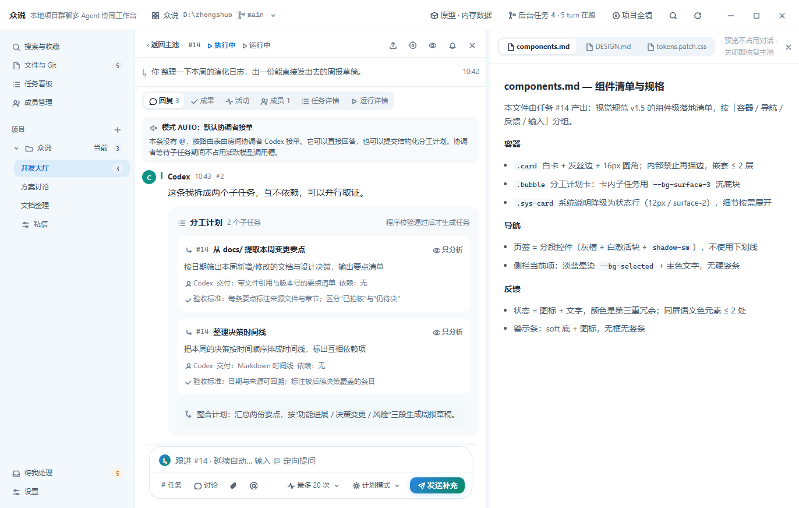

# 众说 · 前端视觉实施规范 v1

> 日期：2026-09-23。状态：**规则现行有效**；施工已完成并实测（见 [施工报告](./dev-briefs/frontend-visual-implementation-result.md)）。
> 本文所有尺寸与配色是可执行的初值，对比度已按 WCAG 公式计算（§2.7）；布局宽度仍须经过 §9 的真实内容验证才算合格。
> 适用对象：`hifi-prototype/`（React + TS，样式层 `src/styles/tokens.css` / `base.css` / `components.css` / `titlebar.css` / `preview.css`）。本次只定义"长什么样"，**不改变任何交互行为**。
> 行为权威：[开发设计报告](./zhongshuo-development-design-v1.md) §17.1 / §17.7 / §17.8 / §17.9；共享预览细则：[交互规格 v1.2](./zhongshuo-workspace-preview-interaction-v1.md)；施工衔接：[原型施工说明](./dev-briefs/prototype-workspace-preview.md)。本文与它们冲突时，以交互基线为准，本文自动失效于冲突点。
> 本文只保留**一套**当前有效规则。`docs/zhongshuo-visual-design-spec-v1.md`（v1.5）是历史参考，与本文不一致处以本文为准（已知过时点见 §1.4）。
> 施工纪律：组件样式只允许使用本文列出的令牌，禁止新增十六进制色值与魔法数字；确需新值时先加进 `tokens.css` 并在本文 §2 登记。

---

## 1. 风格定义与参考基准

### 1.1 一句话风格

**干净、明亮、清爽的桌面工作台**：白底为主、浅蓝白分区、发丝级边框、文字灰度分层；色彩强调是"浅蓝→浅绿渐变 + 蓝色文字图标"（选中态与主按钮同族）和"深色渐变品牌标识/浮层操作"，分工明确。

### 1.2 参考图片（选定基准）

- 选中态直接依据：
  `design-assets/visual-implementation-v1/approved-selected-gradient.png`（110×40 取样截图）。已逐像素解析核对：白底页面上一个圆角条目，内部为浅蓝（左缘 ≈ `#e9f0fc`）到浅绿（右缘 ≈ `#eaf9f5`）的对角渐变，条目内的图标/文字为 `#1d4ed8`。**实现选中态时对照此图验收，不得重新猜配色。**
- 整体氛围参考：
  `design-assets/visual-implementation-v1/kimi-clean-layout-reference.png`（1372×872 整页截图）。已逐像素核对：侧栏 `#f2f8fb`、主区/卡片/标题栏纯白。它只提供"明亮干净"的氛围与分区关系，**不要求照抄其布局结构**（其 52px 顶栏、页面结构是 web 稿，桌面端不采用）。

### 1.3 取值来源（都已确认存在并已读取）

| 来源 | 取用内容 | 不取什么 |
|---|---|---|
| `design-shootout/hy4-fixed.html` | **只取**用户确认的浅渐变选中态 `--grad-soft`、`--accent-text #1d4ed8`，以及深色主按钮渐变 `--grad` 的端点思路 | 不照搬其整套令牌、布局与组件结构 |
| `design-shootout/_src/theme-kimi.css` + `design-shootout/kimi.html` | 背景分区（`#f2f8fb` 侧栏 / 白主区）、文字灰度、发丝边框、间距与排版骨架、圆形头像、分段控件形态 | 其 52px 顶栏、全面胶囊化、`#6b7c8f` 三级文字（对比度不足，见 §2.7）、kimi-preview 的"预览必须收主池"行为（已被 §17.9 取代） |
| `hifi-prototype/src/styles/`（现状） | 语义色三件套、成员深色板、深色主题骨架、组件类名与结构 | 现状的冷灰中性底 `#eef0f4`、纯蓝扁平选中态 |
| `docs/zhongshuo-visual-design-spec-v1.md` | 设计原则（面差分层、文字+图标成对、76 字符行宽、嵌套上限 2 层） | 见 §1.4 过时清单 |

### 1.4 禁止照搬的旧方案特征

1. **Mimo 方案整体禁用**：窄长灰色开发大厅、回复串大面积无效留白、暗淡灰绿配色，一律不得作为视觉基底。开发大厅必须明亮、与回复串协调，空间围绕内容分配。
2. **v1.3 靛紫路线**（`#5b54e0` 主色、蓝紫渐变）已废止，不得复活。
3. **v1.4 全面胶囊化**（按钮/页签/导航行一律 `--r-full`）已被 v1.5 撤回，但**不反向禁止**：按钮保持 `--r-md`；选中项（房间项、内容页签、文件标签）允许 `--r-md` 或 `--r-full`，同一组件组内统一一种（§3.3、§5.5）。
4. **下划线 Tab** 已废止。内容页签改为"白底环境 + 浅渐变独立圆润选中项"（§5.5）；现状 `components.css` 的 `.thread-tab` 仍是下划线式，本次要改（见 §8 第 3 步）。
5. **旧视觉规范 v1.5 的以下条目过时**：§2.1 `--bg-app` 取 `#f2f8fb` 但用途写"主区不用它"——本文改为侧栏/分区专用；§5.6 "侧栏 `--bg-surface` 底 + `--bg-selected` 平色选中"——本文改为 `--bg-app` 底 + 渐变选中；§2.3 `--text-3 #6b7c8f`、`--text-4 #9aa9ba`——对比度不达标，本文替换（§2.3）。
6. **hy4 / kimi 静态稿的行为层一律不取**：固定视口断点、"只在线程预览"、Esc 关闭预览等已由 §17.9 与交互规格 v1.2 替代；视觉施工不得把这些行为带回 `hifi-prototype`。

---

## 2. 颜色令牌

### 2.0 两条渐变，分工唯一

```css
/* 轻强调与主按钮：浅蓝→浅绿透明渐变，叠主题 --bg-surface，配蓝色文字与图标。
   直接依据 approved-selected-gradient.png，不得改端点、改方向或加第三色。
   选中态（导航项、内容页签、文件标签）与主按钮（发送、新建等主操作）同族，
   靠形状与边框区分"位置选中"与"可点操作"。 */
--grad-soft: linear-gradient(135deg,
  rgba(37, 99, 235, .10) 0%,
  rgba(52, 211, 153, .10) 100%);

/* 品牌标识与浮层操作（"有新回复"pill）专用：深蓝→青渐变，白字。
   永不用于选中态、页签、列表行、主按钮。 */
--grad: linear-gradient(135deg, #2678c7 0%, #1c7ea6 55%, #0e856a 100%);
```

**叠加底色说明（必须理解）**：`--grad-soft` 是 10% 透明渐变，最终观感由下面的底色决定。用户认可的观感是 `approved-selected-gradient.png` 里**白底环境**下的浅蓝绿选中项，因此规则定为：**选中项一律以当前主题的 `--bg-surface` 垫底**（浅色主题下即白色、观感对齐基准图；深色主题下为深色表面 `#151a22`，见 §2.8；**任何主题都禁止硬编码白色**）——

```css
background: var(--grad-soft), var(--bg-surface); /* 渐变叠白，任何面板上观感都等于基准图 */
```

这样无论选中项位于白主区、`#f2f8fb` 侧栏还是 `#f7fafc` 次级面板，呈现都与基准图一致（合成 ≈ `#e9effd → #ebfbf5`）。禁止把 `--grad-soft` 直接垫在 `--bg-surface-3` 灰槽或语义色 soft 底（如 `--warning-soft`）上——那会混色、偏离基准图。注意 `--grad-soft` 是 CSS image，只能用于 `background`（或 `background-image`），不能赋给 `background-color`。

### 2.1 中性面（浅色）

| 令牌 | 值 | 用途 |
|---|---|---|
| `--bg-app` | `#f2f8fb` | **侧栏与分区底色**（浅蓝白，来自 Kimi 参考图实测值）；主内容区不用它 |
| `--bg-surface` | `#ffffff` | 主内容面：主池、回复串、预览区、卡片、标题栏（全场最亮） |
| `--bg-surface-2` | `#f7fafc` | 次级面：状态行、回复串面板底、嵌套块 |
| `--bg-surface-3` | `#eef4f7` | 三级面：分段控件槽、系统卡底 |
| `--bg-sunken` | `#f3f8fa` | 凹陷底：代码块、引用块 |
| `--bg-hover` | `rgba(31,60,90,.05)` | 悬停（可叠于任何中性面） |
| `--bg-active` | `rgba(31,60,90,.09)` | 按下、当前项目上下文浅底 |
| `--bg-scrim` | `rgba(20,35,50,.40)` | 遮罩 |

层级原则：**面差分层优先于描边**。侧栏（`#f2f8fb`）与主区（白）靠底色分区，不靠粗边框。开发大厅（主池）用白底 + 白卡 + 发丝边，与回复串的 `--bg-surface-2` 底形成轻区分——两栏都明亮，不出现灰色夹层。

### 2.2 边框（三级，不混用）

| 令牌 | 浅色 | 用途 |
|---|---|---|
| `--border-subtle` | `#e9f0f4` | 面板分隔线、表格行线、卡内分隔 |
| `--border` | `#dde7ee` | 卡片/面板默认描边、浮层 |
| `--border-strong` | `#c6d5df` | 输入框等需要可感知边界的交互控件 |

静态卡片只用 `--border` 一档描边，不叠阴影；卡片内部元素不再描边（嵌套上限 2 层，内嵌块用底色差）。

### 2.3 文字（四级灰度）

| 令牌 | 浅色 | 用途与限制 |
|---|---|---|
| `--text` | `#1e2a38` | 标题、正文 |
| `--text-2` | `#47586b` | 次级正文、摘要 |
| `--text-3` | `#626b75` | 辅助说明、placeholder、标签文字，以及**一切需要阅读的元信息**（时间、行号、版本、路径、错误原因、状态、文件名）。**注意：不是 theme-kimi 的 `#6b7c8f`**——后者白底对比仅 4.28:1 不达标，本值 5.41:1（§2.7） |
| `--text-4` | `#7d8b9d` | **仅用于纯装饰元素**（水印、示意性图形、原型标注）**与真正禁用的控件**；任何需要阅读的文字不得以"弱提示"为由用到这一级 |

### 2.4 主色与选中态

| 令牌 | 浅色 | 用途 |
|---|---|---|
| `--accent` | `#2563eb` | 链接、聚焦环、图标强调、未读徽标 |
| `--accent-hover` | `#1d4ed8` | 链接/主按钮悬停 |
| `--accent-soft` | `#e8effd` | 未读徽标底、引用 chip 底 |
| `--accent-border` | `#b9cdfb` | 引用 chip 描边、hover 提示边 |
| `--accent-text` | `#1d4ed8` | **选中态文字与图标色**（配 `--grad-soft`）、选中房间名、激活标签文字 |
| `--grad-soft` | 见 §2.0 | **轻强调背景**：选中态（侧栏当前项、选中页签、文档标签、文件引用 chip）与主按钮 |
| `--grad` | 见 §2.0 | **品牌标识与浮层操作（"有新回复"pill）专用** |

**着色纪律（按组件组与面积控制，不设全屏绝对配额）**：

1. **每个导航组或页签组同一时刻只有一个激活项**着主色（渐变底 + `--accent-text`）；同组其余项保持中性。
2. **大面积底色保持中性**：页面背景、面板、卡片不染蓝绿；蓝绿只出现在选中项、链接、未读徽标、引用 chip 与主按钮上。
3. **深色主按钮按操作区域收敛**：一个操作区（如一个输入区、一个对话框底部）最多一个 `--grad` 主按钮，其余用次按钮/幽灵按钮。
4. 房间名规则统一为：**激活房间的名称可以用 `--accent-text`，非激活房间名一律中性墨色**；任务号、正文、标题永远中性。
5. 成员识别色（§2.6）不参与上述约束，但只许出现在头像与归属条。

### 2.5 语义状态（文字 + 图标成对，§17.5）

| 组 | 主值 | `-soft` 底 | `-border` | 用途 |
|---|---|---|---|---|
| `--info` | `#2563eb` | `#e8effd` | `#b9cdfb` | 信息提示、执行中 |
| `--success` | `#067647` | `#e6f6ee` | `#a6e0c4` | 完成、验证通过 |
| `--warning` | `#b54708` | `#fdf3e6` | `#f2ce9a` | 排队、待验收、预算告警 |
| `--danger` | `#b42318` | `#fdecea` | `#f3b4ad` | 失败、停止、破坏性操作 |
| `--neutral` | `#475467` | `#eef0f4` | `#d5d9e2` | 无状态标签（讨论、草稿） |

三件套必须一起用；危险操作按钮用 `--danger` 实底白字，警示条用 `soft` 底 + 图标，不闪烁。

### 2.6 成员识别色（不表示状态）

| 令牌 | 浅色 | 深色 | 成员 |
|---|---|---|---|
| `--m-codex` | `#0f766e` | `#2dd4bf` | Codex |
| `--m-claude` | `#7c3aed` | `#c4a2ff` | Claude |
| `--m-codex2` | `#b45309` | `#fbbf24` | Codex #2 |
| `--m-human` | `#c2410c` | `#fb923c` | 人类 |

只允许出现在：圆形头像底色、消息作者名左侧的 3px 归属条。禁止用于背景块、按钮、状态标签。浅色头像一律白字（四色对白字 ≥5.0:1，见 §2.7）；**深色主题下头像字母改用深字 `#0b0d10`**（亮成员色上白字仅 1.86:1，深字 ≥9.2:1）。人类识别色从现状的 `#2563eb`（与主色撞色）改为珊瑚橙 `#c2410c`。

### 2.7 关键前景/背景组合对比度（WCAG 2.1 公式实算）

浅色主题（AA 正文门槛 4.5:1，大字/图形 3:1）：

| 组合 | 对比度 | 判定 |
|---|---|---|
| `--text` on `--bg-surface` / `--bg-app` / `--bg-surface-2` | 14.55 / 13.57 / 13.88 | ✅ |
| `--text` on 选中渐变中段（≈`#e9f5f9`） | 13.09 | ✅ 选中条目内正文可读 |
| `--text-2` on 白 / `#f2f8fb` | 7.30 / 6.81 | ✅ |
| `--text-3 #626b75` on 白 / `#f2f8fb` / `#f7fafc` | 5.41 / 5.05 / 5.16 | ✅ |
| `--text-4 #7d8b9d` on 白 / `#f2f8fb` | 3.47 / 3.24 | ⚠️ 仅装饰/禁用控件，不承载阅读内容（§2.3） |
| `--accent-text #1d4ed8` on 白 | 6.70 | ✅ |
| `--accent-text` on 选中渐变（主题 `--bg-surface` 垫底合成 `#e9effd` / `#ebfbf5`，全局面板统一此观感，§2.0） | 5.82 / 6.27 | ✅ |
| `--accent #2563eb` 链接 on 白 | 5.17 | ✅ |
| `--accent-text` on `--grad-soft` 合成底 `#e9effd` / `#ebfbf5`（选中项与主按钮同族） | 5.82 / 6.27 | ✅ |
| `--success` / `--warning` / `--danger` on 各自 `-soft` | 5.09 / 4.95 / 5.75 | ✅ |
| 白字 on 成员色 `#0f766e` / `#7c3aed` / `#b45309` / `#c2410c` | 5.47 / 5.70 / 5.02 / 5.18 | ✅ 头像 |

深色主题：

| 组合 | 对比度 | 判定 |
|---|---|---|
| `--text #e8ecf2` / `--text-2 #b3bccb` on `--bg-surface #151a22` | 14.73 / 9.12 | ✅ |
| `--text-3 #8b95a5` / `--text-4 #6b7484` on `#151a22` | 5.77 / 3.71 | ✅ / ⚠️ text-4 同浅色限制（仅装饰/禁用） |
| 深色 `--accent-text #93c5fd` on `#151a22` | 10.49（`#93bcff` 9.80） | ✅ |
| `#93c5fd` on 深色选中渐变合成（`#213045` / `#233b3a`） | 7.40 / 6.62 | ✅ |
| 深字 `#0b0d10` on 深色 `--grad` 端点 `#60a5fa` / `#2dd4bf` / `#6ee7b7` | 7.65 / 10.45 / 12.77 | ✅ 深色标识/pill 用深字 |
| 深字 `#0b0d10` on 深色成员色 `#2dd4bf` / `#c4a2ff` / `#fbbf24` | 10.45 / 9.23 / 11.66 | ✅ 深色头像用深字 |

### 2.8 深色主题映射

沿用现状深色骨架（`--bg-app #0d1117`、`--bg-surface #151a22` 等不变），只替换/新增：

| 令牌 | 深色值 |
|---|---|
| `--grad-soft` | `linear-gradient(135deg, rgba(96,165,250,.16), rgba(110,231,183,.16))` |
| `--grad` | `linear-gradient(135deg, #60a5fa, #2dd4bf 55%, #6ee7b7)`，文字 `#0b0d10` |
| `--accent` / `--accent-text` | `#6098ff` / `#93c5fd` |
| `--accent-soft` / `--accent-border` | `rgba(96,152,255,.14)` / `rgba(96,152,255,.36)` |
| 头像字母色 | `#0b0d10`（随主题切换，见 §2.6） |

深色下同样以面板色垫底：`background: var(--grad-soft), var(--bg-surface);`（`#151a22` 垫底），合成 ≈ `#213045 → #233b3a`，任何深色面板上观感一致。

---

## 3. 字体、排版、间距、圆角、阴影、图标

### 3.1 字体与字号

```css
--font: 'Segoe UI', 'Microsoft YaHei UI', 'Microsoft YaHei', system-ui, -apple-system, sans-serif;
--font-mono: 'Cascadia Mono', 'Consolas', 'Sarasa Mono SC', ui-monospace, monospace;
```

| 令牌 | 大小 | 用途 |
|---|---|---|
| `--fs-11` | 11px | 徽标数字（配 `--text-2` 或 `--accent-text`，不单独承担说明文字） |
| `--fs-12` | 12px | 标签、时间戳、元信息（颜色最低 `--text-3`；不作正文） |
| `--fs-13` | 13px | 次级正文、列表行、输入框文字 |
| `--fs-14` | 14px | 任务标题、卡片标题、房间名 |
| `--fs-15` | 15px | **主阅读正文**：回复串消息、报告、文件正文 |
| `--fs-17` | 17px | 页面标题 |
| `--fs-20` / `--fs-24` | 20/24px | 仅空态/引导页 |

字重：正文 400，强调 650，标签/标题 600–650；不用 300 以下细字重（Windows 发虚）。行高：正文 1.65，标题 1.3–1.35，单行控件 1。**任务标题必须可读**：14px/650/1.4，长标题最多两行截断或省略号 + title 悬浮全文，不得压成一行小字。阅读宽度上限 76 字符；数字、任务号、时间用 `font-variant-numeric: tabular-nums`。

### 3.2 间距（4px 基准，只许用令牌）

`--sp-1: 4` `--sp-2: 8` `--sp-3: 12` `--sp-4: 16` `--sp-5: 24`

- 图标与文字：`--sp-1`；控件内 padding：`--sp-1×--sp-2`（紧凑）或 `--sp-2×--sp-3`（常规）
- 卡片内边距：上下 `--sp-4`、左右 `--sp-5`；密集列表行可用 `--sp-3`
- 卡片/区块间距：`--sp-4`；大区块分隔：`--sp-5`
- 空间围绕内容分配：消灭"为了对齐而留"的灰带与大段无信息空白（这是对 Mimo 问题的直接回应）

### 3.3 圆角

| 令牌 | 值 | 用途 |
|---|---|---|
| `--r-xs` | 4px | 代码片、kbd |
| `--r-sm` | 8px | 小按钮、分段控件选项、聚焦环 |
| `--r-md` | 10px | 按钮、输入框、下拉、内嵌块、侧栏行 |
| `--r-lg` | 16px | 卡片、消息相关容器 |
| `--r-xl` | 20px | 输入区（composer）、弹层 |
| `--r-full` | 999px | 头像、徽标、计数 chip；选中项（房间项、内容页签、文件标签）可选 `--r-md` 或 `--r-full`，同一组件组内统一；按钮不胶囊化 |

### 3.4 阴影与聚焦环

| 令牌 | 用途 |
|---|---|
| `--shadow-sm` | `0 1px 2px rgba(30,50,70,.05)`；输入区与分段控件激活块的轻微浮起 |
| `--shadow-md` | `0 6px 16px rgba(30,50,70,.08), 0 1px 4px rgba(30,50,70,.04)`；下拉、popover |
| `--shadow-lg` | `0 16px 44px rgba(30,50,70,.14), 0 3px 10px rgba(30,50,70,.06)`；模态、覆盖面板 |
| `--ring` | `0 0 0 3px rgba(37,99,235,.22)`；聚焦环（深色 `.30`） |
| `--ring-danger` | `0 0 0 3px rgba(180,35,24,.18)` |

静态卡片不用阴影；阴影只表达"浮起来了"。滚动条 10px 常显。

### 3.5 图标

- 线性图标（stroke 1.5，round cap/join），消息内 12–14px、工具按钮 16px 内、侧栏 14px；颜色继承文字色（`currentColor`）。
- 选中条目内图标随文字用 `--accent-text`；语义图标用语义色主值。
- 所有图标按钮必须有可访问名称；状态必须"文字 + 图标"成对（§17.5），颜色只是第三重冗余。

---

## 4. 布局：主池、回复串、共享文件预览

> 行为规则（何时显示哪个区域、关闭恢复、引用目标、草稿隔离）一律以 §17.9 与交互规格 v1.2 为准，本节只给视觉与尺寸。**应用导航之外最多并排两个内容区域**：从主池打开文件保留主池（L3），从线程打开文件保留线程（L4），不把主池、线程、文件挤成三块内容区。

### 4.1 三种内容面的视觉分工

| 区域 | 底色 | 气质 |
|---|---|---|
| 主池（开发大厅） | `--bg-surface` 白 | 明亮、卡片化、可扫读；卡片白底 + `--border` 发丝边 + `--r-lg`，间距 `--sp-4` |
| 回复串 | `--bg-surface-2` | 同样明亮，仅比主池低半档以分栏；消息正文 15px/1.65，气泡感弱、阅读优先 |
| 共享文件预览 | `--bg-surface` 白 | 文档阅读面；正文限宽 76 字符居中偏左，顶部文件栏两行（§5.8） |

三栏之间用 1px `--border-subtle` 竖线 + 6px 分隔条，**禁止灰色夹层**（不用第三种灰把栏位隔开）。

### 4.2 宽度契约（交互基线 vs 候选值）

| 区域 | 值 | 性质 |
|---|---|---|
| 侧栏导航 | 246px | 现状，本轮不改 |
| 标题栏 | 38px | 现状桌面标题栏；**不采用** Kimi 稿的 52px |
| L2 主池最小宽 | **420px（MAIN_MIN，现状常量，不改）** | 交互基线 |
| L2 回复串最小宽 | **380px（THREAD_MIN，现状常量，不改）** | 交互基线 |
| L4 对话/详情候选 | 440px | **待实测**，不替换 L2 的 380 |
| 文件预览候选 | 480px | **待实测** |
| 项目文件/Git 列表候选 | 280px | **待实测** |
| 分隔条 | 6px 热区（视觉 1px 线） | 现状；候选 8px 热区，待实测 |

默认比例：L2 主池约占可用宽 40%；L3/L4 优先给文件约 56%；各自按最小宽钳制；拖动比例按布局模式分别记忆。

### 4.3 宽窄窗口策略（统一降级规则 + 测试样本）

降级顺序（与交互规格 §5.3 一致）：收顶部低频操作 → 钳制分隔比例 → 临时隐藏侧栏 → 单区域切换（对话/文件二选一，选择器在内容顶部）。测量用容器 ResizeObserver，不再只看 `window.innerWidth`。**隐藏侧栏、单区域切换由容器实际可用宽度按这一套统一规则触发；本文不设定"某 px 必须隐藏某区域"的固定触发点**。

下列窗口宽度只是**验收采样点**，不是断点。表中"预期形态"是按候选宽度推算的参考，实际以统一降级规则的结果为准（**数学放得下 ≠ 可读，必须实测**）：

| 窗口（采样点） | 内容可用宽（侧栏 246px 时） | L2 (420+380) | L4 (440+480) | 参考形态 |
|---|---|---|---|---|
| 1600px+ | ≈1354 | 宽裕 | 宽裕 | 双区，比例可拖 |
| 1372px | ≈1126 | ✅ 余 318 | ✅ 余 198 | 双区 |
| 1280px | ≈1034 | ✅ 余 226 | ⚠️ 余 106 | 双区临界，重点实测中文长文/长代码/表格 |
| 1100px | ≈854 | ⚠️ 余 46 | 按候选值不足 | 按统一规则降级（可能是收工具、钳比例或临时隐藏侧栏），内容不裁切即可，不断言必须隐藏哪一块 |
| 900px | ≈654 | 按候选值不足 | 不足 | 继续按同一规则降级直至单区域；验收降级结果而非触发点本身 |

任务标题在任何宽度下保持 ≥14px 且不被压成零宽；发送、引用、返回入口不被裁掉。L2 的 420/380 是既有下限，任何降级结果都不得突破。

---

## 5. 组件规则

### 5.1 侧栏导航

- 底 `--bg-app`，右缘 1px `--border-subtle`；行高 32px（子项 30px），字号 `--fs-13`（子项 12px），圆角 `--r-md`。
- **当前项目（上下文）**：`--bg-active` 浅底，无强调条，文字 `--text` 600。
- **当前页/当前房间（位置）**：主题 `--bg-surface` 垫底渐变选中项（`background: var(--grad-soft), var(--bg-surface)`，观感对齐基准图）+ 左侧 3px `--accent` 竖条 + `--accent-text` 文字 600 + 图标 `--accent-text`；圆角 `--r-md`。两种"当前"样式必须一眼可分（§17.1 缺陷修复）。
- hover `--bg-hover`；未读数字徽标 `--accent-soft` 底 + `--accent-text`，>99 显示 99+。
- 底部"待我处理/设置"固定在视口内，不随项目区滚动。

### 5.2 任务条目（主池原消息卡）

- 白卡 + `--border` + `--r-lg`，内边距 `--sp-2/--sp-3`（紧凑扫读档），hover 描边转 `--border-strong`，无阴影。
- 任务号 `#14`：`--font-mono` `--fs-12` `--text-3`，无容器。
- 任务标题 `--fs-14` 650 `--text`，最多两行；摘要 `--fs-13` `--text-2`；状态标签按 §5.5；回复预览 ≤2 条投影，不与串内重复。
- 有 pending 交付的卡片：验收角标 `--warning` 三件套，文字+图标成对。

### 5.3 消息

- 头像 24px 圆形 + 成员色底（字母色按 §2.6 分主题）；作者名 `--fs-13` 650 + 归属条 3px 成员色 + 时间 `--fs-12` **`--text-3`**（时间戳是可读元信息，不用 `--text-4`）。
- 消息正文 `--fs-15`/1.65/`--text`，限宽 76ch；相邻同作者间距 `--sp-1`，跨作者 `--sp-3`。
- 人类消息可用 `--accent-soft` 底区分"我说的"；agent 消息中性底。
- 流式消息原地更新，光标 2px `--accent` 竖条闪烁（`prefers-reduced-motion` 下降为静态光标，见 §7）；"有新回复" pill = `--grad` 底白字（它是操作按钮，不是选中态）。

### 5.4 分工内容（分工卡/子任务/报告/争议/授权/结果卡）

- 容器降级为 `--bg-surface-2` 无底边 `--r-lg` 块；**子任务卡**为白底 `--r-md` 子卡（"灰容器 + 白子卡"，不再"白卡描边套灰块"）。
- 子任务行：负责人头像 16px + 标题 `--fs-13` 650 + 状态标签；可点击行 hover `--bg-hover`，点击=定向跟进（E3，行为不变）。
- 嵌套上限 2 层。长内容的折叠/展开属于交互行为，**维持现状实现与交互规格，本文不新增"默认折叠三行"之类的强制要求**。

### 5.5 页签与状态标签

- **内容页签（房间视图、线程子视图、文件标签）= 独立圆润选中项**：无灰槽，选项高 26–30px、`--fs-12`、非激活 `--text-3` 透明底（hover `--bg-hover`）；**激活项 = 主题 `--bg-surface` 垫底渐变（`background: var(--grad-soft), var(--bg-surface)`）+ `--accent-text` 600 重**，圆角 `--r-md` 或 `--r-full`（同组统一），观感对照 `approved-selected-gradient.png`。
- **分段控件（`.seg`）= 白底激活块 + `--shadow-sm` + `--text` 600**：槽 `--bg-surface-3` padding 3px `--r-md`；选项高 26px `--r-sm` `--fs-12` `--text-3`；**分段控件内不用渐变**（避免渐变垫灰槽混色，见 §2.0）。**2026-09-25「默认交给 AI」后，输入区不再有「任务/讨论」常驻切换**，`.seg` 只剩两处真实用途：窄布局的「对话/文件」单区域切换器、图片预览的「适应/原尺寸」。**预览的视图切换自 2026-09-24 界面信息减负后也不用分段控件**，改为工具行常驻的「阅读 ▾」按钮 + 菜单（见 §5.7），原因是常驻分段控件占位，且对代码文件是无效选项。
- **状态标签**：图标 + 着色文字，高 20px `--r-full` `--fs-12`；执行中=info、待验收=warning、完成=success、失败=danger、讨论/草稿=neutral，三件套成套。着色按状态真实需要去重：每张卡上的语义色标签表达该卡真实状态即可，不为装饰叠加语义色；任务号永远 neutral。
- 文件引用 chip（消息内）：`--accent-soft` 底 + `--accent-border` 描边 + `--accent-text` mono 文件名；按下/已打开状态改主题 `--bg-surface` 垫底渐变。

### 5.6 双行输入区（composer）

- 外容器 `--r-xl` + `--border` + `--shadow-sm`（全场唯一轻浮起的静态容器），聚焦时描边 `--accent` + `--ring`。
- 输入本体为真实多行 textarea：**默认两行高（54px，房间与回复串输入条等高），随内容增长到 200px 上限后内部滚动**——支持真实多行需求，不把长指令塞进一行胶囊。
- 工具条**收纳策略**（替代硬性"单行不换行"）：常驻可见的只有三样——目标标签（**2026-09-25 起输入区上方不再有常驻行，此项简化为输入框自身的 placeholder 语义**）、附件/提及入口、发送按钮；「方式」芯片、权限档位、附件等低频项在空间不足时，其**操作入口**可依次收入溢出菜单（"···"），菜单内保持完整可用。**收纳只藏操作入口、不藏当前状态**：发送目标、当前执行方式与权限档位的有效值，发送前仍须在工具条以紧凑摘要可辨认，不得仅存在于菜单内，也不得因收纳而改变当前值；具体展示遵循现有交互基线（开发报告 §9.6）。是否换行由实现按容器宽度决定，本文不作强制单行要求。权限档位按实际能力显示、未验证档位置灰（视觉不画锁/盾）；发送按钮在尾端，**主按钮 = `--grad` 深渐变 + 白字**。
- **发送/停止位置稳定（2026-09-24 减负第二轮）**：预算提示、停止、本次运行设置、权限档位、发送组成一个 **`.composer-actions` 右侧操作簇**（`flex: none` + `margin-left: auto`，内部 `nowrap`）。工具条仍可换行，但换行以**整簇**为单位：并排预览把工具条压窄时，不会出现"只剩发送按钮掉到第二排"。左半边的方式芯片、附件、@ 先让位（原「任务/讨论」分段已于 2026-09-25 移除）。
- **发送按钮文案**：任务与线程统一「发送」（2026-09-24 第三轮：原先线程写「发送补充」，用户要求两个字即可）；**历史记录串与选择了「仅记录，不请求回复」时写「保存记录」**（2026-09-25 起，替代原来的「写入」）—— 它只保存内容、不调用模型、不派工，必须与"发给 AI"在文案上区分。按钮仍是 `--grad` 深渐变 + 白字，位置在操作簇尾端。
- **「仅记录」标记（2026-09-25）**：选择后输入框上方出现一枚可取消的 chip（虚线边、中性色，与 @／附件的实线强调色区分），文案「仅记录 · 不请求回复」+ ✕；同一时刻隐藏权限档位、预算与方式开关（与本次无关的模型执行配置），但**档位的值不变**。保存成功后自动消失。
- **输入区不写教学文字、也不再有身份摘要行**（2026-09-24 减负第二/三轮）：输入框上方保持空白（`.composer-target-line` 不再渲染），不出现"点击查看完整任务信息""新任务会在这里形成一张原消息卡"，也不出现 `发布到 开发大厅` / `跟进 #N · 标题` 这类摘要行；身份由房间头部、placeholder 与「详情 → 任务概况」承担。归档只读房间保留一行只读说明（禁用原因）。写入占用正常态只留一行事实，策略解释进 tooltip。
- **菜单项名称保持简短**（同上）：名称 ≤ 8 字，当前状态放行尾 `.hint`（如「已静音」），"点了会发生什么"进 `title` tooltip；每个菜单项都必须有解释 tooltip（`MenuItem` 的 `title` 属性）。
- **内部标识收进「技术信息」折叠区**（2026-09-24 第四轮）：`thread ID`、`taskRevision`、`runId`、`rosterRevision`、原始阶段枚举等放在卡片底部的 `<details class="kv-tech">`（`--fs-11` `--text-3`、`▸/▾` 指示、无边框），默认收起。产品正文只出现产品级信息（如「阶段 = 分歧讨论 · 第 3 轮」）。**产品界面正文不出现规范章节号**（`§x.y`、`v1.x`）；解释统一进 tooltip，诊断明细与验证表里的测试编号属技术信息可以保留。
- 目标标签（"→ 子任务 #n"）在输入框上沿，`--accent-soft` 底 + `--accent-text`；草稿提示 `--fs-11` `--text-3`。

### 5.7 文件标签与版本栏（共享预览顶部）

```text
[收起预览] [components.md v3 ×] [DESIGN.md v2 ×] [已打开 ▾] [还原]
交付 v3 ▾   [阅读：阅读 ▾] [引用到 #14] [···]
来源：开发大厅 › #14 › Codex 的成果 ↗
```

注：第一行只列文件标签与预览区操作——**区域级「收起/返回」在左端**（2026-09-24 后续统一：与回复串的收起同侧、同一个组件 `.panel-nav-btn`：透明底 + 图标 + 短文案，`--fs-12` `--text-3`，hover `--bg-hover` + `--text`，`--r-md`，窄布局隐藏 `.panel-nav-label` 只留图标并保留可访问名称）；「放大」已进第二行「⋯」菜单，放大后本行出现带文字的「还原」按钮（`.preview-restore`）；「已打开 ▾」只在标签溢出或有暂藏资源时出现。单区域布局下同一位是「对话」（`.panel-nav-btn preview-nav-back`），「收起预览」在文件 ⋯ 菜单里可达。

- 第一行文件标签：固定单行、超出横向滚动 +「已打开」列表（「已打开 ▾」入口只在标签溢出或有暂藏资源时出现）；**激活标签 = `--grad-soft` + `--accent-text`**，非激活 `--text-3`；同名文件用最短可区分父路径，不同版本带明确后缀（v3/v4），不只靠颜色区分。
- 第二行文件工具行：**不再重复「目录 / 文件名」路径**（文件名只在标签上一次，完整路径在「⋯ → 文件信息」）；**也不再重复版本**（2026-09-24 减负第二轮去重：版本只在标签上显示一次，口径统一为 `v3` / `读取 r3`，工具行只留"磁盘已更新 · 重新加载"这类需要动作的东西）；阅读方式入口是工具行常驻的 `阅读视图 / 源码视图 ▾` 按钮（`.preview-read`，`--fs-12` `--text-2`，**只写一次模式名**，不再出现"阅读：阅读"；展开/激活时 `--accent-border` + `--accent-text`），切换动作在菜单内完成，菜单项名称简短、解释进 tooltip；「引用到 X」目标文字 `--fs-12` `--text-2`，目标名 `--accent-text`（原规格不变）。
- 来源行同行去重（同上）：归属与"从哪打开"指向同一处时只写一次（`来源：开发大厅 › #14 … · 模拟资源`），跨房间/跨会话时才追加「从 … 打开」。
- 来源行：`--fs-12` `--text-3` 单行可折叠；无任务附件显示「开发大厅 · 某人的消息」，工作区文件显示「项目工作区 · 读取于 HH:MM」，不伪造来源。
- 版本更新提示（"有 v4"/"磁盘已更新"）：`--info` 三件套横条，文字+图标，不抢正文。

### 5.8 主按钮与其他按钮

| 类型 | 规格 |
|---|---|
| 主按钮 | `--grad-soft` + `--bg-surface` 垫底 + `--accent-text` 600 + `--accent-border` 描边 + `--r-md`，高 32px（工具区 28px）；hover `brightness(0.97)`；**禁用态 `filter: saturate(0.45)` 去饱和可辨认（不用透明度），原因常驻或见 title**；深色下同族（深色 `--grad-soft` + `#93c5fd`） |
| 次按钮 | 白底 + `--border-strong` + `--text` |
| 幽灵按钮 | 无底无框，hover `--bg-hover` |
| 危险按钮 | `--danger` 实底白字；低危警示用 danger 幽灵 |

`--grad` 与 `--grad-soft` 分工：深渐变只给品牌标识与"有新回复"pill；浅渐变给选中态与主按钮（用户指定，两者靠形状与边框区分"位置选中"与"可点操作"）。

### 5.9 标题栏（桌面 38px，不改高度）

- 底从 `--bg-surface-2` 提亮为 `--bg-surface` 白 + 底部 1px `--border-subtle`（对齐 Kimi 参考的明亮感）。
- 品牌字 `--fs-12` 700；项目入口、运行统计为幽灵按钮；窗口三键 hover `--bg-hover`，关闭键 hover `--danger` 白字。
- 品牌标识方块可用 `--grad` 底白字（这是 `--grad` 除主按钮外唯一的合法去处）。

---

## 6. Markdown 阅读/源码与文件信息展示

1. **阅读方式菜单**：Markdown/CSV 默认阅读视图；代码/纯文本默认且只有代码视图（菜单如实说明当前可用项，不提供无效选项）。入口是工具行常驻的「阅读 ▾」按钮（按钮上写明当前模式「阅读」或「源码」；展开/激活时 `--accent-border` + `--accent-text`），菜单项含阅读视图 / 源码视图 / 自动换行（并标出当前项）。源码视图等宽字体 + 行号（行号 `--text-3`，行号也是可读文字，不用 `--text-4`）+ 自动换行开关（自动换行现在是真实开关，开启时 `.preview-source.wrap` 用 `white-space: pre-wrap`）；渲染视图 `--fs-15`/1.65、标题分级（h1 `--fs-17`/h2 `--fs-14`）、代码片 `--bg-sunken` `--r-xs`、代码块 `--bg-sunken` `--r-md` mono 12px。原始 HTML 不执行（§16.2 行为不变）。
2. **来源与版本默认一行**：`来源：开发大厅 › #14 › Codex · 交付 v3` 或 `项目工作区 · 读取于 17:30`；hash、文件大小、完整路径、多个引用来源收进「文件信息」展开区（kv 列表，mono 10.5–12px），**默认信息简洁、详细状态按需展开**。
3. **三类版本不混称"最新版"**：成果/附件 = 固定版本标签（`交付 v3`）；工作区文件 = `当前文件 · 读取于 HH:MM`；Git 比较 = 逐侧注明 commit/base/ours/theirs。版本不可用时显示原因，不用同名当前文件顶替。
4. **错误与状态态**：加载中显示文件名 + 阶段文字（不用永久骨架冒充内容）；失败/无权限/缺失/版本缺失/过大/已变化分别用 §7 的 error 态，保留文件名与下载/重试入口。
5. **评论与引用**：评论默认作为预览内可切换工具视图（不新增常驻右栏）；旧版本评论标"基于 v3"；引用卡显示文件名、版本、摘录、来源与移除按钮。

---

## 7. 组件状态与深色映射

| 状态 | 浅色规则 | 深色规则 |
|---|---|---|
| hover | `--bg-hover`（可点文字转 `--text`）；卡片 hover 描边加深 | 同名令牌（深色值） |
| focus-visible | 2px `--accent` outline 或 `--ring`，所有可聚焦元素可见 | 透明度提高到 .30 |
| selected | **独立导航项、内容页签、文件标签：`--grad-soft` + `--bg-surface` 垫底 + `--accent-text` 文字/图标 600**；侧栏另加 3px `--accent` 左竖条。**分段控件（`.seg`：单区域切换器、图片缩放的适应/原尺寸）不套用本行**，按 §5.5 执行（白底激活块 + `--shadow-sm` + `--text` 600，不用渐变）；不得用全局 `.selected` 类把分段控件也染成渐变。新增的详情分组 chip（`.details-chip`）与预览工具行「阅读 ▾」按钮（`.preview-read`）的选中态**属于独立选中项**，按 `--grad-soft` + `--accent-text` 处理 | `--grad-soft`（深色版）+ `#93c5fd`；分段控件同样不适用 |
| disabled | 通用控件：透明度 0.5 + `not-allowed`；**主按钮例外**：`filter: saturate(0.45)` 去饱和（§5.8），结构性禁用原因在输入区常驻 `--warning` 提示，其余原因见按钮 title；未验证权限档位额外给原因说明 | 同 |
| loading | 文件名/标题 + 阶段文字 + 轻量骨架（`--bg-surface-3`）；流式光标原地更新；不阻塞左侧输入。**持续动效（骨架脉动、光标闪烁）在 `prefers-reduced-motion` 下降为静态** | 同 |
| empty | 居中 `--text-4` 图标 + `--empty-title`（`--text-2`）+ 说明 + 一个主操作；不插画 | 同 |
| error | `--danger` 三件套 + 错误码 mono + 可执行的恢复入口（重试/重定位/重新登录）；不用同名内容顶替 | 同 |
| 警告/降级 | `--warning` 三件套横条（如并行写入风险、目录失效），不闪烁不自动消失 | 同 |

深浅主题经 `:root[data-theme]` 整组切换令牌，组件不感知主题；浅色是本次主方向，深色只需保证以上映射成立、抽检一条主流程。

---

## 8. 对 hifi-prototype 的改动映射与施工顺序

> 目标是在现有组件上换肤，**不另写脱离组件的静态样例当最终实现**。以下按文件列出改动点；行为逻辑（useNarrow/useThreadWidth/MAIN_MIN=420/THREAD_MIN=380/草稿/路由）一律不动。

### 第 1 步：`src/styles/tokens.css`（地基）

- 浅色中性面整组替换：`--bg-app #eef0f4→#f2f8fb`、`--bg-surface-2 #f7f8fa→#f7fafc`、`--bg-surface-3 #eff1f5→#eef4f7`、`--bg-sunken #f3f4f7→#f3f8fa`、`--bg-hover/active` 改为 `rgba(31,60,90,.05/.09)`；`--border #e2e5ec→#dde7ee`、`--border-strong #cdd2dc→#c6d5df`、`--border-subtle #eceef3→#e9f0f4`。
- 文字：`--text #101828→#1e2a38`、`--text-2 #475467→#47586b`、`--text-3 #667085→#626b75`、`--text-4 #98a2b3→#7d8b9d`。
- 主色：`--accent-text #1b4bd0→#1d4ed8`；**新增 `--grad-soft` 与 `--grad`**（§2.0）；`--accent-soft #e8efff→#e8effd`。**`--bg-selected` 本步不删**——保留定义作兼容，逐处迁移与最终删除见第 3 步后的专项。
- 成员色：`--m-human #2563eb→#c2410c`（其余三色已是达标深色板，不动）；深色 `--m-human → #fb923c`。
- 圆角刻度上移：`--r-sm 6→8`、`--r-md 8→10`、`--r-lg 12→16`、`--r-xl 16→20`（全局生效，是本次最大杠杆，改完必须全页面走查）。
- 阴影换 Kimi 配方（§3.4），`--ring` 不变。
- 深色组：加 `--grad-soft`、`--grad` 深色版，`--accent-text #93bcff→#93c5fd`；新增头像字母色令牌（如 `--avatar-fg: #fff`，深色 `#0b0d10`）。

### 第 2 步：`src/styles/base.css`

- `.sidebar` 背景 `var(--bg-surface-2)` → `var(--bg-app)`；`.sidebar-foot` 同步。
- `.side-item.active`：`background: var(--bg-selected)` → `background: var(--grad-soft), var(--bg-surface)`（主题 `--bg-surface` 垫底渐变，§2.0）；左竖条保持 `var(--accent)`；文字已是 `--accent-text`。`.side-heading-link.on`、`.icon-btn.active` 同步。
- `.side-item.context-active` 保持 `--bg-hover`/`--bg-active` 浅底无竖条（上下文≠位置）。
- `.btn.primary`：改浅蓝绿渐变主按钮（`background-color: var(--bg-surface)` + `background-image: var(--grad-soft)` + `color: var(--accent-text)` + `--accent-border` 描边，600 字重）；hover `brightness(0.97)`；禁用态保持 `opacity: 1`；深色下同族，无需单独覆盖。
- `.brand-mark` 渐变 → `var(--grad)`。
- `.seg button.on`（**2026-09-25 后仍在用 `.seg` 的是单区域切换器与图片缩放的适应/原尺寸**）：保持白底 + `--shadow-sm`，文字确认 `--text` 600（分段控件内**不用渐变**，与 §5.5 一致——渐变只给独立选中项，避免垫在 `--bg-surface-3` 槽上混色）。新增的详情分组 chip（`.details-chip`）与预览工具行「阅读 ▾」按钮（`.preview-read`）的选中态**属于独立选中项**，按 `--grad-soft` + `--accent-text` 处理，不适用本条。
- `.tag.accent` 等三件套随令牌自动更新，无需改类。
- `.avatar` 字母色改 `var(--avatar-fg)`。

### 第 3 步：`src/styles/components.css`

- `.composer`：`.composer-box` 圆角 `var(--r-md)` → `var(--r-xl)`，加 `box-shadow: var(--shadow-sm)`；`.composer-input` 保持两行默认高（54px）与 200px 上限（已是多行，确认 auto-grow 行为不受视觉改动影响）；发送按钮随 `.btn.primary` 变 `--grad`。
- `.thread-tabs/.thread-tab`：**下划线式改独立圆润选中项**（对齐 §5.5 内容页签）——`.thread-tabs` 去掉底边框与 `margin-bottom:-1px`，**不套 `--bg-surface-3` 灰槽**；`.thread-tab.on` 改主题 `--bg-surface` 垫底渐变（`background: var(--grad-soft), var(--bg-surface)`）+ `--accent-text` 600 + 去 `border-bottom`，圆角 `--r-md` 或 `--r-full`（与文件标签同组统一）。
- `.root-card`：保持白卡发丝边；选中/展开中的卡片如需强调，只允许 `--grad-soft` 底，不加阴影。
- `.new-msg-pill`：`background: var(--accent)` → `var(--grad)`。
- `.msg-card`/`.subtask-row`：分工卡改"灰容器（`--bg-surface-2` 无底边）+ 白子卡"；归属条已是成员色，确认圆角 `--r-full` 3px。
- 文件相关（`.file-row` 选中、`.git-file-row`、`.file-preview` 头）：选中行 → `--grad-soft` + `--accent-text`。
- `.sys-card` 保持降级状态行样式；`.lock-hint` 等警示用 `--warning` 三件套。
- `preview.css`（**已存在，明确纳入本次施工范围**）：`.preview-tab.on` 现为 `--accent-soft` 平色底 + `--accent-border` 描边，改为主题 `--bg-surface` 垫底渐变（`background: var(--grad-soft), var(--bg-surface)`）+ `--accent-text`，对齐 §5.7 文件标签选中态；其对 `--accent-soft` / `--accent-border` / `--accent-text` 的其余消费随令牌自动更新，不新增色值。

#### `--bg-selected` 迁移专项（随第 2/3 步逐处替换，零引用后才删定义）

现状共 6 处引用（行号以施工时实际为准）：`base.css` 的 `.side-heading-link.on`（≈466）、`.side-item.active`（≈505）、`.icon-btn.active`（≈838）；`components.css` 的 `.file-row.on`（≈184）、`.settings-nav-item.on`（≈744）、`.dm-row.on`（≈976）。六处全部是"选中态"，统一替换为主题 `--bg-surface` 垫底渐变 `background: var(--grad-soft), var(--bg-surface);` + `--accent-text`（§2.0）。注意 `--grad-soft` 是 CSS image，只能用于 `background` / `background-image`，**不能赋给 `background-color`**，替换时逐处确认目标属性支持图像值。全部替换完成后 grep 确认零引用，才删除 `tokens.css` 两处定义（浅色 ≈19、深色 ≈112）。

### 第 4 步：`src/styles/titlebar.css`

- `.titlebar` 背景 → `var(--bg-surface)`，底边 `var(--border)` → `var(--border-subtle)`；高度 38px 不动；其余结构不动。

### 第 5 步：TSX 触点（仅加/换类名与文案级调整，不改行为）

- `src/pages/Room.tsx`：不碰 `MAIN_MIN/THREAD_MIN/useNarrow/useThreadWidth`。检查项：`.thread-tab` 改为独立圆润选中项后 DOM 结构是否仍成立；房间列表选中类 `.side-item.active` 已在用，无需新增；L3/L4 预览相关类（施工说明落地后）选中态统一消费 `--grad-soft`。
- `src/pages/pages-misc.tsx`：文件与 Git 页的文件树选中行；ArtifactPage 的预览阅读方式改用 `.preview-read` 按钮 + 菜单（不再使用 `.seg`），版本/来源行按 §5.7/§6 排版；不改动 Git 操作与验收逻辑。
- 若发现组件内联样式写死色值（`style={{color:'#…'}}`），一并收编到令牌。

### 施工顺序

1. tokens.css → 全局截图走查（圆角与底色整组变化）。
2. base.css → 侧栏/按钮/分段控件选中态对照 `approved-selected-gradient.png` 目检。
3. components.css + preview.css → composer、thread-tabs、分工卡、文件行、预览文件标签选中态。
4. titlebar.css。
5. TSX 触点 + 内联色值收编；grep 确认 `--bg-selected` 零引用后，删除 `tokens.css` 两处定义。
6. 深色主题抽检 + §9 全量验收。

---

## 9. 可执行验收清单

> 全部通过后才可以宣称本视觉方案落地。尺寸候选值未通过实测前保持"待实测"标注。

### 9.1 窗口尺寸（100% 缩放，再抽 125%/150% 各一条主流程）

- [ ] **1372px**：L2 主池+回复串、L3 主池+文件、L4 线程+文件三种组合截图；侧栏 246px 完整可见，底部"待我处理/设置"不被推出视口。
- [ ] **1280px**：L4 下中文长文、长代码行、Markdown 表格可读；任务标题不被压窄；发送/引用/收起入口完整。
- [ ] **1100px**（采样点，非固定断点）：按 §4.3 统一规则降级（收工具/钳比例/临时隐藏侧栏，以容器实际可用宽度为准，不强制本宽度必须隐藏某区域）；标题栏项目入口可用；内容不裁切，L2 的 420/380 下限不被突破。
- [ ] **900px**（采样点，非固定断点）：继续按同一规则降级；若进入单区域切换，选择器在内容顶部，未读与文件名可见；返回恢复阅读位置。
- [ ] **大屏（1600/1920px）**：正文限宽 76ch 生效，不被拉成通栏长行；多余空间留白而非灰色夹层。

### 9.2 内容与组件

- [ ] **长任务名**：60+ 字中文标题在主池卡片（最多两行、可省略、`title` 给全文）与输入区目标摘要（单行省略、完整标题在详情→任务概况可查）里都可识别；**不再要求线程头两行内可读**（顶部两行已按界面信息减负删除）。
- [ ] **长消息**：5000 字回复滚动流畅，行宽 ≤76ch，流式更新不抢滚动，"有新回复"pill 出现。
- [ ] **多行输入**：输入 10 行需求，输入框增长到 200px 上限后内部滚动；主池与线程草稿各自独立（TH-04 行为不回归）。
- [ ] **文件并排**：主池+文件、线程+文件各自成立；从线程打开文件线程不丢（§17.9 行为不回归）。
- [ ] **拖动边界**：分隔条拖到两端，主池 ≥420 / 回复串 ≥380 不被突破；拖完比例按模式记忆。
- [ ] **选中态**：侧栏当前房间、激活页签、激活文件标签 = `--grad-soft` + `--accent-text`，与 `approved-selected-gradient.png` 并排目检一致；当前项目（上下文）仍是浅底无竖条，两者可分。
- [ ] **返回与草稿恢复**：打开文件 → 收起 → 恢复；切任务 A→B→A 草稿不串；刷新后选中态与布局恢复。
- [ ] **状态完备**：hover/focus/selected/disabled/loading/empty/error 各抽检一处；状态均有文字+图标。

### 9.3 视觉纪律自查

- [ ] `git diff` 中 `base.css/components.css/titlebar.css` 无新增十六进制色值与魔法数字（tokens.css 除外）。
- [ ] 描边克制：卡片单档 `--border` 发丝边、卡内元素不另描边（嵌套 ≤2 层，内嵌块靠底色差分层）；无灰色夹层分隔带。
- [ ] 每个导航组/页签组仅一个激活项着主色，大面积底色保持中性；`--grad` 只出现在品牌标识与"有新回复"pill；`--grad-soft` 一律主题 `--bg-surface` 垫底（`background: var(--grad-soft), var(--bg-surface)`）。
- [ ] 对比度抽测与 §2.7 表一致（可用 DevTools 取实际渲染色复算）。
- [ ] 深色主题：选中态、主按钮（深字）、头像字母（深字）、语义三件套各抽检一处。
- [ ] 键盘 Tab 走主流程，聚焦环全程可见；200% 缩放不横向滚动。
- [ ] **无 Mimo 特征**：开发大厅非灰色窄条、无大段无效留白、非暗淡灰绿。

---

## 附：本文与既有文档的关系

- 本文是**视觉唯一有效稿**；`zhongshuo-visual-design-spec-v1.md` 保留为历史参考，其 §9 的改造提示词指向的旧取值不再执行。
- 本文不授权任何交互变更；共享预览的施工顺序与验收仍以 `dev-briefs/prototype-workspace-preview.md` 为准（视觉换肤与其并行时，先合 tokens，避免同时改布局逻辑与样式造成回归难定位）。
- 数值未实测声明：§4.2/§4.3 的候选宽度、§9 的全部条目，在施工完成前均为"待实测"；对比度数值（§2.7）为 WCAG 公式实算，可直接引用。
